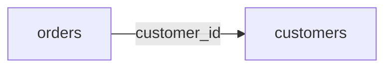

# Contributing

Thank you for helping. This course is only useful if every number in it is right, so the bar for a change is: it is correct, a beginner can follow it, and a test proves it.

## Ways to help

| You found | Do this |
|---|---|
| A wrong statement, a wrong number, or code that does not run | Open an issue with the lesson path, the line, and what you expected. These are fixed first |
| A sentence a beginner would not understand | Open an issue or a pull request with a plainer version |
| A missing diagram | Add a Mermaid block to the lesson README (see below) |
| A planned lesson you want to write | Every lesson in [curriculum.json](curriculum.json) is live today. If a planned one is added later, open an issue first saying which one so two people do not write the same lesson |
| A new lesson idea | Open an issue with the business question, the level, and the job-posting evidence that analysts need it |

## Writing a lesson

1. Read [LESSON_TEMPLATE.md](LESSON_TEMPLATE.md). Every lesson follows it.
2. Copy the folder structure of a live lesson in the same phase.
3. Build the data with `make_data.py` and a fixed seed. Expose `build(seed)` so the test can make a second dataset.
4. Write the test before the solution. The expected answer is computed inside the test, in plain Python.
5. Write the exercise last, then confirm it fails.
6. Set the lesson to `"status": "live"` in [curriculum.json](curriculum.json) and run `python3 tools/build_docs.py`.

## Before you open a pull request

Run these from the repo root. CI runs the same four checks on Python 3.9 and 3.12.

```
python3 tools/run_all_tests.py --exercise
python3 tools/lint.py
python3 tools/build_docs.py --check
for f in phases/*/*/make_data.py; do (cd "$(dirname "$f")" && python3 make_data.py > /dev/null); done; git status --short
```

The last line must print nothing: every dataset rebuilds byte for byte.

## Rules that are never relaxed

- **Standard library only.** No pip installs in a lesson. An optional extra (pandas, git) is tested with `unittest.skipUnless` so the lesson still runs without it.
- **Offline.** No network calls in a test, no API keys.
- **No invented facts.** Data is synthetic and labelled as synthetic. A real-world number needs a source link and the date it was read. A job-market number must come from the dated data drop in [data/job-market](data/job-market).
- **No placeholders in live lessons.** A lesson is either finished and live, or listed as planned.
- **Style.** No em dashes, en dashes or curly quotes (`tools/lint.py` checks). Short sentences. Define every term the first time you use it.
- **Fictional companies only**, and check the name is not a real company in that industry.

## Diagrams

Prefer a Mermaid block inside the README. GitHub renders it, and it is plain text that can be reviewed in a diff:

````

````

A diagram must explain something the text cannot. No decorative pictures. If a lesson's code draws a chart as SVG, commit the SVG and embed it.

## Licence

By contributing you agree that your work is released under the [MIT licence](LICENSE). Job-market data in `data/job-market` is CC BY 4.0, as stated in that folder.
