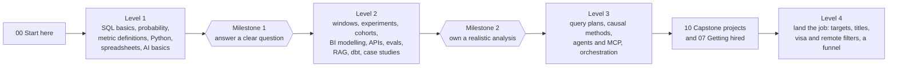

# Learning roadmap

This page tells you what to learn, in what order, and how you will know you have learned it. If you have never written a query, start at [phase 00](phases/00-start-here) and follow Level 1 below. Already working with data or preparing for interviews? Take the [Fast track](#fast-track).

## How the course is organised

Lessons live in **phases** by subject (SQL, statistics, Python and so on). Inside every phase, lessons come at three **levels**:

| Level | What it means | What you can do at the end |
|---|---|---|
| Level 1, beginner | Understand the concept and solve a guided problem | Answer a clear question from clean data, and explain your number |
| Level 2, intermediate | Solve realistic problems on your own | Take a vague request, find the right data, check it, and recommend |
| Level 3, advanced | Handle ambiguous problems, optimise, and defend a recommendation | Own an analysis end to end, including its limits |
| Level 4, land the job | Run your job search with the same methods: data, filters, a funnel and a plan | Know which roles you can get, apply where it counts, and track what works |

You do not finish one subject before starting the next. You climb **all subjects one level at a time**: Level 1 across every phase, then Level 2, then Level 3. Level 4 turns the same skills on your own job search, and you can start it alongside Level 2 or 3. Analysts use SQL, statistics and business sense together from the first week, so the course does too.



## Time

About 348 hours across all 129 lessons. At 10 to 12 focused hours a week that is 6 to 9 months. A lesson takes about 2 hours, a case study about 4 and a capstone 10 to 14. The course builds competence you can demonstrate; it cannot promise a job.

## Every lesson works the same way

1. Read the lesson `README.md`: the business problem, the idea in plain words, a diagram, then the walk through.
2. Open the exercise file and fill in the gaps.
3. Run `python3 test_lesson.py` from the lesson folder. It fails until your answer is right.
4. Answer the **Check yourself** questions out loud before you open the answers. These are the questions interviewers ask.
5. Tick the lesson off below.

Tests run offline on Python 3.9 or later with nothing to install. A few topics cannot run inside a test (clicking in Power BI, calling a live AI model). Those lessons rebuild the logic in code you can test, test a file you export from the tool, or test against recorded model outputs that say which model, prompt and date produced them. Lessons with no test at all are marked **Guide, no test**.

## Milestones

Each milestone is a set of things you can show, not a set of pages you have read.

### Milestone 1: answer a clear question (end of Level 1)

- [ ] Write a SELECT with WHERE, GROUP BY, ORDER BY and a JOIN, and predict the row count before you run it
- [ ] Explain NULL, and why a blank is not a zero
- [ ] Pick mean or median for a skewed number and say why
- [ ] Write a metric definition with numerator, denominator, unit, time window and exclusions
- [ ] Clean a messy CSV in Python and report what you changed
- [ ] Build a lookup and a pivot the way Excel does, and explain when the totals disagree
- [ ] Say what a token is and why the same prompt can return different answers

### Milestone 2: own a realistic analysis (end of Level 2)

- [ ] Use window functions, CTEs and a date spine without fan-out or missing days
- [ ] Run and read an A/B test: sample size, p-value, interval, and the decision
- [ ] Build a cohort retention table and a funnel from raw events
- [ ] Model a star schema, define a measure once, and reconcile a dashboard to the source
- [ ] Pull data from an API, profile it, and write data quality tests for it
- [ ] Evaluate an LLM classifier or a natural-language-to-SQL tool with a test set big enough to trust
- [ ] Finish one business case study with a recommendation and its limits

### Milestone 3: ready to work (end of Level 3)

- [ ] Diagnose a slow query from its plan
- [ ] Estimate an effect without an experiment, and state what could make it wrong
- [ ] Build and audit an agent that queries data, with read-only access and a human approving each step
- [ ] Explain a warehouse pipeline from raw data to a dashboard, and what breaks at each step
- [ ] Ship two capstone projects a stranger can run in one command
- [ ] Pass the SQL, statistics, metrics-case and take-home rounds in [phase 07](phases/07-getting-hired)

### Milestone 4: land the job (end of Level 4)

- [ ] Build a target list of companies and titles from real postings, with dates
- [ ] Search by the titles employers actually use, and filter for visa and remote eligibility honestly
- [ ] Track your applications as a funnel and move your time to the channel that converts
- [ ] Follow a 30-day search plan and review it each week

## Tracks by role

Everyone does the shared core. Then weight your time by the role you want. The skill shares come from [2026-2027-ANALYTICS-SKILLS.md](2026-2027-ANALYTICS-SKILLS.md).

| Phase | Data analyst | Business analyst | Product analyst | BI analyst | Growth analyst | AI-enabled analyst |
|---|---|---|---|---|---|---|
| 00 Start here | Core | Core | Core | Core | Core | Core |
| 01 SQL | Core, all levels | Core to Level 2 | Core, all levels | Core, all levels | Core, all levels | Core, all levels |
| 02 Statistics and experiments | Core | Level 1 | Core, all levels | Level 1 | Core, all levels | Core to Level 2 |
| 03 Metrics and product analytics | Core | Core | Core, all levels | Core | Core, all levels | Core |
| 04 Dashboards and spreadsheets | Core | Core, spreadsheets first | Level 1 and 2 | Core, all levels | Core | Level 1 and 2 |
| 05 Python for analysts | Core, all levels | Level 1 | Core | Core to Level 2 | Core | Core, all levels |
| 06 AI for analysts | Core to Level 2 | Core to Level 2 | Core to Level 2 | Level 1 and 2 | Level 1 and 2 | Core, all levels |
| 07 Getting hired | Core | Core | Core | Core | Core | Core |
| 08 Modern data stack | Core to Level 2 | Optional | Level 1 and 2 | Core to Level 2 | Optional | Core |
| 09 Business case studies | Pick 4 | Pick 4, process heavy | Pick 4, product heavy | Pick 3 | Marketing and growth cases | Pick 4 |
| 10 Capstone projects | 01, 02, 06 | 01, 05 | 02, 04 | 05, 06 | 03, 01 | 07, 08 |

### Analytics leadership track

For someone who manages analysts or is moving into a lead role. You will not write most of the queries any more; you decide what gets measured, which results are trusted, what the team works on and what leadership hears. This path uses only existing live lessons. Do the exercises yourself: you review this work better once you have done it.

Do these, in order:

1. [03-05 Define a metric precisely](phases/03-metrics-and-product-analytics/05-define-a-metric-precisely): You own the metric spec; a vague definition becomes two teams arguing about two numbers.
2. [04-09 One metric, one definition: the semantic layer](phases/04-dashboards/09-the-semantic-layer): Decide where each definition lives, so every dashboard shows the same number.
3. [03-04 North star and guardrails](phases/03-metrics-and-product-analytics/04-north-star-and-guardrails): Set the guardrails before a launch, so a win on the main metric cannot hide damage elsewhere.
4. [02-04 Sample size before you test](phases/02-statistics-and-experiments/04-sample-size-before-you-test): Approve or turn down a test plan on whether it can answer the question in the time asked.
5. [02-13 A/B test pitfalls](phases/02-statistics-and-experiments/13-ab-test-pitfalls): Write the team's experiment rules: one primary metric, no peeking, and a correction when many variants are tested.
6. [03-14 Causal impact without an experiment: difference in differences](phases/03-metrics-and-product-analytics/14-difference-in-differences): Know when "it worked" is a causal claim the data can support and when it is not.
7. [08-01 Warehouse layers: raw, staging and marts](phases/08-modern-data-stack/01-warehouse-layers): Know where a metric should be computed, so fixes happen once and not in every report.
8. [05-09 Data quality tests as code](phases/05-python-for-analysts/09-data-quality-tests-as-code): Ask for tests that catch a broken load before a stakeholder does.
9. [08-04 Orchestration: a tiny DAG runner](phases/08-modern-data-stack/04-orchestration-dag-runner): Understand what fails downstream when one job fails, and who gets told.
10. [08-05 Query cost in a cloud warehouse](phases/08-modern-data-stack/05-cloud-warehouse-cost): You answer for the warehouse bill; know what drives it and which fixes are cheap.
11. [06-07 How big must an eval set be?](phases/06-ai-for-analysts/07-how-big-an-eval-set): Ask how many labelled examples sit behind an AI tool's score before you approve it.
12. [06-08 Human in the loop: confidence thresholds](phases/06-ai-for-analysts/08-human-in-the-loop-thresholds): Set what the AI may do alone and what a person reviews, and staff the review.
13. [06-11 Keep personal data out of prompts](phases/06-ai-for-analysts/11-keep-pii-out-of-prompts): Make the rule your team follows before customer data reaches a model.
14. [06-14 Audit an agent's work](phases/06-ai-for-analysts/14-audit-an-agent-run): Check an AI agent's claim step by step before a number from it reaches leadership.
15. [11-05 Apply where it counts](phases/11-land-the-job/05-apply-where-it-counts): The lesson picks job postings, but the same 0/1 knapsack picks a team backlog: value per request, analyst hours as the budget.
16. [07-06 Explain findings to leadership](phases/07-getting-hired/06-explain-findings-to-leadership): Your team's work only counts if a VP can act on the first two lines.
17. Two case studies, reviewed as the lead: [09-03 Marketing: is the campaign incremental?](phases/09-business-case-studies/03-marketing-is-the-campaign-incremental) and [09-09 Operations: why are deliveries late?](phases/09-business-case-studies/09-operations-late-deliveries): Score your own answer with the case's RUBRIC.md as if an analyst had handed it to you.
18. [10-05 Executive dashboard](phases/10-capstone-projects/05-executive-dashboard): The capstone for this track: one set of definitions the leadership team stops arguing about.

**What this track does not cover.** It is an analytics leadership track, not a management programme. People management, hiring, performance reviews, career conversations, budgets and headcount planning are not taught here. For hiring, the tutor's [interview rubric](skills/analytics-from-scratch/INTERVIEW_RUBRIC.md) gives you a ready mock interview: rounds, a 1 to 4 scale with anchors, red flags and a question bank tied to lessons. Run it with your interviewers on each other first, so everyone scores the same answer the same way. It is practice material, not a validated hiring test: use it alongside your company's own process, not instead of it.

<!-- Fast track: printed by python3 tools/placement.py --markdown from its FAST_TRACK table. Edit the table, then paste. tools/test_placement.py checks they match. -->

## Fast track

Already working with data, or preparing for interviews? You do not have to start at phase 00. Run the placement check from the repo root first. It asks your goal and 13 short questions (plus a follow-up or two where one answer looks like a slip), then prints a start lesson and the lessons you can skip:

```
python3 tools/placement.py
```

Be honest with yourself: skip a lesson only if the placement check or the lesson's own **Check yourself** questions are easy for you. If you are unsure, do the lesson; a skipped gap costs more later than two hours now. Everyone should run [00-01 Run your first lesson](phases/00-start-here/01-run-your-first-lesson) once to check that Python works.

These paths come from one table in `tools/placement.py`, so the script and this page always agree.

### Working data analyst

You write SQL at work and want experiments, metric judgment, data quality and AI checks.

Do these, in order:

1. [01-03 Window functions](phases/01-sql/03-window-functions): Windows are the most asked SQL skill after joins.
2. [01-08 Duplicates and reconciliation](phases/01-sql/08-duplicates-and-reconciliation): Find duplicates and reconcile two sources before you trust a total.
3. [01-12 Review a query someone else wrote](phases/01-sql/12-review-a-query-someone-else-wrote): The daily job now that AI writes much of the SQL.
4. [02-03 A/B test from scratch](phases/02-statistics-and-experiments/03-ab-test-from-scratch): Run an A/B test from raw counts and make the call.
5. [02-04 Sample size before you test](phases/02-statistics-and-experiments/04-sample-size-before-you-test): Size a test before it starts.
6. [03-06 Percent vs points, ratio of sums vs average of ratios](phases/03-metrics-and-product-analytics/06-percent-points-and-averages-of-ratios): Percent vs points and ratio of sums, the most common metric slip.
7. [03-10 Diagnose a metric drop](phases/03-metrics-and-product-analytics/10-diagnose-a-metric-drop): Diagnose a metric drop in a fixed order.
8. [05-05 Profile a table before you trust it](phases/05-python-for-analysts/05-profile-a-table): Row counts, keys and NULLs before any analysis.
9. [05-09 Data quality tests as code](phases/05-python-for-analysts/09-data-quality-tests-as-code): Turn your checks into data quality tests.
10. [06-01 Grade an LLM classifier](phases/06-ai-for-analysts/01-grade-an-llm-classifier): Grade an LLM classifier with precision and recall.
11. [06-10 Natural language to SQL, safely](phases/06-ai-for-analysts/10-safe-nl-to-sql): Guard natural-language-to-SQL with code, not prompts.
12. [10-01 E-commerce performance review](phases/10-capstone-projects/01-ecommerce-performance-review): A capstone you can show.

Safe to skip, if the Check yourself is easy for you:

- [00-04 Your first SQL query](phases/00-start-here/04-your-first-sql-query): You write SELECT, WHERE and ORDER BY every day.
- [01-01 GROUP BY from raw rows](phases/01-sql/01-group-by-from-raw-rows): GROUP BY and HAVING are routine for you.
- [01-07 Subqueries and CTEs](phases/01-sql/07-subqueries-and-ctes): You already use subqueries and CTEs.
- [02-01 Mean, median and skew](phases/02-statistics-and-experiments/01-mean-median-and-skew): You already pick median over mean for skewed numbers.
- [00-06 Python for spreadsheet people](phases/00-start-here/06-python-for-spreadsheet-people): You already read files and loop in Python.
- [05-01 Clean a messy CSV](phases/05-python-for-analysts/01-clean-a-messy-csv): You already clean CSVs in code.
- [04-05 Lookups and SUMIFS like Excel](phases/04-dashboards/05-lookups-and-sumifs): Lookups and SUMIFS are spreadsheet basics you know.
- [04-06 Pivot tables and Power Query steps](phases/04-dashboards/06-pivot-tables-and-power-query): You already build pivots.

### BI analyst

You build dashboards and want the model, the measures and the SQL behind them right.

Do these, in order:

1. [00-03 Tables, rows and grain](phases/00-start-here/03-tables-rows-and-grain): Grain decides every count on a dashboard.
2. [04-01 Model the data a dashboard needs](phases/04-dashboards/01-model-the-data-a-dashboard-needs): Model the star schema a dashboard needs.
3. [04-02 DAX measures from scratch](phases/04-dashboards/02-dax-measures-from-scratch): DAX filter context, built from scratch.
4. [04-03 Tableau LOD expressions in SQL](phases/04-dashboards/03-tableau-lod-expressions-in-sql): Tableau LOD expressions, rebuilt in SQL.
5. [04-08 Relationships, role-playing dates and many-to-many](phases/04-dashboards/08-relationships-and-role-playing-dates): Dates and many-to-many without double counting.
6. [04-09 One metric, one definition: the semantic layer](phases/04-dashboards/09-the-semantic-layer): Define each metric once so dashboards agree.
7. [04-11 Row-level security](phases/04-dashboards/11-row-level-security): Row-level security that holds.
8. [01-03 Window functions](phases/01-sql/03-window-functions): Window functions behind running totals and ranks.
9. [01-08 Duplicates and reconciliation](phases/01-sql/08-duplicates-and-reconciliation): Reconcile the dashboard to the source.
10. [03-05 Define a metric precisely](phases/03-metrics-and-product-analytics/05-define-a-metric-precisely): Write a metric definition people cannot misread.
11. [03-06 Percent vs points, ratio of sums vs average of ratios](phases/03-metrics-and-product-analytics/06-percent-points-and-averages-of-ratios): Percent vs points on every KPI card.
12. [08-01 Warehouse layers: raw, staging and marts](phases/08-modern-data-stack/01-warehouse-layers): Where the tables you report on come from.
13. [10-05 Executive dashboard](phases/10-capstone-projects/05-executive-dashboard): An executive dashboard capstone.

Safe to skip, if the Check yourself is easy for you:

- [04-04 Draw a chart from scratch](phases/04-dashboards/04-draw-a-chart-from-scratch): You build charts every day; drawing one from scratch is optional.
- [04-05 Lookups and SUMIFS like Excel](phases/04-dashboards/05-lookups-and-sumifs): You already use lookups and SUMIFS.
- [04-06 Pivot tables and Power Query steps](phases/04-dashboards/06-pivot-tables-and-power-query): You already build pivots and Power Query steps.
- [04-07 Dashboard design and KPI cards](phases/04-dashboards/07-dashboard-design-and-kpi-cards): You already design KPI cards.
- [00-04 Your first SQL query](phases/00-start-here/04-your-first-sql-query): You already write basic SELECT queries.
- [01-01 GROUP BY from raw rows](phases/01-sql/01-group-by-from-raw-rows): GROUP BY and HAVING are routine for you.

### Business analyst

You work in spreadsheets and with stakeholders and want SQL, sharper metrics and clear answers.

Do these, in order:

1. [00-05 NULLs, CASE and COALESCE](phases/00-start-here/05-nulls-case-and-coalesce): Why a blank is not a zero.
2. [01-02 Joins without losing rows](phases/01-sql/02-joins-without-losing-rows): Joins without losing or doubling rows.
3. [01-07 Subqueries and CTEs](phases/01-sql/07-subqueries-and-ctes): Subqueries and CTEs for multi-step questions.
4. [03-05 Define a metric precisely](phases/03-metrics-and-product-analytics/05-define-a-metric-precisely): Numerator, denominator, window and exclusions, written down.
5. [03-06 Percent vs points, ratio of sums vs average of ratios](phases/03-metrics-and-product-analytics/06-percent-points-and-averages-of-ratios): The two slips behind most wrong KPI numbers.
6. [03-09 Segmentation and mix effects](phases/03-metrics-and-product-analytics/09-segmentation-and-mix-effects): Mix effects: when every segment rises and the total falls.
7. [03-10 Diagnose a metric drop](phases/03-metrics-and-product-analytics/10-diagnose-a-metric-drop): A fixed order of checks when a number falls.
8. [02-01 Mean, median and skew](phases/02-statistics-and-experiments/01-mean-median-and-skew): Pick the number that describes a typical value.
9. [06-03 Catch made-up numbers](phases/06-ai-for-analysts/03-catch-made-up-numbers): Catch made-up numbers in AI summaries.
10. [07-06 Explain findings to leadership](phases/07-getting-hired/06-explain-findings-to-leadership): Lead with the decision, not the method.
11. [09-09 Operations: why are deliveries late?](phases/09-business-case-studies/09-operations-late-deliveries): A process-heavy case study.

Safe to skip, if the Check yourself is easy for you:

- [00-04 Your first SQL query](phases/00-start-here/04-your-first-sql-query): You already write basic SELECT queries.
- [01-01 GROUP BY from raw rows](phases/01-sql/01-group-by-from-raw-rows): GROUP BY and HAVING are routine for you.
- [04-05 Lookups and SUMIFS like Excel](phases/04-dashboards/05-lookups-and-sumifs): Lookups and SUMIFS are your daily tools.
- [04-06 Pivot tables and Power Query steps](phases/04-dashboards/06-pivot-tables-and-power-query): You already build pivots.
- [00-06 Python for spreadsheet people](phases/00-start-here/06-python-for-spreadsheet-people): You already read files and loop in Python.
- [06-04 How LLMs work, for analysts](phases/06-ai-for-analysts/04-how-llms-work-for-analysts): You already know what tokens and temperature do.

### Interview prep

You have an analyst interview soon and want the rounds they actually run.

Do these, in order:

1. [01-02 Joins without losing rows](phases/01-sql/02-joins-without-losing-rows): Joins and fan-out, the first SQL screen question.
2. [01-03 Window functions](phases/01-sql/03-window-functions): Window functions, the second.
3. [01-11 Gaps and islands: streaks](phases/01-sql/11-gaps-and-islands): Gaps and islands, the classic hard question.
4. [07-02 SQL interview questions](phases/07-getting-hired/02-sql-interview-questions): SQL interview questions under time.
5. [02-03 A/B test from scratch](phases/02-statistics-and-experiments/03-ab-test-from-scratch): The experiment question in most statistics rounds.
6. [02-10 Correlation, causation and Simpson's paradox](phases/02-statistics-and-experiments/10-correlation-causation-and-simpson): The causation trap interviewers love.
7. [07-09 The statistics interview round](phases/07-getting-hired/09-statistics-interview-round): Practise the statistics round.
8. [03-01 Metric trees](phases/03-metrics-and-product-analytics/01-metric-trees): Metric trees, the frame for every case.
9. [03-10 Diagnose a metric drop](phases/03-metrics-and-product-analytics/10-diagnose-a-metric-drop): Diagnose a metric drop, the most common case.
10. [07-08 The metrics case interview](phases/07-getting-hired/08-metrics-case-interview): Practise the case out loud.
11. [07-10 The take-home assignment](phases/07-getting-hired/10-the-take-home-assignment): Scope, check and present a take-home.
12. [07-11 Behavioural answers that show analysis](phases/07-getting-hired/11-behavioural-answers): Stories with a number and a decision.

Safe to skip, if the Check yourself is easy for you:

- [00-04 Your first SQL query](phases/00-start-here/04-your-first-sql-query): You already write basic SELECT queries.
- [01-01 GROUP BY from raw rows](phases/01-sql/01-group-by-from-raw-rows): GROUP BY and HAVING are routine for you.
- [02-01 Mean, median and skew](phases/02-statistics-and-experiments/01-mean-median-and-skew): You already pick median over mean for skewed numbers.
- [03-02 Funnel conversion](phases/03-metrics-and-product-analytics/02-funnel-conversion): You can already compute a funnel.
- [05-01 Clean a messy CSV](phases/05-python-for-analysts/01-clean-a-messy-csv): Interviews rarely ask you to clean a CSV.
- [04-05 Lookups and SUMIFS like Excel](phases/04-dashboards/05-lookups-and-sumifs): Interviews rarely test spreadsheet lookups.

## Level 1: understand and solve guided problems

<!-- generated:level-beginner -->
**00 Start here**

- [x] 00-01 [Run your first lesson](phases/00-start-here/01-run-your-first-lesson): Is Python ready on your computer, and how does a lesson tell you that your answer is right? About 1 h.
- [x] 00-02 [Think like an analyst](phases/00-start-here/02-think-like-an-analyst): A manager says sales are down. What do you ask before you touch any data? About 2 h.
- [x] 00-03 [Tables, rows and grain](phases/00-start-here/03-tables-rows-and-grain): What does one row of this table mean, and which column identifies it? About 1.5 h.
- [x] 00-04 [Your first SQL query](phases/00-start-here/04-your-first-sql-query): Which ten orders were the biggest last week, and from which city? About 2 h.
- [x] 00-05 [NULLs, CASE and COALESCE](phases/00-start-here/05-nulls-case-and-coalesce): How many orders have no delivery date, and how do we bucket orders into small, medium and large? About 2 h.
- [x] 00-06 [Python for spreadsheet people](phases/00-start-here/06-python-for-spreadsheet-people): Can you total a column of a CSV without opening Excel? About 3 h.

**01 SQL from raw tables**

- [x] 01-01 [GROUP BY from raw rows](phases/01-sql/01-group-by-from-raw-rows): How much did each city bring in last quarter, and which cities are big enough to matter? About 2 h.
- [x] 01-02 [Joins without losing rows](phases/01-sql/02-joins-without-losing-rows): Which customers have never ordered, and what is revenue by city without counting any order twice? About 2 h.
- [x] 01-05 [Dates and the date spine](phases/01-sql/05-dates-and-the-date-spine): What were signups per day, including the days with zero? About 2 h.
- [x] 01-06 [Anti-joins, self-joins and UNION](phases/01-sql/06-anti-joins-self-joins-and-union): Which customers ordered in March but not in April? About 2 h.
- [x] 01-07 [Subqueries and CTEs](phases/01-sql/07-subqueries-and-ctes): Which customers spent more than their city's average? About 2 h.

**02 Statistics and experiments**

- [x] 02-01 [Mean, median and skew](phases/02-statistics-and-experiments/01-mean-median-and-skew): What is the typical posted pay for an analyst role, and which number should we put on the slide? About 2 h.
- [x] 02-02 [Confidence interval by hand](phases/02-statistics-and-experiments/02-confidence-interval-by-hand): How sure are we about an average or a rate measured on a sample? About 2 h.
- [x] 02-05 [Probability and distributions by simulation](phases/02-statistics-and-experiments/05-probability-by-simulation): If 10% of visitors buy, how many of 200 should buy, and how unusual is 30? About 2 h.
- [x] 02-06 [Outliers, box plots and robust summaries](phases/02-statistics-and-experiments/06-spread-percentiles-and-outliers): Which salaries are real outliers, and which summary survives them? About 2 h.
- [x] 02-07 [Sampling and the central limit theorem](phases/02-statistics-and-experiments/07-sampling-and-the-clt): Why does the average of 18 orders wobble, and by how much? About 2 h.

**03 Metrics and product analytics**

- [x] 03-02 [Funnel conversion](phases/03-metrics-and-product-analytics/02-funnel-conversion): Of the people who look at a course, how many buy it, and at which step do we lose the most of them? About 2 h.
- [x] 03-03 [Active users and stickiness](phases/03-metrics-and-product-analytics/03-active-users-and-stickiness): How many people really use the app, and how often do they come back? About 2 h.
- [x] 03-05 [Define a metric precisely](phases/03-metrics-and-product-analytics/05-define-a-metric-precisely): What exactly counts as an active customer, and what goes in the metric spec? About 2 h.
- [x] 03-06 [Percent vs points, ratio of sums vs average of ratios](phases/03-metrics-and-product-analytics/06-percent-points-and-averages-of-ratios): Did conversion rise 2% or 2 points, and why do two dashboards disagree? About 2 h.

**04 Dashboards and spreadsheets**

- [x] 04-04 [Draw a chart from scratch](phases/04-dashboards/04-draw-a-chart-from-scratch): What does a dashboard tool do when it turns a table into a bar chart, and which chart should you pick in the first place? About 2 h.
- [x] 04-05 [Lookups and SUMIFS like Excel](phases/04-dashboards/05-lookups-and-sumifs): Why does the VLOOKUP total not match finance? About 2 h.
- [x] 04-06 [Pivot tables and Power Query steps](phases/04-dashboards/06-pivot-tables-and-power-query): Can next month's file be cleaned and merged with one click? About 2 h.
- [x] 04-07 [Dashboard design and KPI cards](phases/04-dashboards/07-dashboard-design-and-kpi-cards): What should the CEO see in five seconds? About 2 h.

**05 Python for analysts**

- [x] 05-01 [Clean a messy CSV](phases/05-python-for-analysts/01-clean-a-messy-csv): Which rows of this export can we trust, and what did we change to get there? About 2 h.
- [x] 05-02 [Reshape wide and long](phases/05-python-for-analysts/02-reshape-wide-and-long): The data has one row per region and month. The manager wants one row per region. How do you move between the two without losing anything? About 2 h.
- [x] 05-05 [Profile a table before you trust it](phases/05-python-for-analysts/05-profile-a-table): Is this table fit for the board number? About 2 h.
- [x] 05-06 [Join two files and prove nothing was lost](phases/05-python-for-analysts/06-join-files-and-prove-nothing-was-lost): After the merge, are the totals still the totals? About 2 h.

**06 AI for analysts**

- [x] 06-04 [How LLMs work, for analysts](phases/06-ai-for-analysts/04-how-llms-work-for-analysts): What is a token, what does a run cost, and why does the same prompt give different answers? About 2 h.
- [x] 06-05 [Prompt versions as experiments](phases/06-ai-for-analysts/05-prompt-versions-as-experiments): Is prompt v2 better than v1 on the same 200 tickets? About 2 h.
- [x] 06-11 [Keep personal data out of prompts](phases/06-ai-for-analysts/11-keep-pii-out-of-prompts): Is any customer's email or phone number about to leave the building? About 2 h.

**07 Getting hired**

- [x] 07-01 [Read job postings like data](phases/07-getting-hired/01-read-job-postings-like-data): Across 300 analyst job postings, which tools are required most, how much experience do they want, and what do they say about visa sponsorship? About 2 h.
- [x] 07-04 [Match your resume to a posting](phases/07-getting-hired/04-match-your-resume-to-a-posting): Of five open roles, which ones fit this resume best, and which missing skills stand between the candidate and the rest? About 2 h.
- [x] 07-05 [Role roadmaps from postings](phases/07-getting-hired/05-role-roadmaps-from-postings): Data, business, product or BI analyst: which skills differ? About 2 h.
- [x] 07-06 [Explain findings to leadership](phases/07-getting-hired/06-explain-findings-to-leadership): Can the VP act on your summary after reading only the first two lines? About 2 h.
- [x] 07-07 [Resume bullets that are true](phases/07-getting-hired/07-resume-bullets-that-are-true): Does every number on your resume come from work you can show? About 2 h.
- [x] 07-11 [Behavioural answers that show analysis](phases/07-getting-hired/11-behavioural-answers): Tell me about a time your analysis changed a decision. Guide, no test. About 1 h.
- [x] 07-12 [Publish your portfolio](phases/07-getting-hired/12-publish-your-portfolio): Can a hiring manager run your project in one command? About 2 h.

**08 Modern data stack**

- [x] 08-06 [Git for analysts](phases/08-modern-data-stack/06-git-for-analysts): Who changed the revenue query, and can we undo it? About 2 h.

Level total: about 76.5 hours of focused work.
<!-- /generated:level-beginner -->

## Level 2: solve realistic problems independently

<!-- generated:level-intermediate -->
**01 SQL from raw tables**

- [x] 01-03 [Window functions](phases/01-sql/03-window-functions): How is each region tracking against its fiscal year to date, who are the top reps, and did revenue go up or down from last month? About 2 h.
- [x] 01-04 [Cohort retention](phases/01-sql/04-cohort-retention): Of the users who signed up in each month, what share were still active one, two and three months later? About 2 h.
- [x] 01-08 [Duplicates and reconciliation](phases/01-sql/08-duplicates-and-reconciliation): After the CRM import doubled some rows, how many unique customers really signed up? About 2 h.
- [x] 01-09 [Rolling averages and percent of total](phases/01-sql/09-rolling-averages-and-percent-of-total): What is the 7-day moving average of orders, and each region's share of revenue? About 2 h.
- [x] 01-10 [Sessionization from raw events](phases/01-sql/10-sessionization): How many sessions does each user have with a 30-minute timeout, and how long is a session? About 2 h.
- [x] 01-11 [Gaps and islands: streaks](phases/01-sql/11-gaps-and-islands): Which users logged a workout three days in a row, and what is the longest streak? About 2 h.
- [x] 01-12 [Review a query someone else wrote](phases/01-sql/12-review-a-query-someone-else-wrote): A teammate, or an assistant, wrote this query. Is the number on the slide right? About 2 h.

**02 Statistics and experiments**

- [x] 02-03 [A/B test from scratch](phases/02-statistics-and-experiments/03-ab-test-from-scratch): Did the new checkout page really convert better, or did we get lucky? About 2 h.
- [x] 02-04 [Sample size before you test](phases/02-statistics-and-experiments/04-sample-size-before-you-test): How many users, and how many weeks, do we need before an A/B test can answer the question we care about? About 2 h.
- [x] 02-08 [Hypothesis testing by permutation](phases/02-statistics-and-experiments/08-hypothesis-test-by-permutation): Could this gap appear just by shuffling the labels? About 2 h.
- [x] 02-09 [Comparing categories: the chi-square test](phases/02-statistics-and-experiments/09-chi-square-test): Do the three signup flows differ in completion rate? About 2 h.
- [x] 02-10 [Correlation, causation and Simpson's paradox](phases/02-statistics-and-experiments/10-correlation-causation-and-simpson): Users who get more notifications work out more. Should we send more? About 2 h.
- [x] 02-11 [Linear regression from scratch](phases/02-statistics-and-experiments/11-linear-regression-from-scratch): How much does each extra visit add to monthly spend, and what does R squared really say? About 2 h.
- [x] 02-12 [Bootstrap confidence intervals](phases/02-statistics-and-experiments/12-bootstrap-intervals): How sure are we about a median or a ratio when no simple formula exists? About 2 h.

**03 Metrics and product analytics**

- [x] 03-01 [Metric trees](phases/03-metrics-and-product-analytics/01-metric-trees): Revenue fell this week, so which part of the business made it fall? About 2 h.
- [x] 03-04 [North star and guardrails](phases/03-metrics-and-product-analytics/04-north-star-and-guardrails): The new feature moved our main metric up, so should we launch it? About 2 h.
- [x] 03-07 [Growth accounting](phases/03-metrics-and-product-analytics/07-growth-accounting): Where did this month's MAU change come from: new, retained, resurrected or churned users? About 2 h.
- [x] 03-08 [Retention curves and churn](phases/03-metrics-and-product-analytics/08-retention-curves-and-churn): What share of users are still here on day 7 and day 30, and which retention definition fits? About 2 h.
- [x] 03-09 [Segmentation and mix effects](phases/03-metrics-and-product-analytics/09-segmentation-and-mix-effects): Did conversion fall, or did the traffic mix change? About 2 h.
- [x] 03-10 [Diagnose a metric drop](phases/03-metrics-and-product-analytics/10-diagnose-a-metric-drop): DAU fell 20% overnight. Tracking bug, holiday, segment, or real? About 2 h.
- [x] 03-11 [Attribution: first touch, last touch, linear](phases/03-metrics-and-product-analytics/11-attribution-models): Which channel gets credit for the sale, and how much does the answer depend on the model? About 2 h.
- [x] 03-12 [Unit economics: LTV, CAC and payback](phases/03-metrics-and-product-analytics/12-ltv-cac-and-payback): Is paid social acquisition profitable once churn is included? About 2 h.

**04 Dashboards and spreadsheets**

- [x] 04-01 [Model the data a dashboard needs](phases/04-dashboards/01-model-the-data-a-dashboard-needs): How do you turn one flat export of order lines into tables a dashboard can slice by date, product and region without double counting? About 2 h.
- [x] 04-02 [DAX measures from scratch](phases/04-dashboards/02-dax-measures-from-scratch): What does a Power BI measure actually compute, and how do you get the same Total Sales, filtered sales, share, year to date and growth on last year numbers without Power BI? About 2 h.
- [x] 04-03 [Tableau LOD expressions in SQL](phases/04-dashboards/03-tableau-lod-expressions-in-sql): How do you compute a number at a different level of detail from the chart it sits in, such as each customer's first order month in a chart by month, or a region's total in a chart by customer? About 2 h.
- [x] 04-08 [Relationships, role-playing dates and many-to-many](phases/04-dashboards/08-relationships-and-role-playing-dates): Why does revenue by ship month differ from revenue by order month? About 2 h.
- [x] 04-09 [One metric, one definition: the semantic layer](phases/04-dashboards/09-the-semantic-layer): Why do two dashboards show different active users? About 2 h.
- [x] 04-10 [Slowly changing dimensions](phases/04-dashboards/10-slowly-changing-dimensions): Which region was this customer in when they ordered? About 2 h.
- [x] 04-11 [Row-level security](phases/04-dashboards/11-row-level-security): Can each regional manager see only their own region? About 2 h.
- [x] 04-12 [Tableau table calculations vs LOD](phases/04-dashboards/12-tableau-table-calculations): Running total, rank or percent of total: which should be computed where? About 2 h.

**05 Python for analysts**

- [x] 05-03 [Dates, weeks and time zones](phases/05-python-for-analysts/03-dates-weeks-and-time-zones): How many people signed up each week over the new year, counted on the clock the team actually works on? About 2 h.
- [x] 05-04 [Automate the weekly report](phases/05-python-for-analysts/04-automate-the-weekly-report): Can the Monday KPI report write itself, with the same numbers every time it runs? About 2 h.
- [x] 05-07 [APIs and JSON](phases/05-python-for-analysts/07-apis-and-json): How many analyst roles did the feed return this week? About 2 h.
- [x] 05-08 [More charts from scratch](phases/05-python-for-analysts/08-more-charts-from-scratch): Histogram, scatter or line: which shows the answer, and how do bins and scales mislead? About 2 h.
- [x] 05-09 [Data quality tests as code](phases/05-python-for-analysts/09-data-quality-tests-as-code): Would we have caught last week's broken load? About 2 h.
- [x] 05-10 [From standard library to pandas](phases/05-python-for-analysts/10-from-stdlib-to-pandas): Which pandas call does each function you wrote correspond to? About 2 h.

**06 AI for analysts**

- [x] 06-01 [Grade an LLM classifier](phases/06-ai-for-analysts/01-grade-an-llm-classifier): Is the LLM good enough at spotting refund tickets that we can route them automatically? About 2 h.
- [x] 06-02 [Check LLM-written SQL](phases/06-ai-for-analysts/02-check-llm-written-sql): Which of the queries the LLM wrote can we trust, and which ones would have put a wrong number in the report? About 2 h.
- [x] 06-03 [Catch made-up numbers](phases/06-ai-for-analysts/03-catch-made-up-numbers): Every number in the AI-written summary: is it actually in the data? About 2 h.
- [x] 06-06 [Structured output you can load](phases/06-ai-for-analysts/06-structured-output-you-can-load): Can we put the model's JSON straight into a table? About 2 h.
- [x] 06-07 [How big must an eval set be?](phases/06-ai-for-analysts/07-how-big-an-eval-set): How many labelled examples do we need before we trust the score? About 2 h.
- [x] 06-08 [Human in the loop: confidence thresholds](phases/06-ai-for-analysts/08-human-in-the-loop-thresholds): How many tickets can we auto-route at 95% precision, and who reviews the rest? About 2 h.
- [x] 06-09 [LLM as judge, and judging the judge](phases/06-ai-for-analysts/09-llm-as-judge): Can a model grade answers, and does its grading agree with people? About 2 h.
- [x] 06-10 [Natural language to SQL, safely](phases/06-ai-for-analysts/10-safe-nl-to-sql): Can we let people ask the database questions in English without breaking anything? About 2 h.
- [x] 06-12 [RAG over the metrics glossary](phases/06-ai-for-analysts/12-rag-over-the-metrics-glossary): Which definition of active user did the bot cite, and was it the right one? About 2 h.

**07 Getting hired**

- [x] 07-02 [SQL interview questions](phases/07-getting-hired/02-sql-interview-questions): Can you answer the six SQL questions that come up again and again in analyst interviews, and explain why the obvious answer is wrong? About 2 h.
- [x] 07-03 [Portfolio project end to end](phases/07-getting-hired/03-portfolio-project-end-to-end): Do customers who start on a free trial cancel within 90 days more often than customers who pay from day one? About 2 h.
- [x] 07-08 [The metrics case interview](phases/07-getting-hired/08-metrics-case-interview): Signups fell 20%. Walk me through it. About 2 h.
- [x] 07-09 [The statistics interview round](phases/07-getting-hired/09-statistics-interview-round): Can you explain power, p-values and Simpson's paradox on real numbers? About 2 h.
- [x] 07-10 [The take-home assignment](phases/07-getting-hired/10-the-take-home-assignment): Four hours, one dataset: what does a strong submission contain? About 2 h.

**08 Modern data stack**

- [x] 08-01 [Warehouse layers: raw, staging and marts](phases/08-modern-data-stack/01-warehouse-layers): Why do we never edit raw data, and where should a metric be computed? About 2 h.
- [x] 08-02 [dbt from scratch](phases/08-modern-data-stack/02-dbt-from-scratch): In what order must these six models build, and what do their tests prove? About 2 h.
- [x] 08-03 [Incremental models and backfills](phases/08-modern-data-stack/03-incremental-models-and-backfills): Can yesterday's numbers be fixed without rebuilding three years of data? About 2 h.
- [x] 08-05 [Query cost in a cloud warehouse](phases/08-modern-data-stack/05-cloud-warehouse-cost): Why did one dashboard cost 400 dollars, and how do partitions fix it? About 2 h.

**09 Business case studies**

- [x] 09-01 [E-commerce: why is revenue falling?](phases/09-business-case-studies/01-ecommerce-why-is-revenue-falling): Revenue is down 8% on last quarter. Traffic, conversion, basket size or mix? About 4 h.
- [x] 09-02 [SaaS: reduce subscription churn](phases/09-business-case-studies/02-saas-reduce-subscription-churn): Which customers leave, when, and which change would keep the most revenue? About 4 h.
- [x] 09-03 [Marketing: is the campaign incremental?](phases/09-business-case-studies/03-marketing-is-the-campaign-incremental): The campaign got credit for 3,000 sales. How many would have happened anyway? About 4 h.
- [x] 09-04 [Food delivery: why are cancellations rising?](phases/09-business-case-studies/04-food-delivery-cancellations): Cancellations doubled in six weeks. Restaurants, riders, customers or the app? About 4 h.
- [x] 09-05 [Fintech: loan approvals and defaults](phases/09-business-case-studies/05-fintech-approvals-and-defaults): If we approve more applicants, how many more defaults do we buy? About 4 h.
- [x] 09-06 [Retail: what to restock](phases/09-business-case-studies/06-retail-what-to-restock): Which products deserve more inventory next month, and which are tying up cash? About 4 h.
- [x] 09-07 [Growth: why is acquisition cost rising?](phases/09-business-case-studies/07-growth-why-is-cac-rising): CAC is up 35% this year. Channel saturation, pricing or tracking? About 4 h.
- [x] 09-08 [Banking: which segments are profitable?](phases/09-business-case-studies/08-banking-profitable-segments): Which customer segments earn more than they cost to serve? About 4 h.
- [x] 09-09 [Operations: why are deliveries late?](phases/09-business-case-studies/09-operations-late-deliveries): On-time delivery fell from 94% to 87%. Where in the chain is the delay? About 4 h.

Level total: about 144 hours of focused work.
<!-- /generated:level-intermediate -->

## Level 3: ambiguous problems, optimisation, recommendations

<!-- generated:level-advanced -->
**01 SQL from raw tables**

- [x] 01-13 [Query plans and indexes](phases/01-sql/13-query-plans-and-indexes): Why does the dashboard query take 40 seconds, and what does the query plan say? About 2 h.
- [x] 01-14 [SQL dialects for work and interviews](phases/01-sql/14-sql-dialects): How do the same five queries look in SQLite, Postgres, BigQuery and Snowflake? About 2 h.

**02 Statistics and experiments**

- [x] 02-13 [A/B test pitfalls](phases/02-statistics-and-experiments/13-ab-test-pitfalls): We tested five variants on three metrics. Which wins are real? About 2 h.
- [x] 02-14 [Ratio metrics and the delta method](phases/02-statistics-and-experiments/14-ratio-metrics-and-the-delta-method): Is the drop in replies per application real when one user sends many? About 2 h.
- [x] 02-15 [Variance reduction with CUPED](phases/02-statistics-and-experiments/15-variance-reduction-with-cuped): Can pre-test behaviour make the test finish in half the time? About 2 h.

**03 Metrics and product analytics**

- [x] 03-13 [Marketplace metrics and liquidity](phases/03-metrics-and-product-analytics/13-marketplace-metrics): What share of job posts get an application within 48 hours, and which side is the constraint? About 2 h.
- [x] 03-14 [Causal impact without an experiment: difference in differences](phases/03-metrics-and-product-analytics/14-difference-in-differences): We launched in one city and not the others. Did it work? About 2 h.

**06 AI for analysts**

- [x] 06-13 [An analytics agent loop from scratch](phases/06-ai-for-analysts/13-agent-loop-from-scratch): What does an agent actually do between your question and its answer? About 2 h.
- [x] 06-14 [Audit an agent's work](phases/06-ai-for-analysts/14-audit-an-agent-run): The agent says revenue grew 12%. Which step should we check, and was it right? About 2 h.
- [x] 06-15 [MCP for analysts](phases/06-ai-for-analysts/15-mcp-for-analysts): How does an assistant get safe, read-only access to your data? About 2 h.

**08 Modern data stack**

- [x] 08-04 [Orchestration: a tiny DAG runner](phases/08-modern-data-stack/04-orchestration-dag-runner): What happens at 6 am when the 5 am job failed? About 2 h.

**10 Capstone projects**

- [x] 10-01 [E-commerce performance review](phases/10-capstone-projects/01-ecommerce-performance-review): Prepare the quarterly business review for an online store. About 10 h.
- [x] 10-02 [Customer retention and cohort analysis](phases/10-capstone-projects/02-retention-and-cohorts): Find where retention breaks and which cohort to study first. About 10 h.
- [x] 10-03 [Marketing attribution and campaign effectiveness](phases/10-capstone-projects/03-marketing-attribution): Reallocate next quarter's budget across channels, and defend it. About 10 h.
- [x] 10-04 [SaaS subscription and churn analysis](phases/10-capstone-projects/04-saas-churn): Build the churn model the finance team can plan with. About 10 h.
- [x] 10-05 [Executive dashboard](phases/10-capstone-projects/05-executive-dashboard): Design, model and verify the CEO dashboard, in the tool of your choice. About 10 h.
- [x] 10-06 [Automated analytics reporting](phases/10-capstone-projects/06-automated-reporting-pipeline): Make the weekly business review build, test and send itself. About 10 h.
- [x] 10-07 [A natural-language-to-SQL assistant](phases/10-capstone-projects/07-nl-to-sql-assistant): Build, evaluate and guard an assistant that answers questions from a database. About 12 h.
- [x] 10-08 [A multi-agent analytics copilot](phases/10-capstone-projects/08-analytics-copilot): Agents that plan, query, check and recommend, with a human approving each step. About 14 h.

Level total: about 108 hours of focused work.
<!-- /generated:level-advanced -->

## Level 4: land the job

<!-- generated:level-land-the-job -->
**11 Land the job**

- [x] 11-01 [Build a target list from real postings](phases/11-land-the-job/01-build-a-target-list): Where are the analyst roles you can actually get, and which 30 companies go on your list? About 3 h.
- [x] 11-02 [Search smarter: titles and synonyms](phases/11-land-the-job/02-titles-and-synonyms): Why does a search for data analyst miss most of the analyst roles at a company like Amazon? About 2 h.
- [x] 11-03 [Visa-aware search: H-1B, OPT and UK sponsors](phases/11-land-the-job/03-visa-aware-search): Which employers on your list have sponsored before, and which postings rule you out in their own words? About 2 h.
- [x] 11-04 [Remote, really: where can you be hired from?](phases/11-land-the-job/04-remote-where-you-can-be-hired): Of the remote roles you found, which ones can actually hire someone where you live? About 2 h.
- [x] 11-05 [Apply where it counts](phases/11-land-the-job/05-apply-where-it-counts): With 40 postings in front of you and 10 hours this week, which ones are worth an application? About 2 h.
- [x] 11-06 [Track your search as a funnel](phases/11-land-the-job/06-track-your-search-as-a-funnel): Out of 60 applications, where is your search leaking, and which channel deserves more time? About 2 h.
- [x] 11-07 [Using Real Analyst Jobs in your search](phases/11-land-the-job/07-using-real-analyst-jobs): What does Real Analyst Jobs show you, how is its data collected, and where are LinkedIn, Indeed or a company's own careers page better? Guide, no test. About 1 h.
- [x] 11-08 [Capstone: a 30-day job search plan](phases/11-land-the-job/08-capstone-30-day-search-plan): Can you turn your targets, filters and funnel into a 30-day plan that a checker can verify? About 6 h.

Level total: about 20 hours of focused work.
<!-- /generated:level-land-the-job -->

## Stay current

The job-market numbers in this course are refreshed from the public Real Analyst Jobs feed. When the evidence moves, [2026-2027-ANALYTICS-SKILLS.md](2026-2027-ANALYTICS-SKILLS.md) and this roadmap move with it. Every lesson listed here is live; [CONTRIBUTING.md](CONTRIBUTING.md) explains how to report a problem or propose a new one.
