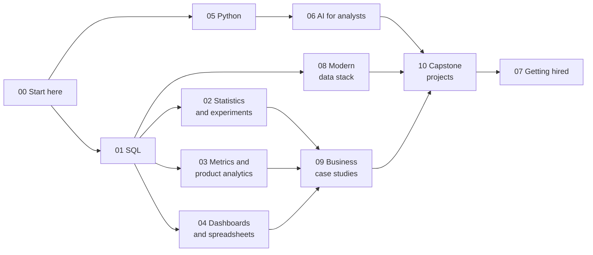

# Analytics from Scratch

**Become an analyst who can be trusted with the number.** A free, open course that takes you from your first SQL query to experiments, dashboards, Python, AI agents and a portfolio, by building every method yourself and checking it with a test.

[Start here](phases/00-start-here) · [Learning roadmap](LEARNING_ROADMAP.md) · [Skills employers ask for in 2026](2026-2027-ANALYTICS-SKILLS.md) · [Read it online](https://realanalystjobs.com/learn) · [Contribute](CONTRIBUTING.md)

## Who this is for

- **Complete beginners** who have never written a query. [Phase 00](phases/00-start-here) assumes nothing.
- **Career switchers** from finance, operations, marketing or engineering who want a structured path to an analyst role.
- **Working analysts** who want the parts most courses skip: experiments done properly, metric design, data modelling, and using AI without shipping wrong numbers.
- **Educators**: every lesson is self-contained, MIT licensed and tested, so you can teach from it.

## What makes it different

Most courses teach you where to click. This one teaches you what the tool is doing, so you can tell when it is wrong.

| | |
|---|---|
| **A business problem in every lesson** | A named company, a stakeholder, a deadline, and a decision at the end: "What to tell the stakeholder" |
| **The trap first** | Each lesson shows the plausible wrong answer failing on real numbers: the join that counts 465 rows instead of 360, the funnel that reads 14.7% instead of 40.3% |
| **Built from scratch, then checked** | You write the GROUP BY, the z-test, the DAX filter context, the agent's guard rails. A test tells you when you are right, and runs on a second dataset so a pasted answer fails |
| **Ready for AI-era work** | The course teaches you to review a query, grade a model, size an eval set, guard natural-language-to-SQL and audit an agent, because the scarce skill is now checking, not typing |
| **Grounded in real hiring data** | What to learn is set by 9,044 live analyst postings, not guesswork. See [2026-2027-ANALYTICS-SKILLS.md](2026-2027-ANALYTICS-SKILLS.md) |
| **Runs anywhere** | Python 3.9+ standard library and SQLite. Offline. No installs, no accounts, no API keys |

## Quick start

```
git clone https://github.com/Ani19arya/analytics-from-scratch
cd analytics-from-scratch/phases/01-sql/01-group-by-from-raw-rows
python3 test_lesson.py
```

The test fails until you complete `exercise.sql`. Read the lesson's `README.md`, fill in the exercise, and run the test again. New to all of this? Begin with [phase 00](phases/00-start-here), which shows you how to install Python and run your first test.

Run any SQL against a lesson's data, from the repo root:

```
python3 tools/query.py phases/00-start-here/04-your-first-sql-query "SELECT * FROM orders LIMIT 5"
```

Check every lesson from the repo root:

```
python3 tools/run_all_tests.py --exercise
```

## The path



You climb every subject one level at a time: Level 1 (understand and solve guided problems), Level 2 (solve realistic problems on your own), Level 3 (ambiguous problems and recommendations). The [learning roadmap](LEARNING_ROADMAP.md) gives the order, the milestones, a checklist to track your progress, and tracks for data, business, product, BI, growth and AI-enabled analyst roles.

**Time:** about 330 hours in all, or 6 to 9 months at 10 to 12 hours a week. The course builds skills you can demonstrate. It cannot promise a job, and it does not pretend to.

## Curriculum

<!-- generated:phase-table -->
| Phase | What you learn | Lessons live | Planned |
|---|---|---|---|
| [00 Start here](phases/00-start-here) | How to use the course, how an analyst thinks, and your first SQL query and Python script. For complete beginners. | 6 | 0 |
| [01 SQL from raw tables](phases/01-sql) | SQL from the first GROUP BY to query plans, built from raw rows and checked against Python. | 12 | 2 |
| [02 Statistics and experiments](phases/02-statistics-and-experiments) | Probability, sampling, tests and regression by hand, so you know what a p-value or an interval really says. | 12 | 3 |
| [03 Metrics and product analytics](phases/03-metrics-and-product-analytics) | Define, decompose and diagnose the numbers a business runs on. | 12 | 2 |
| [04 Dashboards and spreadsheets](phases/04-dashboards) | What Excel, Power BI and Tableau compute underneath, rebuilt and tested, plus how to design for a decision. | 12 | 0 |
| [05 Python for analysts](phases/05-python-for-analysts) | Cleaning, reshaping, profiling, APIs, charts and automation in standard library Python, with the bridge to pandas. | 10 | 0 |
| [06 AI for analysts](phases/06-ai-for-analysts) | Use LLMs and agents for analysis, and measure, check and govern what they produce. | 6 | 9 |
| [07 Getting hired](phases/07-getting-hired) | Roadmaps, interview rounds, an honest resume and a portfolio employers can run. | 12 | 0 |
| [08 Modern data stack](phases/08-modern-data-stack) | Warehouses, transformation, orchestration, testing and version control: what an analyst must understand and what a data engineer builds. | 5 | 1 |
| [09 Business case studies](phases/09-business-case-studies) | Real business questions, end to end: context, KPIs, analysis, recommendation and its limits. | 0 | 9 |
| [10 Capstone projects](phases/10-capstone-projects) | Large end-to-end projects with a brief, data, deliverables, a rubric and a worked solution. | 0 | 8 |
| **All** | | **87** | **34** |
<!-- /generated:phase-table -->

Lessons marked *planned* are being written in roughly the order listed. A lesson is only listed as live when its test passes.

<!-- generated:phase-lessons -->
### 00 Start here

1. 00-01 [Run your first lesson](phases/00-start-here/01-run-your-first-lesson): Is Python ready on your computer, and how does a lesson tell you that your answer is right? (Level 1)
2. 00-02 [Think like an analyst](phases/00-start-here/02-think-like-an-analyst): A manager says sales are down. What do you ask before you touch any data? (Level 1)
3. 00-03 [Tables, rows and grain](phases/00-start-here/03-tables-rows-and-grain): What does one row of this table mean, and which column identifies it? (Level 1)
4. 00-04 [Your first SQL query](phases/00-start-here/04-your-first-sql-query): Which ten orders were the biggest last week, and from which city? (Level 1)
5. 00-05 [NULLs, CASE and COALESCE](phases/00-start-here/05-nulls-case-and-coalesce): How many orders have no delivery date, and how do we bucket orders into small, medium and large? (Level 1)
6. 00-06 [Python for spreadsheet people](phases/00-start-here/06-python-for-spreadsheet-people): Can you total a column of a CSV without opening Excel? (Level 1)

### 01 SQL from raw tables

1. 01-01 [GROUP BY from raw rows](phases/01-sql/01-group-by-from-raw-rows): How much did each city bring in last quarter, and which cities are big enough to matter? (Level 1)
2. 01-02 [Joins without losing rows](phases/01-sql/02-joins-without-losing-rows): Which customers have never ordered, and what is revenue by city without counting any order twice? (Level 1)
3. 01-03 [Window functions](phases/01-sql/03-window-functions): How is each region tracking against its fiscal year to date, who are the top reps, and did revenue go up or down from last month? (Level 2)
4. 01-04 [Cohort retention](phases/01-sql/04-cohort-retention): Of the users who signed up in each month, what share were still active one, two and three months later? (Level 2)
5. 01-05 [Dates and the date spine](phases/01-sql/05-dates-and-the-date-spine): What were signups per day, including the days with zero? (Level 1)
6. 01-06 [Anti-joins, self-joins and UNION](phases/01-sql/06-anti-joins-self-joins-and-union): Which customers ordered in March but not in April? (Level 1)
7. 01-07 [Subqueries and CTEs](phases/01-sql/07-subqueries-and-ctes): Which customers spent more than their city's average? (Level 1)
8. 01-08 [Duplicates and reconciliation](phases/01-sql/08-duplicates-and-reconciliation): After the CRM import doubled some rows, how many unique customers really signed up? (Level 2)
9. 01-09 [Rolling averages and percent of total](phases/01-sql/09-rolling-averages-and-percent-of-total): What is the 7-day moving average of orders, and each region's share of revenue? (Level 2)
10. 01-10 [Sessionization from raw events](phases/01-sql/10-sessionization): How many sessions does each user have with a 30-minute timeout, and how long is a session? (Level 2)
11. 01-11 [Gaps and islands: streaks](phases/01-sql/11-gaps-and-islands): Which users logged a workout three days in a row, and what is the longest streak? (Level 2)
12. 01-12 [Review a query someone else wrote](phases/01-sql/12-review-a-query-someone-else-wrote): A teammate, or an assistant, wrote this query. Is the number on the slide right? (Level 2)
13. 01-13 Query plans and indexes *(planned)*: Why does the dashboard query take 40 seconds, and what does the query plan say? (Level 3)
14. 01-14 SQL dialects for work and interviews *(planned)*: How do the same five queries look in SQLite, Postgres, BigQuery and Snowflake? (Level 3)

### 02 Statistics and experiments

1. 02-01 [Mean, median and skew](phases/02-statistics-and-experiments/01-mean-median-and-skew): What is the typical posted pay for an analyst role, and which number should we put on the slide? (Level 1)
2. 02-02 [Confidence interval by hand](phases/02-statistics-and-experiments/02-confidence-interval-by-hand): How sure are we about an average or a rate measured on a sample? (Level 1)
3. 02-03 [A/B test from scratch](phases/02-statistics-and-experiments/03-ab-test-from-scratch): Did the new checkout page really convert better, or did we get lucky? (Level 2)
4. 02-04 [Sample size before you test](phases/02-statistics-and-experiments/04-sample-size-before-you-test): How many users, and how many weeks, do we need before an A/B test can answer the question we care about? (Level 2)
5. 02-05 [Probability and distributions by simulation](phases/02-statistics-and-experiments/05-probability-by-simulation): If 10% of visitors buy, how many of 200 should buy, and how unusual is 30? (Level 1)
6. 02-06 [Outliers, box plots and robust summaries](phases/02-statistics-and-experiments/06-spread-percentiles-and-outliers): Which salaries are real outliers, and which summary survives them? (Level 1)
7. 02-07 [Sampling and the central limit theorem](phases/02-statistics-and-experiments/07-sampling-and-the-clt): Why does the average of 18 orders wobble, and by how much? (Level 1)
8. 02-08 [Hypothesis testing by permutation](phases/02-statistics-and-experiments/08-hypothesis-test-by-permutation): Could this gap appear just by shuffling the labels? (Level 2)
9. 02-09 [Comparing categories: the chi-square test](phases/02-statistics-and-experiments/09-chi-square-test): Do the three signup flows differ in completion rate? (Level 2)
10. 02-10 [Correlation, causation and Simpson's paradox](phases/02-statistics-and-experiments/10-correlation-causation-and-simpson): Users who get more notifications work out more. Should we send more? (Level 2)
11. 02-11 [Linear regression from scratch](phases/02-statistics-and-experiments/11-linear-regression-from-scratch): How much does each extra visit add to monthly spend, and what does R squared really say? (Level 2)
12. 02-12 [Bootstrap confidence intervals](phases/02-statistics-and-experiments/12-bootstrap-intervals): How sure are we about a median or a ratio when no simple formula exists? (Level 2)
13. 02-13 A/B test pitfalls *(planned)*: We tested five variants on three metrics. Which wins are real? (Level 3)
14. 02-14 Ratio metrics and the delta method *(planned)*: Is the drop in replies per application real when one user sends many? (Level 3)
15. 02-15 Variance reduction with CUPED *(planned)*: Can pre-test behaviour make the test finish in half the time? (Level 3)

### 03 Metrics and product analytics

1. 03-01 [Metric trees](phases/03-metrics-and-product-analytics/01-metric-trees): Revenue fell this week, so which part of the business made it fall? (Level 2)
2. 03-02 [Funnel conversion](phases/03-metrics-and-product-analytics/02-funnel-conversion): Of the people who look at a course, how many buy it, and at which step do we lose the most of them? (Level 1)
3. 03-03 [Active users and stickiness](phases/03-metrics-and-product-analytics/03-active-users-and-stickiness): How many people really use the app, and how often do they come back? (Level 1)
4. 03-04 [North star and guardrails](phases/03-metrics-and-product-analytics/04-north-star-and-guardrails): The new feature moved our main metric up, so should we launch it? (Level 2)
5. 03-05 [Define a metric precisely](phases/03-metrics-and-product-analytics/05-define-a-metric-precisely): What exactly counts as an active customer, and what goes in the metric spec? (Level 1)
6. 03-06 [Percent vs points, ratio of sums vs average of ratios](phases/03-metrics-and-product-analytics/06-percent-points-and-averages-of-ratios): Did conversion rise 2% or 2 points, and why do two dashboards disagree? (Level 1)
7. 03-07 [Growth accounting](phases/03-metrics-and-product-analytics/07-growth-accounting): Where did this month's MAU change come from: new, retained, resurrected or churned users? (Level 2)
8. 03-08 [Retention curves and churn](phases/03-metrics-and-product-analytics/08-retention-curves-and-churn): What share of users are still here on day 7 and day 30, and which retention definition fits? (Level 2)
9. 03-09 [Segmentation and mix effects](phases/03-metrics-and-product-analytics/09-segmentation-and-mix-effects): Did conversion fall, or did the traffic mix change? (Level 2)
10. 03-10 [Diagnose a metric drop](phases/03-metrics-and-product-analytics/10-diagnose-a-metric-drop): DAU fell 20% overnight. Tracking bug, holiday, segment, or real? (Level 2)
11. 03-11 [Attribution: first touch, last touch, linear](phases/03-metrics-and-product-analytics/11-attribution-models): Which channel gets credit for the sale, and how much does the answer depend on the model? (Level 2)
12. 03-12 [Unit economics: LTV, CAC and payback](phases/03-metrics-and-product-analytics/12-ltv-cac-and-payback): Is paid social acquisition profitable once churn is included? (Level 2)
13. 03-13 Marketplace metrics and liquidity *(planned)*: What share of job posts get an application within 48 hours, and which side is the constraint? (Level 3)
14. 03-14 Causal impact without an experiment: difference in differences *(planned)*: We launched in one city and not the others. Did it work? (Level 3)

### 04 Dashboards and spreadsheets

1. 04-01 [Model the data a dashboard needs](phases/04-dashboards/01-model-the-data-a-dashboard-needs): How do you turn one flat export of order lines into tables a dashboard can slice by date, product and region without double counting? (Level 2)
2. 04-02 [DAX measures from scratch](phases/04-dashboards/02-dax-measures-from-scratch): What does a Power BI measure actually compute, and how do you get the same Total Sales, filtered sales, share, year to date and growth on last year numbers without Power BI? (Level 2)
3. 04-03 [Tableau LOD expressions in SQL](phases/04-dashboards/03-tableau-lod-expressions-in-sql): How do you compute a number at a different level of detail from the chart it sits in, such as each customer's first order month in a chart by month, or a region's total in a chart by customer? (Level 2)
4. 04-04 [Draw a chart from scratch](phases/04-dashboards/04-draw-a-chart-from-scratch): What does a dashboard tool do when it turns a table into a bar chart, and which chart should you pick in the first place? (Level 1)
5. 04-05 [Lookups and SUMIFS like Excel](phases/04-dashboards/05-lookups-and-sumifs): Why does the VLOOKUP total not match finance? (Level 1)
6. 04-06 [Pivot tables and Power Query steps](phases/04-dashboards/06-pivot-tables-and-power-query): Can next month's file be cleaned and merged with one click? (Level 1)
7. 04-07 [Dashboard design and KPI cards](phases/04-dashboards/07-dashboard-design-and-kpi-cards): What should the CEO see in five seconds? (Level 1)
8. 04-08 [Relationships, role-playing dates and many-to-many](phases/04-dashboards/08-relationships-and-role-playing-dates): Why does revenue by ship month differ from revenue by order month? (Level 2)
9. 04-09 [One metric, one definition: the semantic layer](phases/04-dashboards/09-the-semantic-layer): Why do two dashboards show different active users? (Level 2)
10. 04-10 [Slowly changing dimensions](phases/04-dashboards/10-slowly-changing-dimensions): Which region was this customer in when they ordered? (Level 2)
11. 04-11 [Row-level security](phases/04-dashboards/11-row-level-security): Can each regional manager see only their own region? (Level 2)
12. 04-12 [Tableau table calculations vs LOD](phases/04-dashboards/12-tableau-table-calculations): Running total, rank or percent of total: which should be computed where? (Level 2)

### 05 Python for analysts

1. 05-01 [Clean a messy CSV](phases/05-python-for-analysts/01-clean-a-messy-csv): Which rows of this export can we trust, and what did we change to get there? (Level 1)
2. 05-02 [Reshape wide and long](phases/05-python-for-analysts/02-reshape-wide-and-long): The data has one row per region and month. The manager wants one row per region. How do you move between the two without losing anything? (Level 1)
3. 05-03 [Dates, weeks and time zones](phases/05-python-for-analysts/03-dates-weeks-and-time-zones): How many people signed up each week over the new year, counted on the clock the team actually works on? (Level 2)
4. 05-04 [Automate the weekly report](phases/05-python-for-analysts/04-automate-the-weekly-report): Can the Monday KPI report write itself, with the same numbers every time it runs? (Level 2)
5. 05-05 [Profile a table before you trust it](phases/05-python-for-analysts/05-profile-a-table): Is this table fit for the board number? (Level 1)
6. 05-06 [Join two files and prove nothing was lost](phases/05-python-for-analysts/06-join-files-and-prove-nothing-was-lost): After the merge, are the totals still the totals? (Level 1)
7. 05-07 [APIs and JSON](phases/05-python-for-analysts/07-apis-and-json): How many analyst roles did the feed return this week? (Level 2)
8. 05-08 [More charts from scratch](phases/05-python-for-analysts/08-more-charts-from-scratch): Histogram, scatter or line: which shows the answer, and how do bins and scales mislead? (Level 2)
9. 05-09 [Data quality tests as code](phases/05-python-for-analysts/09-data-quality-tests-as-code): Would we have caught last week's broken load? (Level 2)
10. 05-10 [From standard library to pandas](phases/05-python-for-analysts/10-from-stdlib-to-pandas): Which pandas call does each function you wrote correspond to? (Level 2)

### 06 AI for analysts

1. 06-01 [Grade an LLM classifier](phases/06-ai-for-analysts/01-grade-an-llm-classifier): Is the LLM good enough at spotting refund tickets that we can route them automatically? (Level 2)
2. 06-02 [Check LLM-written SQL](phases/06-ai-for-analysts/02-check-llm-written-sql): Which of the queries the LLM wrote can we trust, and which ones would have put a wrong number in the report? (Level 2)
3. 06-03 [Catch made-up numbers](phases/06-ai-for-analysts/03-catch-made-up-numbers): Every number in the AI-written summary: is it actually in the data? (Level 2)
4. 06-04 [How LLMs work, for analysts](phases/06-ai-for-analysts/04-how-llms-work-for-analysts): What is a token, what does a run cost, and why does the same prompt give different answers? (Level 1)
5. 06-05 [Prompt versions as experiments](phases/06-ai-for-analysts/05-prompt-versions-as-experiments): Is prompt v2 better than v1 on the same 200 tickets? (Level 1)
6. 06-06 Structured output you can load *(planned)*: Can we put the model's JSON straight into a table? (Level 2)
7. 06-07 How big must an eval set be? *(planned)*: How many labelled examples do we need before we trust the score? (Level 2)
8. 06-08 Human in the loop: confidence thresholds *(planned)*: How many tickets can we auto-route at 95% precision, and who reviews the rest? (Level 2)
9. 06-09 LLM as judge, and judging the judge *(planned)*: Can a model grade answers, and does its grading agree with people? (Level 2)
10. 06-10 Natural language to SQL, safely *(planned)*: Can we let people ask the database questions in English without breaking anything? (Level 2)
11. 06-11 [Keep personal data out of prompts](phases/06-ai-for-analysts/11-keep-pii-out-of-prompts): Is any customer's email or phone number about to leave the building? (Level 1)
12. 06-12 RAG over the metrics glossary *(planned)*: Which definition of active user did the bot cite, and was it the right one? (Level 2)
13. 06-13 An analytics agent loop from scratch *(planned)*: What does an agent actually do between your question and its answer? (Level 3)
14. 06-14 Audit an agent's work *(planned)*: The agent says revenue grew 12%. Which step should we check, and was it right? (Level 3)
15. 06-15 MCP for analysts *(planned)*: How does an assistant get safe, read-only access to your data? (Level 3)

### 07 Getting hired

1. 07-01 [Read job postings like data](phases/07-getting-hired/01-read-job-postings-like-data): Across 300 analyst job postings, which tools are required most, how much experience do they want, and what do they say about visa sponsorship? (Level 1)
2. 07-02 [SQL interview questions](phases/07-getting-hired/02-sql-interview-questions): Can you answer the six SQL questions that come up again and again in analyst interviews, and explain why the obvious answer is wrong? (Level 2)
3. 07-03 [Portfolio project end to end](phases/07-getting-hired/03-portfolio-project-end-to-end): Do customers who start on a free trial cancel within 90 days more often than customers who pay from day one? (Level 2)
4. 07-04 [Match your resume to a posting](phases/07-getting-hired/04-match-your-resume-to-a-posting): Of five open roles, which ones fit this resume best, and which missing skills stand between the candidate and the rest? (Level 1)
5. 07-05 [Role roadmaps from postings](phases/07-getting-hired/05-role-roadmaps-from-postings): Data, business, product or BI analyst: which skills differ? (Level 1)
6. 07-06 [Explain findings to leadership](phases/07-getting-hired/06-explain-findings-to-leadership): Can the VP act on your summary after reading only the first two lines? (Level 1)
7. 07-07 [Resume bullets that are true](phases/07-getting-hired/07-resume-bullets-that-are-true): Does every number on your resume come from work you can show? (Level 1)
8. 07-08 [The metrics case interview](phases/07-getting-hired/08-metrics-case-interview): Signups fell 20%. Walk me through it. (Level 2)
9. 07-09 [The statistics interview round](phases/07-getting-hired/09-statistics-interview-round): Can you explain power, p-values and Simpson's paradox on real numbers? (Level 2)
10. 07-10 [The take-home assignment](phases/07-getting-hired/10-the-take-home-assignment): Four hours, one dataset: what does a strong submission contain? (Level 2)
11. 07-11 [Behavioural answers that show analysis](phases/07-getting-hired/11-behavioural-answers): Tell me about a time your analysis changed a decision. Guide, no test. (Level 1)
12. 07-12 [Publish your portfolio](phases/07-getting-hired/12-publish-your-portfolio): Can a hiring manager run your project in one command? (Level 1)

### 08 Modern data stack

1. 08-01 [Warehouse layers: raw, staging and marts](phases/08-modern-data-stack/01-warehouse-layers): Why do we never edit raw data, and where should a metric be computed? (Level 2)
2. 08-02 [dbt from scratch](phases/08-modern-data-stack/02-dbt-from-scratch): In what order must these six models build, and what do their tests prove? (Level 2)
3. 08-03 [Incremental models and backfills](phases/08-modern-data-stack/03-incremental-models-and-backfills): Can yesterday's numbers be fixed without rebuilding three years of data? (Level 2)
4. 08-04 Orchestration: a tiny DAG runner *(planned)*: What happens at 6 am when the 5 am job failed? (Level 3)
5. 08-05 [Query cost in a cloud warehouse](phases/08-modern-data-stack/05-cloud-warehouse-cost): Why did one dashboard cost 400 dollars, and how do partitions fix it? (Level 2)
6. 08-06 [Git for analysts](phases/08-modern-data-stack/06-git-for-analysts): Who changed the revenue query, and can we undo it? (Level 1)

### 09 Business case studies

1. 09-01 E-commerce: why is revenue falling? *(planned)*: Revenue is down 8% on last quarter. Traffic, conversion, basket size or mix? (Level 2)
2. 09-02 SaaS: reduce subscription churn *(planned)*: Which customers leave, when, and which change would keep the most revenue? (Level 2)
3. 09-03 Marketing: is the campaign incremental? *(planned)*: The campaign got credit for 3,000 sales. How many would have happened anyway? (Level 2)
4. 09-04 Food delivery: why are cancellations rising? *(planned)*: Cancellations doubled in six weeks. Restaurants, riders, customers or the app? (Level 2)
5. 09-05 Fintech: loan approvals and defaults *(planned)*: If we approve more applicants, how many more defaults do we buy? (Level 2)
6. 09-06 Retail: what to restock *(planned)*: Which products deserve more inventory next month, and which are tying up cash? (Level 2)
7. 09-07 Growth: why is acquisition cost rising? *(planned)*: CAC is up 35% this year. Channel saturation, pricing or tracking? (Level 2)
8. 09-08 Banking: which segments are profitable? *(planned)*: Which customer segments earn more than they cost to serve? (Level 2)
9. 09-09 Operations: why are deliveries late? *(planned)*: On-time delivery fell from 94% to 87%. Where in the chain is the delay? (Level 2)

### 10 Capstone projects

1. 10-01 E-commerce performance review *(planned)*: Prepare the quarterly business review for an online store. (Level 3)
2. 10-02 Customer retention and cohort analysis *(planned)*: Find where retention breaks and which cohort to study first. (Level 3)
3. 10-03 Marketing attribution and campaign effectiveness *(planned)*: Reallocate next quarter's budget across channels, and defend it. (Level 3)
4. 10-04 SaaS subscription and churn analysis *(planned)*: Build the churn model the finance team can plan with. (Level 3)
5. 10-05 Executive dashboard *(planned)*: Design, model and verify the CEO dashboard, in the tool of your choice. (Level 3)
6. 10-06 Automated analytics reporting *(planned)*: Make the weekly business review build, test and send itself. (Level 3)
7. 10-07 A natural-language-to-SQL assistant *(planned)*: Build, evaluate and guard an assistant that answers questions from a database. (Level 3)
8. 10-08 A multi-agent analytics copilot *(planned)*: Agents that plan, query, check and recommend, with a human approving each step. (Level 3)
<!-- /generated:phase-lessons -->

## Learn with your coding agent

The repo ships a tutor skill for coding agents that read SKILL.md files (Claude Code, Cursor, Codex and others):

```
npx skills add Ani19arya/analytics-from-scratch
```

Open your agent inside a clone of this repo and ask it to tutor you through analytics from scratch. It places you with three questions, picks a starting lesson, and gives hints before answers. See [skills/README.md](skills/README.md) for the manual install.

## Open job-market data

[data/job-market](data/job-market) holds a monthly snapshot of the analyst job market, built from the live Real Analyst Jobs feed. Unlike the lesson datasets, which are synthetic, these files are real aggregates with counts only:

- `by_country.csv`: postings and distinct hiring companies per country.
- `by_country_skill.csv`: how often postings list SQL, Python, Excel, Tableau, Power BI, Looker, R and dbt.
- `by_country_seniority.csv`: postings per experience level.

A new `YYYY-MM/` folder is added every month and older folders are never edited. Rebuild a month yourself with `tools/build_job_market_snapshot.py`. Method and limits: [data/job-market/README.md](data/job-market/README.md).

## How this course is kept honest

- Every lesson test runs in CI on Python 3.9 and 3.12. Every solution must pass, every exercise must fail, and every dataset must rebuild byte for byte.
- `tools/lint.py` blocks broken links, placeholder lessons and style drift.
- The [repository audit](REPOSITORY_AUDIT.md) lists every known defect and the order they are being fixed in. Found another? [Open an issue](https://github.com/Ani19arya/analytics-from-scratch/issues).

## Share a lesson

Every lesson is a folder with a stable link. Send a friend `github.com/Ani19arya/analytics-from-scratch/tree/main/phases/<phase>/<lesson>`, or the same lesson as a web page at https://realanalystjobs.com/learn.

## Contributing

Corrections come first, then new lessons. [CONTRIBUTING.md](CONTRIBUTING.md) explains the lesson format, the checks to run before a pull request, and how to claim a planned lesson so two people do not write the same one.

## Built by Real Analyst Jobs

This course is made by [Real Analyst Jobs](https://realanalystjobs.com), a job board for data and business analyst roles collected from company career pages. Each lesson ends with what real job postings ask for, with a dated number from the open data drop, so you can see how the skill you just built shows up in hiring.

## License

- Code and lessons: MIT. See [LICENSE](LICENSE).
- Job-market data in `data/job-market`: CC BY 4.0 (https://creativecommons.org/licenses/by/4.0/). Credit it as: Real Analyst Jobs (realanalystjobs.com).
