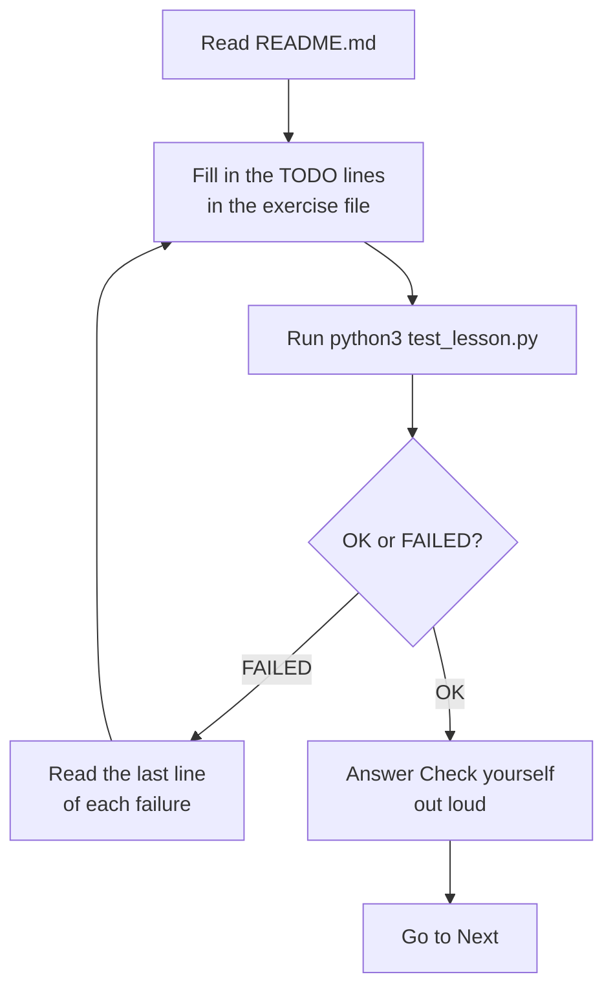

# Run your first lesson

Is Python ready on your computer, and how does a lesson tell you that your answer is right?

## Before you start

- Level: 1 (beginner)
- Time: about 1 hour
- Builds on: nothing. This is the first lesson of the course. The [phase overview](../README.md) lists what comes next.
- You need: a computer (Windows, macOS or Linux) and an internet connection once, to download Python and this course. After that everything runs offline.

## The problem

Tiffinbell is a fictional food delivery app with a kitchen in Pune. Today is your first day as its analyst. Ritu, who runs the kitchen, has a call with her vegetable supplier at 9 am. Before the call she wants two numbers from yesterday: how many orders the kitchen made, and how much money they brought in. The orders are in one small file, `data/orders.csv`. You will get Python working, run your first test, watch it fail, fix the code and watch it pass.

## In plain words

Think of a lesson as a homework sheet that marks itself. The README is the teacher explaining the topic. The exercise file is your answer sheet with blanks to fill in. The test is the answer key, kept by a strict marker who works out the right answer on their own every time and tells you exactly which line is wrong.

A few words you will meet:

- **Python**: a free program that runs instructions written in the Python language. Analysts use it to read files and do sums that would take hours by hand.
- **Terminal**: a window where you type commands instead of clicking. On Windows it is called PowerShell or Terminal.
- **Folder** and **path**: a folder holds files. A path is the address of a folder, such as `Desktop/analytics-from-scratch`.
- **Test**: a small program that runs your code and checks its answers. It says `OK` when everything is right and `FAILED` when something is not.
- **CSV**: a "comma separated values" file. It is a spreadsheet saved as plain text: one line per row, commas between the cells.

## What you will build from scratch

- A working Python 3.9 or later on your computer, checked with one command.
- The habit of opening a terminal and moving into a lesson folder with `cd`.
- `count_orders`: counts the orders in a list.
- `total_amount`: adds up the amount column with a loop.
- The skill of reading a failing test message and knowing what to fix.

The data in `data/orders.csv` is synthetic (made up by `make_data.py` with a fixed random seed, so everyone gets the same 38 rows). Amounts are in Indian rupees.

## The idea

Every lesson in this course is built the same way.

| File | What it is | Do you edit it? |
|---|---|---|
| `README.md` | The lesson you are reading now | No |
| `exercise.py` or `exercise.sql` | Your answer sheet, with `TODO` lines to replace | Yes |
| `test_lesson.py` | The marker. Runs your exercise and checks every answer | No |
| `solution/` | A worked answer, for after you have tried | No |
| `data/` | The CSV files the lesson uses | No |
| `make_data.py` | Rebuilds `data/` exactly, and can build a different dataset for the test | No |

The test does not copy the answer from the solution. It works the answer out again in plain Python, from the data. It also builds a **second dataset** with different numbers and runs your code on that too. So typing `return 38` would pass the first check and fail the second. The only way to pass is code that really works.

This is the loop you will repeat in every lesson:



## Walk through

### Step 1. Open a terminal

- **Windows**: press the Start button, type `PowerShell` and open Windows PowerShell (or Terminal, if you have it).
- **macOS**: press Command and Space together, type `Terminal` and press Return.
- **Linux**: open Terminal from your applications menu. On Ubuntu the shortcut is Ctrl, Alt and T together.

You see a line ending in `$`, `%` or `>`. That is the **prompt**: the terminal is waiting for you to type a command and press Enter.

### Step 2. Check for Python 3.9 or later

Type one of these and press Enter:

```
python3 --version        (macOS and Linux)
py --version             (Windows)
```

You want an answer such as `Python 3.9.6` or `Python 3.12.4`: the first number 3, the second number 9 or higher. On Windows, if `py` is not found, try `python --version`.

If you see "command not found", "not recognized", or a version below 3.9, install Python:

- **Windows**: download the latest Python 3 from the official page, https://www.python.org/downloads/ , and run the installer. If it shows a box called "Add python.exe to PATH", tick it. Then close PowerShell, open a new one, and run `py --version` again.
- **macOS**: running `python3 --version` may offer to install the "command line developer tools". Accept, wait for it to finish, and run the command again. Or install Python from https://www.python.org/downloads/ .
- **Linux**: most distributions already include `python3`. If yours does not, install it with your package manager, for example `sudo apt install python3` on Ubuntu or Debian, or `sudo dnf install python3` on Fedora.

From here on, the course writes `python3`. On Windows, type `py` (or `python`) wherever you see `python3`.

### Step 3. Get the course

On https://github.com/Ani19arya/analytics-from-scratch click the green **Code** button, then **Download ZIP**. Unzip it somewhere easy to find, such as your Desktop. (If you already use git, `git clone https://github.com/Ani19arya/analytics-from-scratch.git` does the same thing.)

Nothing else to install. The course uses only Python and the tools that come with it.

### Step 4. Move into the lesson folder

`cd` means "change directory" (directory is another word for folder). Type `cd`, a space, then the path:

```
cd Desktop/analytics-from-scratch/phases/00-start-here/01-run-your-first-lesson
```

Your folder may be called `analytics-from-scratch-main` if it came from the ZIP. A shortcut that works on macOS and in most Windows and Linux terminals: type `cd ` with a space, drag the folder from your file window into the terminal, and press Enter.

Three commands help you find your way:

| Command | What it does |
|---|---|
| `pwd` | Prints the folder you are in now |
| `ls` | Lists the files in this folder (on Windows cmd, `dir`) |
| `cd ..` | Goes up one folder |

Type `ls`. You should see `README.md`, `exercise.py`, `test_lesson.py` and the others from the table above.

### Step 5. Run the test and watch it fail

```
python3 test_lesson.py
```

The exercise is not filled in yet, so the test fails. That is expected. The end of the output looks like this:

```
======================================================================
FAIL: test_total_on_lesson_data (__main__.TestOrders)
----------------------------------------------------------------------
Traceback (most recent call last):
  File ".../01-run-your-first-lesson/test_lesson.py", line 69, in test_total_on_lesson_data
    self.assertAlmostEqual(got, total, delta=0.01, msg="total_amount gave %r but the amounts add up to %.2f: did the loop add every order?" % (got, total))
AssertionError: 0 != 11194.62 within 0.01 delta (11194.62 difference) : total_amount gave 0 but the amounts add up to 11194.62: did the loop add every order?

----------------------------------------------------------------------
Ran 6 tests in 0.001s

FAILED (failures=4)
```

How to read it:

1. Each block starting with `FAIL:` is one check that did not pass. `test_total_on_lesson_data` is its name, which tells you what it checks.
2. Skip the `Traceback` and `File` lines for now. They say where inside the test the check lives.
3. Read the `AssertionError` line. `0 != 11194.62` means "your code gave 0, the right answer is 11194.62". The text after the colon says what to look at.
4. The last line counts the problems: `FAILED (failures=4)` means 4 of the 6 checks failed.

### Step 6. Fix the code

Open `exercise.py` in any text editor (Notepad, TextEdit in plain text mode, or a code editor such as VS Code). Look at the first function:

```python
def count_orders(orders):
    """How many orders are in the list?"""
    # TODO: return the number of orders. Hint: len(orders) counts the items in a list.
    return 0
```

- `def count_orders(orders):` starts a **function**: a named recipe that takes something in (here a list of orders) and gives an answer back.
- `orders` is a **list**: many values in order, like the rows of a spreadsheet.
- `return 0` gives back 0 every time. That is why the test failed.

Replace the TODO and `return 0` with `return len(orders)`. `len` counts the items in a list. Save the file and run the test again. Now it says `FAILED (failures=3)`: one problem fixed.

The second function needs a **loop**, which does the same step once for each row. This is what the loop does for the first three orders:

```python
from exercise import load_orders
orders = load_orders()
total = 0
for order in orders[:3]:
    total = total + order["amount"]
    print(order["order_id"], order["amount"], round(total, 2))
```

```
1001 387.87 387.87
1002 386.78 774.65
1003 397.6 1172.25
```

`orders[:3]` means "the first three orders". `order["amount"]` reads the amount cell of one row. `total = total + ...` keeps a running total, like adding up a bill line by line. Do the same in `total_amount` for every order (use `orders`, not `orders[:3]`), save, and run the test.

### Step 7. Watch it pass

```
......
----------------------------------------------------------------------
Ran 6 tests in 0.000s

OK
```

Each dot is a check that passed. `OK` means all of them did. You can also run your file on its own to see your answers:

```
python3 exercise.py
```

```
orders: 38
total: 11194.62
```

### Step 8. Check the worked answer (optional)

The same test can mark the solution instead of your exercise. On macOS and Linux:

```
CHECK_SOLUTION=1 python3 test_lesson.py
```

On Windows PowerShell, set the switch, run, then clear it so later runs check your own file again:

```
$env:CHECK_SOLUTION=1; py test_lesson.py; Remove-Item Env:CHECK_SOLUTION
```

### Step 9. Learn with the tutor skill (optional)

If you use a coding agent (Claude Code, Cursor, Codex or another agent that reads SKILL.md files), the course has a tutor for it in [skills/](../../../skills/README.md). Install it as that page explains, open the agent inside your copy of the course, and type "tutor me through analytics from scratch". It asks three questions to pick your starting lesson, then teaches one lesson at a time: it asks you to run the test first, gives a hint before any answer, and only shows `solution/` if you ask for it twice. It never edits the test to make it pass. You do not need it: every lesson works with just the README and the test.

## Common mistakes

**Counting lines instead of orders.** A CSV file has a header line with the column names. Count the lines and you get one too many:

```python
with open("data/orders.csv") as f:
    print(len(f.readlines()))
```

```
39
```

The file has 39 lines but 38 orders. Tell Ritu "39" and you have invented an order. `load_orders` uses `csv.DictReader`, which reads the header as column names, so `len(orders)` is 38.

**Adding numbers that are still text.** A CSV stores everything as text. Joining two pieces of text with `+` glues them together instead of adding:

```python
print("387.87" + "386.78")
```

```
387.87386.78
```

That is why `load_orders` turns the amount into a number with `float(...)` first. Lesson 06 covers this in depth.

**Dropping the free orders.** Three orders were free replacement meals with an amount of 0.00 (orders 1008, 1011 and 1028). They are still orders. If you skip rows with a zero amount you would report 35 orders, not 38. The total is the same either way, which is why this mistake is easy to miss.

**Running the test from the wrong folder.** If you run `python3 test_lesson.py` from the top of the course instead of the lesson folder, Python cannot find the file:

```
python3: can't open file '.../analytics-from-scratch/test_lesson.py': [Errno 2] No such file or directory
```

`cd` into the lesson folder first, and check with `pwd`.

**Typing `python` on a Mac.** On many Macs `python` does not exist or is an old version. Use `python3`. On Windows, use `py` or `python`.

## Your turn

Open `exercise.py` and fill in `count_orders` and `total_amount`. Then run, from this folder:

```
python3 test_lesson.py
```

It passes when both functions work on the lesson data, on a second dataset, and on small cases such as an empty list.

Stretch: add a function `average_order(orders)` that returns the total divided by the count, and decide what it should return for an empty list (you cannot divide by zero). The test does not check it.

## Check yourself

1. A test ends with `FAILED (failures=3)`. What do you read first, and what does `0 != 11194.62` mean?
2. Why does each test also run your code on a second dataset?
3. A CSV file has 39 lines. How many rows of data does it have?
4. You see `can't open file 'test_lesson.py'`. What went wrong?

<details>
<summary>Answers</summary>

1. Read the `AssertionError` line of each failure. `0 != 11194.62` means your code returned 0 and the right answer is 11194.62. The sentence after it says where to look.
2. So that only working code passes. A fixed answer such as `return 38` matches the lesson data but not a dataset with 36 orders.
3. Usually 38: the first line is the header with the column names. Always check whether a count includes the header.
4. The terminal is in a different folder from the test. Use `pwd` to see where you are and `cd` into the lesson folder.

</details>

## What to tell the stakeholder

"Yesterday the Pune kitchen made 38 orders worth Rs 11,194.62. Three of the 38 were free replacement meals at Rs 0, so they count as orders but add nothing to the takings."

## In real job postings

Of the eight tools the data drop tracks, Python is the most requested after SQL. In the Real Analyst Jobs data drop of 25 October 2026, 996 of the 2,056 US analyst postings that list a tool ask for Python (48.4%), and 448 of 900 in India (49.8%). Browse them at [Python data analyst jobs](https://realanalystjobs.com/jobs/python-data-analyst-jobs).

## Next

[02 Think like an analyst](../02-think-like-an-analyst/)
