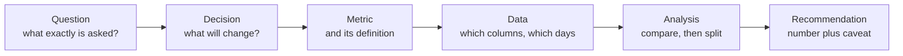
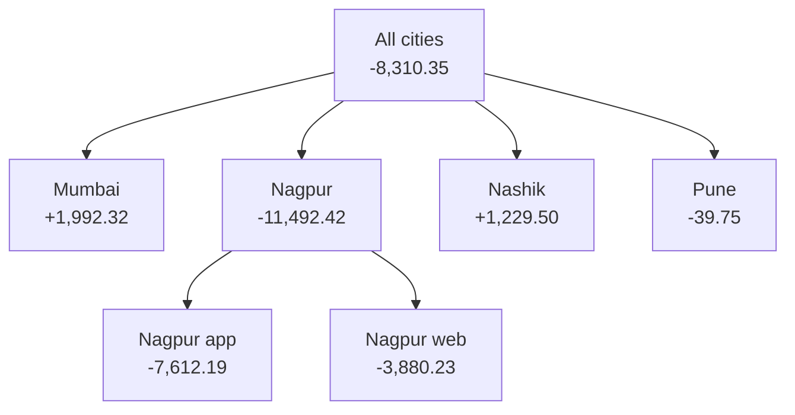

# Think like an analyst

A manager says sales are down. What do you ask before you touch any data?

## Before you start

- Level: 1 (beginner)
- Time: about 2 hours
- Builds on: [01 Run your first lesson](../01-run-your-first-lesson/) (running a test, a list, a loop)

## The problem

It is Friday 30 October 2026. Arjun, head of sales at Tiffinbell (a fictional food delivery app in four cities of Maharashtra), sends you one line: "Sales are down this week, can you look?" At 4 pm he meets the city managers and can move delivery riders or a promotion budget between cities. The order data runs to the end of Thursday 29 October. If you open the data straight away you will answer a question nobody asked. If you ask five short questions first, you can give Arjun a number he can act on before 4 pm.

## In plain words

Imagine a friend says "my money keeps disappearing". You would not start by reading every line of their bank statement. You would ask: disappearing compared with when? Last month, or the same month last year? Which kind of spending: rent, food, subscriptions? And what will you do about it: cancel something, or change your budget? Only then do you open the statement, and you know exactly which lines to add up.

An analyst does the same with "sales are down". Some words you will need:

- **Metric**: the number you measure, such as completed sales in rupees.
- **Definition**: the exact rule for the metric, including what is left out. "Sales" could mean every order placed, or only orders that were delivered and paid.
- **Comparison**: "down" always means "down compared with something". You must say what.
- **Segment**: a group inside the data, such as one city or one channel (the app or the website). Splitting a number by segment shows where a change comes from.
- **Like for like**: comparing equal things, such as Monday to Thursday this week against Monday to Thursday last week.

## What you will build from scratch

- A question plan: the clarified question, the decision, the metric and its definition, the comparison, the segments and the data needed.
- Labels for the four kinds of analysis: descriptive, diagnostic, predictive, prescriptive.
- `total_sales` and `percent_change`: the like-for-like comparison.
- `change_by_segment` and `biggest_drop`: which city or channel explains the fall.

The data in `data/orders.csv` is synthetic: 486 orders from Monday 19 to Thursday 29 October 2026, built by `make_data.py` with a fixed random seed.

## The idea

### Ask before you analyse

Every analysis follows the same chain. Each step depends on the one before it, so a gap early on breaks everything after it.



The questions to ask Arjun, and his answers:

| You ask | Why it matters | Arjun says |
|---|---|---|
| What decision will this feed? | Tells you how precise to be and which split helps | "Whether to move riders or promotion money between cities at 4 pm." |
| What do you mean by sales? | Placed orders and completed orders give different numbers | "Completed orders. Cancelled ones are not sales." |
| Down compared with what? | "Down" needs a baseline | "This week against last week." |
| Which days? | The data stops on Thursday | "Then the same days of each week." |
| Down where? | A total hides where the change is | "Check cities. Also app against website." |

That gives the plan:

- **Question**: did completed sales fall from Monday to Thursday this week, compared with the same four days last week, and which city or channel explains it?
- **Metric**: completed sales = the sum of `amount` where `status` is `completed`. Cancelled orders are left out.
- **Comparison**: 26 to 29 October against 19 to 22 October.
- **Segments**: `city` and `channel`.
- **Data needed**: `order_date`, `status`, `amount`, `city`, `channel`.

### Four kinds of analysis

| Kind | It answers | Example at Tiffinbell |
|---|---|---|
| Descriptive | What happened? | How much did we sell last week? |
| Diagnostic | Why did it happen? | Why did sales fall in one city this week? |
| Predictive | What will happen? | How many orders should we expect next Monday? |
| Prescriptive | What should we do? | Should we send a discount coupon to customers in that city? |

Arjun's question is diagnostic: he already knows something happened and wants to know why.

### The arithmetic of "explains the drop"

The change in the total is the sum of the changes in its segments:

```
total change = change in Mumbai + change in Nagpur + change in Nashik + change in Pune
```

So the segment that "explains most of the drop" is the one with the most negative change. It can even fall by more than the total did, if other segments grew.

## Walk through

Start Python from this folder by typing `python3` (on Windows, `py`). Paste the blocks below in order into the same session. Type `exit()` to leave.

### Step 1. Look at the data

```python
import csv
with open("data/orders.csv", newline="") as f:
    rows = list(csv.DictReader(f))
print(len(rows))
print(rows[0])
```

```
486
{'order_id': '50001', 'order_date': '2026-10-19', 'city': 'Mumbai', 'channel': 'app', 'status': 'completed', 'amount': '555.41'}
```

One row is one order. Dates are written as text in the form `YYYY-MM-DD`. Text in that form sorts in date order, so `"2026-10-19" <= date <= "2026-10-22"` works as a date range check.

### Step 2. Add up completed sales for a range of days

```python
def sales(start, end, city=None):
    total = 0
    for r in rows:
        if r["status"] != "completed":
            continue
        if city is not None and r["city"] != city:
            continue
        if start <= r["order_date"] <= end:
            total = total + float(r["amount"])
    return round(total, 2)
```

- `continue` skips to the next row. Cancelled orders are skipped first, because the definition says they are not sales.
- `city=None` means "all cities" unless you name one.
- `float(...)` turns the amount text into a number before adding.

### Step 3. Make the comparison Arjun asked for

```python
this_week = sales("2026-10-26", "2026-10-29")
same_days_last_week = sales("2026-10-19", "2026-10-22")
print(this_week, same_days_last_week)
print(round((this_week - same_days_last_week) / same_days_last_week * 100, 1))
```

```
71805.24 80115.59
-10.4
```

Completed sales fell from Rs 80,115.59 to Rs 71,805.24, a change of -10.4%. The **percent change** is (new - old) / old x 100.

### Step 4. Split by city

```python
for city in ["Mumbai", "Nagpur", "Nashik", "Pune"]:
    now = sales("2026-10-26", "2026-10-29", city)
    before = sales("2026-10-19", "2026-10-22", city)
    print(city, now, before, round(now - before, 2))
```

```
Mumbai 22098.94 20106.62 1992.32
Nagpur 10828.73 22321.15 -11492.42
Nashik 19872.8 18643.3 1229.5
Pune 19004.77 19044.52 -39.75
```

The total fell by Rs 8,310.35. Nagpur alone fell by Rs 11,492.42, a 51.5% fall, while the other three cities together grew by Rs 3,182.07. Nagpur explains more than the whole drop.

The split by channel says app sales fell by Rs 5,563.63 and website sales by Rs 2,746.72. Both fell, roughly in line with their size, so the channel is not the story. A check that settles it: inside Nagpur both channels fell (app -7,612.19, web -3,880.23); outside Nagpur both grew (app +2,048.56, web +1,133.51). The fall is about one city, not about the app or the website.



In the exercise you turn these steps into functions that work for any column, so the same code answers "by city" and "by channel".

## Common mistakes

**Comparing a part week with a whole week.** The data stops on Thursday. Compare Monday to Thursday this week with all seven days of last week and you get a fall that did not happen:

```python
whole_last_week = sales("2026-10-19", "2026-10-25")
print(whole_last_week)
print(round((this_week - whole_last_week) / whole_last_week * 100, 1))
```

```
164149.22
-56.3
```

-56.3% would send Arjun into a panic over every city. The like-for-like fall is -10.4%. Always check that both sides of a comparison cover the same kind of days.

**Not defining the metric.** If cancelled orders count as sales, the totals are Rs 77,722.01 against Rs 86,353.47, a fall of -10.0%. Close this time, but a different number, and the gap grows in a week with many cancellations. Write the definition down and get the stakeholder to agree to it.

**Reporting the total without a split.** "Sales are down 10.4%" sounds like a company-wide problem. "Nagpur is down 51.5%, the rest is up" leads to a completely different decision.

**Jumping to why.** The data shows where the fall happened, not why. It could be a kitchen problem, fewer riders or a local festival. Say which, only after someone checks.

## Your turn

Open `exercise.py`. Fill in, in this order:

1. `PLAN`: the question plan from "The idea", in your own words. The test checks every field is filled, the dates are like for like, the definition says what happens to cancelled orders, and the columns exist.
2. `ANALYSIS_TYPES`: one label per question.
3. `in_period`, `total_sales`, `percent_change`, `change_by_segment`, `biggest_drop`.

Then run, from this folder:

```
python3 test_lesson.py
```

The test runs your functions on the lesson data and on a second dataset where a different city has the drop, so the answer cannot be typed in.

Stretch: write a function that returns the share of the total change each segment explains (segment change / total change x 100), and say what a share above 100% means.

## Check yourself

1. A manager says "conversions are down". Name three questions you ask first.
2. Why is Monday to Thursday against Monday to Sunday a bad comparison?
3. Nagpur fell by Rs 11,492.42 but the total fell by only Rs 8,310.35. How can one city fall by more than the total?
4. Is "which customers will cancel next month?" descriptive, diagnostic, predictive or prescriptive?

<details>
<summary>Answers</summary>

1. Any three of: what decision this feeds; how conversion is defined (which numerator and denominator); down compared with which period; over which days or dates; down in which segment (country, device, channel).
2. The two sides cover different numbers of days, so the "fall" is mostly missing days. Compare equal periods: the same weekdays, or full weeks only.
3. The other cities grew by Rs 3,182.07 in total, which offsets part of Nagpur's fall. The segment changes always add up to the total change.
4. Predictive: it asks what will happen. "Which customers should we call?" would be prescriptive.

</details>

## What to tell the stakeholder

"Completed sales from Monday to Thursday are down 10.4% on the same days last week (Rs 71,805 against Rs 80,116). The fall is in Nagpur, down 51.5%, while the other three cities together grew. Both app and website orders fell in Nagpur, so before 4 pm it is worth asking the Nagpur manager what changed there this week. The data shows where the fall is, not why."

## In real job postings

Once a question is framed, the numbers usually come from a database, which is why SQL is the tool analyst postings name most. In the Real Analyst Jobs data drop of 25 October 2026, 1,477 of the 2,056 US analyst postings that list a tool ask for SQL (71.8%), and 634 of 900 in India (70.4%). See the [analyst job market report](https://realanalystjobs.com/analyst-job-market).

## Next

[03 Tables, rows and grain](../03-tables-rows-and-grain/)
