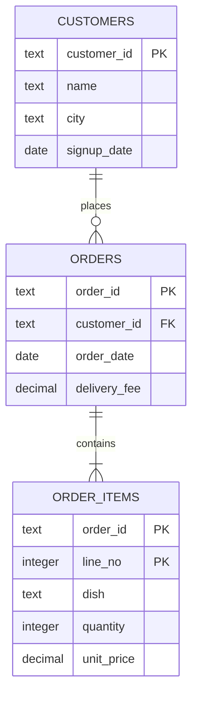

# Tables, rows and grain

What does one row of this table mean, and which column identifies it?

## Before you start

- Level: 1 (beginner)
- Time: about 1.5 hours
- Builds on: [01 Run your first lesson](../01-run-your-first-lesson/) and [02 Think like an analyst](../02-think-like-an-analyst/)

## The problem

Kavya runs finance at Tiffinbell, a fictional food delivery app. Every month she checks the delivery fees customers paid against what riders were paid. For October two colleagues sent her two different totals: Rs 1,648 and Rs 3,256. Both added up the `delivery_fee` column, so both look right. She needs the true number by Monday, and she wants to know why the other two are wrong so it does not happen in November. You have three tables: customers, orders and order items.

## In plain words

Think of a restaurant bill. The bill has a header (bill number, table, date, service charge) and lines below it (one line per dish). If you want the total service charge for the night, you add one service charge per bill. If you add it once per dish line instead, a bill with four dishes counts its service charge four times. Nothing looks broken. The number is just too big.

That is the whole idea of **grain**. Some words:

- **Table**: data laid out in rows and columns, like one sheet of a spreadsheet. A CSV file holds one table.
- **Row**: one record, such as one order. **Column**: one property of every record, such as the order date.
- **Grain**: what one row stands for. "One row per order" and "one row per dish in an order" are different grains.
- **Primary key**: the column (or columns) whose value is different on every row, and never blank. It is how you point at exactly one row, like a bill number.
- **Data type**: the kind of value a column holds: text, whole number (integer), decimal number, or date.
- **One-to-many**: one row in one table matches many rows in another. One customer places many orders.

## What you will build from scratch

- The grain and primary key of three tables, written down.
- `duplicate_keys`: finds key values that appear more than once.
- `is_primary_key`: checks that a key is never blank and never repeats.
- `relationship`: says whether a join is one-to-one, one-to-many, many-to-one or many-to-many.
- `total_delivery_fees`: adds the fee once per order, however many times the order appears.

The data in `data/` is synthetic, built by `make_data.py` with a fixed random seed. On purpose, the orders export repeated a few orders.

## The idea

### Three tables, three grains

| Table | Rows | Grain | Primary key |
|---|---|---|---|
| `customers` | 23 | one row per customer | `customer_id` |
| `orders` | 62 | one row per order | `order_id` (should be; see below) |
| `order_items` | 120 | one row per order line (one dish in one order) | `order_id` + `line_no` |

`order_items` needs two columns for its key. `order_id` alone repeats, because an order with three dishes has three lines. `line_no` alone repeats, because every order has a line 1. The pair is unique. A key made of more than one column is called a **composite key**.

### How they connect



Read the lines between the boxes as "one customer places zero or more orders" and "one order contains one or more order lines". `PK` marks the primary key. `FK` (foreign key) marks a column that points at the primary key of another table: `orders.customer_id` points at a customer.

### Data types

A CSV stores everything as text, so you decide what each column is. `quantity` is an integer you can add up. `unit_price` and `delivery_fee` are decimals. `order_date` is a date. `order_id` looks like a number, but it is a label: adding two order ids means nothing. Treat ids as text.

### Why grain errors double count

`delivery_fee` lives at the order grain: one fee per order. Move it to a finer grain, such as order lines, and every line carries a copy:

```
order 7005: delivery_fee 25.00, 4 order lines
added once per order:  25.00
added once per line:   25.00 + 25.00 + 25.00 + 25.00 = 100.00
```

So a total is only right when you add it up at the grain where the number lives. Before adding any column, ask: is this table one row per thing I am counting?

## Walk through

Start Python from this folder (`python3`, or `py` on Windows) and paste the blocks in order.

### Step 1. Load the tables and look at one row of each

```python
import csv

def load(table):
    with open("data/" + table + ".csv", newline="") as f:
        return list(csv.DictReader(f))

customers = load("customers")
orders = load("orders")
items = load("order_items")
print(customers[0])
print(orders[0])
print(items[0])
```

```
{'customer_id': 'C001', 'name': 'Sara M.', 'city': 'Nagpur', 'signup_date': '2026-07-18'}
{'order_id': '7001', 'customer_id': 'C014', 'order_date': '2026-10-25', 'delivery_fee': '49.00'}
{'order_id': '7001', 'line_no': '1', 'dish': 'chicken biryani', 'quantity': '3', 'unit_price': '260.00'}
```

Order 7001 appears in both `orders` and `order_items`. That shared column is how the tables join.

### Step 2. Test a candidate key: rows against distinct values

A key must have as many distinct values as the table has rows. `set(...)` keeps each value once, so `len(set(...))` counts distinct values.

```python
print(len(customers), len(set(r["customer_id"] for r in customers)), len(set(r["name"] for r in customers)))
```

```
23 23 14
```

23 rows and 23 distinct customer ids: `customer_id` works. Only 14 distinct names: names repeat (there are three customers called "Sara S."), so a name can never be a key.

### Step 3. The orders table has repeats

```python
print(len(orders), len(set(r["order_id"] for r in orders)))
counts = {}
for r in orders:
    counts[r["order_id"]] = counts.get(r["order_id"], 0) + 1
print({k: n for k, n in counts.items() if n > 1})
```

```
62 59
{'7022': 2, '7025': 2, '7028': 2}
```

62 rows but only 59 orders. Orders 7022, 7025 and 7028 each appear twice, as exact copies. The grain should be one row per order, and the data breaks that rule. `counts.get(key, 0)` reads the count so far, or 0 if the key is new. This counting loop is what `duplicate_keys` does in the exercise.

### Step 4. A composite key

```python
print(len(items), len(set(r["order_id"] for r in items)), len(set((r["order_id"], r["line_no"]) for r in items)))
```

```
120 59 120
```

`order_id` alone has 59 distinct values in 120 rows, so it is not the key of `order_items`. The pair `(order_id, line_no)` has 120: one per row. That is the key.

### Step 5. Add the fee at the right grain

```python
fee = {}
for r in orders:
    fee[r["order_id"]] = float(r["delivery_fee"])
print(sum(fee.values()))
```

```
1574.0
```

A dictionary keeps one value per key, so a repeated order lands on the same key and is counted once. The true October delivery fees are Rs 1,574.

## Common mistakes

**Adding up a table with repeated keys.** Sum `delivery_fee` straight down `orders.csv` and the three repeated orders count twice:

```python
print(sum(float(r["delivery_fee"]) for r in orders))
```

```
1648.0
```

That is the first colleague's Rs 1,648, which is Rs 74 too high. Always check rows against distinct keys before adding.

**Adding at the wrong grain after a join.** The second colleague joined every order line to its order to see dishes and fees together, then added the fee column:

```python
joined = [(i, o) for i in items for o in orders if o["order_id"] == i["order_id"]]
print(len(joined), sum(float(o["delivery_fee"]) for i, o in joined))
```

```
124 3256.0
```

124 joined rows: 120 lines, plus 4 extra, because each copy of a repeated order matches that order's lines again (7022 and 7025 have one line each, 7028 has two). Each order's fee is counted once per line, then again for the copies: Rs 3,256, more than double the truth. The fee belongs to the order grain, so add it there.

**Trusting a key because it is unique today.** In this data some columns might happen to be unique by luck, such as a date in a tiny table. A key comes from what the row means (an order has an order number), and the data is then checked against it.

**Calling a join safe without checking the relationship.** Customers to orders is one-to-many, as expected. Orders to order_items should be one-to-many too, but with the repeated orders it is many-to-many: both sides repeat `order_id`. A many-to-many join multiplies rows. If you see it where you expected one-to-many, look for duplicates first.

## Your turn

Open `exercise.py`. Fill in `GRAIN` and `KEYS`, then the four functions marked TODO. Run, from this folder:

```
python3 test_lesson.py
```

The test checks your keys really are unique (and have no extra columns) on a second dataset with different repeated orders, and runs every function on small hand-made cases such as an empty table and a blank key.

Stretch: write `dedupe(rows, key)` that keeps the first row for each key value, and check that `orders` goes from 62 rows to 59.

## Check yourself

1. What is the grain of a table, and why ask about it before adding a column?
2. A table has 1,000 rows and 980 distinct values of `order_id`. What do you do before using it?
3. Why does `order_items` need two columns in its key?
4. You join customers (one row per customer) to orders and the row count goes up. Is that a problem?

<details>
<summary>Answers</summary>

1. The grain is what one row stands for. A number such as a fee or a price belongs to one grain; adding it at a finer grain counts it once per row of that finer grain.
2. Find the 20 repeats, look at them, and decide whether they are exact copies to remove or different records sharing an id (a bigger problem). Do not add anything up until rows equal distinct keys.
3. One column alone repeats: an order has several lines, and every order has a line 1. Only the pair identifies one row.
4. No. One customer has many orders, so the join has one row per order. It becomes a problem if you then add up a customer-level column, such as a sign-up bonus, on the joined rows.

</details>

## What to tell the stakeholder

"October delivery fees were Rs 1,574 across 59 orders. The Rs 1,648 version counted three orders twice because the export repeated them, and the Rs 3,256 version added the fee once per dish instead of once per order. I suggest we check the export for repeated order ids every month before the reconciliation."

## In real job postings

Grain and keys are what make SQL joins safe, and SQL is the tool analyst postings ask for most. In the Real Analyst Jobs data drop of 25 October 2026, 1,477 of the 2,056 US postings that list a tool ask for SQL (71.8%), and 286 of 413 in the UK (69.2%). Browse them at [SQL data analyst jobs](https://realanalystjobs.com/jobs/sql-data-analyst-jobs).

## Next

[04 Your first SQL query](../04-your-first-sql-query/)
