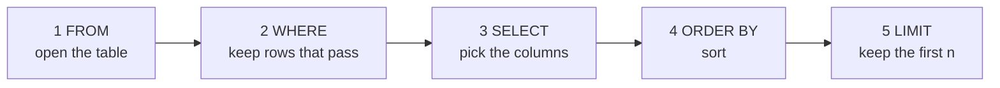

# Your first SQL query

Which ten orders were the biggest last week, and from which city?

## Before you start

- Level: 1 (beginner)
- Time: about 2 hours
- Builds on: [03 Tables, rows and grain](../03-tables-rows-and-grain/) (rows, columns, keys) and [01 Run your first lesson](../01-run-your-first-lesson/) (running a command in a terminal)

## The problem

It is Monday 26 October 2026. Neha, who leads business sales at Tiffinbell (a fictional food delivery app), thinks offices are ordering big group lunches through the normal app. If so, she wants to call them and offer a proper office lunch plan. She asks for the ten biggest delivered orders of last week, Monday 19 to Sunday 25 October, with the city of each, by lunchtime. The data is one table of 284 orders over two weeks. You will write your first SQL queries to answer her, and check them with a test.

## In plain words

Think of a shop's order book with one line per order. To answer Neha by hand you would: open the book (FROM), cross out the lines you do not want, such as cancelled orders and other weeks (WHERE), copy only the columns she asked for (SELECT), sort what is left from biggest to smallest (ORDER BY), and keep the top ten (LIMIT). A SQL query is that list of instructions, written in a fixed order.

Some words:

- **SQL** (often said "sequel"): Structured Query Language, the language for asking questions of tables in a database.
- **Database**: a program that stores tables and answers SQL. This course uses **SQLite**, a small database that comes with Python, so there is nothing to install.
- **Query**: one SQL question. It returns a table of results.
- **Clause**: one part of a query, such as `WHERE ...`.
- **Condition**: a test that is true or false for each row, such as `amount >= 1000`.

## What you will build from scratch

- A first look at a table with `SELECT *`, `ORDER BY` and `LIMIT`.
- The top ten delivered orders of one week, with a tie-breaker.
- A filter that combines `AND` and `OR` correctly.
- The habit of running any query against a lesson's CSV files with `tools/query.py`.

The data in `data/orders.csv` is synthetic, built by `make_data.py` with a fixed random seed. Amounts are in rupees.

## The idea

### The shape of a query

```sql
SELECT order_id, city, amount        -- which columns to show
FROM orders                          -- which table
WHERE status = 'delivered'           -- which rows to keep
ORDER BY amount DESC                 -- how to sort them
LIMIT 10;                            -- how many to show
```

Text after `--` is a **comment**: a note for people that the database ignores. Text values go in single quotes, `'delivered'`. Numbers do not. The `;` ends the query.

### The order the database works in

You write `SELECT` first, but the database does it third. This **logical order** explains many errors:



So `LIMIT 10` keeps the first ten rows *after* sorting. Without `ORDER BY`, "the first ten" means whatever order the database happens to read, which is not "the biggest".

### Comparisons, AND, OR

| Write | Means |
|---|---|
| `=` and `<>` (or `!=`) | equal, not equal |
| `<` `<=` `>` `>=` | less than, at most, more than, at least |
| `a AND b` | both must be true |
| `a OR b` | at least one must be true |
| `city IN ('Pune', 'Nagpur')` | short for `city = 'Pune' OR city = 'Nagpur'` |
| `amount BETWEEN 1000 AND 2000` | short for `amount >= 1000 AND amount <= 2000` (both ends included) |

`AND` is worked out before `OR`, the way multiplication comes before addition in `2 + 3 x 4`. So

```
city = 'Pune' OR city = 'Nagpur' AND amount >= 1000
```

means "every Pune order, plus Nagpur orders of 1000 or more". If you want both cities to need 1000 or more, add brackets: `(city = 'Pune' OR city = 'Nagpur') AND amount >= 1000`.

Dates here are text in the form `YYYY-MM-DD`, and that form sorts in date order, so `order_date >= '2026-10-19' AND order_date <= '2026-10-25'` selects the week.

## Walk through

### How to run any SQL on a lesson's data

The course has one helper for this, `tools/query.py`. From the top folder of the course (the one with `README.md` and `tools/` in it), type:

```
python3 tools/query.py <lesson-folder> "<SQL>"
```

It loads every CSV in the lesson's `data/` folder into a temporary SQLite database, one table per file (`data/orders.csv` becomes the table `orders`), runs your SQL and prints the result as a table with a row count. Empty cells become NULL (lesson 05 explains NULL). Numbers are stored as numbers, so `2400.00` in the file prints as `2400.0`. Nothing is saved and the CSV files are never changed. With no SQL it lists the tables and their columns:

```
python3 tools/query.py phases/00-start-here/04-your-first-sql-query
```

```
orders (284 rows): order_id, order_date, city, status, amount
```

Put the SQL in double quotes and the text values inside it in single quotes. That works in macOS, Linux and Windows PowerShell terminals. Every query below was run this way.

### Step 1. Look before you filter

```sql
SELECT * FROM orders ORDER BY order_id LIMIT 5
```

```
order_id | order_date | city   | status    | amount
---------+------------+--------+-----------+-------
   80001 | 2026-10-12 | Nashik | delivered | 1200.0
   80002 | 2026-10-12 | Nagpur | delivered | 3600.0
   80003 | 2026-10-12 | Nashik | delivered | 461.85
   80004 | 2026-10-12 | Pune   | delivered | 801.51
   80005 | 2026-10-12 | Pune   | delivered | 854.77
(5 rows)
```

`*` means every column. Now you know the columns, what a date looks like, and that `status` holds words such as `delivered`.

### Step 2. Keep last week's delivered orders, biggest first

```sql
SELECT order_id, order_date, city, amount
FROM orders
WHERE status = 'delivered'
  AND order_date >= '2026-10-19'
  AND order_date <= '2026-10-25'
ORDER BY amount DESC
LIMIT 12
```

```
order_id | order_date | city   | amount
---------+------------+--------+-------
   80246 | 2026-10-24 | Nagpur | 3600.0
   80219 | 2026-10-22 | Pune   | 3000.0
   80162 | 2026-10-19 | Nashik | 2400.0
   80232 | 2026-10-23 | Pune   | 2400.0
   80215 | 2026-10-22 | Nagpur | 1800.0
   80229 | 2026-10-23 | Mumbai | 1800.0
   80264 | 2026-10-25 | Nagpur | 1800.0
   80241 | 2026-10-24 | Pune   | 1500.0
   80167 | 2026-10-20 | Nashik | 1200.0
   80174 | 2026-10-20 | Pune   | 1200.0
   80272 | 2026-10-25 | Pune   | 1200.0
   80253 | 2026-10-24 | Nagpur | 948.62
(12 rows)
```

- `WHERE` has three conditions joined by `AND`, so a row must pass all three.
- `DESC` means descending, biggest first. `ASC` (the default) is smallest first.
- `LIMIT 12` shows two more than Neha asked for, on purpose, so you can see what is just below the line.

Places 9, 10 and 11 all have 1200.0. `LIMIT 10` must cut that tie somewhere, and with `ORDER BY amount` alone the database is free to cut it differently from one run, or one database, to the next.

### Step 3. Break the tie on purpose

```sql
SELECT order_id, order_date, city, amount
FROM orders
WHERE status = 'delivered'
  AND order_date >= '2026-10-19'
  AND order_date <= '2026-10-25'
ORDER BY amount DESC, order_id
LIMIT 10
```

```
order_id | order_date | city   | amount
---------+------------+--------+-------
   80246 | 2026-10-24 | Nagpur | 3600.0
   80219 | 2026-10-22 | Pune   | 3000.0
   80162 | 2026-10-19 | Nashik | 2400.0
   80232 | 2026-10-23 | Pune   | 2400.0
   80215 | 2026-10-22 | Nagpur | 1800.0
   80229 | 2026-10-23 | Mumbai | 1800.0
   80264 | 2026-10-25 | Nagpur | 1800.0
   80241 | 2026-10-24 | Pune   | 1500.0
   80167 | 2026-10-20 | Nashik | 1200.0
   80174 | 2026-10-20 | Pune   | 1200.0
(10 rows)
```

`ORDER BY amount DESC, order_id` sorts by amount, and among equal amounts by order id (smallest first). Now the answer is the same every time. Order 80272 (also 1200.0) is the one left out, and Neha should be told about it.

### Step 4. Two cities, done right

Neha asks a follow-up: which of last week's delivered orders of 1000 or more came from Pune or Nagpur?

```sql
SELECT order_id, city, amount
FROM orders
WHERE status = 'delivered'
  AND order_date >= '2026-10-19'
  AND order_date <= '2026-10-25'
  AND amount >= 1000
  AND city IN ('Pune', 'Nagpur')
ORDER BY order_id
```

```
order_id | city   | amount
---------+--------+-------
   80174 | Pune   | 1200.0
   80215 | Nagpur | 1800.0
   80219 | Pune   | 3000.0
   80232 | Pune   | 2400.0
   80241 | Pune   | 1500.0
   80246 | Nagpur | 3600.0
   80264 | Nagpur | 1800.0
   80272 | Pune   | 1200.0
(8 rows)
```

## Common mistakes

**OR without brackets.** Write the two cities with `OR` and no brackets, and count the rows with `COUNT(*)` (it counts the rows that pass the WHERE; lesson 05 says more):

```sql
SELECT COUNT(*) AS orders
FROM orders
WHERE city = 'Pune' OR city = 'Nagpur'
  AND amount >= 1000
  AND status = 'delivered'
  AND order_date >= '2026-10-19'
  AND order_date <= '2026-10-25'
```

```
orders
------
    76
(1 row)
```

76 orders instead of 8. Because `AND` binds first, this reads "every Pune order of any size, any status, any week, plus big delivered Nagpur orders of last week". The query runs without any error. Only the number tells you.

**Forgetting a filter.** Drop `status = 'delivered'` and a cancelled order slips into the top five:

```sql
SELECT order_id, city, status, amount
FROM orders
WHERE order_date >= '2026-10-19' AND order_date <= '2026-10-25'
ORDER BY amount DESC, order_id
LIMIT 5
```

```
order_id | city   | status    | amount
---------+--------+-----------+-------
   80246 | Nagpur | delivered | 3600.0
   80219 | Pune   | delivered | 3000.0
   80162 | Nashik | delivered | 2400.0
   80232 | Pune   | delivered | 2400.0
   80189 | Nagpur | cancelled | 1800.0
(5 rows)
```

Neha would call an office about an order it cancelled.

**Numbers stored as text.** Some tools load every CSV column as text. Text sorts letter by letter, so "9" beats "3" and 948.62 ranks above 3600. You can see the effect by turning the amount into text on purpose with `CAST(amount AS TEXT)`:

```sql
SELECT order_id, amount
FROM orders
WHERE status = 'delivered' AND order_date >= '2026-10-19' AND order_date <= '2026-10-25'
ORDER BY CAST(amount AS TEXT) DESC
LIMIT 3
```

```
order_id | amount
---------+-------
   80203 |  96.27
   80253 | 948.62
   80169 | 941.28
(3 rows)
```

A Rs 96.27 order comes first, because the text "96.27" starts with a 9. None of these is in the real top ten. If a "top" list looks odd, check the column's type. `tools/query.py` and the tests store numbers as numbers, so this does not happen in the course.

**LIMIT without ORDER BY.** `LIMIT 10` on its own returns ten rows in whatever order the table is stored, not the ten biggest. Always sort before you limit.

**SQLite and other databases.** The SQL in this lesson works almost everywhere. Two differences to know: SQL Server writes `SELECT TOP 10 ...` instead of `LIMIT 10`, and Oracle writes `FETCH FIRST 10 ROWS ONLY`. Other databases store dates as a real date type, written `DATE '2026-10-19'`; SQLite keeps them as text, which works because of the `YYYY-MM-DD` form.

## Your turn

Open `exercise.sql`. Write the three queries under their `-- query:` markers: `first_look`, `top_ten_last_week` and `big_orders_pune_nagpur`. Try each with `tools/query.py` first, then run, from this folder:

```
python3 test_lesson.py
```

The test runs your SQL on the lesson data, on a second dataset with different orders, and on small hand-made tables: an empty table, the first and last day of the week, a cancelled order, and eleven orders with the same amount.

Stretch: write a query for the five smallest delivered orders of last week. Do any have an amount of 0?

## Check yourself

1. In which order does the database run SELECT, FROM, WHERE, ORDER BY and LIMIT?
2. What does `WHERE a OR b AND c` mean, and how do you write "(a or b) and c"?
3. Why add `order_id` to `ORDER BY amount DESC` when you only care about amount?
4. Your "top 10 by revenue" puts 950 above 3,600. What is the likely cause?

<details>
<summary>Answers</summary>

1. FROM, WHERE, SELECT, ORDER BY, LIMIT.
2. It means "a, or (b and c)", because AND is done first. Write `(a OR b) AND c`.
3. To break ties. Without it, rows with the same amount can come back in any order, so the tenth place can change between runs.
4. The amount column is stored as text, so it sorts letter by letter. Convert it to a number (in SQL, `CAST(amount AS REAL)`) or load the data with the right types.

</details>

## What to tell the stakeholder

"Last week's ten biggest delivered orders range from Rs 1,200 to Rs 3,600: four from Pune, three from Nagpur, two from Nashik and one from Mumbai. One more Pune order, 80272, also came to Rs 1,200 and ties for tenth place. One Nagpur order of Rs 1,800 was cancelled and is not in the list."

## In real job postings

SQL is the tool analyst postings name most often. In the Real Analyst Jobs data drop of 25 October 2026, 1,477 of the 2,056 US postings that list a tool ask for SQL (71.8%), and 634 of 900 in India (70.4%). Browse them at [SQL data analyst jobs](https://realanalystjobs.com/jobs/sql-data-analyst-jobs).

## Next

[05 NULLs, CASE and COALESCE](../05-nulls-case-and-coalesce/)
