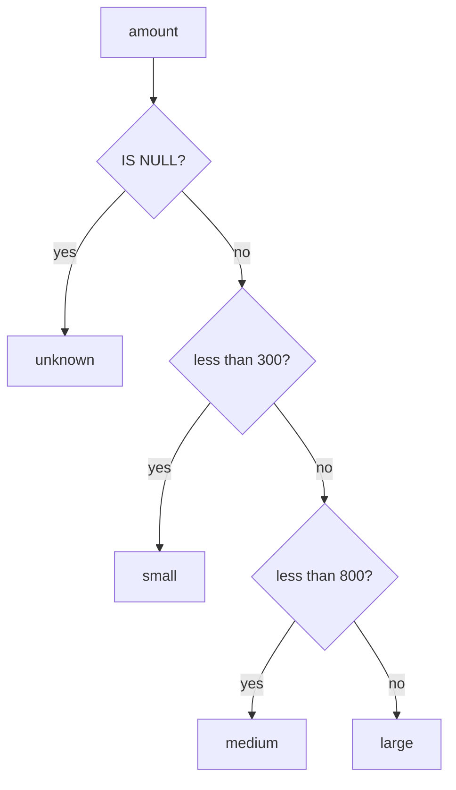

# NULLs, CASE and COALESCE

How many orders have no delivery date, and how do we bucket orders into small, medium and large?

## Before you start

- Level: 1 (beginner)
- Time: about 2 hours
- Builds on: [04 Your first SQL query](../04-your-first-sql-query/) (SELECT, WHERE, ORDER BY and `tools/query.py`)

## The problem

Farah runs customer operations at Tiffinbell, a fictional food delivery app. For Thursday's weekly review she needs two things from last week's 204 orders. First, how many orders have no delivery date, and why: an order that was cancelled has no delivery date for a good reason, but a delivered order without one is a bug in the rider app. Second, she wants every order put in a size bucket, small, medium or large, to plan bags and bikes for next week. She also asks for the average tip, which turns out to depend on what an empty cell means.

## In plain words

Picture an attendance register. A tick means present, a cross means absent, and an empty box means nobody filled it in. The empty box is not "absent". You do not know. If you count the empty boxes as absences, you blame students who were never marked.

In a database the empty box is called **NULL**: "no value, unknown". Some words:

- **NULL**: a missing value. It is not 0, and it is not empty text `''`. In this course an empty cell in a CSV file is loaded as NULL.
- **Three-valued logic**: a condition can be true, false, or unknown. Any comparison with NULL, even `NULL = NULL`, is unknown, and `WHERE` keeps only rows where the condition is true.
- **CASE**: SQL's "if this, then that". It turns values into labels, such as an amount into a size.
- **COALESCE**: "use the first value that is not NULL". `COALESCE(tip, 0)` means "the tip, or 0 if there is none".
- **Aggregate**: a function that turns many rows into one number, such as `COUNT`, `SUM` or `AVG`.

## What you will build from scratch

- Counts of orders with and without a delivery date, using `COUNT(*)` and `COUNT(column)`.
- The list of orders with no delivery date, using `IS NULL`.
- A size label for every order with `CASE WHEN`, including a label for unknown amounts.
- The count of orders in each size, in one row.
- Two averages of the tip, with and without `COALESCE`, and the reason they differ.

The data in `data/orders.csv` is synthetic, built by `make_data.py` with a fixed random seed. Empty cells are there on purpose: `delivered_date` is empty for orders that were not delivered (and, through a bug, for a few that were), `amount` is empty where the payment record is missing, and `tip` is empty where no tip was recorded (the old app version did not record tips, and orders that were not delivered have none).

## The idea

### NULL, empty text and zero are three different things

| Value | Means | `IS NULL`? | Counted by `COUNT(column)`? | Used by `AVG`? |
|---|---|---|---|---|
| `NULL` | unknown, not recorded | yes | no | skipped |
| `''` | text with nothing in it | no | yes | (text, not a number) |
| `0` | a known value of zero | no | yes | yes, as 0 |

A tip of `0` means "the customer chose not to tip". A NULL tip means "we do not know". They must not be mixed up.

### Comparisons with NULL are unknown

```
amount > 100     with amount = 150   -> true    (row kept by WHERE)
amount > 100     with amount = 50    -> false   (row dropped)
amount > 100     with amount = NULL  -> unknown (row dropped)
NULL = NULL                          -> unknown
```

So `WHERE delivered_date = NULL` keeps nothing. To test for a missing value use `IS NULL`, or `IS NOT NULL` for a present one.

### CASE reads top to bottom and stops at the first match



In SQL:

```
CASE
  WHEN amount IS NULL THEN 'unknown'
  WHEN amount < 300 THEN 'small'
  WHEN amount < 800 THEN 'medium'
  ELSE 'large'
END
```

The NULL check comes first. Without it, a NULL amount fails every `WHEN` (each comparison is unknown) and falls into `ELSE`, so a missing payment would be called "large".

### COUNT(*) and COUNT(column)

`COUNT(*)` counts rows. `COUNT(delivered_date)` counts rows where `delivered_date` is not NULL. The difference is the number of NULLs. `SUM` and `AVG` also skip NULLs, so `AVG(tip)` is the average of recorded tips only.

## Walk through

Run each query from the top folder of the course with:

```
python3 tools/query.py phases/00-start-here/05-nulls-case-and-coalesce "<SQL>"
```

`tools/query.py` prints NULL for an empty value, and stores numbers as numbers, so `409.90` in the file prints as `409.9`.

### Step 1. Look at the empty cells

```sql
SELECT order_id, status, amount, delivered_date, tip
FROM orders
WHERE order_id <= 90010
```

```
order_id | status    |  amount | delivered_date |  tip
---------+-----------+---------+----------------+-----
   90001 | delivered | 1570.24 | 2026-10-21     |   30
   90002 | delivered | 1369.19 | 2026-10-23     |   20
   90003 | cancelled | 1629.56 | NULL           | NULL
   90004 | cancelled | 1494.75 | NULL           | NULL
   90005 | delivered |  721.75 | 2026-10-20     |   20
   90006 | delivered |   409.9 | 2026-10-25     |   30
   90007 | delivered |  306.61 | 2026-10-24     |   30
   90008 | delivered |  317.02 | 2026-10-21     | NULL
   90009 | cancelled |    NULL | NULL           | NULL
   90010 | delivered |    NULL | 2026-10-24     |   10
(10 rows)
```

Order 90008 was delivered but its tip is NULL (old app). Order 90010 was delivered, with a tip, but its amount is missing.

### Step 2. See how NULL behaves

```sql
SELECT NULL IS NULL AS null_is_null, '' IS NULL AS empty_is_null, 0 IS NULL AS zero_is_null, NULL = NULL AS null_equals_null
```

```
null_is_null | empty_is_null | zero_is_null | null_equals_null
-------------+---------------+--------------+-----------------
           1 |             0 |            0 |             NULL
(1 row)
```

SQLite shows true as 1 and false as 0. `NULL = NULL` is neither: it is NULL, unknown.

### Step 3. Count the missing delivery dates

```sql
SELECT
  COUNT(*) AS total_orders,
  COUNT(delivered_date) AS with_date,
  COUNT(*) - COUNT(delivered_date) AS without_date
FROM orders
```

```
total_orders | with_date | without_date
-------------+-----------+-------------
         204 |       170 |           34
(1 row)
```

34 of the 204 orders have no delivery date.

### Step 4. Find the ones that should have one

```sql
SELECT order_id, status, amount
FROM orders
WHERE delivered_date IS NULL AND status = 'delivered'
```

```
order_id | status    | amount
---------+-----------+-------
   90075 | delivered |  615.4
   90196 | delivered | 584.61
(2 rows)
```

Of the 34, 22 were cancelled and 10 are still in transit, so their empty date is correct. Two delivered orders have no date: those are the rider-app bug Farah suspected.

### Step 5. Bucket every order with CASE

```sql
SELECT
  order_id,
  amount,
  CASE
    WHEN amount IS NULL THEN 'unknown'
    WHEN amount < 300 THEN 'small'
    WHEN amount < 800 THEN 'medium'
    ELSE 'large'
  END AS size
FROM orders
WHERE order_id >= 90005 AND order_id <= 90012
ORDER BY order_id
```

```
order_id |  amount | size
---------+---------+--------
   90005 |  721.75 | medium
   90006 |   409.9 | medium
   90007 |  306.61 | medium
   90008 |  317.02 | medium
   90009 |    NULL | unknown
   90010 |    NULL | unknown
   90011 | 1013.36 | large
   90012 |  103.86 | small
(8 rows)
```

`END AS size` names the new column. The WHERE only keeps this example short.

### Step 6. Count each bucket in one row

`SUM(CASE WHEN ... THEN 1 ELSE 0 END)` adds 1 for every row that matches, so it counts the matches:

```sql
SELECT
  SUM(CASE WHEN amount < 300 THEN 1 ELSE 0 END) AS small,
  SUM(CASE WHEN amount >= 300 AND amount < 800 THEN 1 ELSE 0 END) AS medium,
  SUM(CASE WHEN amount >= 800 THEN 1 ELSE 0 END) AS large,
  SUM(CASE WHEN amount IS NULL THEN 1 ELSE 0 END) AS unknown
FROM orders
```

```
small | medium | large | unknown
------+--------+-------+--------
   46 |     99 |    52 |       7
(1 row)
```

46 + 99 + 52 + 7 = 204: every order is in exactly one bucket. Always check that the buckets add up to the total.

### Step 7. Replace NULL with COALESCE, and know when not to

```sql
SELECT order_id, status, COALESCE(delivered_date, 'not delivered') AS delivered
FROM orders
WHERE order_id <= 90004
```

```
order_id | status    | delivered
---------+-----------+--------------
   90001 | delivered | 2026-10-21
   90002 | delivered | 2026-10-23
   90003 | cancelled | not delivered
   90004 | cancelled | not delivered
(4 rows)
```

That is a fair use: a readable label for a report. Now the tip:

```sql
SELECT
  COUNT(tip) AS tips_recorded,
  ROUND(AVG(tip), 2) AS avg_tip_recorded,
  ROUND(AVG(COALESCE(tip, 0)), 2) AS avg_tip_blank_as_zero
FROM orders
```

```
tips_recorded | avg_tip_recorded | avg_tip_blank_as_zero
--------------+------------------+----------------------
          132 |            18.79 |                 12.16
(1 row)
```

`AVG(tip)` divides by the 132 recorded tips (zeros included). `AVG(COALESCE(tip, 0))` treats the 72 unrecorded tips as zero and divides by all 204 orders. A NULL here means "unknown", not "no tip", so Rs 12.16 understates tipping. Rs 18.79 is the average among orders where we know the tip.

## Common mistakes

**Writing `= NULL`.** It looks right and returns nothing:

```sql
SELECT COUNT(*) AS orders FROM orders WHERE delivered_date = NULL
```

```
orders
------
     0
(1 row)
```

0 instead of 34, with no error. Use `IS NULL`.

**Thinking "true" and "not true" cover every row.** Orders with a tip above 0, plus orders where that is not the case, should be all 204. They are not:

```sql
SELECT COUNT(*) AS tipped FROM orders WHERE tip > 0
```

```
tipped
------
    87
(1 row)
```

```sql
SELECT COUNT(*) AS not_tipped FROM orders WHERE NOT (tip > 0)
```

```
not_tipped
----------
        45
(1 row)
```

87 + 45 = 132, not 204. For the 72 NULL tips, `tip > 0` is unknown and `NOT (tip > 0)` is unknown too, so both queries drop them.

**Putting the WHEN lines in the wrong order.** CASE stops at the first true line. Check "at least 300" before "at least 800" and nothing is ever large:

```sql
SELECT
  SUM(CASE WHEN size = 'large' THEN 1 ELSE 0 END) AS large
FROM (
  SELECT CASE
    WHEN amount IS NULL THEN 'unknown'
    WHEN amount >= 300 THEN 'medium'
    WHEN amount >= 800 THEN 'large'
    ELSE 'small'
  END AS size
  FROM orders
)
```

```
large
-----
    0
(1 row)
```

0 large orders instead of 52. The query in brackets builds the sizes and the outer query counts them; you will use this "query inside a query" again later. An order of 1013.36 passes `amount >= 300` first and is labelled medium.

**Letting ELSE catch NULL.** Leave out the `IS NULL` line and the 7 orders with no amount fall into `ELSE 'large'`, so large becomes 59 instead of 52, and Farah plans bikes for payments that were never recorded.

**Using COALESCE to hide a problem.** `COALESCE(amount, 0)` would make the 7 missing payments look like free orders. Replace NULL only when you know what the missing value really is.

**SQLite and other databases.** NULL, `IS NULL`, `CASE` and `COALESCE` work the same in PostgreSQL, MySQL, SQL Server, BigQuery and Snowflake. Two differences: SQLite shows true and false as 1 and 0, and Oracle treats the empty text `''` as NULL, unlike the others.

## Your turn

Open `exercise.sql` and write the five queries under their markers: `delivery_date_counts`, `orders_without_delivery_date`, `order_sizes`, `size_counts` and `tip_summary`. Then run, from this folder:

```
python3 test_lesson.py
```

The test runs your SQL on the lesson data, on a second dataset, and on small hand-made tables: amounts of exactly 300 and 800, an amount of 0, a NULL amount, a tip of 0 next to a NULL tip, and an empty table.

Stretch: count the orders that have a tip recorded but no amount. What would you tell Farah about them?

## Check yourself

1. What is the difference between `COUNT(*)` and `COUNT(tip)`?
2. Why does `WHERE tip = NULL` return no rows?
3. In a CASE expression, why does the `IS NULL` check go first?
4. When is `COALESCE(tip, 0)` the right choice, and when is it wrong?

<details>
<summary>Answers</summary>

1. `COUNT(*)` counts rows. `COUNT(tip)` counts rows where tip is not NULL. The difference is the number of missing tips.
2. Any comparison with NULL is unknown, not true, and WHERE keeps only true rows. Use `tip IS NULL`.
3. A NULL fails every comparison, so without its own line it falls into ELSE and gets whatever label ELSE gives, such as "large".
4. Right when a missing value really means zero, for example when the system writes nothing for "no tip". Wrong when it means "not recorded", as here: it pulls the average down from 18.79 to 12.16.

</details>

## What to tell the stakeholder

"34 of last week's 204 orders have no delivery date. 32 are expected (22 cancelled, 10 still in transit). Two delivered orders, 90075 and 90196, are missing the date, which points to the rider-app bug. By size: 46 small, 99 medium, 52 large, and 7 with no payment record that I left as unknown rather than guess. The average tip is Rs 18.79 on the 132 orders where a tip was recorded; tips were not recorded on the old app, so I did not count those as zero."

## In real job postings

NULL handling and CASE are everyday SQL, and SQL is the tool analyst postings ask for most. In the Real Analyst Jobs data drop of 25 October 2026, 634 of the 900 India postings that list a tool ask for SQL (70.4%), and 1,477 of 2,056 in the US (71.8%). Browse them at [SQL data analyst jobs](https://realanalystjobs.com/jobs/sql-data-analyst-jobs).

## Next

[06 Python for spreadsheet people](../06-python-for-spreadsheet-people/)
