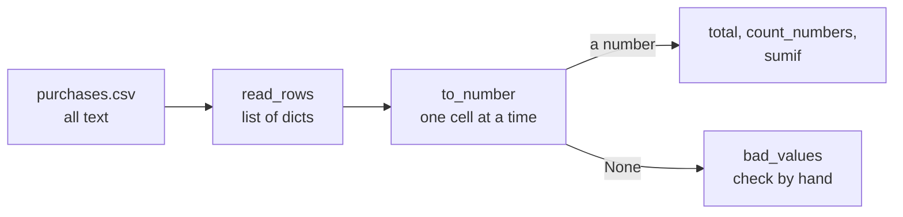

# Python for spreadsheet people

Can you total a column of a CSV without opening Excel?

## Before you start

- Level: 1 (beginner)
- Time: about 3 hours
- Builds on: [01 Run your first lesson](../01-run-your-first-lesson/) (running a test, a list, a loop) and [03 Tables, rows and grain](../03-tables-rows-and-grain/) (rows, columns, data types)

## The problem

Imran manages Tiffinbell's Nashik kitchen (Tiffinbell is a fictional food delivery app). His team types every purchase into a shared sheet: vegetables, rice, dairy, gas, packaging. Finance wants three numbers for October by Monday: total spend, how many purchases have an amount, and spend on vegetables. The sheet was typed by hand, so the amounts are messy: `1,428.57`, `Rs 2300`, ` 383 `, blanks, `n/a`, a refund written as `-138.41`, and one `92O` with a letter O. Last month someone's total came out thousands of rupees short and nobody knew why. You will write a small Python program that reads the CSV export, cleans each cell, and says which cells it could not read.

## In plain words

You already know the ideas in this lesson from spreadsheets. Python just writes them down as instructions instead of formulas.

| Spreadsheet | Python | Example |
|---|---|---|
| A cell | a **value** | `450`, `"onions"` |
| A named cell | a **variable** | `price = 450` |
| A column | a **list** | `[141.94, 383.0, 2437.13]` |
| A row with headers | a **dictionary** (dict) | `{"item": "onions", "amount": "383"}` |
| A sheet | a list of dicts | `rows` |
| Fill a formula down a column | a **for loop** | `for row in rows:` |
| `=IF(...)` | `if` | `if amount > 300:` |
| A formula you reuse | a **function** | `def total(rows, column):` |
| `=SUM(B:B)` | `total(rows, "amount")` | |
| `=COUNT(B:B)` | `count_numbers(rows, "amount")` | |
| `=SUMIF(C:C, "vegetables", B:B)` | `sumif(rows, "amount", "category", "vegetables")` | |
| `#VALUE!` | an error **traceback** | `ValueError: could not convert string to float` |

A **type** is the kind of a value. The four you need now: `int` (whole number), `float` (decimal number), `str` (string, meaning text) and `None` (no value, like an empty cell).

## What you will build from scratch

- `read_rows`: reads a CSV file into a list of rows.
- `to_number`: turns one messy typed cell into a number, or `None`.
- `total`, `count_numbers` and `sumif`: your own SUM, COUNT and SUMIF.
- With the given `bad_values`: the list of cells a person must check by hand.

The data in `data/purchases.csv` is synthetic (88 rows, built by `make_data.py` with a fixed random seed). The messy cells are there on purpose.

## The idea

Every cell in a CSV file is text, even `2437.13`. A spreadsheet guesses which cells are numbers. Python does not guess: you convert text to a number yourself with `float(...)`. That is more work, but you decide what happens to every odd cell instead of having it silently dropped.

The program is a short pipeline:



`to_number` follows written rules, in this order:

1. Remove spaces at both ends: `" 383 "` becomes `"383"`.
2. Remove an `Rs` at the start: `"Rs 2300"` becomes `"2300"`.
3. Remove commas: `"1,428.57"` becomes `"1428.57"`.
4. A blank, `n/a` or `-` means no value: return `None`.
5. Try `float(...)`. If Python cannot read it (such as `"92O"`), return `None`.

A minus sign is kept: `-138.41` is a refund and should reduce the total.

## Walk through

Start Python from this folder (`python3`, or `py` on Windows) and paste the blocks in order.

### Values and types

```python
print(type(450), type(450.5), type("450"), type(None))
```

```
<class 'int'> <class 'float'> <class 'str'> <class 'NoneType'>
```

`450` and `"450"` look the same in a sheet. To Python one is a number and one is text.

### Variables

```python
price = 450
quantity = 3
cost = price * quantity
print(cost)
```

```
1350
```

`=` stores a value under a name, like naming a cell. `*` multiplies.

### Lists: a column

```python
amounts = [141.94, 383.0, 2437.13]
print(len(amounts), sum(amounts), amounts[0])
```

```
3 2962.07 141.94
```

`len` counts the items, `sum` adds them, and `amounts[0]` is the first item. Python counts positions from 0.

### Dictionaries: a row

```python
row = {"date": "2026-10-01", "item": "gas cylinder", "category": "gas", "amount": "2437.13"}
print(row["amount"], type(row["amount"]))
```

```
2437.13 <class 'str'>
```

A dict looks values up by name, like a column header. The amount is still text.

### Loops and if: fill down, with a condition

```python
for a in amounts:
    if a > 300:
        print(a, "is over 300")
```

```
383.0 is over 300
2437.13 is over 300
```

The indented lines run once per item. Python uses the indent (4 spaces) to know what is inside the loop and inside the `if`.

### Functions: a formula you can reuse

```python
def add_tax(amount, rate):
    return round(amount * (1 + rate), 2)

print(add_tax(1000, 0.05))
```

```
1050.0
```

`def` names the formula and its inputs. `return` gives the answer back.

### Reading the CSV

```python
import csv
with open("data/purchases.csv", newline="") as f:
    rows = list(csv.DictReader(f))
print(len(rows))
print(rows[1])
```

```
88
{'date': '2026-10-01', 'item': 'gas cylinder', 'category': 'gas', 'amount': '2437.13'}
```

`import csv` loads Python's built-in CSV reader. `with open(...) as f` opens the file and closes it afterwards. `csv.DictReader` uses the header line for the dictionary names. This is `read_rows` in the exercise.

### Reading a traceback

Try the obvious total, with `float` on every cell:

```python
total = 0
for row in rows:
    total = total + float(row["amount"])
```

Python stops with:

```
Traceback (most recent call last):
  File "<stdin>", line 2, in <module>
ValueError: could not convert string to float: 'n/a'
```

Read a **traceback** from the bottom up:

1. The last line is the error. `ValueError` is its type, and the message says `float` was given the text `'n/a'`, which is not a number.
2. The line above says where. `<stdin>` means "what you typed", and line 2 of the `for` statement is the line with `float` in it. When you run a file, it names the file and the line number in that file.
3. "most recent call last" means the deepest step is at the bottom, next to the error.

It is the same as a `#VALUE!` cell, except Python stops instead of carrying on. Now look at how `float` treats the messy cells one by one:

```python
print(float(" 383 "))
print("1,428.57".replace(",", ""))
print(float("1,428.57".replace(",", "")))
```

```
383.0
1428.57
1428.57
```

`float` ignores spaces at the ends, but not commas, `Rs` or letters. Those need the rules from "The idea", which you write in `to_number`.

### The answer

With the five functions filled in, `python3 exercise.py` prints:

```
rows: 88
total: 62240.62
numbers: 84
vegetables: 15005.59
to check: [(86, '92O')]
```

84 of the 88 rows have a readable amount. Two are blank and one says `n/a`, which is a known gap. Only line 86 (`92O`, paper bags) is a typo for a person to fix.

## Common mistakes

**Skipping every cell that fails.** The quick fix for the traceback is to wrap `float` in `try` and skip errors:

```python
total = 0
for row in rows:
    try:
        total = total + float(row["amount"])
    except ValueError:
        pass
print(round(total, 2))
```

```
49162.89
```

No crash, and Rs 13,077.73 has vanished: every `1,428.57` and `Rs 2300` was skipped along with the real blanks. This is last month's short total, and a spreadsheet SUM over numbers stored as text does the same thing without any message. Clean the cell first, and keep a list of what you could not read.

**Matching categories exactly.** People type `vegetables`, `Vegetables`, `VEGETABLES` and `vegetables ` with a space. An exact match finds only the first spelling:

```python
veg = 0
for row in rows:
    if row["category"] == "vegetables":
        try:
            veg = veg + float(row["amount"].replace(",", "").strip())
        except ValueError:
            pass
print(round(veg, 2))
```

```
13446.52
```

Rs 13,446.52 instead of Rs 15,005.59. Compare `.strip().lower()` on both sides, which is what Excel's SUMIF does with case anyway.

**Turning blanks into zero.** For a total, a blank adds nothing either way. For a count it matters: turning the blanks, the `n/a` and the `92O` into 0 would report 88 purchases with an amount instead of 84, and an average would be pulled down. Return `None` for "no value", as SQL does with NULL in [lesson 05](../05-nulls-case-and-coalesce/).

**Dropping the minus sign.** `-138.41` is a refund for green chillies. If the cleaning removed every `-`, the total would be Rs 276.82 too high (the refund counted as a purchase instead of taken off).

## Your turn

Open `exercise.py` and fill in, in order: `read_rows`, `to_number`, `total`, `count_numbers`, `sumif`. As shipped, `to_number` is just `float(text)`, so once `read_rows` works, `python3 exercise.py` stops with the traceback above. That is your cue to write the cleaning rules. Then run, from this folder:

```
python3 test_lesson.py
```

The test checks `to_number` on cells such as `"12,34,567.5"`, `"Rs ,"` and `"N/A"`, checks your SUM, COUNT and SUMIF on a tiny hand-made sheet (blanks, a zero, a refund, mixed-case categories, an empty sheet), and then on the lesson data and a second dataset with different messy cells.

Stretch: write `average(rows, column)` that returns the total divided by `count_numbers`, and `None` when there are no numbers.

## Check yourself

1. `float("1,250.00")` fails but `float(" 300 ")` works. Why, and how do you fix the first?
2. Why is skipping every cell that raises `ValueError` dangerous?
3. What is the Python version of `=SUMIF(C:C, "dairy", B:B)`, and what should it do with `"Dairy "`?
4. Read this: `ValueError: could not convert string to float: 'Rs 804'`. What happened, and where do you look?

<details>
<summary>Answers</summary>

1. `float` ignores spaces at the ends but not commas. Remove the commas first: `float(text.replace(",", ""))`.
2. Good numbers in an unexpected format are skipped with the real gaps, and nothing tells you. Here it lost Rs 13,077.73. Clean what you can and list what you could not read.
3. A loop that adds `to_number(row["amount"])` for each row whose category, stripped and lowercased, equals `"dairy"`. `"Dairy "` should match.
4. `float` was given text that starts with "Rs". The last line is the error; the line above it says which line of code ran it. Strip the "Rs" before converting.

</details>

## What to tell the stakeholder

"October purchases at the Nashik kitchen total Rs 62,240.62, from 84 entries with a readable amount, after taking off one refund of Rs 138.41. Vegetables were Rs 15,005.59. Three entries have no amount (two blank, one n/a) and one, line 86 for paper bags, says 92O, so please confirm those four and I will rerun the totals."

## In real job postings

Python is the tool analyst postings ask for most after SQL, and Excel is close behind. In the Real Analyst Jobs data drop of 25 October 2026, 448 of the 900 India postings that list a tool ask for Python (49.8%) and 411 ask for Excel (45.7%). In the US the figures are 996 (48.4%) and 860 (41.8%) of 2,056. Browse them at [Python data analyst jobs](https://realanalystjobs.com/jobs/python-data-analyst-jobs).

## Next

You have finished phase 00. Go on to [01 GROUP BY from raw rows](../../01-sql/01-group-by-from-raw-rows/), and see the [learning roadmap](../../../LEARNING_ROADMAP.md) for the full order.
