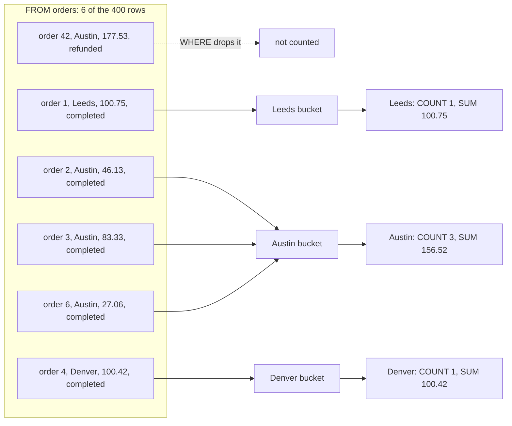
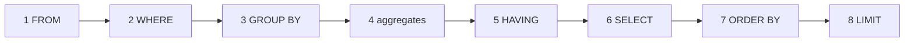

# GROUP BY from raw rows

How much did each city bring in last quarter, and which cities are big enough to matter?

## Before you start

- **Level 1** (beginner). About 2 hours.
- **Builds on:** nothing. This is the first SQL lesson. If you have never written SQL, the short box in [In plain words](#in-plain-words) gives you the four words you need.
- **You need:** Python 3.9 or later. Nothing to install. SQLite, the database used here, comes with Python.

## The problem

You are the first analyst at Brightcart, a small online grocery that ships in five cities. The operations lead, Maya, needs completed revenue by city for the third quarter (July to September 2026) before Friday's planning meeting. She also wants a short list of the cities with at least 70 completed orders, because only those get a second delivery van. The data is one raw table of 400 orders, including refunded and cancelled ones that must not count as revenue. You will answer with three GROUP BY queries and prove the totals with a plain Python loop.

## In plain words

Picture a shoebox of 400 paper receipts at the end of the quarter. To answer Maya by hand you would:

1. Take out the refund and cancellation slips and set them aside.
2. Sort the rest into one envelope per city.
3. For each envelope, count the receipts and add up the amounts.
4. Keep only the envelopes with at least 70 receipts.

That is exactly what a GROUP BY query does. The envelopes are called **groups** (or buckets). Counting and adding are **aggregates**: functions that turn many values into one.

**The four words you need.** A **table** is a grid, like one sheet in a spreadsheet. Each **row** is one record (one order). Each **column** is one fact about it (city, amount). **SQL** is the language for asking a database questions, and one question is a **query**:

```
SELECT city, amount        -- which columns to show
FROM orders                -- which table to read
WHERE status = 'completed' -- which rows to keep
ORDER BY amount DESC;      -- how to sort the result (DESC = biggest first)
```

Text after `--` is a comment. The database ignores it.

## What you will build from scratch

- A count of orders per status, so you know what you are filtering out.
- Completed orders, revenue and average order value per city with `COUNT`, `SUM` and `AVG`.
- A filtered list of cities using `HAVING`, and the reason it is not `WHERE`.
- The same totals computed in a Python loop, so you can see what GROUP BY does under the hood.

The data in `data/orders.csv` is synthetic. `make_data.py` builds it with a fixed random seed, so everyone gets the same 400 rows.

## The idea

GROUP BY is a loop with a dictionary: one bucket per key, and a running count and sum in each bucket. Here are six of the 400 rows going through the query.



The database works through a query in a fixed **logical order**. It is not the order you type the words in:



1. `FROM orders` reads every row.
2. `WHERE status = 'completed'` throws away rows before any grouping happens.
3. `GROUP BY city` puts each remaining row into a bucket keyed by its city.
4. The aggregate functions collapse each bucket to one number:
   - `COUNT(*)` = number of rows in the bucket
   - `SUM(amount)` = amount_1 + amount_2 + ... + amount_n
   - `AVG(amount)` = SUM(amount) / COUNT(amount)
5. `HAVING` filters the buckets after they are collapsed. It can use `COUNT(*)` because by then the count exists. `WHERE` ran before the buckets existed, so it cannot.
6. `SELECT` picks the output columns and creates the names you give them with `AS` (called **aliases**, such as `revenue`).
7. `ORDER BY` sorts the result.
8. `LIMIT` keeps the first n rows, if you asked for that.

Step 6 explains a rule that confuses many beginners. An alias made in SELECT works in ORDER BY, because ORDER BY runs after SELECT. In most databases (Postgres, SQL Server, BigQuery) it does not work in WHERE, because WHERE runs before SELECT. SQLite and Snowflake are lenient and accept it, so do not rely on that habit at work.

Every column in the SELECT list must be either a GROUP BY key or an aggregate. If you select `order_date` without aggregating it, there is no single date for a bucket of 109 orders.

## Walk through

**How to run these queries.** Every SQL block below runs from this lesson folder with the small runner in the phase folder. It loads each CSV in `data/` as a table and prints the result:

```
python3 ../query.py "SELECT status, COUNT(*) AS orders FROM orders GROUP BY status"
```

For a longer query, save it in a file (for example `scratch.sql`) and run `python3 ../query.py scratch.sql`. Empty cells print as `NULL`.

Step 1. Look at the statuses first. You cannot filter what you have not seen.

```sql
SELECT status, COUNT(*) AS orders
FROM orders
GROUP BY status
ORDER BY status;
```

```text
status     orders
---------  ------
cancelled  21
completed  340
refunded   39
```

60 of the 400 orders are not completed revenue.

Step 2. Do the city totals by hand in Python. Run this from the lesson folder (save it as `loop.py` and run `python3 loop.py`).

```python
import csv

buckets = {}
with open("data/orders.csv", newline="") as f:
    for row in csv.DictReader(f):
        if row["status"] != "completed":   # this is WHERE
            continue
        b = buckets.setdefault(row["city"], {"orders": 0, "revenue": 0.0})  # this is GROUP BY
        b["orders"] += 1                     # COUNT(*)
        b["revenue"] += float(row["amount"]) # SUM(amount)

for city in sorted(buckets):
    b = buckets[city]
    print(city, b["orders"], round(b["revenue"], 2), round(b["revenue"] / b["orders"], 2))
```

```text
Austin 109 10004.56 91.78
Denver 78 7903.64 101.33
Leeds 60 5571.09 92.85
Perth 19 1808.03 95.16
Pune 74 6700.24 90.54
```

Line by line: `buckets` is the dictionary. `continue` skips a row, which is what WHERE does. `setdefault` finds the city's bucket, or creates an empty one the first time the city appears. That is GROUP BY. The two `+=` lines are COUNT and SUM.

Step 3. Write the same thing in SQL.

```sql
SELECT
  city,
  COUNT(*) AS orders,
  ROUND(SUM(amount), 2) AS revenue,
  ROUND(AVG(amount), 2) AS avg_order
FROM orders
WHERE status = 'completed'
GROUP BY city
ORDER BY city;
```

```text
city    orders  revenue   avg_order
------  ------  --------  ---------
Austin  109     10004.56  91.78
Denver  78      7903.64   101.33
Leeds   60      5571.09   92.85
Perth   19      1808.03   95.16
Pune    74      6700.24   90.54
```

`ROUND(x, 2)` rounds to 2 decimals. The numbers match the loop. That match is the habit to keep: when a total matters, check it a second way.

Step 4. Filter the groups with HAVING. Leeds has 60 completed orders and Perth has 19, so a threshold of 70 keeps three cities.

```sql
SELECT city, COUNT(*) AS orders, ROUND(SUM(amount), 2) AS revenue
FROM orders
WHERE status = 'completed'
GROUP BY city
HAVING COUNT(*) >= 70
ORDER BY revenue DESC, city;
```

```text
city    orders  revenue
------  ------  --------
Austin  109     10004.56
Denver  78      7903.64
Pune    74      6700.24
```

`ORDER BY revenue DESC, city` sorts by revenue, biggest first, and uses the city name only to break a tie. `ORDER BY revenue` can use the alias because ORDER BY runs after SELECT (step 7 of the logical order).

## Common mistakes

**1. Forgetting the WHERE (the trap).** Without the status filter, refunded and cancelled orders count as revenue. Nothing errors, and every number looks plausible.

```sql
SELECT ROUND(SUM(amount), 2) AS all_statuses,
       ROUND(SUM(CASE WHEN status = 'completed' THEN amount END), 2) AS completed_only
FROM orders;
```

```text
all_statuses  completed_only
------------  --------------
37576.58      31987.56
```

The unfiltered total is 5,589.02 too high. (`CASE WHEN ... THEN amount END` gives the amount for completed rows and NULL for the rest, and SUM skips NULLs. This is called conditional aggregation.) Leeds would also show 65 orders instead of 60, five closer to a van it has not earned.

**2. Filtering a count with WHERE.** WHERE runs before the buckets exist, so there is no count to compare yet.

```sql
SELECT city, COUNT(*) AS orders
FROM orders
WHERE COUNT(*) >= 70
GROUP BY city;
```

```text
SQLite error: misuse of aggregate: COUNT()
```

Move the condition to HAVING. Conditions on single rows (status) go in WHERE; conditions on a group (its count) go in HAVING.

**3. Selecting a column that is not grouped.** Each city bucket holds many customers, so there is no single `customer_id` to show.

```sql
SELECT city, customer_id, ROUND(SUM(amount), 2) AS revenue
FROM orders
WHERE status = 'completed'
GROUP BY city
ORDER BY city;
```

```text
city    customer_id  revenue
------  -----------  --------
Austin  C129         10004.56
Denver  C023         7903.64
Leeds   C050         5571.09
Perth   C120         1808.03
Pune    C062         6700.24
```

Postgres, SQL Server and Snowflake reject this query. SQLite runs it and shows one customer per city, picked without any rule. That is worse, because it looks fine.

**4. Averaging the averages.** The average of the five city averages is not the average order.

```sql
SELECT ROUND(AVG(avg_order), 2) AS average_of_averages,
       (SELECT ROUND(AVG(amount), 2) FROM orders WHERE status = 'completed') AS true_average
FROM (
  SELECT city, AVG(amount) AS avg_order
  FROM orders
  WHERE status = 'completed'
  GROUP BY city
);
```

```text
average_of_averages  true_average
-------------------  ------------
94.33                94.08
```

The first number gives tiny Perth (19 orders) the same weight as Austin (109). To combine groups, go back to the rows, or divide the total revenue by the total orders.

## Your turn

Open `exercise.sql` and write the three queries under their markers: `status_counts`, `city_totals` and `busy_cities`. The comments say exactly which columns and order the test expects.

```
python3 test_lesson.py
```

Run it from this folder. The test builds the expected answers with a Python loop and checks your queries three ways: on the committed data, on a second dataset made with a different seed (so typing the answers into the query cannot pass), and on tiny hand-made tables for the edge cases: no rows at all, a city on exactly 70 orders, a city with no completed orders, an order with no amount, and two cities tied on revenue. For `busy_cities`, any correct form passes: HAVING, or WHERE on a grouped subquery.

Stretch: add a `LIMIT 1` to the step 4 query. Which city does it keep, and at which step of the logical order did the other two disappear?

## Check yourself

1. What is the difference between WHERE and HAVING?
2. Why does `COUNT(amount)` sometimes differ from `COUNT(*)`?
3. You select `city, customer_id, SUM(amount)` but group only by `city`. What is wrong?
4. Average order value: is `AVG(amount)` the same as `SUM(amount) / COUNT(*)`?
5. Why does `ORDER BY revenue` work when `revenue` is an alias, while `WHERE revenue > 5000` fails in Postgres?

<details>
<summary>Answers</summary>

1. WHERE filters rows before grouping. HAVING filters groups after the aggregates are computed, so it can use `COUNT(*)` or `SUM(...)`.
2. `COUNT(amount)` skips rows where amount is NULL. `COUNT(*)` counts every row.
3. `customer_id` is neither a group key nor an aggregate, so a city bucket has many values for it. Most databases reject the query. SQLite returns an arbitrary one, which is worse because it looks fine.
4. Only when no amount is NULL. AVG ignores NULLs in both the sum and the count, while `COUNT(*)` counts them. The test checks this with an order that has no amount.
5. Aliases are created at the SELECT step. ORDER BY runs after SELECT, so the alias exists. WHERE runs before SELECT, so it does not. Repeat the expression in WHERE, or wrap the query in a subquery.

</details>

## What to tell the stakeholder

> Maya, completed revenue for July to September was 31,987.56 from 340 orders. Three cities clear the 70-order bar for a second van: Austin (109 orders, 10,004.56), Denver (78, 7,903.64) and Pune (74, 6,700.24). Leeds is next with 60. These figures leave out 39 refunded and 21 cancelled orders; counting them would have overstated revenue by 5,589.02.

The caveat to say out loud: the van rule here counts completed orders only. If Maya wants every order counted, refunds and cancellations included, the same three cities qualify and Leeds rises to 65, still short of 70.

## In real job postings

In the Real Analyst Jobs data drop of 25 October 2026 ([data/job-market/2026-10](../../../data/job-market/2026-10/)), there were 2,789 US analyst postings, and 71.8% of the 2,056 that list tools ask for SQL. See the current roles on [SQL data analyst jobs](https://realanalystjobs.com/jobs/sql-data-analyst-jobs).

## Next

[02 Joins without losing rows](../02-joins-without-losing-rows/)
