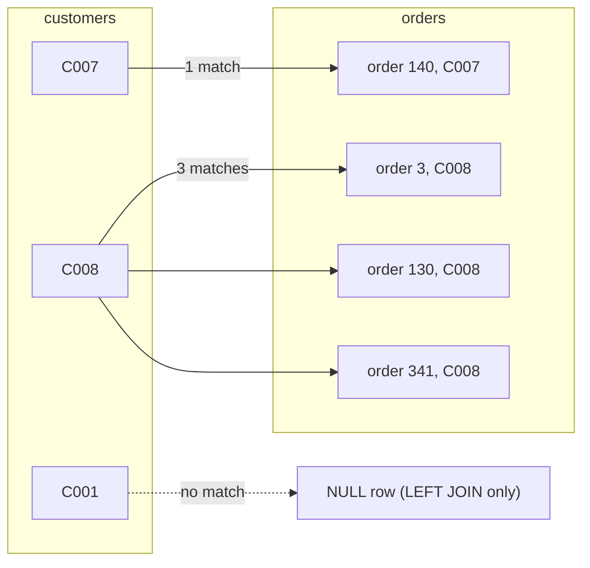
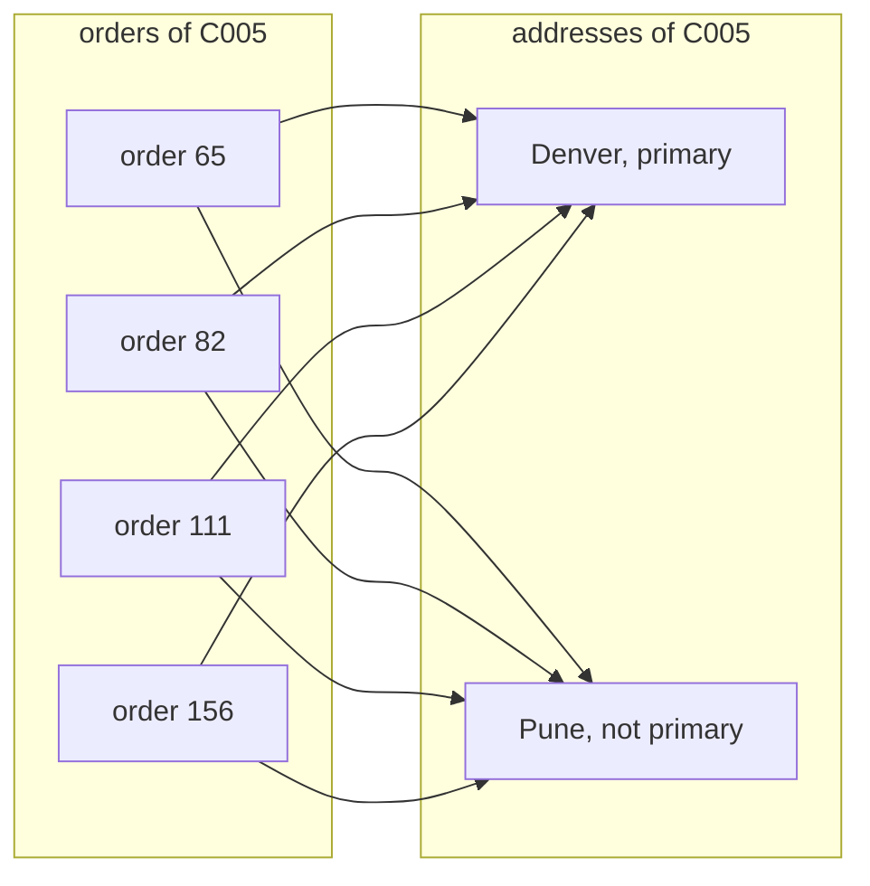

# Joins without losing rows

Which customers have never ordered, and what is revenue by city without counting any order twice?

## Before you start

- **Level 1** (beginner). About 2 hours.
- **Builds on:** [01 GROUP BY from raw rows](../01-group-by-from-raw-rows/) (WHERE, GROUP BY, COUNT and SUM, and how to run a query with `../query.py`).
- **You need:** Python 3.9 or later. Nothing to install.

## The problem

You work on the growth team at Brightcart, an online grocery. Dev, the CRM manager, wants a list of every customer who signed up this year but never placed an order, so he can send them a first-order coupon on Monday. Finance also wants revenue by customer city, and last month's version of that report came out higher than the actual order total. You have three tables: 120 customers, 360 orders and 154 saved addresses. Your job is to join them without silently dropping customers or silently duplicating orders.

## In plain words

Think of a class register and a pile of homework sheets. Each sheet has a student's name on it. To see who handed in what, you go down the register and, for each student, pull out every sheet with their name.

- A student with three sheets gets three lines in your list. That is expected.
- A student with no sheet either vanishes from your list or gets a line that says "nothing handed in". Which one happens is your choice, and it matters.
- If two students share a name, every sheet with that name lands next to both of them. Now sheets are counted twice, and nobody notices.

A **join** is that matching, done by the database. It combines rows from two tables where a **key** matches. A key is the column that says which row belongs to which, such as `customer_id`. **NULL** means "no value here", which is different from 0 or an empty word.

## What you will build from scratch

- The row-count check: count each table, then count the join, and explain the difference.
- An inner join and a left join on the same keys, and a list of customers with no match, done two ways.
- One row per customer with order count and total spend, zeros included.
- Revenue by city that adds up to the real order total, by fixing a fan-out.

The data in `data/` is synthetic. `make_data.py` builds it with a fixed random seed.

## The idea

A join pairs every row on the left with every row on the right whose key matches. Here are three real customers from the data, joined to their orders.



- **INNER JOIN** keeps only pairs. These three customers give 4 rows: one for C007 and three for C008. C001 has no pair, so C001 disappears.
- **LEFT JOIN** keeps every row of the left table. C001 gets one extra row with NULL in every orders column, so the result has 5 rows.

You can predict the row count before you run anything:

```
inner rows = sum over keys of (left rows with key k) x (right rows with key k)
left rows  = inner rows + (left rows with no match)
```

Customers to orders is **one to many**: one customer, any number of orders, and each order belongs to exactly one customer. So the inner join has one row per order: 360. The 28 customers with no orders add one NULL row each to the left join: 360 + 28 = 388.

**Fan-out** happens when the right side has more than one row per key and you did not expect it. C005 has 4 orders and saved 2 addresses (Denver, which is primary, and Pune). Joining orders to addresses on customer_id alone pairs each order with both addresses:



4 orders become 8 rows, and `SUM(amount)` counts each of C005's orders twice, half of it under Pune. Nothing errors. The total is just wrong.

Two other joins you will meet. A **RIGHT JOIN** is a LEFT JOIN with the tables swapped, and a **FULL OUTER JOIN** keeps unmatched rows from both sides. SQLite runs both from version 3.39, but most analysts write LEFT JOIN and put the table they must not lose on the left. A **self-join** joins a table to itself under two names (for example `orders a JOIN orders b ON a.customer_id = b.customer_id`) to compare rows of the same table, such as each order with the same customer's previous one.

The analyst's habit: before you trust a join, compare the row count to what the key relationship says it should be.

## Walk through

Run any query below from this folder with `python3 ../query.py "<the query>"`, or save it in a file and run `python3 ../query.py file.sql`.

Step 1. Count everything.

```sql
SELECT
  (SELECT COUNT(*) FROM customers) AS customers,
  (SELECT COUNT(*) FROM orders) AS orders,
  (SELECT COUNT(*) FROM customers c JOIN orders o ON o.customer_id = c.customer_id) AS inner_rows,
  (SELECT COUNT(*) FROM customers c LEFT JOIN orders o ON o.customer_id = c.customer_id) AS left_rows;
```

```text
customers  orders  inner_rows  left_rows
---------  ------  ----------  ---------
120        360     360         388
```

Each `(SELECT ...)` in the list is a small query of its own, called a subquery, that returns one number. `customers c` gives the table a short name, `c`, so `c.customer_id` means the customer_id column of customers. `JOIN` on its own means INNER JOIN.

Step 2. Find the customers with no match. After a left join, unmatched rows have NULL in every right side column, including the right side key.

```sql
SELECT c.customer_id
FROM customers c
LEFT JOIN orders o ON o.customer_id = c.customer_id
WHERE o.order_id IS NULL
ORDER BY c.customer_id
LIMIT 5;
```

```text
customer_id
-----------
C001
C009
C011
C017
C020
```

`IS NULL` is how you test for NULL; `= NULL` is never true. Remove `LIMIT 5` to see all 28.

The second way, often clearer, is `NOT EXISTS`. It reads as: keep the customer if there is no order with their id.

```sql
SELECT c.customer_id
FROM customers c
WHERE NOT EXISTS (
  SELECT 1 FROM orders o WHERE o.customer_id = c.customer_id
)
ORDER BY c.customer_id
LIMIT 5;
```

```text
customer_id
-----------
C001
C009
C011
C017
C020
```

The inner query runs once per customer and only asks whether any row exists, so `SELECT 1` is enough. A query that keeps rows with no match is called an **anti-join**. Both forms here are anti-joins.

Step 3. One row per customer. Count `o.order_id`, not `*`, because `COUNT(*)` would count the NULL row of a non-buyer as 1.

```sql
SELECT
  c.customer_id,
  COUNT(o.order_id) AS order_count,
  ROUND(COALESCE(SUM(o.amount), 0), 2) AS total_spent
FROM customers c
LEFT JOIN orders o ON o.customer_id = c.customer_id
GROUP BY c.customer_id
ORDER BY c.customer_id
LIMIT 3;
```

```text
customer_id  order_count  total_spent
-----------  -----------  -----------
C001         0            0.0
C002         7            606.7
C003         4            265.84
```

C001 has no orders, so `SUM(o.amount)` is the sum of nothing, which is NULL. `COALESCE` returns the first of its arguments that is not NULL, so `COALESCE(SUM(o.amount), 0)` turns that NULL into 0. Coupon lists and spreadsheets handle 0 better than an empty cell.

Step 4. Make the right side one row per key during the join. Each customer has exactly one primary address, so put that condition in the ON clause.

```sql
SELECT a.city, ROUND(SUM(o.amount), 2) AS revenue
FROM orders o
LEFT JOIN customer_addresses a
  ON a.customer_id = o.customer_id
 AND a.is_primary = 1
GROUP BY a.city
ORDER BY a.city;
```

```text
city    revenue
------  -------
Austin  4831.29
Denver  6302.5
Leeds   4567.64
Perth   5747.45
Pune    8102.98
```

The five cities add up to 29551.86, the total of the orders table. It is a LEFT JOIN from orders on purpose: if a customer ever orders without saving an address, their revenue appears in a row with city NULL instead of vanishing. Here every buyer has a primary address, so there is no NULL row, but the test checks a case where there is.

## Common mistakes

**1. Fan-out (the trap).** Join orders to addresses on customer_id alone.

```sql
SELECT COUNT(*) AS joined_rows, ROUND(SUM(o.amount), 2) AS revenue
FROM orders o
JOIN customer_addresses a ON a.customer_id = o.customer_id;
```

```text
joined_rows  revenue
-----------  --------
465          38399.54
```

There are only 360 orders worth 29551.86. Customers with two addresses doubled their orders, and the report is 8,847.68 too high. That is last month's finance report. Fix it as in step 4, or pre-aggregate: sum orders per customer first, then join one row per customer.

**2. A WHERE condition after a LEFT JOIN.** You want every customer, with spend on orders over 50.

```sql
SELECT COUNT(*) AS customers_kept
FROM (
  SELECT c.customer_id
  FROM customers c
  LEFT JOIN orders o ON o.customer_id = c.customer_id
  WHERE o.amount > 50
  GROUP BY c.customer_id
);
```

```text
customers_kept
--------------
89
```

31 customers vanished: the 28 non-buyers, because NULL > 50 is not true, and 3 buyers whose orders were all 50 or less. The LEFT JOIN quietly became an INNER JOIN. Move the condition into the ON clause:

```sql
SELECT COUNT(*) AS customers_kept
FROM (
  SELECT c.customer_id
  FROM customers c
  LEFT JOIN orders o ON o.customer_id = c.customer_id AND o.amount > 50
  GROUP BY c.customer_id
);
```

```text
customers_kept
--------------
120
```

**3. COUNT(\*) after a LEFT JOIN.**

```sql
SELECT c.customer_id, COUNT(*) AS wrong_count, COUNT(o.order_id) AS right_count
FROM customers c
LEFT JOIN orders o ON o.customer_id = c.customer_id
GROUP BY c.customer_id
ORDER BY c.customer_id
LIMIT 3;
```

```text
customer_id  wrong_count  right_count
-----------  -----------  -----------
C001         1            0
C002         7            7
C003         4            4
```

C001 never ordered but `COUNT(*)` says 1, because it counts C001's NULL row.

**4. NOT IN with a NULL in the list.** `WHERE customer_id NOT IN (SELECT customer_id FROM orders)` works on this data. But if a single order has customer_id NULL, for example a guest checkout, it returns nothing at all. Here is the same query with one NULL added to the list:

```sql
SELECT
  (SELECT COUNT(*) FROM customers
   WHERE customer_id NOT IN (SELECT customer_id FROM orders)) AS not_in,
  (SELECT COUNT(*) FROM customers
   WHERE customer_id NOT IN (SELECT customer_id FROM orders UNION ALL SELECT NULL)) AS not_in_with_one_null;
```

```text
not_in  not_in_with_one_null
------  --------------------
28      0
```

`x NOT IN (a, b, NULL)` means x is not a, and not b, and not NULL. Comparing anything with NULL gives "unknown", never true, so no customer passes. (`UNION ALL` stacks the rows of two queries into one list.) Use NOT EXISTS or the LEFT JOIN form; both give 28 either way.

## Your turn

Open `exercise.sql` and write the four queries: `row_counts`, `customer_totals`, `customers_without_orders` and `revenue_by_city`.

```
python3 test_lesson.py
```

Run it from this folder. The fan-out test checks that your city revenue adds up to the order total. The test also runs your queries on a second dataset made with a different seed, and on tiny hand-made tables: empty tables, a guest order with no customer, a buyer with no saved address, an order with no amount, and a customer with three addresses.

Stretch: write `revenue_by_city` the pre-aggregate way. Sum orders per customer in a subquery, then join that to the primary addresses. Do the totals still match?

## Check yourself

1. A join between two tables of 1,000 rows returns 1,400 rows. What does that tell you?
2. Why is `COUNT(o.order_id)` correct after a LEFT JOIN and `COUNT(*)` wrong?
3. You put `WHERE o.amount > 50` after a LEFT JOIN. What happens to customers with no orders?
4. Two ways to fix a fan-out?
5. `NOT IN (SELECT customer_id FROM orders)` returns no rows, but you know some customers never ordered. What is the likely cause?

<details>
<summary>Answers</summary>

1. Some rows matched more than once. If you expected one to one, a key is duplicated: find the duplicated keys before using any SUM. If the relationship is one to many, growth is expected; check that the row count equals the many side's count of matching rows.
2. A non-buyer still produces one row, with NULLs on the right. `COUNT(*)` counts that row as 1. `COUNT(o.order_id)` skips NULLs and gives 0.
3. They disappear, because NULL > 50 is not true. The LEFT JOIN behaves like an INNER JOIN. Put the condition in the ON clause to keep them.
4. Make the right side one row per key first (filter, as with is_primary, or pre-aggregate in a subquery), or aggregate each table separately and join the totals.
5. The orders list contains a NULL customer_id. `x NOT IN (..., NULL)` is never true. Use `NOT EXISTS`, or add `WHERE customer_id IS NOT NULL` inside the subquery.

</details>

## What to tell the stakeholder

> Dev, 28 of our 120 customers have never placed an order; the list is attached and is ready for the coupon. Finance: revenue by primary-address city is Pune 8,102.98, Denver 6,302.50, Perth 5,747.45, Austin 4,831.29 and Leeds 4,567.64, which adds up to the 29,551.86 order total. Last month's report joined every saved address, so customers with two addresses were counted twice and it came out 8,847.68 too high.

The caveat: city here means the customer's primary address today, not where each order was delivered. If customers move, use a delivery address on the order instead.

## In real job postings

In the Real Analyst Jobs data drop of 25 October 2026 ([data/job-market/2026-10](../../../data/job-market/2026-10/)), there were 1,174 India analyst postings, and 70.4% of the 900 that list tools ask for SQL. Read the full breakdown in [SQL skills for data analyst jobs](https://realanalystjobs.com/research/sql-skills-for-data-analyst-jobs).

## Next

[03 Window functions](../03-window-functions/)
