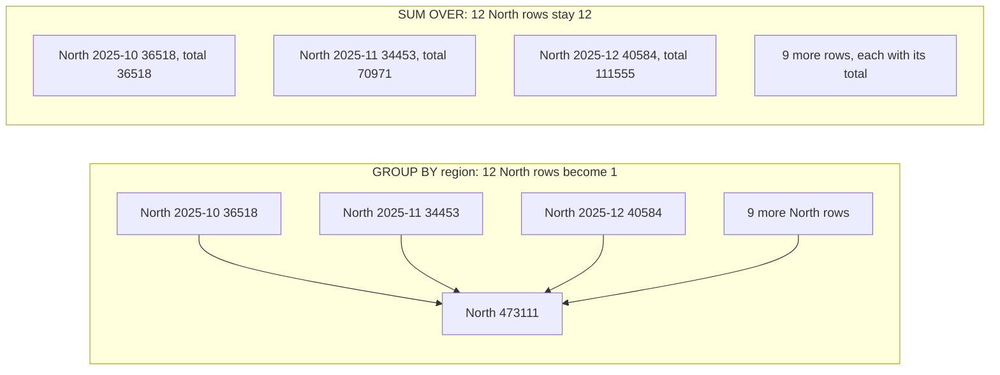
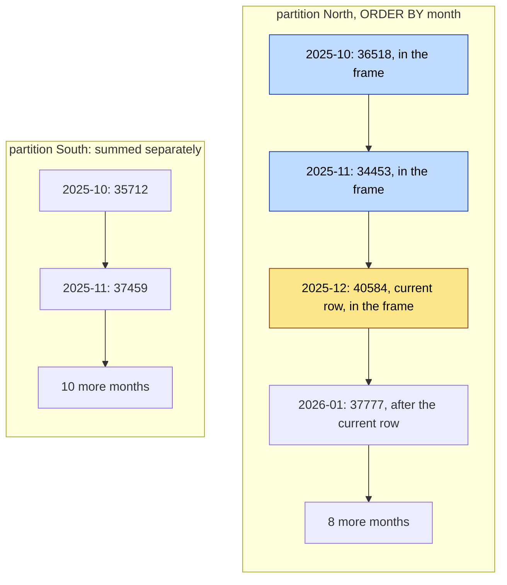

# Window functions

How is each region tracking against its fiscal year to date, who are the top reps, and did revenue go up or down from last month?

## Before you start

- **Level 2** (intermediate). About 2 hours.
- **Builds on:** [01 GROUP BY from raw rows](../01-group-by-from-raw-rows/) (GROUP BY and the logical order of a query) and [02 Joins without losing rows](../02-joins-without-losing-rows/) (subqueries and NULLs).
- **You need:** Python 3.9 or later. Nothing to install.

## The problem

You are the sales analyst at Fernhill Supply, a wholesale company with three regions. Fernhill's financial year runs from October to September. Priya, the head of sales, opens the monthly review on Thursday and wants four things on one sheet: revenue per region so far this financial year, a ranked list of reps inside each region, how much of each region's sales comes from its top reps, and the change from the previous month. Last quarter someone built the rep ranking with ROW_NUMBER, and one of two tied reps was left off the bonus list. You have 12 months of revenue for each region (October 2025 to September 2026, one full financial year) and the sales total for 15 reps.

## In plain words

Think of a cricket scorecard. After every over, the board shows the runs in that over and the total so far. The overs do not disappear into one final number; each over keeps its line and gains a "total so far" next to it. And each team's total starts again from zero when its innings starts.

That is a **window function**. GROUP BY would give you one line per team, the final score. A window function keeps every row and adds a column worked out from a set of related rows:

- the **partition** is which rows belong together (one team's innings, one sales region),
- the **order** is the sequence inside the partition (over 1, 2, 3; month by month),
- the **frame** is which of those rows count for the current line (here: every row from the start up to this one).

A **running total** (also called a cumulative total) is the total so far. **Year to date** means the running total since the start of the year, so it restarts every year. Fernhill's year starts in October, so its year to date is a **fiscal year to date**.

## What you will build from scratch

- A fiscal-year-to-date running total with `SUM(...) OVER (PARTITION BY ... ORDER BY ...)`.
- A rep ranking with both `RANK()` and `ROW_NUMBER()`, so you can see where they differ.
- A top-rep list that keeps ties.
- A running total of rep sales, from the top rep down, that handles ties.
- A month over month comparison with `LAG()`.

The data in `data/` is synthetic. `make_data.py` builds it with a fixed random seed.

## The idea

GROUP BY collapses many rows into one. A window function keeps every row and adds a column.



The parts of a window, written out:

```
function(...) OVER (
  PARTITION BY region      -- which rows belong together (like GROUP BY, but no collapse)
  ORDER BY month           -- the order inside each partition
  ROWS BETWEEN UNBOUNDED PRECEDING AND CURRENT ROW   -- the frame: which rows of the partition to use
)
```

Here is the frame for one row, North's December. The sum for that row uses the rows in its frame and nothing else. South is a different partition, so its rows never enter North's sum.



So North's December total is 36518 + 34453 + 40584 = 111555.

- **Running total.** For row i in a partition, running_total_i = revenue_1 + revenue_2 + ... + revenue_i. The frame `ROWS BETWEEN UNBOUNDED PRECEDING AND CURRENT ROW` says exactly that: from the first row of the partition up to this row.
- **ROW_NUMBER** numbers the rows 1, 2, 3, ... with no repeats. If two rows tie, the database picks an order unless you add a tie breaker.
- **RANK** gives tied rows the same number and then skips. Sales of 60, 60, 55, 55, 50 get ranks 1, 1, 3, 3, 5. ROW_NUMBER gives 1, 2, 3, 4, 5.
- **LAG(x)** returns x from the previous row in the partition order. The first row has no previous row, so it gets NULL.

**ROWS or RANGE.** If you write ORDER BY and leave the frame out, the default is not ROWS. It is `RANGE BETWEEN UNBOUNDED PRECEDING AND CURRENT ROW`. RANGE treats rows with the same ORDER BY value as one step, called **peers**, and puts all of them in the frame together. On unique months the two give the same answer. On ties they do not; Common mistakes shows the wrong number this gives on the rep data.

**When windows run.** In the logical order from lesson 01, window functions are computed after FROM, WHERE, GROUP BY and HAVING, at the SELECT step, and before ORDER BY and LIMIT. That is why you cannot filter on them in the same query's WHERE clause. You wrap them in a subquery and filter outside it. Snowflake, BigQuery and Databricks also have `QUALIFY`, a clause that filters on a window result directly (`QUALIFY RANK() OVER (...) = 1`). SQLite, Postgres and SQL Server do not.

Try it: the [window function playground](../../../visuals/window-functions.html) (one HTML file, opens offline) lets you pick the partition, order, frame and function and highlights the rows each value uses, including the R04 and R05 tie.

## Walk through

Run any query below from this folder with `python3 ../query.py "<the query>"`, or save it in a file and run `python3 ../query.py file.sql`.

Step 1. The running total, fiscal year to date. The outer query only shows the first three months, so you can see each region start again.

```sql
SELECT *
FROM (
  SELECT
    region,
    month,
    revenue,
    SUM(revenue) OVER (
      PARTITION BY region
      ORDER BY month
      ROWS BETWEEN UNBOUNDED PRECEDING AND CURRENT ROW
    ) AS running_total
  FROM monthly_revenue
)
WHERE month <= '2025-12'
ORDER BY region, month;
```

```text
region  month    revenue  running_total
------  -------  -------  -------------
North   2025-10  36518    36518
North   2025-11  34453    70971
North   2025-12  40584    111555
South   2025-10  35712    35712
South   2025-11  37459    73171
South   2025-12  44397    117568
West    2025-10  46989    46989
West    2025-11  52375    99364
West    2025-12  52783    152147
```

North starts at 36518, then adds 34453 to reach 70971, then adds 40584 to reach 111555. The partition restarts the sum at each region. Without `PARTITION BY region` the total would run across all three regions. The total does not restart in January, which is right for Fernhill's October year. Filtering in the outer query matters: the window first sees every month, and only then are rows hidden.

The last month gives the whole financial year so far:

```sql
SELECT region, month, revenue, running_total
FROM (
  SELECT
    region,
    month,
    revenue,
    SUM(revenue) OVER (
      PARTITION BY region
      ORDER BY month
      ROWS BETWEEN UNBOUNDED PRECEDING AND CURRENT ROW
    ) AS running_total
  FROM monthly_revenue
)
WHERE month = '2026-09'
ORDER BY region;
```

```text
region  month    revenue  running_total
------  -------  -------  -------------
North   2026-09  41856    473111
South   2026-09  57304    565646
West    2026-09  58067    611862
```

Step 2. Rank the reps. In North, R04 and R05 both sold 60000.

```sql
SELECT
  region,
  rep,
  sales,
  RANK() OVER (PARTITION BY region ORDER BY sales DESC) AS sales_rank,
  ROW_NUMBER() OVER (PARTITION BY region ORDER BY sales DESC, rep ASC) AS row_num
FROM rep_sales
ORDER BY region, row_num;
```

```text
region  rep  sales  sales_rank  row_num
------  ---  -----  ----------  -------
North   R04  60000  1           1
North   R05  60000  1           2
North   R02  55000  3           3
North   R03  55000  3           4
North   R01  50000  5           5
South   R10  80000  1           1
South   R08  70000  2           2
South   R09  60000  3           3
South   R06  55000  4           4
South   R07  55000  4           5
West    R14  80000  1           1
West    R12  75000  2           2
West    R15  75000  2           3
West    R13  55000  4           4
West    R11  50000  5           5
```

There is no GROUP BY here, so every rep keeps its row. `rep ASC` is the tie breaker, so ROW_NUMBER gives the same answer every time you run it.

Step 3. Keep every top rep. Filter on the rank, in an outer query.

```sql
SELECT region, rep
FROM (
  SELECT region, rep, RANK() OVER (PARTITION BY region ORDER BY sales DESC) AS sales_rank
  FROM rep_sales
) ranked
WHERE sales_rank = 1
ORDER BY region, rep;
```

```text
region  rep
------  ---
North   R04
North   R05
South   R10
West    R14
```

`ranked` is the name given to the subquery. Four reps, because North has two at the top.

Step 4. A running total of rep sales, from the top rep down. It shows how much of a region's sales its first few reps bring in. Reps tie, so give the ORDER BY a tie breaker and write the ROWS frame.

```sql
SELECT
  region,
  rep,
  sales,
  SUM(sales) OVER (
    PARTITION BY region
    ORDER BY sales DESC, rep
    ROWS BETWEEN UNBOUNDED PRECEDING AND CURRENT ROW
  ) AS cumulative_sales
FROM rep_sales
WHERE region = 'North'
ORDER BY region, sales DESC, rep;
```

```text
region  rep  sales  cumulative_sales
------  ---  -----  ----------------
North   R04  60000  60000
North   R05  60000  120000
North   R02  55000  175000
North   R03  55000  230000
North   R01  50000  280000
```

Here the WHERE runs before the window, which is fine: the window only needs North's rows.

Step 5. Compare with the previous month. The outer query shows the first two months and the last one.

```sql
SELECT region, month, revenue, prev_revenue, change
FROM (
  SELECT
    region,
    month,
    revenue,
    LAG(revenue) OVER (PARTITION BY region ORDER BY month) AS prev_revenue,
    revenue - LAG(revenue) OVER (PARTITION BY region ORDER BY month) AS change
  FROM monthly_revenue
)
WHERE month IN ('2025-10', '2025-11', '2026-09')
ORDER BY region, month;
```

```text
region  month    revenue  prev_revenue  change
------  -------  -------  ------------  ------
North   2025-10  36518    NULL          NULL
North   2025-11  34453    36518         -2065
North   2026-09  41856    45273         -3417
South   2025-10  35712    NULL          NULL
South   2025-11  37459    35712         1747
South   2026-09  57304    53575         3729
West    2025-10  46989    NULL          NULL
West    2025-11  52375    46989         5386
West    2026-09  58067    52506         5561
```

North went from 36518 to 34453, a change of -2065. October has no previous month in this data, so its LAG is NULL, and NULL minus a number is NULL. The month column is text in `YYYY-MM` form, which sorts in date order. A format like `Oct 2025` would not.

## Common mistakes

**1. Leaving the frame out when the order has ties (the trap).** Same running total of rep sales as step 4, but ordered by sales only and with no frame, so the default RANGE frame applies:

```sql
SELECT
  region,
  rep,
  sales,
  SUM(sales) OVER (PARTITION BY region ORDER BY sales DESC) AS default_frame,
  SUM(sales) OVER (
    PARTITION BY region
    ORDER BY sales DESC, rep
    ROWS BETWEEN UNBOUNDED PRECEDING AND CURRENT ROW
  ) AS rows_frame
FROM rep_sales
WHERE region = 'North'
ORDER BY sales DESC, rep;
```

```text
region  rep  sales  default_frame  rows_frame
------  ---  -----  -------------  ----------
North   R04  60000  120000         60000
North   R05  60000  120000         120000
North   R02  55000  230000         175000
North   R03  55000  230000         230000
North   R01  50000  280000         280000
```

R04 and R05 are peers (both 60000), so RANGE puts both in the frame at once and both show 120000. A slide that says "the top rep brings in 120,000" is double the truth. Nothing errors. Rule: whenever you write ORDER BY inside OVER for a running total, write the frame too, and add a tie breaker if the ordered column can repeat.

**2. Calling a running total "year to date" without checking where the year starts.** Fernhill's year starts in October, so the step 1 total is right. If someone asks for calendar year to date, the total must restart on 1 January. Add the year to the partition:

```sql
SELECT region, month, revenue,
       SUM(revenue) OVER (
         PARTITION BY region, substr(month, 1, 4)
         ORDER BY month
         ROWS BETWEEN UNBOUNDED PRECEDING AND CURRENT ROW
       ) AS calendar_ytd
FROM monthly_revenue
WHERE region = 'North'
ORDER BY month;
```

```text
region  month    revenue  calendar_ytd
------  -------  -------  ------------
North   2025-10  36518    36518
North   2025-11  34453    70971
North   2025-12  40584    111555
North   2026-01  37777    37777
North   2026-02  33282    71059
North   2026-03  36558    107617
North   2026-04  40767    148384
North   2026-05  39005    187389
North   2026-06  42290    229679
North   2026-07  44748    274427
North   2026-08  45273    319700
North   2026-09  41856    361556
```

`substr(month, 1, 4)` takes the first four characters, the year. North's calendar 2026 to date in September is 361556, while its fiscal year to date is 473111. They answer different questions, so label the column with the one you computed.

**3. Picking the top rep with ROW_NUMBER.**

```sql
SELECT region, rep
FROM (
  SELECT region, rep,
         ROW_NUMBER() OVER (PARTITION BY region ORDER BY sales DESC, rep) AS row_num
  FROM rep_sales
)
WHERE row_num = 1
ORDER BY region;
```

```text
region  rep
------  ---
North   R04
South   R10
West    R14
```

R05 sold exactly as much as R04 and is gone. That is last quarter's bonus-list mistake. Use RANK (or DENSE_RANK) when ties must share a place.

**4. Filtering before LAG.** Put the month filter in the same query as LAG, and LAG only sees the rows that are left:

```sql
SELECT region, month, revenue,
       LAG(revenue) OVER (PARTITION BY region ORDER BY month) AS prev_revenue
FROM monthly_revenue
WHERE region = 'North' AND month IN ('2025-10', '2025-11', '2026-09')
ORDER BY month;
```

```text
region  month    revenue  prev_revenue
------  -------  -------  ------------
North   2025-10  36518    NULL
North   2025-11  34453    36518
North   2026-09  41856    34453
```

September is now compared with November (34453) instead of August (45273). Compute the window over all rows in a subquery, then filter, as in step 5.

## Your turn

Open `exercise.sql` and write `running_total`, `rep_rank`, `top_reps`, `month_over_month` and `rep_cumulative`.

```
python3 test_lesson.py
```

Run it from this folder. The test recomputes every answer with a Python loop. It runs your queries on the committed data, on a second dataset made with a different seed, and on tiny hand-made tables: empty tables, three reps tied for first, a region with one rep, a month with no revenue figure (NULL) and a month with zero revenue.

Stretch: add a `share_of_region` column to `rep_cumulative`, the cumulative sales divided by the region's total. Hint: `SUM(sales) OVER (PARTITION BY region)` with no ORDER BY is the whole partition.

## Check yourself

1. When would you use ROW_NUMBER instead of RANK?
2. What does DENSE_RANK give for sales of 60, 60, 55?
3. Why can you not write `WHERE RANK() OVER (...) = 1`?
4. A month is missing for one region. What does LAG return for the month after the gap?
5. You write `SUM(x) OVER (ORDER BY day)` and two rows share a day. What do those two rows show, and why?

<details>
<summary>Answers</summary>

1. When you need exactly one row per group, such as the latest order per customer for deduplication. Add a tie breaker to the ORDER BY so the result is repeatable.
2. 1, 1, 2. DENSE_RANK does not skip numbers after a tie.
3. WHERE runs before window functions are computed. Compute the rank in a subquery or CTE and filter in the outer query. In Snowflake, BigQuery and Databricks you can use `QUALIFY` instead.
4. The revenue of the last month that exists, which is two months back. LAG looks at the previous row, not the previous calendar month. Fill missing months first if the comparison must be calendar based.
5. Both show the total up to the end of that day. With ORDER BY and no frame, the default frame is RANGE, and rows with the same day are peers that enter the frame together. Write `ROWS BETWEEN UNBOUNDED PRECEDING AND CURRENT ROW` and add a tie breaker if you want one value per row.

</details>

## What to tell the stakeholder

> Priya, for the financial year from October 2025 to September 2026, West brought in 611,862, South 565,646 and North 473,111. In September North fell 3,417 from August, while South rose 3,729 and West rose 5,561. The top rep in South is R10 (80,000) and in West R14 (80,000). North has a tie: R04 and R05 both sold 60,000, so both belong on the bonus list.

The caveat: these totals are fiscal year to date (from 1 October). If the board deck uses calendar year to date, North's figure for 2026 so far is 361,556, not 473,111.

## In real job postings

In the Real Analyst Jobs data drop of 25 October 2026 ([data/job-market/2026-10](../../../data/job-market/2026-10/)), there were 620 UK analyst postings, and 69.2% of the 413 that list tools ask for SQL. See the current roles on [SQL data analyst jobs](https://realanalystjobs.com/jobs/sql-data-analyst-jobs).

## Next

[04 Cohort retention](../04-cohort-retention/)
