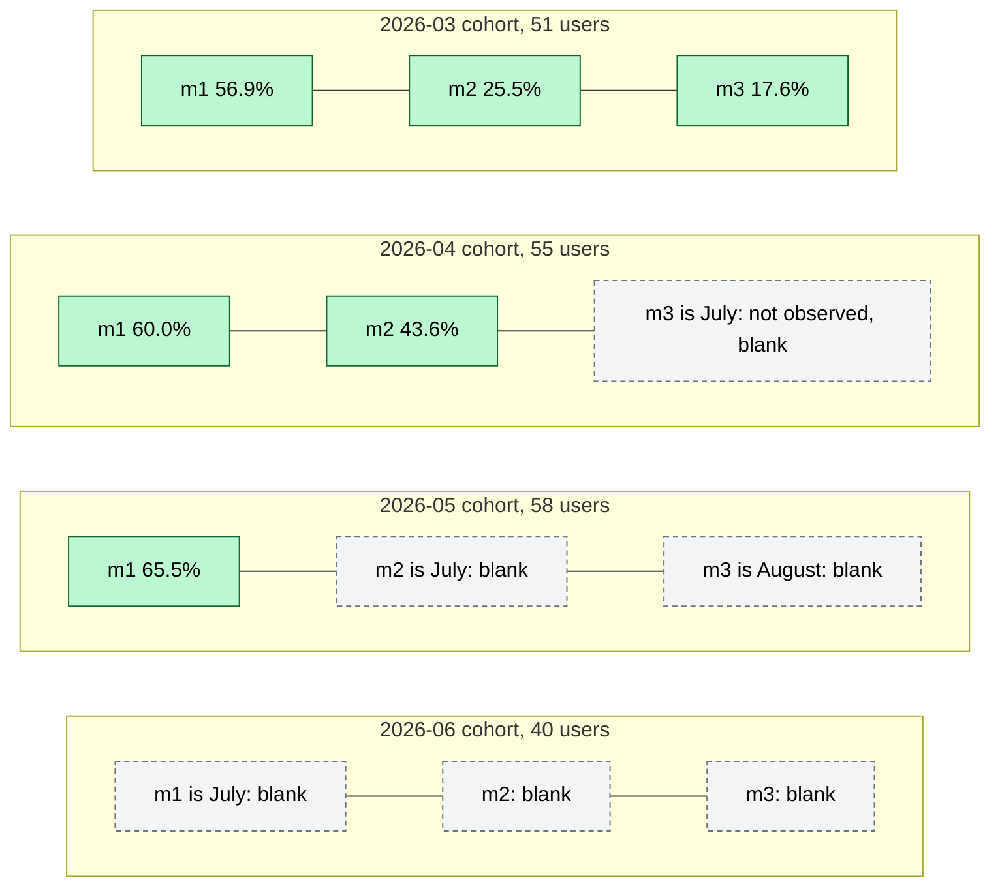
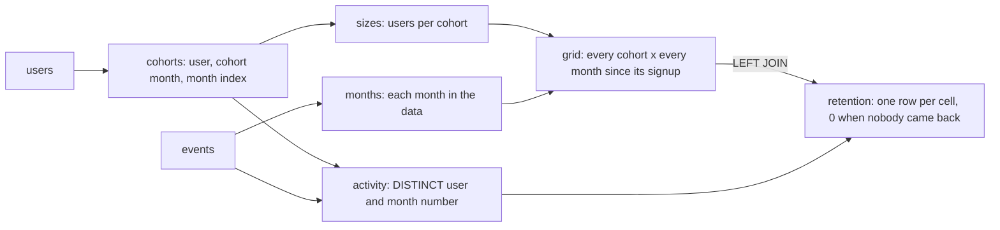

# Cohort retention

Of the users who signed up in each month, what share were still active one, two and three months later?

## Before you start

- **Level 2** (intermediate). About 2 hours.
- **Builds on:** [01 GROUP BY from raw rows](../01-group-by-from-raw-rows/) (GROUP BY, conditional aggregation), [02 Joins without losing rows](../02-joins-without-losing-rows/) (LEFT JOIN, NULL) and [03 Window functions](../03-window-functions/) (LAG, used once in Common mistakes).
- **You need:** Python 3.9 or later. Nothing to install.

## The problem

You are the product analyst at Tallyo, a budgeting app. Sam, the product manager, wants to know whether the onboarding change shipped in April kept new users around longer, and the board deck is due next Wednesday. A single "monthly active users" number cannot answer that, because it mixes old and new users. You have two raw tables: 298 users with their signup date, and 716 activity events from January to June 2026. You will group users into monthly signup cohorts and build the retention table in SQL.

## In plain words

Think of a gym that runs a new-members class every month. To judge whether the January class or the April class stuck with it better, you would not count everyone in the gym today. You would follow each class separately: of the 42 people who joined in January, how many still came in February, March and April?

- A **cohort** is one of those classes: users who share a starting point. Here the starting point is the signup month.
- **Retention** in month m is the share of the cohort that was active in the m-th calendar month after signing up. Month 0 is the signup month itself.
- **Active** here means the user has at least one event (any row in `events`) in that month.
- The **cohort triangle** is the table you get: one row per cohort, one column per month. Younger cohorts have fewer months to show, so the table has a staircase edge.

The April class joined less than three months before the data ends. Its month 3 has not happened. That cell is unknown, not zero, and the whole lesson is about keeping those two apart.

## What you will build from scratch

- Monthly signup cohorts with `strftime('%Y-%m', ...)`.
- A month number for every event: how many calendar months after signup it happened.
- Active users per cohort and month with `COUNT(DISTINCT ...)`, with real zeros kept as rows.
- Retention as a percentage of cohort size, in long form and as a pivoted triangle that leaves unobserved months blank.

The data in `data/` is synthetic. `make_data.py` builds it with a fixed random seed. Data stops at 30 June 2026, so later cohorts have fewer months to show.

## The idea

For each user u and each event e:

```
month_index(date) = year * 12 + month            (2026-01 is 24313, 2026-02 is 24314)
cohort(u)         = signup month of u
month_number(e)   = month_index(event_date) - month_index(signup_date of u)
```

Month 0 is the signup month. Month 1 is the next calendar month, whatever day the user signed up. The month index makes the year end work: December 2025 is 2025 * 12 + 12 = 24312 and January 2026 is 2026 * 12 + 1 = 24313, one month apart. Subtracting the month parts alone (1 - 12) would give -11.

Then, for each cohort c and month number m:

```
active_users(c, m)  = number of DISTINCT users in c with at least one event in month m
retention_pct(c, m) = 100 * active_users(c, m) / cohort_size(c)
cohort_size(c)      = number of users in c (from the users table)
```

A cell of the triangle can be one of three things, and each must look different:



1. **Observed, with active users**: a percentage.
2. **Observed, nobody came back**: a real 0.0%. This is a finding, and it must be a row with 0.
3. **Not observed yet**: the month is after the data ends. It is blank (NULL), never 0.

Three traps decide whether the table is right:

1. **Count users, not events.** A user with two events in a month is still one retained user. `COUNT(*)` on events inflates retention.
2. **Divide by the cohort size, not by last month's actives**, and not by the month 0 actives either. Retention compares each month to the starting group, counted from `users`. Every row of a cohort uses the same denominator.
3. **Blank is not zero.** A month after the end of the data has no value. Showing it as 0.0 says everyone left, which nobody knows.

## Walk through

Run any query below from this folder with `python3 ../query.py "<the query>"`. For the long ones, save the query in a file and run `python3 ../query.py file.sql`.

Step 1. Cohort sizes.

```sql
SELECT strftime('%Y-%m', signup_date) AS cohort_month, COUNT(*) AS users
FROM users
GROUP BY cohort_month
ORDER BY cohort_month;
```

```text
cohort_month  users
------------  -----
2026-01       42
2026-02       52
2026-03       51
2026-04       55
2026-05       58
2026-06       40
```

`strftime(format, date)` formats a date as text; `'%Y-%m'` keeps the year and month, so 2026-01-30 becomes 2026-01.

Step 2. Give every event a month number. User 20 shows the two things to watch: repeat events inside one month, and a month number that keeps counting across months.

```sql
SELECT
  e.user_id,
  u.signup_date,
  e.event_date,
  CAST(strftime('%Y', e.event_date) AS INTEGER) * 12 + CAST(strftime('%m', e.event_date) AS INTEGER)
    - (CAST(strftime('%Y', u.signup_date) AS INTEGER) * 12 + CAST(strftime('%m', u.signup_date) AS INTEGER))
    AS month_number
FROM events e
JOIN users u ON u.user_id = e.user_id
WHERE e.user_id = 20
ORDER BY e.event_date;
```

```text
user_id  signup_date  event_date  month_number
-------  -----------  ----------  ------------
20       2026-01-15   2026-01-15  0
20       2026-01-15   2026-02-09  1
20       2026-01-15   2026-03-24  2
20       2026-01-15   2026-03-28  2
20       2026-01-15   2026-04-03  3
20       2026-01-15   2026-04-22  3
20       2026-01-15   2026-05-12  4
20       2026-01-15   2026-05-14  4
20       2026-01-15   2026-06-12  5
20       2026-01-15   2026-06-17  5
```

`strftime('%Y', ...)` returns the year as text, such as '2026'. `CAST(x AS INTEGER)` turns that text into a number so you can multiply it. SQLite has no month difference function, so this builds the month index from the parts. User 20 has two events in month 2, but is one active user in month 2. That is what `SELECT DISTINCT user_id, month_number` will fix.

Step 3. Name the pieces with CTEs. A **CTE** (common table expression) is a named subquery: `WITH name AS (...)` defines it, and the query after it uses `name` like a table. It lets you build a long query in small, readable steps.

```sql
WITH sizes AS (
  SELECT strftime('%Y-%m', signup_date) AS cohort_month, COUNT(*) AS users
  FROM users
  GROUP BY cohort_month
)
SELECT cohort_month, users
FROM sizes
WHERE users >= 52;
```

```text
cohort_month  users
------------  -----
2026-02       52
2026-04       55
2026-05       58
```

The long-form retention query, which you will write in `exercise.sql`, is a chain of CTEs. Several CTEs are separated by commas after one `WITH`. Its shape:



The grid is what keeps real zeros. If you only count the activity rows, a month where nobody from a cohort came back has no rows at all, so it vanishes from the result, and you cannot tell it from a month that has not happened. Joining the grid to the activity with a LEFT JOIN keeps that month as a row, and `COUNT(a.user_id)` counts 0 for it. The grid stops at the last month in the data, so months that have not happened get no row. In this data every observed cell has at least one active user, but the test checks a case where one does not.

Step 4. Read the result as a triangle. Pivot it with **conditional aggregation**: an aggregate over a `CASE` expression, such as `COUNT(DISTINCT CASE WHEN a.month_number = 1 THEN a.user_id END)`. The CASE returns the user for month 1 rows and NULL for the rest, and COUNT skips NULLs, so it counts month 1 users only. Then a second CASE leaves a cell NULL when the cohort is too young for it.

```sql
WITH cohorts AS (
  SELECT
    user_id,
    strftime('%Y-%m', signup_date) AS cohort_month,
    CAST(strftime('%Y', signup_date) AS INTEGER) * 12 + CAST(strftime('%m', signup_date) AS INTEGER) AS cohort_index
  FROM users
),
data_end AS (
  SELECT CAST(strftime('%Y', MAX(event_date)) AS INTEGER) * 12 + CAST(strftime('%m', MAX(event_date)) AS INTEGER) AS end_index
  FROM events
),
activity AS (
  SELECT DISTINCT
    c.user_id,
    CAST(strftime('%Y', e.event_date) AS INTEGER) * 12 + CAST(strftime('%m', e.event_date) AS INTEGER)
      - c.cohort_index AS month_number
  FROM cohorts c
  JOIN events e ON e.user_id = c.user_id
),
per_cohort AS (
  SELECT
    c.cohort_month,
    d.end_index - c.cohort_index AS months_observed,
    COUNT(DISTINCT c.user_id) AS users,
    COUNT(DISTINCT CASE WHEN a.month_number = 1 THEN a.user_id END) AS active_m1,
    COUNT(DISTINCT CASE WHEN a.month_number = 2 THEN a.user_id END) AS active_m2,
    COUNT(DISTINCT CASE WHEN a.month_number = 3 THEN a.user_id END) AS active_m3
  FROM cohorts c
  CROSS JOIN data_end d
  LEFT JOIN activity a ON a.user_id = c.user_id
  GROUP BY c.cohort_month, months_observed
)
SELECT
  cohort_month,
  users,
  CASE WHEN months_observed >= 1 THEN ROUND(100.0 * active_m1 / users, 1) END AS m1_pct,
  CASE WHEN months_observed >= 2 THEN ROUND(100.0 * active_m2 / users, 1) END AS m2_pct,
  CASE WHEN months_observed >= 3 THEN ROUND(100.0 * active_m3 / users, 1) END AS m3_pct
FROM per_cohort
ORDER BY cohort_month;
```

```text
cohort_month  users  m1_pct  m2_pct  m3_pct
------------  -----  ------  ------  ------
2026-01       42     57.1    35.7    26.2
2026-02       52     61.5    36.5    28.8
2026-03       51     56.9    25.5    17.6
2026-04       55     60.0    43.6    NULL
2026-05       58     65.5    NULL    NULL
2026-06       40     NULL    NULL    NULL
```

Line by line: `data_end` finds the month of the latest event (June 2026). `CROSS JOIN` pairs every row of one table with every row of the other; `data_end` has one row, so it just adds `end_index` to every user. `months_observed` is how many months after signup the data reaches: 2 for April, so April has m1 and m2 but not m3. The denominator `users` counts every user in the cohort from `users`, not the month 0 actives. `100.0` (not `100`) makes the division decimal; in SQLite `24 / 42` is 0.

| cohort | users | month 1 | month 2 | month 3 |
|---|---|---|---|---|
| 2026-01 | 42 | 57.1% | 35.7% | 26.2% |
| 2026-02 | 52 | 61.5% | 36.5% | 28.8% |
| 2026-03 | 51 | 56.9% | 25.5% | 17.6% |
| 2026-04 | 55 | 60.0% | 43.6% | |
| 2026-05 | 58 | 65.5% | | |
| 2026-06 | 40 | | | |

The blank cells are months that have not happened yet. They are not zero retention. Read down a column to compare cohorts at the same age: April's month 2 retention of 43.6% is the highest so far, but it is one cohort of 55 users, so treat it as a lead, not a result.

**In other databases.** `strftime` is SQLite only. To get the month: Postgres and Snowflake `TO_CHAR(d, 'YYYY-MM')` or `DATE_TRUNC('month', d)`, BigQuery `FORMAT_DATE('%Y-%m', d)` or `DATE_TRUNC(d, MONTH)`. For the month difference: BigQuery `DATE_DIFF(event_date, signup_date, MONTH)`, Snowflake `DATEDIFF('month', signup_date, event_date)`, SQL Server `DATEDIFF(month, signup_date, event_date)`; all three count calendar month boundaries, like the month index here. Postgres has no month DATEDIFF: write `(EXTRACT(YEAR FROM e) - EXTRACT(YEAR FROM s)) * 12 + EXTRACT(MONTH FROM e) - EXTRACT(MONTH FROM s)`. Do not use Postgres `AGE()`, which counts whole months by day of the month, so 30 January to 22 February is 0 months, not 1.

## Common mistakes

**1. Printing 0.0 for months that have not happened (the trap).** This is the pivot without the `months_observed` check, dividing by the month 0 actives:

```sql
WITH activity AS (
  SELECT DISTINCT
    u.user_id,
    strftime('%Y-%m', u.signup_date) AS cohort_month,
    (CAST(strftime('%Y', e.event_date) AS INTEGER) - CAST(strftime('%Y', u.signup_date) AS INTEGER)) * 12
      + CAST(strftime('%m', e.event_date) AS INTEGER) - CAST(strftime('%m', u.signup_date) AS INTEGER)
      AS month_number
  FROM users u
  JOIN events e ON e.user_id = u.user_id
)
SELECT
  cohort_month,
  COUNT(DISTINCT CASE WHEN month_number = 0 THEN user_id END) AS m0,
  ROUND(100.0 * COUNT(DISTINCT CASE WHEN month_number = 1 THEN user_id END)
        / COUNT(DISTINCT CASE WHEN month_number = 0 THEN user_id END), 1) AS m1_pct,
  ROUND(100.0 * COUNT(DISTINCT CASE WHEN month_number = 2 THEN user_id END)
        / COUNT(DISTINCT CASE WHEN month_number = 0 THEN user_id END), 1) AS m2_pct,
  ROUND(100.0 * COUNT(DISTINCT CASE WHEN month_number = 3 THEN user_id END)
        / COUNT(DISTINCT CASE WHEN month_number = 0 THEN user_id END), 1) AS m3_pct
FROM activity
GROUP BY cohort_month
ORDER BY cohort_month;
```

```text
cohort_month  m0  m1_pct  m2_pct  m3_pct
------------  --  ------  ------  ------
2026-01       42  57.1    35.7    26.2
2026-02       52  61.5    36.5    28.8
2026-03       51  56.9    25.5    17.6
2026-04       55  60.0    43.6    0.0
2026-05       58  65.5    0.0     0.0
2026-06       40  0.0     0.0     0.0
```

It runs, and six cells say 0.0. A chart of this shows April, May and June losing every user, the opposite of what Sam hopes to learn. COUNT of nothing is 0, not NULL, so the 0.0 comes for free. Leave a cell NULL unless the cohort is old enough for it, as step 4 does.

It also divides by the month 0 actives. That equals the cohort size here only because every user has an event on their signup day. A user who signs up and never opens the app has no month 0 event, and this denominator silently drops them. The test removes one such event to check.

**2. Counting events instead of users.** For the January cohort:

```sql
SELECT
  strftime('%Y-%m', e.event_date) AS event_month,
  COUNT(*) AS events,
  COUNT(DISTINCT e.user_id) AS users
FROM users u
JOIN events e ON e.user_id = u.user_id
WHERE strftime('%Y-%m', u.signup_date) = '2026-01'
  AND e.event_date < '2026-03-01'
GROUP BY event_month
ORDER BY event_month;
```

```text
event_month  events  users
-----------  ------  -----
2026-01      42      42
2026-02      34      24
```

34 events in February would give 81.0% month 1 retention. The true figure is 24 users, 57.1%.

**3. Dividing by last month's actives.**

```sql
WITH jan AS (
  SELECT
    strftime('%Y-%m', e.event_date) AS event_month,
    COUNT(DISTINCT e.user_id) AS active_users
  FROM users u
  JOIN events e ON e.user_id = u.user_id
  WHERE strftime('%Y-%m', u.signup_date) = '2026-01'
  GROUP BY event_month
)
SELECT
  event_month,
  active_users,
  ROUND(100.0 * active_users / (SELECT COUNT(*) FROM users WHERE strftime('%Y-%m', signup_date) = '2026-01'), 1) AS retention_pct,
  ROUND(100.0 * active_users / LAG(active_users) OVER (ORDER BY event_month), 1) AS vs_previous_month_pct
FROM jan
ORDER BY event_month
LIMIT 4;
```

```text
event_month  active_users  retention_pct  vs_previous_month_pct
-----------  ------------  -------------  ---------------------
2026-01      42            100.0          NULL
2026-02      24            57.1           57.1
2026-03      15            35.7           62.5
2026-04      11            26.2           73.3
```

The last column rises from 57.1 to 73.3 while the cohort shrinks from 42 to 11 users. It is a month to month rate, not retention.

**4. Using day counts or AGE() for calendar months.** User 1 signed up on 30 January and came back on 22 February, 23 days later. In calendar month retention that is month 1. A "days since signup divided by 30" rule, or Postgres `AGE()`, calls it month 0. Both definitions are fine; mixing them is not. Say which one the table uses.

## Your turn

Open `exercise.sql` and write `cohort_sizes` and `retention`. The retention query returns the long form: one row per cohort and month number, from month 0 to the end of the data, with real zeros kept as rows.

```
python3 test_lesson.py
```

Run it from this folder. One test checks that month 0 equals the cohort size on the committed data, which fails if you count events instead of distinct users. The test also runs your queries on a second dataset made with a different seed, where one user has no signup-day event, and on tiny hand-made tables: empty tables, a month where nobody came back, a cohort that crosses the year end, repeat events in one month, and a cohort too young for month 1.

Your query may assume that every calendar month up to the end of the data has at least one event from someone, so the months can come from the events table. A real report would use a calendar table instead (a date spine, covered in a later lesson).

Stretch: add `m4_pct` and `m5_pct` to the step 4 pivot. Which cohorts get a value?

## Check yourself

1. Why is a retention table better than a monthly active users chart for judging an onboarding change?
2. A user signs up on 31 January and comes back on 1 February. Which month number is that event?
3. What goes wrong if you divide by the previous month's active users?
4. Why are the bottom right cells of the triangle empty, and why must they not be 0?
5. A cohort has no active users in month 2 but some in month 3. What should the long form show for month 2?

<details>
<summary>Answers</summary>

1. Active users mix every cohort together, so a large new cohort can hide that each cohort is leaving faster. Cohorts compare users at the same age.
2. Month 1. Calendar month retention counts the month boundary, not 30 days. If you need day based retention, use day 30, day 60 and so on, and say which one you used.
3. You get month to month survival, a conditional rate. It does not tell you what share of the original cohort is left; in January's cohort it rises to 73.3% while only 26.2% of the cohort remains. It also misbehaves when users skip a month and come back, because the month 2 actives are not a subset of the month 1 actives.
4. Those cohorts are too young. The data ends in June, so the May cohort can only have months 0 and 1. A 0 would claim everyone left, which nobody has observed yet.
5. A row with 0 active users and 0.0%. That month was observed and nobody came back. Leaving the row out makes it look like a month that has not happened.

</details>

## What to tell the stakeholder

> Sam, the April cohort, the first after the onboarding change, kept 43.6% of its 55 users into their second month after signup. The three earlier cohorts kept 35.7%, 36.5% and 25.5% at the same age. Month 1 did not move much: April's 60.0% sits inside the 56.9% to 61.5% range of January to March.

The caveats: it is one cohort of 55 users, so treat it as a lead, not a result. May's month 2 can only be read once July's data is in, and that second cohort is what would confirm it.

## In real job postings

In the Real Analyst Jobs data drop of 25 October 2026 ([data/job-market/2026-10](../../../data/job-market/2026-10/)), 70.7% of the 5,606 analyst postings that list tools ask for SQL, out of 8,158 postings across all countries. The [SQL skills for data analyst jobs](https://realanalystjobs.com/research/sql-skills-for-data-analyst-jobs) study has more on how SQL shows up in analyst postings.

## Next

Phase 01 is done. Go on to [Phase 02: Statistics and experiments](../../02-statistics-and-experiments/).
