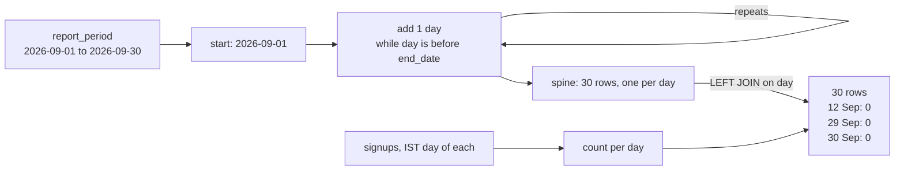

# Dates and the date spine

What were signups per day, including the days with zero?

## Before you start

- **Level 1** (beginner). About 2 hours.
- **Builds on:** [01 GROUP BY from raw rows](../01-group-by-from-raw-rows/) (GROUP BY, COUNT, running a query with `../query.py`) and [02 Joins without losing rows](../02-joins-without-losing-rows/) (LEFT JOIN, why `COUNT(*)` is wrong after one, NOT EXISTS). [05 NULLs, CASE and COALESCE](../../00-start-here/05-nulls-case-and-coalesce/) helps if NULL is still new.
- **Leads to:** [04 Cohort retention](../04-cohort-retention/), which assumes every month has some data. This lesson shows how to stop assuming that.
- **You need:** Python 3.9 or later. Nothing to install.

## The problem

You are the product analyst at Tallyo, a budgeting app with its team in Bengaluru. Sam, the product manager, is writing the September board update on Monday and wants two numbers: average signups per day in September, and the days with no signups at all. Sam suspects the release on 29 September broke the signup form. The app logs every signup with a timestamp in UTC, and the team reads days in India time. You have one raw table of 131 signups and a one-row table that says which days the report covers. Your first draft gave 4.59 signups a day. The right answer is 4.13, and this lesson is about the gap.

## In plain words

Think of a shop that writes every sale in a notebook. On the day the shop was shut, nobody wrote anything. If you flip through the notebook and count the pages, the shut day is not there at all. Average the pages and you get the average of the days the shop was open, which is higher than the average day of the month.

To get the real average you need a calendar next to the notebook: one line for every day of the month, whether anything happened or not. Then you write each day's count next to its line, and a blank line gets a 0.

- A **timestamp** is a moment: a date and a time, such as `2026-09-01 18:30:00`.
- A **date** is a calendar day, such as `2026-09-02`. Which day a moment falls on depends on the clock you read it with.
- **UTC** (Coordinated Universal Time) is the world's reference clock. Apps log in UTC so every moment has one label.
- **IST** (India Standard Time) is UTC plus 5 hours 30 minutes, all year. Midnight in India is 18:30 UTC the evening before.
- A **date spine** (also called a calendar table) is a list with one row per day, made separately from the data. You join the data to it so that empty days stay in the result as zeros.
- A **recursive CTE** is a named query that refers to itself. Here it starts with the first day and keeps adding one day until it reaches the last.

## What you will build from scratch

- The IST day of each signup from a UTC timestamp, with `date(..., '+330 minutes')`.
- A date spine for the report period with `WITH RECURSIVE`.
- Signups per day for every day, zero days included, with a LEFT JOIN onto the spine.
- The list of zero days, and an average per day that counts them.

The data in `data/` is synthetic. `make_data.py` builds it with a fixed random seed. The export is padded: it holds every signup from 31 August 00:00 UTC to 1 October 23:59 UTC, a little more than September on each side, so that no Indian day is cut in half.

## The idea

**Count per day, over a list of days you made yourself.** GROUP BY can only make groups for values that exist in the data. A day with no signups has no rows, so it has no group, so it is not in the result. Nothing errors. The day is simply missing.

That changes the average:

```
right average = signups in the period / days in the period          = 124 / 30 = 4.13
wrong average = signups in the period / days that had a signup       = 124 / 27 = 4.59
```

The fix is to build the days first, from the report period, and join the data onto them:



The spine is on the left of the LEFT JOIN, so every day is kept. A day with no match gets NULL on the signups side, and `COUNT(s.user_id)` counts 0 for it, because COUNT of a column skips NULLs.

**The day depends on the clock.** A signup at `2026-09-01 18:30:00` UTC happened at 00:00 on 2 September in Bengaluru:

```
IST day = date part of (UTC timestamp + 5 hours 30 minutes)
```

Take the date after you convert, never before. In SQLite that is `date(signed_up_at_utc, '+330 minutes')`: `date()` reads a timestamp and returns its date, and a modifier such as `'+330 minutes'` or `'+1 day'` shifts it first.

**Dates as text.** SQLite has no date type. Dates and timestamps are text in the form `YYYY-MM-DD` and `YYYY-MM-DD HH:MM:SS`, which sort in time order because the biggest unit comes first. But text compares character by character, so the timestamp `'2026-09-07 10:00:00'` is greater than the date `'2026-09-07'`: it is longer and starts the same. That is why `timestamp <= '2026-09-07'` drops almost all of 7 September.

## Walk through

Run any query below from this folder with `python3 ../query.py "<the query>"`. For the long ones, save the query in a file and run `python3 ../query.py file.sql`.

Step 1. Look at the raw rows, and turn a UTC timestamp into an IST day.

```sql
SELECT
  user_id,
  signed_up_at_utc,
  datetime(signed_up_at_utc, '+330 minutes') AS ist_time,
  date(signed_up_at_utc, '+330 minutes') AS ist_day
FROM signups
WHERE user_id IN (7001, 7005, 7006);
```

```text
user_id  signed_up_at_utc     ist_time             ist_day
-------  -------------------  -------------------  ----------
7001     2026-08-31 09:13:27  2026-08-31 14:43:27  2026-08-31
7005     2026-08-31 18:08:34  2026-08-31 23:38:34  2026-08-31
7006     2026-08-31 22:56:34  2026-09-01 04:26:34  2026-09-01
```

`datetime()` returns the shifted timestamp and `date()` keeps only its day. All three signed up on 31 August by the UTC clock. User 7005 signed up at 23:38 in India, still 31 August, so it is not in September. For user 7006 it was already 04:26 on 1 September in India, so it belongs in Sam's September.

Step 2. Count per IST day with GROUP BY, the first draft. Look at the end of the month.

```sql
SELECT date(signed_up_at_utc, '+330 minutes') AS day, COUNT(*) AS signups
FROM signups
WHERE date(signed_up_at_utc, '+330 minutes') >= '2026-09-25'
GROUP BY day
ORDER BY day;
```

```text
day         signups
----------  -------
2026-09-25  4
2026-09-26  4
2026-09-27  2
2026-09-28  6
2026-10-01  2
```

28 September is followed by 1 October. The two days Sam asked about are not zeros in this table. They are not there at all.

Step 3. Build the spine. `WITH RECURSIVE` starts a query that may refer to itself.

```sql
WITH RECURSIVE spine(day) AS (
  SELECT start_date FROM report_period
  UNION ALL
  SELECT date(spine.day, '+1 day')
  FROM spine, report_period
  WHERE spine.day < report_period.end_date
)
SELECT COUNT(*) AS days, MIN(day) AS first_day, MAX(day) AS last_day
FROM spine;
```

```text
days  first_day   last_day
----  ----------  ----------
30    2026-09-01  2026-09-30
```

Line by line:

- `spine(day)` names the CTE and its one column.
- The first SELECT is the **anchor**: it runs once and gives the first row, `2026-09-01`.
- `UNION ALL` adds the rows of the second SELECT under the first. (Lesson [06](../06-anti-joins-self-joins-and-union/) covers UNION in full.)
- The second SELECT is the **recursive step**. It reads the rows the CTE made in the last round and makes the next day with `date(spine.day, '+1 day')`. `FROM spine, report_period` pairs each of those rows with the one period row, so the step can see `end_date`.
- The WHERE stops it. When `day` reaches `2026-09-30` it is no longer before `end_date`, so no new row is made and the recursion ends.

`date(day, '+1 day')` knows the calendar: `date('2026-09-30', '+1 day')` is `2026-10-01`, and `date('2026-02-28', '+1 day')` is `2026-03-01` in 2026, which is not a leap year.

Step 4. LEFT JOIN the signups onto the spine.

```sql
WITH RECURSIVE spine(day) AS (
  SELECT start_date FROM report_period
  UNION ALL
  SELECT date(spine.day, '+1 day')
  FROM spine, report_period
  WHERE spine.day < report_period.end_date
)
SELECT spine.day, COUNT(s.user_id) AS signups
FROM spine
LEFT JOIN signups s ON date(s.signed_up_at_utc, '+330 minutes') = spine.day
WHERE spine.day >= '2026-09-10' AND spine.day <= '2026-09-14'
   OR spine.day >= '2026-09-27'
GROUP BY spine.day
ORDER BY spine.day;
```

```text
day         signups
----------  -------
2026-09-10  5
2026-09-11  6
2026-09-12  0
2026-09-13  2
2026-09-14  7
2026-09-27  2
2026-09-28  6
2026-09-29  0
2026-09-30  0
```

The WHERE only picks rows to show you here; drop it to see all 30 days. Saturday 12 September is a real zero that nobody asked about, and 29 and 30 September are the outage. `COUNT(s.user_id)` gives 0 on those days. `COUNT(*)` would give 1, because it counts the spine row itself. Signups from 31 August and 1 October (IST) find no day on the spine, so the LEFT JOIN leaves them out, which is what you want.

Step 5. The summary. Count first, per day, then average over the days.

```sql
WITH RECURSIVE spine(day) AS (
  SELECT start_date FROM report_period
  UNION ALL
  SELECT date(spine.day, '+1 day')
  FROM spine, report_period
  WHERE spine.day < report_period.end_date
),
daily AS (
  SELECT spine.day, COUNT(s.user_id) AS signups
  FROM spine
  LEFT JOIN signups s ON date(s.signed_up_at_utc, '+330 minutes') = spine.day
  GROUP BY spine.day
)
SELECT
  COUNT(*) AS days,
  SUM(signups) AS signups,
  ROUND(1.0 * SUM(signups) / COUNT(*), 2) AS avg_per_day
FROM daily;
```

```text
days  signups  avg_per_day
----  -------  -----------
30    124      4.13
```

`daily` is a second CTE after the first, separated by a comma. `1.0 *` makes the division decimal; in SQLite `124 / 30` is 4.

**In other databases.** The recursive CTE works in Postgres and Snowflake as written, apart from the date function. Most teams use a built-in instead:

- Postgres: `SELECT d::date AS day FROM generate_series(DATE '2026-09-01', DATE '2026-09-30', INTERVAL '1 day') AS d`.
- BigQuery: `SELECT day FROM UNNEST(GENERATE_DATE_ARRAY('2026-09-01', '2026-09-30')) AS day`.
- Snowflake: `SELECT DATEADD(day, ROW_NUMBER() OVER (ORDER BY SEQ4()) - 1, '2026-09-01'::date) AS day FROM TABLE(GENERATOR(ROWCOUNT => 30))`.

For the time zone, SQLite only knows fixed offsets, which is fine for India because IST never changes. Real warehouses take a zone name and apply daylight saving for you: Postgres `(signed_up_at AT TIME ZONE 'UTC' AT TIME ZONE 'Asia/Kolkata')::date` for a timestamp stored without a zone, BigQuery `DATE(signed_up_at, 'Asia/Kolkata')`, Snowflake `CONVERT_TIMEZONE('UTC', 'Asia/Kolkata', signed_up_at)::date`. Many teams keep a permanent calendar table (one row per day for years, with columns such as weekday and holiday) instead of building a spine in every query.

## Common mistakes

**1. Averaging the GROUP BY result (the trap).** This is the first draft:

```sql
SELECT COUNT(*) AS days, SUM(signups) AS signups, ROUND(AVG(signups), 2) AS avg_per_day
FROM (
  SELECT date(signed_up_at_utc, '+330 minutes') AS day, COUNT(*) AS signups
  FROM signups
  WHERE date(signed_up_at_utc, '+330 minutes') BETWEEN '2026-09-01' AND '2026-09-30'
  GROUP BY day
);
```

```text
days  signups  avg_per_day
----  -------  -----------
27    124      4.59
```

It counts every signup correctly and still reports 4.59 a day, because September has 30 days, not 27. The three missing days are exactly the ones Sam asked about. Any average, rate or chart built on a GROUP BY by day has this problem. A line chart would also draw a straight line from 28 September to 1 October, hiding the outage.

**2. Building the spine from the data.** Starting the spine at the first signup and ending it at the last one looks safe:

```sql
WITH RECURSIVE ist AS (
  SELECT date(signed_up_at_utc, '+330 minutes') AS day FROM signups
  WHERE date(signed_up_at_utc, '+330 minutes') BETWEEN '2026-09-01' AND '2026-09-30'
),
spine(day) AS (
  SELECT MIN(day) FROM ist
  UNION ALL
  SELECT date(day, '+1 day') FROM spine WHERE day < (SELECT MAX(day) FROM ist)
)
SELECT COUNT(*) AS days, MIN(day) AS first_day, MAX(day) AS last_day FROM spine;
```

```text
days  first_day   last_day
----  ----------  ----------
28    2026-09-01  2026-09-28
```

It keeps 12 September but loses 29 and 30 September, because zero days at the edges are never between the first and last signup. The average becomes 124 / 28 = 4.43. Build the spine from the period you are reporting on.

**3. Comparing a timestamp with a date.** Signups in the first week, 1 to 7 September (IST):

```sql
SELECT
  (SELECT COUNT(*) FROM signups
   WHERE datetime(signed_up_at_utc, '+330 minutes') BETWEEN '2026-09-01' AND '2026-09-07') AS timestamp_between,
  (SELECT COUNT(*) FROM signups
   WHERE date(signed_up_at_utc, '+330 minutes') BETWEEN '2026-09-01' AND '2026-09-07') AS date_between,
  (SELECT COUNT(*) FROM signups
   WHERE datetime(signed_up_at_utc, '+330 minutes') >= '2026-09-01'
     AND datetime(signed_up_at_utc, '+330 minutes') < '2026-09-08') AS half_open;
```

```text
timestamp_between  date_between  half_open
-----------------  ------------  ---------
30                 32            32
```

The first column misses both signups of 7 September (IST): `'2026-09-07 03:25:40'` is after `'2026-09-07'` as text, so BETWEEN leaves it out, and the same goes for the one at 18:06. Compare dates with dates, or use a **half-open range**: from the first day, up to but not including the day after the last. The half-open range also works in databases with real timestamp types, where `'2026-09-07'` means midnight at the start of that day.

**4. Taking the day in UTC.** The same September, counted on the UTC calendar:

```sql
SELECT
  (SELECT COUNT(*) FROM signups
   WHERE date(signed_up_at_utc) BETWEEN '2026-09-01' AND '2026-09-30') AS utc_september,
  (SELECT COUNT(*) FROM signups
   WHERE date(signed_up_at_utc, '+330 minutes') BETWEEN '2026-09-01' AND '2026-09-30') AS ist_september;
```

```text
utc_september  ist_september
-------------  -------------
122            124
```

UTC runs 5 hours 30 minutes behind India, so the UTC version drops the two signups made between midnight and 05:30 on 1 September in India (it was still 31 August in UTC). It would also count anything from the first five and a half hours of 1 October in India as September. The monthly total moves by 2 here, and single days move too (2 September is 11 signups in India time and 9 in UTC), so a day by day chart in UTC does not match what the team saw in Bengaluru. Convert first, then take the date.

**5. A fixed offset for a zone with daylight saving.** `'+330 minutes'` is right for India all year. US and European zones move their clocks twice a year, so a fixed offset is an hour wrong for part of the year. Use the warehouse's time zone functions with a zone name, and see [05-03 Dates, weeks and time zones](../../05-python-for-analysts/03-dates-weeks-and-time-zones/) for how daylight saving works.

## Your turn

Open `exercise.sql` and write three queries: `daily_signups`, `zero_days` and `summary`.

```
python3 test_lesson.py
```

Run it from this folder. One test checks that `daily_signups` has 30 rows, which fails if the days come from GROUP BY instead of a spine. The test also runs your queries on a second dataset made with a different seed, and on tiny hand-made tables: no signups at all, signups a second either side of midnight in India, zero days at the very start and end of the period, a period from 30 December to 2 January, February in a year that is not a leap year, and a period of one day.

Stretch: add a `weekday` column to `daily_signups` with `strftime('%w', day)` (0 is Sunday) and compare the average weekday with the average weekend day. What does that do to your estimate of the signups lost in the outage?

## Check yourself

1. Why does a GROUP BY by day never show a day with zero rows?
2. Your spine goes from the first to the last signup in the data. What can it still miss?
3. A signup is logged at `2026-09-30 19:00:00` UTC. Which IST day is it, and is it in Sam's September report?
4. Why is `ts >= '2026-09-01' AND ts < '2026-10-01'` safer than `ts BETWEEN '2026-09-01' AND '2026-09-30'` for a timestamp column?

<details>
<summary>Answers</summary>

1. GROUP BY makes one group per value that appears in the rows. A day with no signups has no rows, so there is no value to group on. You need a list of days from somewhere else, and a LEFT JOIN from it.
2. Zero days before the first signup and after the last one, at the edges of the period. Build the spine from the report period, not from the data.
3. 19:00 UTC plus 5 hours 30 minutes is 00:30 on 1 October in India, so it is in October. A report that takes the UTC date would put it in September.
4. BETWEEN includes the end value exactly, and for a timestamp `'2026-09-30'` means the very start of 30 September (or, as text in SQLite, something smaller than every timestamp on that day). Everything later on the 30th is dropped. The half-open range includes the whole last day and never double counts midnight between two periods.

</details>

## What to tell the stakeholder

> Sam, Tallyo had 124 signups in September (India time), an average of 4.13 a day across all 30 days. Three days had none: Saturday 12 September, which looks like a normal quiet weekend, and Tuesday 29 and Wednesday 30 September, right after the release, which fits the broken signup form.

The caveats: weekdays from 1 to 28 September averaged 5.35 signups, so the two outage days cost roughly 11 signups, but that is an estimate of what would have happened, not a count. The figures use India time; a dashboard on UTC would show 122 for September.

## In real job postings

In the Real Analyst Jobs data drop of 25 October 2026 ([data/job-market/2026-10](../../../data/job-market/2026-10/)), there were 1,174 India analyst postings, and 634 of the 900 that list tools (70.4%) ask for SQL. Browse them at [SQL data analyst jobs](https://realanalystjobs.com/jobs/sql-data-analyst-jobs).

## Next

[06 Anti-joins, self-joins and UNION](../06-anti-joins-self-joins-and-union/)
