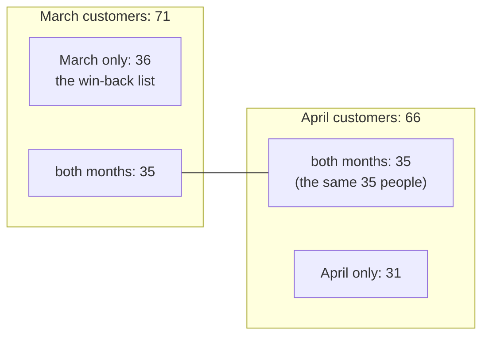

# Anti-joins, self-joins and UNION

Which customers ordered in March but not in April?

## Before you start

- **Level 1** (beginner). About 2 hours.
- **Builds on:** [01 GROUP BY from raw rows](../01-group-by-from-raw-rows/) (GROUP BY, COUNT, SUM) and [02 Joins without losing rows](../02-joins-without-losing-rows/) (LEFT JOIN, NULL, a first look at NOT EXISTS and the NOT IN trap). [05 Dates and the date spine](../05-dates-and-the-date-spine/) explains why the date filters here use half-open ranges.
- **You need:** Python 3.9 or later. Nothing to install.

## The problem

You are back on the growth team at Brightcart, the online grocery that sells fixed-price grocery boxes. Dev, the CRM manager, wants to send a win-back email on Monday to every customer who ordered in March but not in April. If the customer was referred by a friend, the email names the friend, so Dev needs that name too. Orders live in two tables, one from the website and one from the app, and the website allows guest checkout with no customer attached. Dev's own quick query returned nobody at all, which he knows cannot be right. You have 140 customers, 256 web orders and 202 app orders from February to April 2026.

## In plain words

Think of two class registers, one for March and one for April. To find the students who came in March but not in April, you go down the March list and, for each name, look for it on the April list. Keep the name if it is not there.

- That "keep it if there is no match" is an **anti-join**: rows from one table that have no matching row in another.
- If someone wrote a smudge instead of a name on the April list, a careless reader says "I cannot rule anyone out" and keeps nobody. That is what `NOT IN` does with a NULL, and why Dev's query came back empty.
- A **self-join** joins a table to itself. The customers table says who referred whom, so to get the referrer's name you look up the same table a second time, under a second name.
- **UNION ALL** stacks the rows of two queries into one list, keeping every row. **UNION** does the same and then removes rows that are exact duplicates. Use UNION ALL to stack facts such as orders, and UNION when you want a list where each value appears once, such as customer ids.
- **NULL** means "no value here". A guest order has customer_id NULL.

## What you will build from scratch

- One list of orders from two tables with UNION ALL, and a row-count check that proves nothing merged.
- The March-not-April customers, three ways: NOT EXISTS, LEFT JOIN ... IS NULL, and EXCEPT.
- The referrer's name for each customer with a LEFT self-join.
- A one-row summary of March, April, both, March only and either month, with UNION for the last.

The data in `data/` is synthetic. `make_data.py` builds it with a fixed random seed.

## The idea

**Sets of customers.** Write M for the customers who ordered in March and A for April. Each question Dev might ask is one region of the picture:



```
march only  = M minus A          = 71 - 35      = 36
either      = M plus A, once each = 71 + 66 - 35 = 102
```

Adding 71 and 66 gives 137, which counts the 35 people in both months twice. UNION removes that double count because it removes duplicates.

**Three ways to write "in M and not in A".** For each March customer c:

1. **NOT EXISTS:** keep c if no April order has c's customer_id. The subquery only asks whether a row exists.
2. **LEFT JOIN ... IS NULL:** left join c to April's customers; if there was no match, the right side is NULL.
3. **EXCEPT:** the rows of the first query that are not in the second. `SELECT customer_id FROM march EXCEPT SELECT customer_id FROM april`.

All three are safe with NULLs. The fourth form you will see in other people's code, `customer_id NOT IN (SELECT customer_id FROM april_orders)`, is not. `x NOT IN (a, b, NULL)` means x is not a, and x is not b, and x is not NULL. A comparison with NULL is unknown, never true, so the whole condition is never true, and no row comes back.

**A self-join** gives the same table two short names, called **aliases**, so each copy plays a different role:

```
customers c   = the customer
customers r   = the same table again, playing the referrer
ON r.customer_id = c.referred_by
```

It must be a LEFT JOIN: most customers were not referred, and an inner join would drop them.

## Walk through

Run any query below from this folder with `python3 ../query.py "<the query>"`. For the long ones, save the query in a file and run `python3 ../query.py file.sql`.

Step 1. Stack the two order tables, and count.

```sql
SELECT
  (SELECT COUNT(*) FROM web_orders) AS web,
  (SELECT COUNT(*) FROM app_orders) AS app,
  (SELECT COUNT(*) FROM (
     SELECT order_id, customer_id, order_date, amount FROM web_orders
     UNION ALL
     SELECT order_id, customer_id, order_date, amount FROM app_orders
  )) AS stacked;
```

```text
web  app  stacked
---  ---  -------
256  202  458
```

UNION ALL needs the same number of columns in the same order on both sides; the names come from the first SELECT. 256 + 202 = 458, so every order is there. Make this check every time you stack tables.

Step 2. Orders and revenue per month, from the stacked list. A CTE (`WITH name AS (...)`) names the stacked list so the query reads in steps.

```sql
WITH all_orders AS (
  SELECT order_id, customer_id, order_date, amount FROM web_orders
  UNION ALL
  SELECT order_id, customer_id, order_date, amount FROM app_orders
)
SELECT strftime('%Y-%m', order_date) AS month, COUNT(*) AS orders, ROUND(SUM(amount), 2) AS revenue
FROM all_orders
GROUP BY month
ORDER BY month;
```

```text
month    orders  revenue
-------  ------  -------
2026-02  169     6912.0
2026-03  146     5892.0
2026-04  143     5940.0
```

Guest orders are in these totals. They are real revenue, even though they belong to no customer.

Step 3. The anti-join with NOT EXISTS. Only the customer_id and date are needed from the orders, so `all_orders` keeps just those.

```sql
WITH all_orders AS (
  SELECT customer_id, order_date FROM web_orders
  UNION ALL
  SELECT customer_id, order_date FROM app_orders
)
SELECT COUNT(*) AS march_not_april
FROM customers c
WHERE EXISTS (
    SELECT 1 FROM all_orders o
    WHERE o.customer_id = c.customer_id
      AND o.order_date >= '2026-03-01' AND o.order_date < '2026-04-01'
  )
  AND NOT EXISTS (
    SELECT 1 FROM all_orders o
    WHERE o.customer_id = c.customer_id
      AND o.order_date >= '2026-04-01' AND o.order_date < '2026-05-01'
  );
```

```text
march_not_april
---------------
36
```

Read it as: keep customer c if there is at least one March order with c's id, and there is no April order with c's id. Each subquery mentions `c.customer_id` from the outer query, so it runs once per customer; that is called a **correlated subquery**. A guest order has customer_id NULL, and `NULL = c.customer_id` is never true, so guests can never match anyone, which is exactly right. The dates use a half-open range: on or after the first day of the month, and before the first day of the next.

Step 4. The same answer with LEFT JOIN ... IS NULL and with EXCEPT.

```sql
WITH all_orders AS (
  SELECT customer_id, order_date FROM web_orders
  UNION ALL
  SELECT customer_id, order_date FROM app_orders
),
march AS (
  SELECT DISTINCT customer_id FROM all_orders
  WHERE order_date >= '2026-03-01' AND order_date < '2026-04-01' AND customer_id IS NOT NULL
),
april AS (
  SELECT DISTINCT customer_id FROM all_orders
  WHERE order_date >= '2026-04-01' AND order_date < '2026-05-01' AND customer_id IS NOT NULL
)
SELECT
  (SELECT COUNT(*) FROM march m LEFT JOIN april a ON a.customer_id = m.customer_id
   WHERE a.customer_id IS NULL) AS left_join_is_null,
  (SELECT COUNT(*) FROM (SELECT customer_id FROM march EXCEPT SELECT customer_id FROM april)) AS except_form;
```

```text
left_join_is_null  except_form
-----------------  -----------
36                 36
```

`march` and `april` are one row per customer, so the LEFT JOIN cannot fan out. `a.customer_id IS NULL` keeps the March customers with no April match. EXCEPT removes duplicates from its result, like UNION, and treats two NULLs as the same value, so it is NULL safe too.

Step 5. The self-join for the referrer's name.

```sql
SELECT c.customer_id, c.name, c.referred_by, r.name AS referrer_name
FROM customers c
LEFT JOIN customers r ON r.customer_id = c.referred_by
WHERE c.customer_id IN ('C004', 'C007', 'C013', 'C015');
```

```text
customer_id  name     referred_by  referrer_name
-----------  -------  -----------  -------------
C004         Omar F.  NULL         NULL
C007         Chen N.  C004         Omar F.
C013         Dara L.  NULL         NULL
C015         Hana K.  C005         Uma J.
```

`c` is the customer and `r` is the same table playing the referrer. C007 was referred by C004, so `r` finds C004's row and returns that name. C004 and C013 were not referred: `referred_by` is NULL, the ON condition never matches, and the LEFT JOIN keeps them with a NULL referrer name.

Step 6. The summary. UNION, not UNION ALL, for "either month", because here the goal is a list of distinct customers.

```sql
WITH all_orders AS (
  SELECT customer_id, order_date FROM web_orders
  UNION ALL
  SELECT customer_id, order_date FROM app_orders
),
march AS (
  SELECT DISTINCT customer_id FROM all_orders
  WHERE order_date >= '2026-03-01' AND order_date < '2026-04-01' AND customer_id IS NOT NULL
),
april AS (
  SELECT DISTINCT customer_id FROM all_orders
  WHERE order_date >= '2026-04-01' AND order_date < '2026-05-01' AND customer_id IS NOT NULL
)
SELECT
  (SELECT COUNT(*) FROM march) AS march_customers,
  (SELECT COUNT(*) FROM april) AS april_customers,
  (SELECT COUNT(*) FROM march m JOIN april a ON a.customer_id = m.customer_id) AS both_months,
  (SELECT COUNT(*) FROM (SELECT customer_id FROM march UNION SELECT customer_id FROM april)) AS either_month;
```

```text
march_customers  april_customers  both_months  either_month
---------------  ---------------  -----------  ------------
71               66               35           102
```

`both_months` is an inner join of two one-row-per-customer lists, so it counts each shared customer once. SQLite also has `INTERSECT`, which gives the same 35.

**In other databases.** NOT EXISTS, LEFT JOIN ... IS NULL, UNION and UNION ALL are written the same way in Postgres, BigQuery, Snowflake and SQL Server. EXCEPT and INTERSECT work in Postgres, Snowflake and SQL Server; BigQuery requires `EXCEPT DISTINCT` and `INTERSECT DISTINCT`, and Oracle has long called EXCEPT `MINUS`. BigQuery also refuses a bare `UNION`: write `UNION DISTINCT` or `UNION ALL`. `strftime('%Y-%m', d)` is SQLite only; Postgres and Snowflake use `TO_CHAR(d, 'YYYY-MM')`, BigQuery `FORMAT_DATE('%Y-%m', d)`.

## Common mistakes

**1. NOT IN with a NULL in the list (the trap).** This is Dev's query:

```sql
WITH all_orders AS (
  SELECT customer_id, order_date FROM web_orders
  UNION ALL
  SELECT customer_id, order_date FROM app_orders
)
SELECT COUNT(*) AS lapsed
FROM customers
WHERE customer_id IN (SELECT customer_id FROM all_orders
                      WHERE order_date >= '2026-03-01' AND order_date < '2026-04-01')
  AND customer_id NOT IN (SELECT customer_id FROM all_orders
                          WHERE order_date >= '2026-04-01' AND order_date < '2026-05-01');
```

```text
lapsed
------
0
```

Zero, against the real 36. April has 7 guest web orders, so the April list holds NULL, and `customer_id NOT IN (..., NULL)` is never true. Nothing errors, and on a month with no guest orders the same query gives the right answer, which is why it survives in old reports. `IN` is safe; only `NOT IN` breaks. Use NOT EXISTS, or add `AND customer_id IS NOT NULL` inside the subquery.

**2. UNION where you meant UNION ALL.** Stacking orders with UNION merges any two rows that look the same:

```sql
SELECT
  (SELECT COUNT(*) FROM (SELECT customer_id, order_date, amount FROM web_orders
                         UNION ALL
                         SELECT customer_id, order_date, amount FROM app_orders)) AS union_all_rows,
  (SELECT COUNT(*) FROM (SELECT customer_id, order_date, amount FROM web_orders
                         UNION
                         SELECT customer_id, order_date, amount FROM app_orders)) AS union_rows,
  (SELECT SUM(amount) FROM (SELECT customer_id, order_date, amount FROM web_orders
                            UNION
                            SELECT customer_id, order_date, amount FROM app_orders)) AS union_revenue;
```

```text
union_all_rows  union_rows  union_revenue
--------------  ----------  -------------
458             456         18696.0
```

Brightcart's boxes have fixed prices, so two genuine orders can share the customer, the date and the amount. UNION drops 2 orders here, and revenue comes out 48.0 too low, against a real 18,744.0. Even with order_id included, UNION can merge rows, because both systems number from 1, so web order 7 and app order 7 can look identical. The test checks that case. UNION ALL is also faster, because it does not have to sort and compare.

**3. Adding the months to get "either month".** 71 March customers plus 66 April customers is 137, but only 102 different people ordered in March or April. The 35 who ordered in both are counted twice. The same mistake adds up weekly active users to get monthly active users. Count the UNION of the lists instead.

**4. An inner self-join.** With `JOIN customers r` instead of `LEFT JOIN customers r`, the win-back list keeps only the 10 lapsed customers who were referred, and the other 26 vanish:

```sql
WITH all_orders AS (
  SELECT customer_id, order_date FROM web_orders
  UNION ALL
  SELECT customer_id, order_date FROM app_orders
)
SELECT
  (SELECT COUNT(*) FROM customers c LEFT JOIN customers r ON r.customer_id = c.referred_by
   WHERE EXISTS (SELECT 1 FROM all_orders o WHERE o.customer_id = c.customer_id
                 AND o.order_date >= '2026-03-01' AND o.order_date < '2026-04-01')
     AND NOT EXISTS (SELECT 1 FROM all_orders o WHERE o.customer_id = c.customer_id
                     AND o.order_date >= '2026-04-01' AND o.order_date < '2026-05-01')) AS left_self_join,
  (SELECT COUNT(*) FROM customers c JOIN customers r ON r.customer_id = c.referred_by
   WHERE EXISTS (SELECT 1 FROM all_orders o WHERE o.customer_id = c.customer_id
                 AND o.order_date >= '2026-03-01' AND o.order_date < '2026-04-01')
     AND NOT EXISTS (SELECT 1 FROM all_orders o WHERE o.customer_id = c.customer_id
                     AND o.order_date >= '2026-04-01' AND o.order_date < '2026-05-01')) AS inner_self_join;
```

```text
left_self_join  inner_self_join
--------------  ---------------
36              10
```

**5. Checking one channel.** A customer who ordered on the website in March and in the app in April is not lapsed. Run the anti-join against web_orders alone and that customer gets a "we miss you" email they did not earn. Stack both tables first.

## Your turn

Open `exercise.sql` and write three queries: `monthly_orders`, `lapsed_customers` and `march_april_summary`.

```
python3 test_lesson.py
```

Run it from this folder. One test fails straight away if `lapsed_customers` returns no rows, which is what NOT IN does with the guest orders. The test also runs your queries on a second dataset made with a different seed, and on tiny hand-made tables: empty tables, a guest order in April, a customer who switched from the web to the app, two identical rows in the two order tables, a referrer who is not in the customers table, and orders on the first and last day of each month.

Stretch: add a column `channel` ('web' or 'app') to the stacked list, and find the customers who ordered on the web in March and only in the app in April. Which anti-join form is easiest to adapt?

## Check yourself

1. Why does `NOT IN (subquery)` return no rows when the subquery returns a NULL, while `NOT EXISTS` works?
2. When do you want UNION, and when UNION ALL?
3. You have 71 customers in March and 66 in April. Why is "137 customers in March or April" wrong, and what would you compute instead?
4. Why must the self-join for the referrer be a LEFT JOIN?

<details>
<summary>Answers</summary>

1. `x NOT IN (a, NULL)` means `x <> a AND x <> NULL`. Any comparison with NULL is unknown, so the AND is never true and every row is filtered out. NOT EXISTS asks whether a matching row exists; `NULL = x` never matches, so the NULL row simply does not count.
2. UNION ALL when stacking facts such as orders, events or payments, where two identical rows are two real things. UNION when building a list of distinct values, such as the customers active in either month. If you are not sure, use UNION ALL and remove duplicates on purpose with DISTINCT on the right columns.
3. Customers who ordered in both months are counted twice. Compute the size of the union of the two lists (102 here), or 71 + 66 minus the 35 in both.
4. Most customers have no referrer. An inner join keeps only rows with a match, so every customer who was not referred disappears from the list.

</details>

## What to tell the stakeholder

> Dev, 36 customers ordered in March and not in April; the list is attached, and 10 of them came through a referral, so their email can name the friend. For scale: 71 customers ordered in March, 66 in April, 35 in both, and 102 different customers ordered in one of the two months.

The caveats: guest orders cannot be matched to anyone, so a lapsed customer who checked out as a guest in April is on the list by mistake. Your earlier query returned nobody because of the guest orders, not because nobody lapsed.

## In real job postings

In the Real Analyst Jobs data drop of 25 October 2026 ([data/job-market/2026-10](../../../data/job-market/2026-10/)), 286 of the 413 UK analyst postings that list tools (69.2%) ask for SQL, out of 620 UK postings. Browse them at [SQL data analyst jobs](https://realanalystjobs.com/jobs/sql-data-analyst-jobs).

## Next

[07 Subqueries and CTEs](../07-subqueries-and-ctes/)
