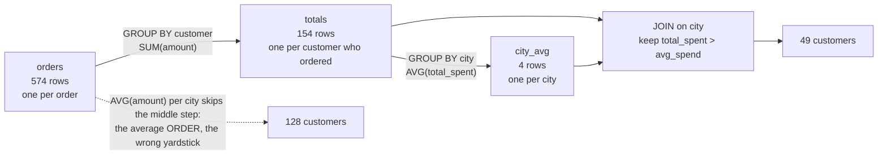

# Subqueries and CTEs

Which customers spent more than their city's average?

## Before you start

- **Level 1** (beginner). About 2 hours.
- **Builds on:** [03 Tables, rows and grain](../../00-start-here/03-tables-rows-and-grain/) (what one row stands for), [01 GROUP BY from raw rows](../01-group-by-from-raw-rows/) (GROUP BY, SUM, AVG), [02 Joins without losing rows](../02-joins-without-losing-rows/) (joins and row counts) and [06 Anti-joins, self-joins and UNION](../06-anti-joins-self-joins-and-union/) (a first correlated subquery with NOT EXISTS).
- **You need:** Python 3.9 or later. Nothing to install.

## The problem

You are the analyst at Tiffinbell, a fictional food delivery app in four cities of Maharashtra. Ishaan, who runs the loyalty programme, wants to invite October's bigger spenders to a pilot of a paid membership, and the invitations go out on Friday. Prices differ a lot between cities, so he does not want one rupee cut-off: he wants every customer who spent more than the average customer in their own city. You have 180 customers and 574 October orders. A first attempt, comparing each customer with the average order in their city, invited 128 people. The right list has 49.

## In plain words

Picture a school sports day with four houses. The coach asks: which children ran more laps than the average child in their own house? You would first add up each child's laps over the day (one number per child), then work out each house's average of those numbers, and only then go down the list comparing each child with their own house.

What you would not do is average the individual laps on the score sheet. A child who ran ten short laps and a child who ran one long lap are two children, not eleven.

- A **subquery** is a query inside another query, in brackets. It can stand where a table goes (in FROM), or where a single value goes (in WHERE or SELECT).
- A **correlated subquery** mentions a column of the outer query, such as "the average of this customer's city", so it is worked out again for every outer row.
- A **CTE** (common table expression) is a named subquery written at the top with `WITH name AS (...)`. The rest of the query uses `name` like a table. Several CTEs, separated by commas, let you build an answer in small steps.
- **Grain** is what one row stands for. Here, orders are one row per order, the totals are one row per customer, and the averages are one row per city. Comparing numbers of different grains is how this question goes wrong.

## What you will build from scratch

- Customer totals: one row per customer who ordered, which add up to the order total.
- City averages of those customer totals, first with a subquery in FROM, then with a CTE.
- The above-average list two ways: a correlated subquery, and a chain of CTEs joined back together.
- A tie rule: a customer exactly at the average is not above it.

The data in `data/` is synthetic. `make_data.py` builds it with a fixed random seed. Amounts are whole rupees, so totals are exact and a tie at the average really is a tie.

## The idea

The question has three grains, and each step changes the grain once:



Written out, for a customer c in city k:

```
total(c)  = sum of amount over c's orders
avg(k)    = sum of total(c) over the customers c in k who ordered / number of those customers
c is above average  when  total(c) > avg(k)
```

Two definitions sit inside that formula, and the stakeholder should hear both:

1. **Who counts in the average.** Only customers who ordered in October. 26 of the 180 customers placed no order; counting them as 0 would answer a different question ("more than the average registered customer").
2. **Strictly more.** `>` and not `>=`, so a customer exactly at the average is not invited. Compare against the exact average, and round only when you display it.

**Subquery or CTE?** Both say the same thing to the database. The CTE names each step once and reads top to bottom. The correlated subquery repeats the totals inside the WHERE, which is fine for one comparison and hard to read for two.

## Walk through

Run any query below from this folder with `python3 ../query.py "<the query>"`. For the long ones, save the query in a file and run `python3 ../query.py file.sql`.

Step 1. Look at the grain. One customer, many orders.

```sql
SELECT order_id, customer_id, order_date, amount
FROM orders
WHERE customer_id = 'T008' OR customer_id = 'T010'
ORDER BY customer_id, order_date;
```

```text
order_id  customer_id  order_date  amount
--------  -----------  ----------  ------
35        T008         2026-10-03  203
17        T010         2026-10-02  386
310       T010         2026-10-18  412
541       T010         2026-10-30  258
```

Each row is one order. T010 has three rows and T008 has one, but each of them is one customer. For Ishaan's question you need one number per customer.

Step 2. Customer totals, and the check that nothing was lost or doubled.

```sql
SELECT
  (SELECT SUM(amount) FROM orders) AS orders_total,
  (SELECT SUM(total_spent) FROM (
     SELECT c.customer_id, SUM(o.amount) AS total_spent
     FROM customers c
     JOIN orders o ON o.customer_id = c.customer_id
     GROUP BY c.customer_id
  )) AS sum_of_customer_totals,
  (SELECT COUNT(DISTINCT customer_id) FROM orders) AS customers_who_ordered;
```

```text
orders_total  sum_of_customer_totals  customers_who_ordered
------------  ----------------------  ---------------------
200235        200235                  154
```

The bracketed query in the second column is a **subquery in FROM**, also called a **derived table**: it makes a temporary table of customer totals, and the outer SELECT adds them up. The two totals match, so every order is counted once. 154 of the 180 customers ordered in October.

Step 3. City averages of the customer totals, with the subquery in FROM.

```sql
SELECT city, COUNT(*) AS customers, ROUND(AVG(total_spent), 2) AS avg_spend
FROM (
  SELECT c.customer_id, c.city, SUM(o.amount) AS total_spent
  FROM customers c
  JOIN orders o ON o.customer_id = c.customer_id
  GROUP BY c.customer_id, c.city
) AS totals
GROUP BY city
ORDER BY city;
```

```text
city    customers  avg_spend
------  ---------  ---------
Mumbai  47         1736.34
Nagpur  19         973.53
Nashik  24         1301.04
Pune    64         1076.64
```

The inner query has one row per customer; the outer GROUP BY turns that into one row per city. `AS totals` names the derived table. `AVG` here averages customers, because each row in `totals` is a customer.

Step 4. The above-average list with a correlated subquery.

```sql
SELECT COUNT(*) AS above_average
FROM (
  SELECT c.customer_id, c.city, SUM(o.amount) AS total_spent
  FROM customers c JOIN orders o ON o.customer_id = c.customer_id
  GROUP BY c.customer_id, c.city
) AS t
WHERE t.total_spent > (
  SELECT AVG(t2.total_spent)
  FROM (
    SELECT c.customer_id, c.city, SUM(o.amount) AS total_spent
    FROM customers c JOIN orders o ON o.customer_id = c.customer_id
    GROUP BY c.customer_id, c.city
  ) AS t2
  WHERE t2.city = t.city
);
```

```text
above_average
-------------
49
```

The subquery in the WHERE returns one value, so it can sit on the right of `>`; a subquery like this is called a **scalar subquery**. `WHERE t2.city = t.city` is the correlation: for each customer t, it averages only the customers of t's city. It works, but the totals query is written twice, and a change to one copy and not the other is a classic way to ship a wrong number.

Step 5. The same list as a chain of CTEs.

```sql
WITH totals AS (
  SELECT c.customer_id, c.name, c.city, SUM(o.amount) AS total_spent
  FROM customers c
  JOIN orders o ON o.customer_id = c.customer_id
  GROUP BY c.customer_id, c.name, c.city
),
city_avg AS (
  SELECT city, AVG(total_spent) AS avg_spend
  FROM totals
  GROUP BY city
)
SELECT t.customer_id, t.name, t.city, t.total_spent, ROUND(a.avg_spend, 2) AS city_avg
FROM totals t
JOIN city_avg a ON a.city = t.city
WHERE t.total_spent > a.avg_spend
ORDER BY t.city, t.total_spent DESC, t.customer_id
LIMIT 6;
```

```text
customer_id  name      city    total_spent  city_avg
-----------  --------  ------  -----------  --------
T130         Ira B.    Mumbai  6377         1736.34
T084         Rohan J.  Mumbai  4718         1736.34
T094         Nisha V.  Mumbai  4423         1736.34
T067         Zoya O.   Mumbai  4351         1736.34
T162         Ira X.    Mumbai  4331         1736.34
T016         Nisha U.  Mumbai  4073         1736.34
```

Line by line: `totals` is step 2, named once. `city_avg` reads from `totals`, so a CTE can use an earlier CTE. The final SELECT joins each customer to the one row of their city (one row per city, so the join cannot fan out) and keeps the customers above it. `WHERE` compares with `a.avg_spend`, the exact average; `ROUND` is only in the SELECT, for display. Drop `LIMIT 6` to see all 49.

How many per city:

```sql
WITH totals AS (
  SELECT c.customer_id, c.city, SUM(o.amount) AS total_spent
  FROM customers c
  JOIN orders o ON o.customer_id = c.customer_id
  GROUP BY c.customer_id, c.city
),
city_avg AS (
  SELECT city, COUNT(*) AS customers, AVG(total_spent) AS avg_spend
  FROM totals
  GROUP BY city
)
SELECT a.city, a.customers, ROUND(a.avg_spend, 2) AS avg_spend,
       SUM(CASE WHEN t.total_spent > a.avg_spend THEN 1 ELSE 0 END) AS above_average
FROM city_avg a
JOIN totals t ON t.city = a.city
GROUP BY a.city, a.customers, a.avg_spend
ORDER BY a.city;
```

```text
city    customers  avg_spend  above_average
------  ---------  ---------  -------------
Mumbai  47         1736.34    16
Nagpur  19         973.53     4
Nashik  24         1301.04    7
Pune    64         1076.64    22
```

Fewer than half the customers in every city are above the average. That is normal for spending: a few regulars and office lunches pull the average up, so most customers sit below it. If Ishaan wanted "the top half", the yardstick would be the median instead.

**In other databases.** Subqueries and CTEs are written the same way in Postgres, BigQuery, Snowflake and SQL Server. Two differences: Postgres, Snowflake and SQL Server raise an error if a scalar subquery returns more than one row, while SQLite quietly uses the first row (see mistake 4); and BigQuery requires a name for every derived table, which is a good habit anyway. A window function gives the same list without a join: `AVG(total_spent) OVER (PARTITION BY city)` puts each city's average on every customer row (see [03 Window functions](../03-window-functions/)).

## Common mistakes

**1. Averaging orders instead of customers (the trap).** This is the first attempt: each customer's total against the average order in their city.

```sql
WITH totals AS (
  SELECT c.customer_id, c.city, SUM(o.amount) AS total_spent
  FROM customers c
  JOIN orders o ON o.customer_id = c.customer_id
  GROUP BY c.customer_id, c.city
),
avg_order AS (
  SELECT c.city, AVG(o.amount) AS avg_amount
  FROM orders o
  JOIN customers c ON c.customer_id = o.customer_id
  GROUP BY c.city
)
SELECT a.city, ROUND(a.avg_amount, 2) AS avg_order_value,
       SUM(CASE WHEN t.total_spent > a.avg_amount THEN 1 ELSE 0 END) AS customers_above_it
FROM avg_order a
JOIN totals t ON t.city = a.city
GROUP BY a.city, a.avg_amount
ORDER BY a.city;
```

```text
city    avg_order_value  customers_above_it
------  ---------------  ------------------
Mumbai  474.47           37
Nagpur  260.52           18
Nashik  276.33           24
Pune    316.08           49
```

It runs and returns a confident list of 128 customers. In Nashik every one of the 24 customers who ordered clears the bar, because almost anyone with two orders spends more than one average order. The average order is a number per order; a customer's October total is a number per customer. Comparing two grains gives a yardstick that is far too low. Before you compare two numbers, say what one row of each stands for.

**2. Counting customers with no orders as zero.** A LEFT JOIN from customers with `COALESCE(SUM(o.amount), 0)` puts the 26 customers who did not order into the average:

```sql
WITH totals AS (
  SELECT c.customer_id, c.city, COALESCE(SUM(o.amount), 0) AS total_spent
  FROM customers c
  LEFT JOIN orders o ON o.customer_id = c.customer_id
  GROUP BY c.customer_id, c.city
)
SELECT city, COUNT(*) AS customers, ROUND(AVG(total_spent), 2) AS avg_spend
FROM totals
GROUP BY city
ORDER BY city;
```

```text
city    customers  avg_spend
------  ---------  ---------
Mumbai  52         1569.38
Nagpur  22         840.77
Nashik  30         1040.83
Pune    76         906.64
```

Every average drops (Pune from 1,076.64 to 906.64), so more people clear it. This is not a bug in the SQL, it is a different definition. Pick one on purpose, write it in the query comment, and say it in the message.

**3. Forgetting the correlation.** Without `WHERE t2.city = t.city`, the subquery averages every customer in every city:

```sql
WITH totals AS (
  SELECT c.customer_id, c.city, SUM(o.amount) AS total_spent
  FROM customers c
  JOIN orders o ON o.customer_id = c.customer_id
  GROUP BY c.customer_id, c.city
)
SELECT city, COUNT(*) AS above_overall_average
FROM totals
WHERE total_spent > (SELECT AVG(total_spent) FROM totals)
GROUP BY city
ORDER BY city;
```

```text
city    above_overall_average
------  ---------------------
Mumbai  23
Nagpur  4
Nashik  7
Pune    15
```

This list also has 49 people, which makes it easy to miss. But it holds 23 Mumbai customers instead of 16 and 15 Pune customers instead of 22, because Mumbai prices are higher. A matching total is not proof that the rows are right.

**4. A scalar subquery that returns more than one row.** Grouping inside the subquery and forgetting the WHERE:

```sql
WITH totals AS (
  SELECT c.customer_id, c.city, SUM(o.amount) AS total_spent
  FROM customers c
  JOIN orders o ON o.customer_id = c.customer_id
  GROUP BY c.customer_id, c.city
)
SELECT COUNT(*) AS above,
       (SELECT ROUND(AVG(total_spent), 2) FROM totals GROUP BY city) AS yardstick_used
FROM totals
WHERE total_spent > (SELECT AVG(total_spent) FROM totals GROUP BY city);
```

```text
above  yardstick_used
-----  --------------
37     1736.34
```

The subquery returns four rows, one per city. SQLite does not complain; it uses the first row it happens to get, here Mumbai's 1,736.34 for every customer in every city, which gives 37. Postgres, Snowflake and SQL Server stop with an error, which is the better behaviour. If a subquery sits next to `>` or `=`, make sure it can only return one row.

**5. Ties and rounding.** `>=` would invite a customer who spent exactly the average, and comparing against `ROUND(avg_spend, 2)` instead of `avg_spend` can move a customer across the line by a fraction of a rupee. There is no exact tie in this month's data, but the test has one: totals of 200, 300 and 400 average exactly 300, and only the 400 is above it.

## Your turn

Open `exercise.sql` and write three queries: `customer_totals`, `city_averages` and `above_average`.

```
python3 test_lesson.py
```

Run it from this folder. One test checks that your customer totals add up to the order total, which catches a join that drops or doubles orders. The test also runs your queries on a second dataset made with a different seed, and on tiny hand-made tables: empty tables, a customer exactly at the average, a city with one customer, a customer with no orders, and a city where one customer has ten small orders and another has one big order.

Stretch: write `above_average` with `AVG(total_spent) OVER (PARTITION BY city)` instead of the `city_avg` CTE. You will still need one CTE, because a window function cannot be used in WHERE. Why not? (Think about the order in which the parts of a query run.)

## Check yourself

1. What is the difference between a subquery in FROM and a correlated subquery in WHERE?
2. Why is the average order value the wrong yardstick for "spent more than the average customer"?
3. One city has a single customer. Is that customer above the city's average?
4. When would you choose a CTE over a nested subquery?

<details>
<summary>Answers</summary>

1. A subquery in FROM runs once and acts as a table for the outer query. A correlated subquery mentions a column of the outer row (here the city), so it is evaluated for each outer row and returns a value that depends on that row.
2. It is a number per order, and the comparison is per customer. Customers place several orders, so the average order is much smaller than the average customer total, and almost anyone with two orders clears it.
3. No. Their total is the average, and equal is not more. The query should return nobody for that city.
4. When a step is used more than once, or when the query has several steps. A CTE names each step once, so it cannot drift out of sync, and someone reviewing the query can check each step on its own.

</details>

## What to tell the stakeholder

> Ishaan, 49 customers spent more than the average customer in their own city in October: 22 in Pune, 16 in Mumbai, 7 in Nashik and 4 in Nagpur. The city averages are 1,076.64 rupees in Pune, 1,736.34 in Mumbai, 1,301.04 in Nashik and 973.53 in Nagpur. The list is attached.

The caveats: the averages include only the 154 customers who ordered in October, and a customer exactly at the average is not on the list. One month is noisy; a customer with one office lunch can clear the bar without being a regular, so you may want to require at least two orders.

## In real job postings

In the Real Analyst Jobs data drop of 25 October 2026 ([data/job-market/2026-10](../../../data/job-market/2026-10/)), 634 of the 900 India analyst postings that list tools (70.4%) ask for SQL, out of 1,174 India postings. Browse them at [SQL data analyst jobs](https://realanalystjobs.com/jobs/sql-data-analyst-jobs).

## Next

[08 Duplicates and reconciliation](../08-duplicates-and-reconciliation/): after the CRM import doubled some rows, how many unique customers really signed up?
