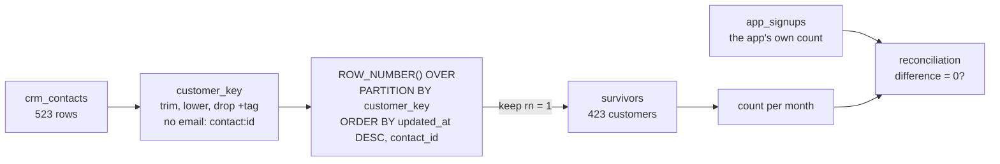

# Duplicates and reconciliation

After the CRM import doubled some rows, how many unique customers really signed up?

## Before you start

- **Level 2** (intermediate). About 2 hours.
- **Builds on:** [05 NULLs, CASE and COALESCE](../../00-start-here/05-nulls-case-and-coalesce/) (NULL is not a value), [03 Window functions](../03-window-functions/) (ROW_NUMBER and PARTITION BY), [06 Anti-joins, self-joins and UNION](../06-anti-joins-self-joins-and-union/) (UNION) and [07 Subqueries and CTEs](../07-subqueries-and-ctes/) (building an answer in named steps).
- **You need:** Python 3.9 or later. Nothing to install.

## The problem

You are the analyst at Tallyo, a fictional budgeting app with its team in Bengaluru. Mira, the head of growth, is sending the investor update on Thursday and needs new customers per month for August, September and October 2026. The CRM (customer relationship management tool, the sales and marketing team's list of contacts) says 523. On 2 October someone imported the old marketing tool's contact list into the CRM, and the app's own account database counts only 423 signups for the same three months. Mira wants the real number, the current plan of each customer, and proof that the CRM now agrees with the app, month by month.

## In plain words

Think of a wedding guest list that two aunts typed up separately and then pasted together. "Asha Rao" appears twice. So does "ASHA RAO", and " Asha Rao " with a stray space. Counting lines gives too many guests. Asking for the distinct lines does not help much either, because the computer sees "ASHA RAO" and "Asha Rao" as different text. You first have to agree what makes two lines the same guest, write every line in that agreed form, and only then count. When two lines disagree (one says vegetarian, one says not), you need a rule for which line to believe.

- A **duplicate** is two or more rows that stand for the same real thing. An **exact duplicate** matches in every column. A **near-duplicate** differs in ways that do not matter: letter case, spaces, an alias.
- A **business key** is the column, or the cleaned-up version of a column, that identifies the real thing. Here the real thing is a customer and the business key is the email address, normalised.
- To **normalise** a value is to rewrite it in one agreed form: here, trim the spaces, lower the case, and drop any `+tag`.
- A **plus alias** (or +tag) is the part after a `+` and before the `@`, as in `asha+webinar@post.example`. Many mail services deliver it to `asha@post.example`, and Tallyo's marketing forms added tags to track campaigns.
- To **dedupe** is to keep one row per business key. The row you keep is the **surviving row**.
- To **reconcile** is to compare your count with an independent count of the same thing (here, the app's own count) and explain every difference.

## What you will build from scratch

- A `customer_key` for every CRM row: trimmed, lower case, +tag removed, and a separate key for each contact with no email.
- The surviving row of each customer with `ROW_NUMBER() OVER (PARTITION BY customer_key ORDER BY ...)`.
- Customers per plan, counted from the surviving rows.
- A reconciliation table: CRM rows, unique customers, the app's count and the difference, for every month on either side.

The data in `data/` is synthetic. `make_data.py` builds it with a fixed random seed. Email addresses use the reserved `.example` domains, so none can belong to a real person.

## The idea

Deduping is three decisions, made in order, and each one can be wrong on its own:

1. **What makes two rows the same customer?** The business key. Here: `lower(trim(email))`, with any `+tag` before the `@` removed. A contact with no email cannot be matched to anyone, so it gets its own key, `'contact:' || contact_id`.
2. **Which row survives?** Rows of one customer disagree: the import copied old plans. Mira's rule is "the newest row wins": latest `updated_at`, and on a tie the smallest `contact_id`, so the answer is the same every time the query runs.
3. **Does the result agree with an independent count?** The app has one account per person. After deduping, unique customers per month should equal the app's signups per month. A difference of 0 is the evidence; any other number is a question to answer before the update goes out.



`ROW_NUMBER()` numbers the rows inside each partition (here, each customer) 1, 2, 3 in the order you give. Keeping `rn = 1` keeps exactly one row per customer, and the ORDER BY inside the window is where the survivor rule lives. This is why a window function is better than `GROUP BY customer_key` here: GROUP BY gives one row per customer, but it cannot say which row's plan to take.

## Walk through

Run any query below from this folder with `python3 ../query.py "<the query>"`. For the long ones, save the query in a file and run `python3 ../query.py file.sql`.

Step 1. How far apart are the two counts?

```sql
SELECT (SELECT COUNT(*) FROM crm_contacts) AS crm_rows,
       (SELECT SUM(signups) FROM app_signups) AS app_signups,
       (SELECT COUNT(*) FROM crm_contacts WHERE source = 'import_mkt') AS imported_rows;
```

```text
crm_rows  app_signups  imported_rows
--------  -----------  -------------
523       423          100
```

100 more rows in the CRM than accounts in the app, and 100 rows came from the import. That is a clue, not a proof: some imported rows might be new people, and some duplicates might have come from elsewhere.

Step 2. Look at what a duplicate looks like.

```sql
SELECT contact_id, email, plan, updated_at, source
FROM crm_contacts
WHERE lower(email) LIKE '%uma.nair81%' OR lower(email) LIKE '%isha.silva80%'
ORDER BY lower(trim(email)), updated_at;
```

```text
contact_id  email                                 plan    updated_at           source
----------  ------------------------------------  ------  -------------------  ----------
C81530      isha.silva80+webinar@letters.example  family  2026-08-31 13:45:10  import_mkt
C92501      isha.silva80@letters.example          plus    2026-08-27 07:54:03  app_sync
C38469      uma.nair81+news@mailbox.example       plus    2026-08-15 08:53:56  import_mkt
C52356      uma.nair81@mailbox.example            family  2026-10-24 12:43:25  app_sync
```

Two people, four rows. The import gave each a `+tag`, so the emails are different strings. The two rows also disagree about the plan: for Uma the newer row is the app's, for Isha it is the imported one. Spaces are harder to see: `'[' || email || ']'` puts brackets around the value so you can spot them.

```sql
SELECT contact_id, '[' || email || ']' AS email, source
FROM crm_contacts
WHERE email <> trim(email) OR email <> lower(email)
ORDER BY contact_id
LIMIT 4;
```

```text
contact_id  email                             source
----------  --------------------------------  ----------
C10409      [LEO.ROY53@POST.EXAMPLE]          import_mkt
C13813      [  divya.patel57@inbox.example ]  import_mkt
C13824      [  elena.mehta3@post.example ]    import_mkt
C15865      [  omar.rao26@mailbox.example ]   import_mkt
```

Step 3. Count customers under stricter and stricter keys.

```sql
SELECT COUNT(DISTINCT email) AS raw_email,
       COUNT(DISTINCT lower(trim(email))) AS trimmed_lower,
       SUM(email IS NULL) AS no_email
FROM crm_contacts;
```

```text
raw_email  trimmed_lower  no_email
---------  -------------  --------
471        431            17
```

`COUNT(DISTINCT ...)` skips NULLs, so neither of the first two columns counts the 17 contacts with no email. Trimming and lower-casing merges 40 more rows than the raw email does, but 431 + 17 = 448 is still 25 more than the app. The rest are +tags.

Step 4. Build the key and number the rows of each customer.

```sql
WITH cleaned AS (
  SELECT *, lower(trim(email)) AS e FROM crm_contacts
),
keyed AS (
  SELECT *,
         CASE
           WHEN e IS NULL OR e = '' THEN 'contact:' || contact_id
           WHEN instr(e, '+') BETWEEN 1 AND instr(e, '@') THEN
             substr(e, 1, instr(e, '+') - 1) || substr(e, instr(e, '@'))
           ELSE e
         END AS customer_key
  FROM cleaned
)
SELECT customer_key, contact_id, plan, updated_at,
       ROW_NUMBER() OVER (PARTITION BY customer_key ORDER BY updated_at DESC, contact_id) AS rn
FROM keyed
WHERE customer_key IN ('uma.nair81@mailbox.example', 'isha.silva80@letters.example',
                       'contact:C14794', 'contact:C26179')
ORDER BY customer_key, rn;
```

```text
customer_key                  contact_id  plan    updated_at           rn
----------------------------  ----------  ------  -------------------  --
contact:C14794                C14794      free    2026-10-22 20:39:37  1
contact:C26179                C26179      free    2026-09-23 15:27:43  1
isha.silva80@letters.example  C81530      family  2026-08-31 13:45:10  1
isha.silva80@letters.example  C92501      plus    2026-08-27 07:54:03  2
uma.nair81@mailbox.example    C52356      family  2026-10-24 12:43:25  1
uma.nair81@mailbox.example    C38469      plus    2026-08-15 08:53:56  2
```

Line by line: `cleaned` trims and lower-cases once, so the CASE does not repeat it. In `keyed`, `instr(e, '+')` is the position of the first `+` (0 if there is none). `BETWEEN 1 AND instr(e, '@')` says: there is a `+`, and it comes before the `@`. Then the key is the part before the `+` glued to the part from the `@` on. A contact with no email gets `contact:` plus its own id, so each one is its own partition. In the window, `ORDER BY updated_at DESC, contact_id` puts the newest row first and breaks ties by id, so `rn = 1` is the survivor.

Step 5. Keep the survivors and count plans.

```sql
WITH cleaned AS (
  SELECT *, lower(trim(email)) AS e FROM crm_contacts
),
keyed AS (
  SELECT *,
         CASE
           WHEN e IS NULL OR e = '' THEN 'contact:' || contact_id
           WHEN instr(e, '+') BETWEEN 1 AND instr(e, '@') THEN
             substr(e, 1, instr(e, '+') - 1) || substr(e, instr(e, '@'))
           ELSE e
         END AS customer_key
  FROM cleaned
),
ranked AS (
  SELECT *, ROW_NUMBER() OVER (PARTITION BY customer_key ORDER BY updated_at DESC, contact_id) AS rn
  FROM keyed
)
SELECT plan, COUNT(*) AS customers
FROM ranked
WHERE rn = 1
GROUP BY plan
ORDER BY plan;
```

```text
plan    customers
------  ---------
family  143
free    138
plus    142
```

143 + 138 + 142 = 423, the app's total. The window cannot be used in WHERE directly (it is worked out after WHERE runs), which is why `rn` is made in one CTE and filtered in the next.

Step 6. Reconcile month by month.

```sql
WITH cleaned AS (
  SELECT *, lower(trim(email)) AS e FROM crm_contacts
),
keyed AS (
  SELECT *,
         CASE
           WHEN e IS NULL OR e = '' THEN 'contact:' || contact_id
           WHEN instr(e, '+') BETWEEN 1 AND instr(e, '@') THEN
             substr(e, 1, instr(e, '+') - 1) || substr(e, instr(e, '@'))
           ELSE e
         END AS customer_key
  FROM cleaned
),
crm AS (
  SELECT substr(signup_date, 1, 7) AS month, COUNT(*) AS crm_rows,
         COUNT(DISTINCT customer_key) AS unique_customers
  FROM keyed
  GROUP BY substr(signup_date, 1, 7)
),
months AS (
  SELECT month FROM crm UNION SELECT month FROM app_signups
)
SELECT m.month, COALESCE(c.crm_rows, 0) AS crm_rows,
       COALESCE(c.unique_customers, 0) AS unique_customers,
       COALESCE(a.signups, 0) AS app_signups,
       COALESCE(c.unique_customers, 0) - COALESCE(a.signups, 0) AS difference
FROM months m
LEFT JOIN crm c ON c.month = m.month
LEFT JOIN app_signups a ON a.month = m.month
ORDER BY m.month;
```

```text
month    crm_rows  unique_customers  app_signups  difference
-------  --------  ----------------  -----------  ----------
2026-08  207       153               153          0
2026-09  180       137               137          0
2026-10  136       133               133          0
```

`months` is every month on either side (UNION also removes repeats), so a month that only one side has still shows up, with a 0 on the other side. Joining `crm` straight to `app_signups` would silently drop such a month. Every difference is 0. October has almost no duplicates because the import ran on 2 October and only knew people who had signed up by then. `COUNT(DISTINCT customer_key)` is safe here because every row has a key, including the no-email ones.

**In other databases.** `lower`, `trim` and `ROW_NUMBER` are the same in Postgres, BigQuery, Snowflake and SQL Server. SQLite's `instr(s, '+')` is `strpos(s, '+')` in Postgres and BigQuery, `position('+' in s)` in Postgres and Snowflake, and `charindex('+', s)` in SQL Server. BigQuery, Snowflake and Databricks also have `QUALIFY rn = 1`, which filters a window result without the extra CTE.

## Common mistakes

**1. DISTINCT over the columns (the trap).** "Remove the duplicate rows" sounds like `SELECT DISTINCT`:

```sql
SELECT COUNT(*) AS distinct_rows
FROM (SELECT DISTINCT email, full_name, signup_date, plan FROM crm_contacts);
```

```text
distinct_rows
-------------
488
```

It runs and gives 488, which looks cleaned. It only removed the exact copies. `DISTINCT` compares text exactly, so `ASHA.RAO1@POST.EXAMPLE`, ` asha.rao1@post.example ` and `asha.rao1+webinar@post.example` are three different rows, and two copies with different plans are different rows too. `SELECT DISTINCT *` is worse: the copies have different `contact_id`s and `source`s, so it removes nothing at all and returns all 523. Dedupe on a business key you have written down, never on "all the columns".

**2. Picking the wrong surviving row.** Any rule gives 423 customers, so the count cannot catch this one. Keeping the smallest `contact_id`, or `MIN(plan)` in a GROUP BY, moves customers between plans:

```sql
WITH keyed AS (
  SELECT *,
         CASE
           WHEN lower(trim(email)) IS NULL THEN 'contact:' || contact_id
           WHEN instr(lower(trim(email)), '+') BETWEEN 1 AND instr(lower(trim(email)), '@') THEN
             substr(lower(trim(email)), 1, instr(lower(trim(email)), '+') - 1)
             || substr(lower(trim(email)), instr(lower(trim(email)), '@'))
           ELSE lower(trim(email))
         END AS customer_key
  FROM crm_contacts
),
first_id AS (
  SELECT *, ROW_NUMBER() OVER (PARTITION BY customer_key ORDER BY contact_id) AS rn FROM keyed
)
SELECT plan, COUNT(*) AS customers FROM first_id WHERE rn = 1 GROUP BY plan ORDER BY plan;
```

```text
plan    customers
------  ---------
family  145
free    138
plus    140
```

Compare with step 5: family 143, free 138, plus 142. The total is right and the split is wrong, because `contact_id` is a random CRM id and says nothing about which row is newer. Also never leave the tie open: `ORDER BY updated_at DESC` alone lets two exact copies come back in either order, so the "same" query can return a different `contact_id` tomorrow.

**3. Letting the NULL emails collapse into one customer.** `PARTITION BY lower(trim(email))` puts every NULL into one partition, so 17 phone signups become 1 customer:

```sql
SELECT COUNT(*) AS customers
FROM (
  SELECT ROW_NUMBER() OVER (
           PARTITION BY CASE WHEN instr(lower(trim(email)), '+') > 0
                             THEN substr(lower(trim(email)), 1, instr(lower(trim(email)), '+') - 1)
                                  || substr(lower(trim(email)), instr(lower(trim(email)), '@'))
                             ELSE lower(trim(email)) END
           ORDER BY updated_at DESC, contact_id) AS rn
  FROM crm_contacts
)
WHERE rn = 1;
```

```text
customers
---------
407
```

407 is 16 short of the app. The opposite mistake is `COUNT(DISTINCT key)` with NULL keys: it drops all 17. A missing key means "cannot be matched", not "the same as every other missing key". Give each one its own key, or report them on a separate line.

**4. Merging too much.** A rule that removes dots from the part before the `@`, or treats every `+` as an alias, is right for some mail services and wrong for others, and two different people can end up as one customer. Check the merged groups by eye: do the names match? Write the rule down with the stakeholder, as Mira did here, and keep it in the query comment. If the merged count goes below the independent count, you have merged too much.

## Your turn

Open `exercise.sql` and write three queries: `survivors`, `plan_counts` and `reconciliation`. The rules for the key and the survivor are at the top of the file; how you build them is up to you.

```
python3 test_lesson.py
```

Run it from this folder. The test checks that your survivors match the app's total, then runs your queries on a second dataset made with a different seed, and on tiny hand-made tables: empty tables, four spellings of one address, two exact copies with the same `updated_at`, contacts with no email, and a month the app has but the CRM does not.

Stretch: add a `duplicates_by_source` query that counts, for each source, how many rows were NOT the survivor. Did all the losing rows come from the import?

## Check yourself

1. Why does `SELECT DISTINCT *` not remove the duplicates from this table?
2. Two rows of one customer have the same `updated_at`. Why does the ORDER BY still need `contact_id`?
3. Your deduped count matches the independent count exactly. What could still be wrong?
4. The deduped count is 5 below the app's count. Name two causes.

<details>
<summary>Answers</summary>

1. DISTINCT compares every selected column exactly. The copies have different `contact_id` and `source` values, and many differ in the email's case, spaces or +tag, so no two rows are identical.
2. Without it, the database may return either row first, and the choice can change between runs. The count stays the same, but the surviving `contact_id`, and any column that differs between the copies, can change.
3. Which row survived. Counts reconcile under any survivor rule, but the plan split depends on the rule. A matching total also does not prove that the right rows were merged: one wrong merge and one missed merge cancel out.
4. Over-merging (a key rule that joins two different people, such as stripping dots), or rows lumped together because their key was NULL. It could also be accounts that exist in the app and never reached the CRM.

</details>

## What to tell the stakeholder

> Mira, Tallyo gained 423 unique customers from August to October 2026: 153 in August, 137 in September and 133 in October. That matches the app's own count in every month. The CRM showed 523 because the 2 October import added 100 copies of existing customers, with different capitals, spaces or +tags in the email. Today 143 are on Family, 142 on Plus and 138 on Free.

The caveats: two emails are treated as one person when they differ only by case, spaces or a +tag, as we agreed; 17 customers signed up by phone with no email and are counted one by one. The plan is taken from each customer's most recently updated CRM row.

## In real job postings

In the Real Analyst Jobs data drop of 25 October 2026 ([data/job-market/2026-10](../../../data/job-market/2026-10/)), 634 of the 900 India analyst postings that list tools (70.4%) ask for SQL, out of 1,174 India postings. Browse them at [SQL data analyst jobs](https://realanalystjobs.com/jobs/sql-data-analyst-jobs).

## Next

[09 Rolling averages and percent of total](../09-rolling-averages-and-percent-of-total/).
