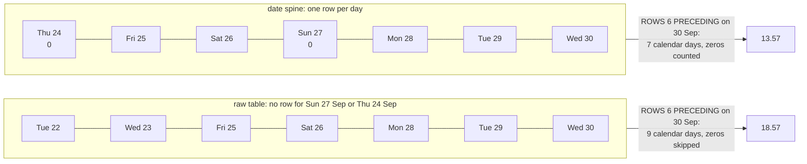

# Rolling averages and percent of total

What is the 7-day moving average of orders, and each region's share of revenue?

## Before you start

- **Level 2** (intermediate). About 2 hours.
- **Builds on:** [03 Window functions](../03-window-functions/) (OVER, PARTITION BY, frames, ROWS and RANGE) and [05 Dates and the date spine](../05-dates-and-the-date-spine/) (a recursive date spine, why a missing day is a zero).
- **You need:** Python 3.9 or later. Nothing to install.

## The problem

You are the analyst at Fernhill Supply, a fictional wholesale company with three regions: North, South and West. Diana, the operations director, plans warehouse staff from a chart of daily orders, and the daily line jumps around too much to read. For Monday's planning meeting she wants a 7-day moving average of orders for September and October 2026, and each region's share of revenue over the same two months. The warehouse is shut on Sundays and was shut on two other days, and on those days the orders table has no row at all. A colleague's first chart put the moving average at about 18.6 orders a day at the end of September. The right number is closer to 13.6.

## In plain words

Think of a step counter that shows "average steps per day this week". If you leave the phone at home on Sunday, the phone records nothing for Sunday. A fair weekly average still divides by seven days, with Sunday as zero. A lazy one takes "the last seven days the phone has data for", which quietly reaches back eight or nine days, skips the zero, and makes you look more active than you are.

- A **moving average** (or rolling average) is the average of the last few values, recomputed every day, so it slides along. A **7-day moving average** on 30 September is the average of 24 to 30 September.
- A **window frame** is the set of rows a window function looks at for the current row. `ROWS BETWEEN 6 PRECEDING AND CURRENT ROW` means "this row and the 6 rows before it", counted in rows. `RANGE BETWEEN 6 PRECEDING AND CURRENT ROW` means "every row whose ORDER BY value is within 6 of this row's", counted in values.
- A **date spine** is a list of every calendar day, made from the report period, so a day with no data still has a row.
- **Percent of total** (or share) is one part divided by the whole, times 100. `SUM(x) OVER ()` puts the whole on every row: an empty `OVER ()` means the window is every row of the result.

## What you will build from scratch

- Orders and revenue for every day of the period, zero days included, from a recursive date spine.
- A 7-day moving average with `ROWS BETWEEN 6 PRECEDING AND CURRENT ROW` on the spine, and a guard that leaves the first 6 days empty.
- The same frame with RANGE on the raw table, to see when the two agree.
- Each region's revenue and share of the total with `SUM(revenue) OVER ()`.

The data in `data/` is synthetic. `make_data.py` builds it with a fixed random seed. Amounts are whole currency units.

## The idea

**A ROWS frame counts rows. It only counts days if there is exactly one row per day.** On the raw table, a Sunday has no row, so "the 6 rows before" reaches back past it:



Written out, for day d:

```
avg_7d(d) = (orders on d-6 + orders on d-5 + ... + orders on d) / 7
```

Every one of the seven days is in the sum, including the days with 0, and the divisor is always 7. Two ways to get that right in SQL:

1. **Spine and ROWS.** Build one row per day (zeros included), then `AVG(orders) OVER (ORDER BY day ROWS BETWEEN 6 PRECEDING AND CURRENT ROW)`. Clear, and the zero days show on the chart.
2. **RANGE on the date as a number.** `SUM(orders) OVER (ORDER BY julianday(day) RANGE BETWEEN 6 PRECEDING AND CURRENT ROW) / 7.0` takes every row within 6 days, however many rows that is. Note the `/ 7.0`: `AVG` would divide by the rows present, not by 7. `julianday()` turns a date into a day number, so "6 PRECEDING" means 6 days.

**The first 6 days.** On 1 September there is no 7-day history inside the period. A frame at the start simply holds fewer rows, so `AVG` would quietly average 1, 2, 3 days. Either load 6 days of history before the period, or leave those days empty. Here they are NULL: `CASE WHEN COUNT(*) OVER w = 7 THEN ... END`.

**Share of total.** `revenue / SUM(revenue) OVER ()` divides each region by the sum over all rows of the result. The window runs after GROUP BY, so `SUM(revenue) OVER ()` adds up the grouped rows. Multiply by `100.0`, not `100`, so the division is not done in whole numbers.

## Walk through

Run any query below from this folder with `python3 ../query.py "<the query>"`. For the long ones, save the query in a file and run `python3 ../query.py file.sql`.

Step 1. How many days have data?

```sql
SELECT p.start_date, p.end_date,
       CAST(julianday(p.end_date) - julianday(p.start_date) AS INTEGER) + 1 AS days_in_period,
       (SELECT COUNT(DISTINCT order_date) FROM orders) AS days_with_orders,
       (SELECT COUNT(*) FROM orders) AS orders
FROM report_period p;
```

```text
start_date  end_date    days_in_period  days_with_orders  orders
----------  ----------  --------------  ----------------  ------
2026-09-01  2026-10-31  61              51                898
```

61 days in the period and only 51 have a row. The 10 missing days are the 8 Sundays and the 2 shut days. Nothing in the orders table says so: a day with no orders simply has no row.

Step 2. A date spine, with orders per day.

```sql
WITH RECURSIVE spine(day) AS (
  SELECT start_date FROM report_period
  UNION ALL
  SELECT date(day, '+1 day') FROM spine, report_period WHERE day < end_date
),
per_day AS (
  SELECT order_date, COUNT(*) AS orders, SUM(amount) AS revenue
  FROM orders GROUP BY order_date
)
SELECT s.day, CASE strftime('%w', s.day) WHEN '0' THEN 'Sun' ELSE '' END AS sunday,
       COALESCE(p.orders, 0) AS orders, COALESCE(p.revenue, 0) AS revenue
FROM spine s
LEFT JOIN per_day p ON p.order_date = s.day
WHERE s.day BETWEEN '2026-09-22' AND '2026-09-30'
ORDER BY s.day;
```

```text
day         sunday  orders  revenue
----------  ------  ------  -------
2026-09-22          15      16448
2026-09-23          20      20985
2026-09-24          0       0
2026-09-25          21      18621
2026-09-26          12      10701
2026-09-27  Sun     0       0
2026-09-28          23      18847
2026-09-29          22      19216
2026-09-30          17      18386
```

The spine starts at `start_date` and adds a day until it reaches `end_date`. Orders are counted per day first (`per_day`), then joined on, and `COALESCE` turns the missing days into 0. 24 September was a Thursday and the warehouse was shut; 27 September is a Sunday. Both now have a row.

Step 3. The 7-day moving average on the spine.

```sql
WITH RECURSIVE spine(day) AS (
  SELECT start_date FROM report_period
  UNION ALL
  SELECT date(day, '+1 day') FROM spine, report_period WHERE day < end_date
),
daily AS (
  SELECT s.day, COUNT(o.order_id) AS orders
  FROM spine s LEFT JOIN orders o ON o.order_date = s.day
  GROUP BY s.day
),
smoothed AS (
  SELECT day, orders,
         CASE WHEN COUNT(*) OVER w = 7 THEN ROUND(AVG(orders) OVER w, 2) END AS avg_7d
  FROM daily
  WINDOW w AS (ORDER BY day ROWS BETWEEN 6 PRECEDING AND CURRENT ROW)
)
SELECT * FROM smoothed
WHERE day <= '2026-09-08' OR day BETWEEN '2026-09-26' AND '2026-09-30'
ORDER BY day;
```

```text
day         orders  avg_7d
----------  ------  ------
2026-09-01  13      NULL
2026-09-02  21      NULL
2026-09-03  16      NULL
2026-09-04  20      NULL
2026-09-05  7       NULL
2026-09-06  0       NULL
2026-09-07  17      13.43
2026-09-08  20      14.43
2026-09-26  12      12.29
2026-09-27  0       12.29
2026-09-28  23      13.0
2026-09-29  22      14.0
2026-09-30  17      13.57
```

Line by line: `COUNT(o.order_id)` counts the joined orders and gives 0 on a spine day with none (`COUNT(*)` would give 1). `WINDOW w AS (...)` names the window once so the COUNT and the AVG share it. `COUNT(*) OVER w = 7` is true only when the frame holds a full week, so the first 6 days are NULL. The filter on `day` is in the outer query, after the window has run, so it only picks which rows to show.

Step 4. ROWS and RANGE side by side on the raw table.

```sql
WITH per_day AS (
  SELECT order_date AS day, COUNT(*) AS orders FROM orders GROUP BY order_date
),
w AS (
  SELECT day, orders,
         ROUND(AVG(orders) OVER (ORDER BY day ROWS BETWEEN 6 PRECEDING AND CURRENT ROW), 2) AS rows_avg,
         ROUND(AVG(orders) OVER (ORDER BY julianday(day) RANGE BETWEEN 6 PRECEDING AND CURRENT ROW), 2) AS range_avg,
         ROUND(SUM(orders) OVER (ORDER BY julianday(day) RANGE BETWEEN 6 PRECEDING AND CURRENT ROW) / 7.0, 2) AS range_sum_div_7
  FROM per_day
)
SELECT * FROM w WHERE day BETWEEN '2026-09-26' AND '2026-09-30' ORDER BY day;
```

```text
day         orders  rows_avg  range_avg  range_sum_div_7
----------  ------  --------  ---------  ---------------
2026-09-26  12      15.71     17.2       12.29
2026-09-28  23      16.43     18.2       13.0
2026-09-29  22      18.71     19.6       14.0
2026-09-30  17      18.57     19.0       13.57
```

Only `range_sum_div_7` matches step 3: 12.29, 13.0, 14.0 and 13.57. `rows_avg` uses 7 rows, which are 8 or 9 calendar days. `range_avg` uses the right days but divides by the number of rows in them, so the zero days are left out of the average. The days with no row (24 and 27 September) also have no average at all, which is a hole in Diana's chart.

Step 5. Each region's share of revenue.

```sql
WITH by_region AS (
  SELECT COALESCE(o.region, 'Unassigned') AS region, SUM(o.amount) AS revenue
  FROM orders o, report_period p
  WHERE o.order_date BETWEEN p.start_date AND p.end_date
  GROUP BY COALESCE(o.region, 'Unassigned')
)
SELECT region, revenue,
       SUM(revenue) OVER () AS total,
       ROUND(100.0 * revenue / NULLIF(SUM(revenue) OVER (), 0), 1) AS share_pct
FROM by_region
ORDER BY revenue DESC, region;
```

```text
region      revenue  total   share_pct
----------  -------  ------  ---------
North       360272   857364  42.0
West        274809   857364  32.1
South       212307   857364  24.8
Unassigned  9976     857364  1.2
```

`SUM(revenue) OVER ()` is the same total on every row, so each row can divide by it without a second query. `NULLIF(x, 0)` turns a zero total into NULL, so an empty period gives a NULL share instead of an error. The 14 orders with no region are kept as `Unassigned`, so the shares are of all revenue. The rounded shares add up to 100.1; say so on the slide rather than nudging one of them.

**In other databases.** `ROWS` frames and `SUM() OVER ()` are the same everywhere. A RANGE frame with a number (`6 PRECEDING`) needs SQLite 3.28 or later (2019); Postgres 11 and later write it on a date directly as `RANGE BETWEEN INTERVAL '6 days' PRECEDING AND CURRENT ROW`, and BigQuery needs a number such as `UNIX_DATE(day)`. SQL Server does not support RANGE with an offset at all, which is one more reason to build the spine. `WITH RECURSIVE` is `WITH` in SQL Server; BigQuery and Snowflake also have `GENERATE_DATE_ARRAY` and `GENERATOR` for the spine.

## Common mistakes

**1. ROWS BETWEEN 6 PRECEDING on a table with missing days (the trap).** This is the colleague's chart: the frame on the raw daily counts, no spine.

```sql
WITH per_day AS (
  SELECT order_date AS day, COUNT(*) AS orders FROM orders GROUP BY order_date
),
w AS (
  SELECT day, orders,
         ROUND(AVG(orders) OVER (ORDER BY day ROWS BETWEEN 6 PRECEDING AND CURRENT ROW), 2) AS avg_7_rows
  FROM per_day
)
SELECT * FROM w WHERE day >= '2026-09-26' AND day <= '2026-10-03' ORDER BY day;
```

```text
day         orders  avg_7_rows
----------  ------  ----------
2026-09-26  12      15.71
2026-09-28  23      16.43
2026-09-29  22      18.71
2026-09-30  17      18.57
2026-10-01  17      18.86
2026-10-02  19      18.71
2026-10-03  11      17.29
```

It runs, it looks smooth, and it is about 5 orders a day too high: 18.57 on 30 September against 13.57. Every frame skips the Sunday and reaches back an extra day, so the zero never enters any average. The same skew shows in the plain average: the days that have a row average 17.61 orders, while the 61 calendar days average 14.72. Planning staff from this line would over-staff every week. Check before you trust a ROWS frame: does the table have exactly one row per day?

**2. RANGE with AVG.** RANGE fixes which days are in the frame but not the divisor: `AVG` divides by the rows it found, so a week with a Sunday and a shut day is averaged over 5 rows. Use `SUM(...) / 7.0`, or the spine.

**3. Whole-number division in the share.** In SQLite, Postgres and SQL Server an integer divided by an integer is an integer:

```sql
WITH by_region AS (
  SELECT COALESCE(region, 'Unassigned') AS region, SUM(amount) AS revenue
  FROM orders GROUP BY COALESCE(region, 'Unassigned')
)
SELECT region, revenue,
       revenue / SUM(revenue) OVER () * 100 AS share_wrong,
       100 * revenue / SUM(revenue) OVER () AS share_truncated,
       ROUND(100.0 * revenue / SUM(revenue) OVER (), 1) AS share_pct
FROM by_region
ORDER BY revenue DESC;
```

```text
region      revenue  share_wrong  share_truncated  share_pct
----------  -------  -----------  ---------------  ---------
North       360272   0            42               42.0
West        274809   0            32               32.1
South       212307   0            24               24.8
Unassigned  9976     0            1                1.2
```

`share_wrong` is 0 for every region because 360272 / 857364 is 0 in whole numbers, then times 100 is still 0. `share_truncated` drops the decimals, so the shares add up to 99. `100.0 *` first makes the whole calculation decimal. (BigQuery and Snowflake return a decimal from `/`, so the same query gives a different answer there.)

**4. Filtering before the window.** `WHERE day >= '2026-10-01'` in the same SELECT as the window removes September before the window runs, so the first October averages are built from 1, 2, 3 days. In step 3 the filter is in the outer query, after the window. The same applies to shares: `WHERE region <> 'Unassigned'` in the grouping query changes the total, so the three regions add up to 100% of a smaller number. Decide which total the share is of, and filter accordingly.

## Your turn

Open `exercise.sql` and write three queries: `daily_orders`, `moving_avg` and `region_share`. Diana's definitions are at the top of the file.

```
python3 test_lesson.py
```

Run it from this folder. The test checks that `daily_orders` has a row for every day of the period, then runs your queries on a second dataset made with a different seed, and on tiny hand-made tables: no orders at all, a period shorter than a week, a missing day inside the window, two regions with the same revenue, an order with no region, an order outside the period, and a period with zero revenue.

Stretch: add a `region_share_by_month` query with each region's share of its month's revenue, using `SUM(revenue) OVER (PARTITION BY month)`. Do the North, South and West shares move between September and October?

## Check yourself

1. On a table with one row per day that has data, what does `ROWS BETWEEN 6 PRECEDING AND CURRENT ROW` cover, and why is it not a week?
2. Why does `AVG` over a RANGE frame of 7 days still give the wrong moving average here?
3. What does `OVER ()` with nothing in the brackets mean?
4. A share query returns 0 for every region. What is the first thing you check?

<details>
<summary>Answers</summary>

1. The current row and the 6 rows before it, whatever dates they have. When days are missing, those 7 rows span more than 7 calendar days and the zero days are never in the frame.
2. RANGE picks the right days, but the days with no orders have no row, so `AVG` divides by fewer than 7. The sum over the frame divided by 7, or a spine with zeros, gives the right number.
3. The window is the whole result set: every row, no partition, no order. `SUM(x) OVER ()` is the grand total, repeated on every row.
4. Integer division: both sides are whole numbers, so the result is truncated to 0 before the multiplication by 100. Write `100.0 * part / total`.

</details>

## What to tell the stakeholder

> Diana, the 7-day moving average of orders was 13.57 a day at the end of September, and 13.57 again on 31 October, a week that included the shut day on 28 October. That counts Sundays and the two shut days (24 September, 28 October) as zero-order days. For September and October together, North brought in 42.0% of revenue, West 32.1% and South 24.8%; 1.2% came from accounts not yet assigned to a region.

The caveats: the average is per calendar day, so it includes Sundays. If you plan staff for open days only, divide by open days instead, which gives a higher number; tell me which you want. The first 6 days of September have no average, because the data starts on 1 September. The shares are rounded and add up to 100.1%.

## In real job postings

In the Real Analyst Jobs data drop of 25 October 2026 ([data/job-market/2026-10](../../../data/job-market/2026-10/)), 286 of the 413 UK analyst postings that list tools (69.2%) ask for SQL, out of 620 UK postings. Browse them at [SQL data analyst jobs](https://realanalystjobs.com/jobs/sql-data-analyst-jobs).

## Next

[10 Sessionization from raw events](../10-sessionization/).
