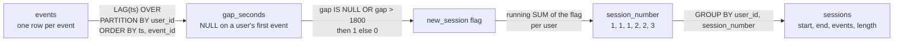

# Sessionization from raw events

How many sessions does each user have with a 30-minute timeout, and how long is a session?

## Before you start

- **Level 2** (intermediate). About 2 hours.
- **Builds on:** [03 Window functions](../03-window-functions/) (OVER, PARTITION BY, LAG and running totals), [05 Dates and the date spine](../05-dates-and-the-date-spine/) (date and time text in SQLite) and [07 Subqueries and CTEs](../07-subqueries-and-ctes/) (building an answer in named steps).
- **You need:** Python 3.9 or later. Nothing to install.

## The problem

You are the product analyst at Lanternway Courses, a fictional online course platform. Kofi, the product manager for the new mobile app, is presenting the first week of the pilot (Monday 12 to Sunday 18 October 2026) on Wednesday. He wants two numbers for the 37 learners in the pilot: how many visits ("sessions") each learner made, and how long a session usually lasts. The app does not record visits, only events: one row each time a learner opens the app, plays a video or answers a quiz. The dashboard tile a colleague built says 271 sessions. The right number, under the rule Kofi agreed, is 247.

## In plain words

Think of a cafe that only keeps its till receipts, not a record of who sat where. To count visits, you would line up each customer's receipts by time and say: if two receipts are more than half an hour apart, the customer must have left and come back. Every such gap starts a new visit.

- An **event** is one thing a user did, with a time: open the app, play a video. The table has one row per event.
- A **session** is one visit: a run of a user's events with no long pause inside it.
- The **timeout** (or inactivity timeout) is the longest pause that still counts as the same visit. Here it is 30 minutes, the rule Kofi agreed. A pause of exactly 30:00 stays in the visit; 30:01 starts a new one. That is a definition, agreed with Kofi and written down, not a law of nature.
- **Sessionization** is turning events into sessions: give every event a session number.
- `LAG(x) OVER (...)` returns `x` from the previous row of the same window, so each row can see the one before it.
- A **running sum** (`SUM(...) OVER (... ROWS BETWEEN UNBOUNDED PRECEDING AND CURRENT ROW)`) adds up everything from the first row to this one.
- **Epoch seconds** are a time written as a whole number of seconds since 1 January 1970. Subtracting two of them gives an exact gap in seconds.

## What you will build from scratch

- The gap, in whole seconds, between each event and the same user's previous event.
- A session number for every event: a flag (1 when a new session starts) and a running sum of the flags.
- One row per session with its start, end, number of events and length.
- One row per learner with sessions, events and average session length.

The data in `data/` is synthetic. `make_data.py` builds it with a fixed random seed. Times are text in the form `YYYY-MM-DD HH:MM:SS`, all in one time zone.

## The idea

Sessionization is three window steps, and the order matters:



On one learner's morning it looks like this. Each number is the gap in seconds since the previous event:

```text
event      02:27:50  02:36:25  02:46:05  02:48:24  03:18:24  05:03:58
gap        NULL      515       580       139       1800      6334
new?       1         0         0         0         0         1
running    1         1         1         1         1         2      <- session_number
```

Written out, for user u and their events in time order e1, e2, ...:

```
gap(ek)        = time(ek) - time(ek-1), in whole seconds; NULL for e1
new(ek)        = 1 if gap(ek) is NULL or gap(ek) > 1800, else 0
session(ek)    = new(e1) + new(e2) + ... + new(ek)
length(s)      = time of the last event in s - time of the first event in s
```

Four decisions are hidden in those lines, and each one changes the count:

1. **The partition.** Gaps are measured within one user. Without `PARTITION BY user_id`, a learner's gap is measured from someone else's event.
2. **The order and the tie.** Two events can share the same second. Order by `event_time, event_id`, so the order, and so every gap, is the same every time.
3. **The boundary.** `> 1800`, not `>= 1800`, because Kofi's rule says exactly 30:00 is the same visit. And the gap must be an exact whole number of seconds, or a pause of exactly 1800 seconds can come out as 1800.00001.
4. **What a length means.** The app does not know when a learner put the phone down, only when the last event happened. A session with one event has a length of 0. So "session length" here is "time from first to last event", which is shorter than the real time spent.

Events with no time cannot be placed, so they are left out and counted separately.

## Walk through

Run any query below from this folder with `python3 ../query.py "<the query>"`. For the long ones, save the query in a file and run `python3 ../query.py file.sql`.

Step 1. What is in the table?

```sql
SELECT COUNT(*) AS events,
       COUNT(DISTINCT user_id) AS users,
       SUM(event_time IS NULL) AS no_time,
       MIN(event_time) AS first_event,
       MAX(event_time) AS last_event
FROM events;
```

```text
events  users  no_time  first_event          last_event
------  -----  -------  -------------------  -------------------
1219    37     4        2026-10-12 05:43:55  2026-10-18 23:59:41
```

1,219 events from 37 learners over the week. 4 events arrived with no time at all (a tracking glitch); they cannot belong to any session, so they are left out from here on. `MIN` and `MAX` skip NULLs, so they still show the real first and last events.

Step 2. One learner's events, and the gap to the previous one.

```sql
SELECT event_id, event_time, event_name,
       LAG(event_time) OVER (PARTITION BY user_id ORDER BY event_time, event_id) AS previous_time,
       CAST(strftime('%s', event_time) AS INTEGER)
         - CAST(strftime('%s', LAG(event_time) OVER (PARTITION BY user_id ORDER BY event_time, event_id)) AS INTEGER)
         AS gap_seconds
FROM events
WHERE user_id = 'L017' AND event_time IS NOT NULL
ORDER BY event_time, event_id;
```

```text
event_id  event_time           event_name  previous_time        gap_seconds
--------  -------------------  ----------  -------------------  -----------
352       2026-10-15 02:27:50  open_app    NULL                 NULL
353       2026-10-15 02:36:25  bookmark    2026-10-15 02:27:50  515
354       2026-10-15 02:46:05  play_video  2026-10-15 02:36:25  580
355       2026-10-15 02:48:24  play_video  2026-10-15 02:46:05  139
360       2026-10-15 03:18:24  bookmark    2026-10-15 02:48:24  1800
375       2026-10-15 05:03:58  open_app    2026-10-15 03:18:24  6334
```

Line by line: `LAG(event_time) OVER (PARTITION BY user_id ORDER BY event_time, event_id)` takes the previous event of the same learner. The first event has no previous one, so it gets NULL. `strftime('%s', t)` turns the time into epoch seconds as text, and `CAST(... AS INTEGER)` makes it a number, so the subtraction is exact whole seconds. Event 360 came exactly 1800 seconds after event 355: a 30-minute pause, which under Kofi's rule is still the same visit. Event 375 came 6334 seconds (about 1 hour 46 minutes) later: a new visit.

Step 3. Flag the new sessions and number them with a running sum.

```sql
WITH timed AS (
  SELECT event_id, user_id, event_time,
         CAST(strftime('%s', event_time) AS INTEGER) AS ts
  FROM events
  WHERE event_time IS NOT NULL
),
gaps AS (
  SELECT *, ts - LAG(ts) OVER (PARTITION BY user_id ORDER BY ts, event_id) AS gap_seconds
  FROM timed
),
flagged AS (
  SELECT *, CASE WHEN gap_seconds IS NULL OR gap_seconds > 1800 THEN 1 ELSE 0 END AS new_session
  FROM gaps
)
SELECT event_id, event_time, gap_seconds, new_session,
       SUM(new_session) OVER (PARTITION BY user_id ORDER BY ts, event_id
                              ROWS BETWEEN UNBOUNDED PRECEDING AND CURRENT ROW) AS session_number
FROM flagged
WHERE user_id = 'L017'
ORDER BY ts, event_id;
```

```text
event_id  event_time           gap_seconds  new_session  session_number
--------  -------------------  -----------  -----------  --------------
352       2026-10-15 02:27:50  NULL         1            1
353       2026-10-15 02:36:25  515          0            1
354       2026-10-15 02:46:05  580          0            1
355       2026-10-15 02:48:24  139          0            1
360       2026-10-15 03:18:24  1800         0            1
375       2026-10-15 05:03:58  6334         1            2
```

`timed` converts each time to seconds once, so the later steps do not repeat it. `gaps` is step 2 on the number. `flagged` writes the rule: a NULL gap (the learner's first event) or a gap of more than 1800 seconds starts a session. The running sum of the flag then counts how many sessions have started so far, which is the session number. The filter on `user_id` is in the outer query, after the windows have run; putting it in `timed` would give the same rows here only because the windows are already partitioned by user.

Why two CTEs and not one? A window function cannot be used inside another window function, so the flag (which needs LAG) must be made in one step and summed in the next.

Step 4. One row per session.

```sql
WITH timed AS (
  SELECT event_id, user_id, event_time,
         CAST(strftime('%s', event_time) AS INTEGER) AS ts
  FROM events
  WHERE event_time IS NOT NULL
),
gaps AS (
  SELECT *, ts - LAG(ts) OVER (PARTITION BY user_id ORDER BY ts, event_id) AS gap_seconds
  FROM timed
),
numbered AS (
  SELECT *,
         SUM(CASE WHEN gap_seconds IS NULL OR gap_seconds > 1800 THEN 1 ELSE 0 END)
           OVER (PARTITION BY user_id ORDER BY ts, event_id
                 ROWS BETWEEN UNBOUNDED PRECEDING AND CURRENT ROW) AS session_number
  FROM gaps
)
SELECT user_id, session_number,
       MIN(event_time) AS start_time, MAX(event_time) AS end_time,
       COUNT(*) AS events, MAX(ts) - MIN(ts) AS duration_seconds
FROM numbered
WHERE user_id IN ('L017', 'L032')
GROUP BY user_id, session_number
ORDER BY user_id, session_number
LIMIT 6;
```

```text
user_id  session_number  start_time           end_time             events  duration_seconds
-------  --------------  -------------------  -------------------  ------  ----------------
L017     1               2026-10-15 02:27:50  2026-10-15 03:18:24  5       3034
L017     2               2026-10-15 05:03:58  2026-10-15 05:03:58  1       0
L032     1               2026-10-12 23:20:20  2026-10-12 23:37:15  3       1015
L032     2               2026-10-14 23:44:25  2026-10-14 23:44:25  1       0
L032     3               2026-10-15 23:42:10  2026-10-16 01:27:22  12      6312
L032     4               2026-10-16 14:39:34  2026-10-16 15:17:06  8       2252
```

`(user_id, session_number)` identifies a session, so it is the GROUP BY. Look at L032's session 3: it starts at 23:42 on 15 October and ends at 01:27 the next morning, one visit across midnight. L017's session 2 and L032's session 2 have one event each, so their length is 0 seconds. They are real visits (the learner opened the app and left), and they pull the average down.

Step 5. The numbers for Kofi.

```sql
WITH timed AS (
  SELECT event_id, user_id, event_time,
         CAST(strftime('%s', event_time) AS INTEGER) AS ts
  FROM events
  WHERE event_time IS NOT NULL
),
gaps AS (
  SELECT *, ts - LAG(ts) OVER (PARTITION BY user_id ORDER BY ts, event_id) AS gap_seconds
  FROM timed
),
numbered AS (
  SELECT *,
         SUM(CASE WHEN gap_seconds IS NULL OR gap_seconds > 1800 THEN 1 ELSE 0 END)
           OVER (PARTITION BY user_id ORDER BY ts, event_id
                 ROWS BETWEEN UNBOUNDED PRECEDING AND CURRENT ROW) AS session_number
  FROM gaps
),
sessions AS (
  SELECT user_id, session_number, COUNT(*) AS events, MAX(ts) - MIN(ts) AS duration_seconds
  FROM numbered
  GROUP BY user_id, session_number
),
ordered AS (
  SELECT duration_seconds,
         ROW_NUMBER() OVER (ORDER BY duration_seconds) AS rn,
         COUNT(*) OVER () AS n
  FROM sessions
)
SELECT (SELECT COUNT(*) FROM sessions) AS sessions,
       (SELECT COUNT(DISTINCT user_id) FROM sessions) AS users,
       (SELECT ROUND(AVG(duration_seconds) / 60.0, 1) FROM sessions) AS avg_minutes,
       (SELECT ROUND(AVG(duration_seconds) / 60.0, 1) FROM ordered WHERE rn IN ((n + 1) / 2, (n + 2) / 2)) AS median_minutes,
       (SELECT SUM(events = 1) FROM sessions) AS one_event_sessions;
```

```text
sessions  users  avg_minutes  median_minutes  one_event_sessions
--------  -----  -----------  --------------  ------------------
247       37     27.6         22.1            38
```

247 sessions from 37 learners, about 6.7 per learner in the week. The **median** (the middle session when they are sorted by length) is 22.1 minutes, and the average is 27.6: a few long study sessions pull the average up, so the median is the better "usual" length. `rn IN ((n + 1) / 2, (n + 2) / 2)` uses whole-number division to pick the middle row, or the two middle rows when `n` is even. 38 sessions have a single event and a length of 0.

**In other databases.** `LAG` and running `SUM` are the same everywhere. The gap in seconds is written differently: `EXTRACT(EPOCH FROM t2 - t1)` in Postgres, `TIMESTAMP_DIFF(t2, t1, SECOND)` in BigQuery, `DATEDIFF('second', t1, t2)` in Snowflake and `DATEDIFF(second, t1, t2)` in SQL Server. All of them return whole seconds for timestamps stored to the second. SQLite 3.38 and later also has `unixepoch(t)`, the same as `CAST(strftime('%s', t) AS INTEGER)`. In BigQuery and Snowflake you can filter on a window result with `QUALIFY`.

## Common mistakes

**1. Measuring the gap with julianday (the trap).** `julianday(t)` is the time as a number of days, with the time of day as a fraction. Multiplying a difference by 86400 looks like it gives seconds. This is how the dashboard tile was built:

```sql
WITH gaps AS (
  SELECT user_id, event_time,
         (julianday(event_time)
          - julianday(LAG(event_time) OVER (PARTITION BY user_id ORDER BY event_time, event_id))) * 86400 AS gap
  FROM events
  WHERE event_time IS NOT NULL
)
SELECT SUM(gap IS NULL OR gap > 1800) AS sessions_julianday
FROM gaps;
```

```text
sessions_julianday
------------------
271
```

271 sessions, 24 more than the right 247, and nothing about the query looks wrong. Here is one of the 24, L017's 30-minute pause from step 2:

```sql
WITH gaps AS (
  SELECT user_id, event_time,
         (julianday(event_time)
          - julianday(LAG(event_time) OVER (PARTITION BY user_id ORDER BY event_time, event_id))) * 86400 AS gap
  FROM events
  WHERE event_time IS NOT NULL
)
SELECT event_time, gap, gap > 1800 AS splits
FROM gaps
WHERE user_id = 'L017' AND event_time = '2026-10-15 03:18:24';
```

```text
event_time           gap                splits
-------------------  -----------------  ------
2026-10-15 03:18:24  1800.000013411045  1
```

A day number like 2461328.6 has only so many digits of precision, so a difference of exactly 1800 seconds comes back as 1800.0000134 or 1799.9999732, depending on the times. The ones just above 1800 split a visit in two. Any boundary test on a float can do this. Compare whole numbers (epoch seconds), or round before you compare.

**2. `>=` instead of `>`.** Is a pause of exactly 30:00 a new visit? The data has 34 such pauses, so the answer moves the count:

```sql
WITH timed AS (
  SELECT user_id, event_id, CAST(strftime('%s', event_time) AS INTEGER) AS ts
  FROM events WHERE event_time IS NOT NULL
),
gaps AS (
  SELECT ts - LAG(ts) OVER (PARTITION BY user_id ORDER BY ts, event_id) AS gap FROM timed
)
SELECT SUM(gap IS NULL OR gap > 1800) AS more_than_30,
       SUM(gap IS NULL OR gap >= 1800) AS at_least_30,
       SUM(gap = 1800) AS exactly_30
FROM gaps;
```

```text
more_than_30  at_least_30  exactly_30
------------  -----------  ----------
247           281          34
```

Neither is wrong in general; tools differ. What is wrong is not knowing which one your query does. Write the rule in the query comment, and when you compare with another team's number, ask them which they used.

**3. LAG without PARTITION BY.** Without the partition, "the previous event" is whoever was active just before, across all learners:

```sql
WITH timed AS (
  SELECT user_id, event_id, CAST(strftime('%s', event_time) AS INTEGER) AS ts
  FROM events WHERE event_time IS NOT NULL
),
gaps AS (
  SELECT ts - LAG(ts) OVER (ORDER BY ts, event_id) AS gap FROM timed
)
SELECT SUM(gap IS NULL OR gap > 1800) AS sessions_without_partition
FROM gaps;
```

```text
sessions_without_partition
--------------------------
51
```

51 sessions: this counts the times the whole app went quiet for half an hour, not anyone's visits. The opposite version, `ORDER BY user_id, ts` without a partition, measures each learner's first event from the previous learner's last one, which is often negative, so that learner's first visit is glued onto the previous learner's last session.

**4. Splitting sessions at midnight.** Partitioning by user and day, or grouping events by date first, cuts every late-night visit in two:

```sql
WITH timed AS (
  SELECT user_id, event_id, date(event_time) AS day, CAST(strftime('%s', event_time) AS INTEGER) AS ts
  FROM events WHERE event_time IS NOT NULL
),
gaps AS (
  SELECT ts - LAG(ts) OVER (PARTITION BY user_id, day ORDER BY ts, event_id) AS gap FROM timed
)
SELECT SUM(gap IS NULL OR gap > 1800) AS sessions_split_at_midnight
FROM gaps;
```

```text
sessions_split_at_midnight
--------------------------
257
```

257, ten too many: the data has ten visits that run past midnight, like L032's from 23:42 to 01:27. If you need sessions per day, give each session to the day it started, after sessionizing.

**5. Leaving the NULL times in.** SQLite sorts NULL before every time, so a NULL-time event becomes the learner's "first" event, and the real first event then has a gap of `time - NULL`, which is NULL:

```sql
WITH gaps AS (
  SELECT user_id, event_id, event_time,
         CAST(strftime('%s', event_time) AS INTEGER)
           - CAST(strftime('%s', LAG(event_time) OVER (PARTITION BY user_id ORDER BY event_time, event_id)) AS INTEGER) AS gap
  FROM events
)
SELECT SUM(gap IS NULL OR gap > 1800) AS sessions_with_null_rows
FROM gaps;
```

```text
sessions_with_null_rows
-----------------------
251
```

251: each of the 4 glitched events becomes a session with no start time. Filter them out first, and report how many you dropped. (Postgres and Snowflake sort NULLs last by default, so there the glitch lands at the end instead.)

**6. Reading the length as time spent.** A session's length stops at its last event. A learner who opened the app, watched a 20-minute video and closed it without another event has a length of 0. Call it "time between first and last event" on the slide, or add a fixed allowance for the last event and say so.

## Your turn

Open `exercise.sql` and write three queries: `sessionized_events`, `sessions` and `user_summary`. Kofi's rules are at the top of the file; the CTE steps are up to you.

```
python3 test_lesson.py
```

Run it from this folder. The test recomputes every session in Python, then runs your queries on the committed data, on a second dataset made with a different seed, and on tiny hand-made tables: no events, one event, pauses of exactly 1800 and 1801 seconds (with times where julianday gets 1800 wrong), two events in the same second, a visit past midnight, two learners whose events interleave, and events with no time.

Stretch: add a `sessions_per_day` query that counts sessions by the day they started. Then change the timeout to 15 minutes and see how much the session count moves. A number that moves a lot with the timeout is a number to present with its definition.

## Check yourself

1. Why does sessionization need two window steps instead of one?
2. A colleague's session count is 10% higher than yours on the same events. Name three things to check.
3. Why order by `event_time, event_id` and not just `event_time`?
4. Why can a session have a length of 0, and is that a bug?

<details>
<summary>Answers</summary>

1. The flag needs `LAG`, and the session number is a running sum of the flag. A window function cannot be nested inside another, so the flag is computed in one CTE and summed in the next.
2. The timeout and the boundary (`>` or `>=`, 30 or 15 minutes); how the gap is computed (whole seconds, or a float like julianday that can land on either side of 1800); whether sessions are split at midnight or by day; whether LAG is partitioned by user; whether events with no time, or test and bot users, are included.
3. Two events can share the same second. Without a tie-breaker the database may return them in either order, so the gaps, and in some cases the session numbers, can change between runs. `event_id` makes the order fixed.
4. A session with one event starts and ends at the same moment. It is not a bug: the learner opened the app and did nothing else that was logged. But it shows that "length" means first to last event, not time spent.

</details>

## What to tell the stakeholder

> Kofi, in the pilot week (12 to 18 October) the 37 learners made 247 sessions, about 6.7 each. The median session lasted 22.1 minutes and the average 27.6 minutes; the average is higher because a few long study sessions pull it up. A session ends after more than 30 minutes with no activity; a pause of exactly 30 minutes counts as the same session.

The caveats: length is from the first to the last event, so it misses the time after the last event, and 38 one-event sessions count as 0 minutes. 4 events had no timestamp and are left out. The dashboard tile shows 271 because of a rounding problem in how it measures 30-minute pauses; we should fix the tile before it is shared.

## In real job postings

In the Real Analyst Jobs data drop of 25 October 2026 ([data/job-market/2026-10](../../../data/job-market/2026-10/)), 1,477 of the 2,056 US analyst postings that list tools (71.8%) ask for SQL, and event tables like this one are where product analysts use it most. Browse [product analyst jobs](https://realanalystjobs.com/jobs/product-analyst-jobs).

## Next

[11 Gaps and islands: streaks](../11-gaps-and-islands/).
