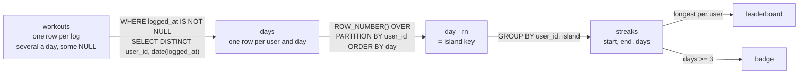

# Gaps and islands: streaks

Which users logged a workout three days in a row, and what is the longest streak?

## Before you start

- **Level 2** (intermediate). About 2 hours.
- **Builds on:** [03 Window functions](../03-window-functions/) (ROW_NUMBER, PARTITION BY), [05 Dates and the date spine](../05-dates-and-the-date-spine/) (date arithmetic in SQLite), [08 Duplicates and reconciliation](../08-duplicates-and-reconciliation/) (deciding what one row stands for before counting) and [10 Sessionization from raw events](../10-sessionization/) (LAG and grouping events into runs).
- **You need:** Python 3.9 or later. Nothing to install.

## The problem

You are the analyst at Fitloop, a fictional workout tracking app. Amara, who runs engagement, is launching a "3-day streak" badge and a "longest streak" leaderboard on Monday, and wants both back-filled for October 2026 so that 50 early users see their badges on day one. A first query gave 37 badge users and a top streak of 14 days. Then F002 wrote to support: they had worked out 22 days in a row. They were right, and the first query was wrong in both directions: the right numbers are 36 badge users and a longest streak of 22 days.

## In plain words

Picture a wall calendar where you tick each day you went to the gym. A streak is a run of ticked days with no gap. Counting streaks by eye is easy: you look for the runs of ticks. Two ticks on one day (a morning run and an evening class) are still one ticked day.

In SQL there is a neat trick for finding the runs. Number your ticked days 1, 2, 3 in order. Inside a run, the date goes up by one day and the number goes up by one, so **date minus number** stays the same. After a gap, the date jumps ahead by more than the number, so date minus number jumps too. Every run gets its own constant.

- An **island** is a run of consecutive values with no gap inside: here, a streak of workout days. A **gap** is the missing days between two islands. "Gaps and islands" is the name for this whole family of problems.
- A **workout day** is a calendar day on which a user logged at least one workout.
- The **island key** is the constant `day - ROW_NUMBER()` that is the same for every day of one island.
- `ROW_NUMBER() OVER (PARTITION BY user_id ORDER BY day)` numbers each user's rows 1, 2, 3 in date order, starting again for each user.

## What you will build from scratch

- One row per user and workout day, from logs that can have several rows a day or no time at all.
- The island key `date(day, '-' || ROW_NUMBER() || ' days')` and one row per streak.
- Each user's longest streak, with a fixed rule for ties.
- The users with at least one streak of 3 days or more.

The data in `data/` is synthetic. `make_data.py` builds it with a fixed random seed. Times are local to each user, so the date part of `logged_at` is the user's own calendar day.

## The idea

Take F030's October. They logged workouts on 2, 3, 4, 11 and 13 October (twice on the 2nd, and the app sent the 4th twice). One row per day first, then number the days and subtract:

```text
day          2 Oct   3 Oct   4 Oct   11 Oct   13 Oct
row number   1       2       3       4        5
day - rn     1 Oct   1 Oct   1 Oct   7 Oct    8 Oct
island       A       A       A       B        C
```

Three islands: 2 to 4 October (3 days), 11 October (1 day) and 13 October (1 day).



Why does it work? Inside one island the days are d, d+1, d+2 and the row numbers are r, r+1, r+2, so day minus number is d - r every time. A gap of g missing days adds g to the date but nothing to the row number, so the next island's key is g days later. Keys are never shared between islands of one user.

The one condition: **one row per day**. If a day appears twice, it takes two row numbers, the row number runs ahead of the date, and the key shifts in the middle of a real streak. That is why the DISTINCT comes first.

## Walk through

Run any query below from this folder with `python3 ../query.py "<the query>"`. For the long ones, save the query in a file and run `python3 ../query.py file.sql`.

Step 1. Logs against workout days.

```sql
SELECT COUNT(*) AS logs,
       SUM(logged_at IS NULL) AS no_time,
       COUNT(DISTINCT user_id) AS users,
       COUNT(DISTINCT user_id || ' ' || date(logged_at)) AS workout_days
FROM workouts;
```

```text
logs  no_time  users  workout_days
----  -------  -----  ------------
694   4        50     609
```

The 4 rows with no time cannot be put on a day. The rest are fewer workout days than logs, because some users log twice in a day and the app sometimes sends a workout twice. `COUNT(DISTINCT ...)` skips the NULLs, since `user_id || ' ' || NULL` is NULL.

Step 2. One user's logs.

```sql
SELECT workout_id, logged_at, date(logged_at) AS day, workout_type, minutes
FROM workouts
WHERE user_id = 'F030'
ORDER BY logged_at, workout_id;
```

```text
workout_id  logged_at            day         workout_type  minutes
----------  -------------------  ----------  ------------  -------
29          2026-10-02 17:23:36  2026-10-02  cycle         30
34          2026-10-02 21:54:10  2026-10-02  run           51
46          2026-10-03 10:23:04  2026-10-03  run           50
53          2026-10-04 05:40:17  2026-10-04  run           69
54          2026-10-04 05:40:24  2026-10-04  run           69
215         2026-10-11 08:00:57  2026-10-11  run           61
220         2026-10-11 11:27:11  2026-10-11  walk          74
260         2026-10-13 12:12:09  2026-10-13  strength      54
```

`date(logged_at)` keeps the date part. 2 October has two different workouts; 4 October has the same run twice, 7 seconds apart. For a streak, each of those days counts once either way.

Step 3. One row per day, then day minus row number.

```sql
WITH days AS (
  SELECT DISTINCT user_id, date(logged_at) AS day
  FROM workouts
  WHERE logged_at IS NOT NULL
)
SELECT user_id, day,
       ROW_NUMBER() OVER (PARTITION BY user_id ORDER BY day) AS rn,
       date(day, '-' || ROW_NUMBER() OVER (PARTITION BY user_id ORDER BY day) || ' days') AS island
FROM days
WHERE user_id = 'F030'
ORDER BY day;
```

```text
user_id  day         rn  island
-------  ----------  --  ----------
F030     2026-10-02  1   2026-10-01
F030     2026-10-03  2   2026-10-01
F030     2026-10-04  3   2026-10-01
F030     2026-10-11  4   2026-10-07
F030     2026-10-13  5   2026-10-08
```

`days` has one row per user and day, so the numbering cannot double count. `date(day, '-3 days')` is how SQLite subtracts days; the `'-' || rn || ' days'` builds that text from the row number. The `WHERE user_id = 'F030'` is safe in the outer query because the window is partitioned by user, so other users never change F030's numbers.

Step 4. One row per streak.

```sql
WITH days AS (
  SELECT DISTINCT user_id, date(logged_at) AS day
  FROM workouts
  WHERE logged_at IS NOT NULL
),
islands AS (
  SELECT user_id, day,
         date(day, '-' || ROW_NUMBER() OVER (PARTITION BY user_id ORDER BY day) || ' days') AS island
  FROM days
)
SELECT user_id, MIN(day) AS streak_start, MAX(day) AS streak_end, COUNT(*) AS days
FROM islands
WHERE user_id IN ('F030', 'F041')
GROUP BY user_id, island
ORDER BY user_id, streak_start;
```

```text
user_id  streak_start  streak_end  days
-------  ------------  ----------  ----
F030     2026-10-02    2026-10-04  3
F030     2026-10-11    2026-10-11  1
F030     2026-10-13    2026-10-13  1
F041     2026-10-01    2026-10-01  1
F041     2026-10-07    2026-10-07  1
F041     2026-10-11    2026-10-11  1
F041     2026-10-13    2026-10-13  1
F041     2026-10-16    2026-10-18  3
F041     2026-10-24    2026-10-24  1
F041     2026-10-31    2026-10-31  1
```

`GROUP BY user_id, island` turns each island into one row; `MIN`, `MAX` and `COUNT` give its start, end and length. The island key itself means nothing to Amara, so it is not shown. F041 worked out on 9 days but has only one streak of 3.

Step 5. The leaderboard and the badge.

```sql
WITH days AS (
  SELECT DISTINCT user_id, date(logged_at) AS day
  FROM workouts
  WHERE logged_at IS NOT NULL
),
islands AS (
  SELECT user_id, day,
         date(day, '-' || ROW_NUMBER() OVER (PARTITION BY user_id ORDER BY day) || ' days') AS island
  FROM days
),
streaks AS (
  SELECT user_id, MIN(day) AS streak_start, MAX(day) AS streak_end, COUNT(*) AS days
  FROM islands
  GROUP BY user_id, island
),
ranked AS (
  SELECT *, ROW_NUMBER() OVER (PARTITION BY user_id ORDER BY days DESC, streak_start) AS rn
  FROM streaks
)
SELECT user_id, days AS longest_days, streak_start, streak_end
FROM ranked
WHERE rn = 1
ORDER BY longest_days DESC, user_id
LIMIT 5;
```

```text
user_id  longest_days  streak_start  streak_end
-------  ------------  ------------  ----------
F002     22            2026-10-04    2026-10-25
F043     20            2026-10-09    2026-10-28
F047     14            2026-10-10    2026-10-23
F010     11            2026-10-12    2026-10-22
F017     11            2026-10-18    2026-10-28
```

`ranked` puts each user's streaks in order of length, longest first, and on a tie the earlier one first, so `rn = 1` is one fixed row per user. Now the badge:

```sql
WITH days AS (
  SELECT DISTINCT user_id, date(logged_at) AS day
  FROM workouts
  WHERE logged_at IS NOT NULL
),
islands AS (
  SELECT user_id, day,
         date(day, '-' || ROW_NUMBER() OVER (PARTITION BY user_id ORDER BY day) || ' days') AS island
  FROM days
),
streaks AS (
  SELECT user_id, island, MAX(day) AS streak_end, COUNT(*) AS days
  FROM islands
  GROUP BY user_id, island
)
SELECT COUNT(DISTINCT user_id) AS users_with_a_workout,
       COUNT(DISTINCT CASE WHEN days >= 3 THEN user_id END) AS badge_users,
       SUM(days >= 3) AS streaks_3_plus,
       SUM(days >= 3 AND streak_end = '2026-10-31') AS still_running_on_31_oct
FROM streaks;
```

```text
users_with_a_workout  badge_users  streaks_3_plus  still_running_on_31_oct
--------------------  -----------  --------------  -----------------------
50                    36           67              2
```

`COUNT(DISTINCT CASE WHEN ... THEN user_id END)` counts each qualifying user once, however many long streaks they had (the CASE gives NULL otherwise, and COUNT skips NULLs). The last column counts the streaks that end on the last day of the data. They may well continue into November, so their length is a floor, not a final number.

**In other databases.** The pattern works everywhere; only the date arithmetic changes. Postgres: `day - ROW_NUMBER() OVER (...)::int` (a date minus an integer is a date). BigQuery: `DATE_SUB(day, INTERVAL ROW_NUMBER() OVER (...) DAY)`. Snowflake: `DATEADD(day, -ROW_NUMBER() OVER (...), day)`. SQL Server: `DATEADD(day, -ROW_NUMBER() OVER (...), day)`. In SQLite you can also use `julianday(day) - ROW_NUMBER() OVER (...)`, a number instead of a date.

## Common mistakes

**1. Numbering the logs instead of the days (the trap).** This is the first query, the one that missed the support tickets:

```sql
WITH logs AS (
  SELECT user_id, date(logged_at) AS day,
         date(date(logged_at), '-' || ROW_NUMBER() OVER (PARTITION BY user_id ORDER BY logged_at) || ' days') AS island
  FROM workouts
  WHERE logged_at IS NOT NULL
),
streaks AS (
  SELECT user_id, COUNT(DISTINCT day) AS days FROM logs GROUP BY user_id, island
)
SELECT COUNT(DISTINCT CASE WHEN days >= 3 THEN user_id END) AS badge_users,
       MAX(days) AS longest_days
FROM streaks;
```

```text
badge_users  longest_days
-----------  ------------
37           14
```

It runs, it has a window function and a COUNT(DISTINCT day), and it is wrong both ways: one user too many gets the badge, and the longest streak drops from 22 to 14. A second log on a day takes a row number of its own, so from that row on the row number is one ahead of the date and the island key moves back a day. Look at F004:

```sql
SELECT workout_id, date(logged_at) AS day,
       ROW_NUMBER() OVER (ORDER BY logged_at) AS rn,
       date(date(logged_at), '-' || ROW_NUMBER() OVER (ORDER BY logged_at) || ' days') AS island
FROM workouts
WHERE user_id = 'F004' AND date(logged_at) <= '2026-10-05'
ORDER BY logged_at;
```

```text
workout_id  day         rn  island
----------  ----------  --  ----------
27          2026-10-02  1   2026-10-01
69          2026-10-04  2   2026-10-02
70          2026-10-04  3   2026-10-01
100         2026-10-05  4   2026-10-01
```

F004 rested on 3 October, yet 2, 4 and 5 October all get the key 1 October: the second log on the 4th shifted the key back by exactly the one missing day, and the rest day disappeared. F004 gets a 3-day badge they did not earn. The same shift cuts real streaks: F002's 22 days come out as pieces, the longest 14. Every extra log moves the key, so the more someone logs, the more wrong their streaks are. `DENSE_RANK() OVER (PARTITION BY user_id ORDER BY date(logged_at))` also fixes it, because equal days get equal ranks; the DISTINCT step is clearer to a reviewer.

**2. Subtracting the day of the month.** `CAST(substr(day, 9, 2) AS INTEGER) - rn` gives the same islands on this data, because all of it is in October. On 30 September and 1 October it gives 30 - 1 = 29 and 1 - 2 = -1, two islands for two days in a row. Use real date arithmetic:

```sql
SELECT date('2026-10-01', '-2 days') AS date_minus_2,
       CAST(substr('2026-10-01', 9, 2) AS INTEGER) - 2 AS day_of_month_minus_2;
```

```text
date_minus_2  day_of_month_minus_2
------------  --------------------
2026-09-29    -1
```

**3. "Three in a row" with LAG on the raw logs.** `LAG(day, 2)` equal to the day two days ago finds three consecutive days only if there is one row per day:

```sql
WITH logs AS (
  SELECT user_id, date(logged_at) AS day,
         LAG(date(logged_at), 2) OVER (PARTITION BY user_id ORDER BY logged_at) AS two_back
  FROM workouts
  WHERE logged_at IS NOT NULL
)
SELECT COUNT(DISTINCT user_id) AS badge_users_lag_on_logs
FROM logs
WHERE two_back = date(day, '-2 days');
```

```text
badge_users_lag_on_logs
-----------------------
37
```

The same problem in a new form: two logs on one day push the real day-before-yesterday out of `LAG(..., 2)`. On the distinct days, LAG works and gives 36. It is fine for "at least 3 in a row" but cannot give the length of a streak; the island key gives both.

**4. Using the wrong day.** `date(logged_at)` is only the user's day if `logged_at` is local time. If the app stores UTC, a 06:00 workout in Mumbai is 00:30 UTC on the same day, but an 04:00 one is 22:30 UTC the day before, and a streak breaks or joins at random. Convert to the user's time zone before you take the date, and say which one you used.

**5. Reading a streak at the end of the data as finished.** A streak that ends on 31 October may still be going. For the leaderboard that is fine (it is "longest so far"), but "average streak length" from this data would be too short. This is called **right-censoring**: the data stops before the thing you measure does.

## Your turn

Open `exercise.sql` and write three queries: `streaks`, `longest_streak` and `three_day_users`. Amara's rules are at the top of the file.

```
python3 test_lesson.py
```

Run it from this folder. The test checks that your streak lengths add up to the number of distinct workout days, then runs your queries on a second dataset made with a different seed, and on tiny hand-made tables: no workouts, one workout, three logs on one day, a streak across the end of September, two equally long streaks, a one-day gap with another user active that day, and workouts with no time.

Stretch: Amara asks for a "comeback" list: users whose gap between two streaks was 7 days or more. Use `LAG(streak_end) OVER (PARTITION BY user_id ORDER BY streak_start)` on your `streaks` result.

## Check yourself

1. Why is `day - ROW_NUMBER()` the same for every day of a streak?
2. What goes wrong if a day appears twice before you number the rows, and name two ways to fix it.
3. Two streaks are both 5 days long. Why does the ORDER BY in the ranking need a second column?
4. Your data ends on 31 October. What should you say about a streak that ends that day?

<details>
<summary>Answers</summary>

1. Inside a streak, each next row is one day later and has a row number one higher, so the difference does not change. After a gap the date jumps by more than one and the row number by exactly one, so the difference changes.
2. The repeated day takes an extra row number, so the row number gets ahead of the date and the key changes halfway through a real streak, cutting it in pieces. Fix it with `SELECT DISTINCT user_id, date(...)` before ROW_NUMBER, or use `DENSE_RANK()` over the date, which gives equal days the same number.
3. Without it the database can return either streak, and the answer can change between runs. A rule such as "the earlier one" makes the result the same every time and is easy to explain.
4. It may still be going, so its length is a minimum. Label it "so far" on a leaderboard, and leave such streaks out, or treat them separately, when you average streak lengths.

</details>

## What to tell the stakeholder

> Amara, 36 of the 50 users had at least one streak of 3 or more workout days in October 2026, so 36 get the badge. The longest streak was 22 days. Two workouts on the same day count as one day, and days are the user's local calendar days.

The caveats: 4 workouts arrived with no time after a sync error and are not counted, which could cost someone a day. Streaks still running on 31 October are counted up to that day; they will grow when November is added. The first query showed 37 badge users and a top streak of 14 because it numbered workouts instead of days, which both cut real streaks and joined streaks across rest days.

## In real job postings

In the Real Analyst Jobs data drop of 25 October 2026 ([data/job-market/2026-10](../../../data/job-market/2026-10/)), 286 of the 413 UK analyst postings that list tools (69.2%) ask for SQL, out of 620 UK postings. Streak and gaps-and-islands questions are a common interview step for those roles; practise with the [SQL case study](https://realanalystjobs.com/tools/sql-case-study) and browse [SQL data analyst jobs](https://realanalystjobs.com/jobs/sql-data-analyst-jobs).

## Next

[12 Review a query someone else wrote](../12-review-a-query-someone-else-wrote/).
