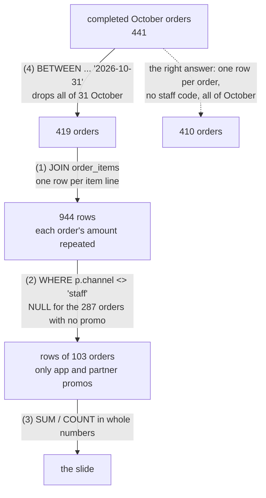

# Review a query someone else wrote

A teammate, or an assistant, wrote this query. Is the number on the slide right?

## Before you start

- **Level 2** (intermediate). About 2 hours.
- **Builds on:** [02 Joins without losing rows](../02-joins-without-losing-rows/) (fan-out, and LEFT JOIN with a filter), [05 NULLs, CASE and COALESCE](../../00-start-here/05-nulls-case-and-coalesce/) (a comparison with NULL is not true), [05 Dates and the date spine](../05-dates-and-the-date-spine/) (date text and date ranges), [07 Subqueries and CTEs](../07-subqueries-and-ctes/) (fixing the grain in a CTE) and [08 Duplicates and reconciliation](../08-duplicates-and-reconciliation/) (checking a number against an independent count).
- **You need:** Python 3.9 or later. Nothing to install.

## The problem

You are an analyst at Tiffinbell, a fictional food delivery app in four cities of Maharashtra. Meher, the head of city operations, presents October 2026 to the founders on Monday. Rahul, a teammate, drafted the slide's query with an AI assistant on Friday evening and pasted the result straight into the slide: Pune 46 orders and 53,202 rupees of revenue, an average order of 1,156 rupees, 3 items per order. Meher asks you to check it before Monday. The query is in `slide_query.sql`. It runs without an error, and every number on the slide is wrong.

## In plain words

Think of checking a friend's restaurant bill split. You do not redo the whole thing from scratch first. You ask quick questions that would expose a mistake: does the total match the receipt? Did anyone's dish get counted twice? Did the person who left early get dropped? Is the tip worked out on the right number? Each question is cheap, and each one catches a different kind of slip.

Reviewing a query works the same way. You run it, then test it against facts you can get another way.

- A **code review** is reading someone else's code to find mistakes before the result is used. It is normal and polite; it is not an accusation.
- **Reconciling** is comparing a number with an independent count of the same thing, as in [08](../08-duplicates-and-reconciliation/).
- **Fan-out** is when a join matches one row to several, so the rows of the first table are repeated and any SUM over them counts values more than once.
- **Grain** is what one row stands for: here one order, or one item line of an order.
- A **bug code** is a short name for a kind of mistake (FANOUT, DATE_BOUND), so a review can say exactly what was wrong.

## What you will build from scratch

- A review of `slide_query.sql`: one cheap check per suspicion, each run on the lesson's data.
- A list of the bugs you found, as bug codes, checked by the test.
- The fixed query, with one row per order before anything is summed.
- A short note to Meher with the right numbers and what changed.

The data in `data/` is synthetic. `make_data.py` builds it with a fixed random seed. Amounts are whole rupees, and `ordered_at` is a time to the second.

## The idea

Here is Rahul's query, with what each line does to the rows:

```sql
SELECT c.city,
       COUNT(DISTINCT o.order_id) AS orders,
       SUM(i.qty) AS items,
       SUM(o.amount) AS revenue,                                     -- (1) summed after the item join
       SUM(o.amount) / COUNT(DISTINCT o.order_id) AS avg_order_value, -- (3) whole-number division
       SUM(i.qty) / COUNT(DISTINCT o.order_id) AS items_per_order     -- (3) whole-number division
FROM orders o
JOIN customers c ON c.customer_id = o.customer_id
JOIN order_items i ON i.order_id = o.order_id                       -- (1) one row per item line
LEFT JOIN promo_redemptions p ON p.order_id = o.order_id
WHERE o.status = 'completed'
  AND o.ordered_at BETWEEN '2026-10-01' AND '2026-10-31'             -- (4) stops at 31 Oct 00:00:00
  AND p.channel <> 'staff'                                           -- (2) NULL for orders with no promo
GROUP BY c.city
ORDER BY revenue DESC;
```

Follow the rows through it:



Four bugs, and none of them raises an error:

1. **FANOUT.** `order_items` has one row per item line. After the join, an order with three lines is three rows, and `SUM(o.amount)` adds its amount three times. `COUNT(DISTINCT o.order_id)` hides the problem in the orders column, which makes the revenue look trustworthy next to it.
2. **LEFT_JOIN_FILTER.** A LEFT JOIN keeps orders with no promo, with NULL in every `p.` column. Then `p.channel <> 'staff'` is NULL for them (a comparison with NULL is not true), and WHERE keeps only rows where the condition is true. The intent was "leave out staff codes"; the effect is "keep only orders that used a promo".
3. **INTEGER_DIVISION.** In SQLite (and Postgres and SQL Server) a whole number divided by a whole number is a whole number: the decimals are thrown away, not rounded.
4. **DATE_BOUND.** `ordered_at` holds a time. `'2026-10-31 21:15:00'` sorts after `'2026-10-31'`, so `BETWEEN '2026-10-01' AND '2026-10-31'` stops at the first instant of 31 October and misses the whole last day. A half-open range, `>= '2026-10-01' AND < '2026-11-01'`, takes every moment of October and nothing else.

The review habit that finds all four: **for every number on the slide, find a second way to get it.**

## Walk through

Run any query below from this folder with `python3 ../query.py "<the query>"`. Run Rahul's whole query with `python3 ../query.py slide_query.sql`.

Step 1. Run it as it is.

```sql
SELECT c.city,
       COUNT(DISTINCT o.order_id) AS orders,
       SUM(i.qty) AS items,
       SUM(o.amount) AS revenue,
       SUM(o.amount) / COUNT(DISTINCT o.order_id) AS avg_order_value,
       SUM(i.qty) / COUNT(DISTINCT o.order_id) AS items_per_order
FROM orders o
JOIN customers c ON c.customer_id = o.customer_id
JOIN order_items i ON i.order_id = o.order_id
LEFT JOIN promo_redemptions p ON p.order_id = o.order_id
WHERE o.status = 'completed'
  AND o.ordered_at BETWEEN '2026-10-01' AND '2026-10-31'
  AND p.channel <> 'staff'
GROUP BY c.city
ORDER BY revenue DESC;
```

```text
city    orders  items  revenue  avg_order_value  items_per_order
------  ------  -----  -------  ---------------  ---------------
Pune    46      180    53202    1156             3
Mumbai  27      83     25794    955              3
Nashik  21      65     13537    644              3
Nagpur  9       35     9538     1059             3
```

Already two smells, before any checking. Every items_per_order is exactly 3, a whole number, and the average orders (644 to 1,156 rupees) are very large for a tiffin app.

Step 2. Reconcile the order count with the orders table alone.

```sql
SELECT COUNT(*) AS completed_in_october,
       SUM(p.channel = 'staff') AS with_staff_code,
       COUNT(*) - COALESCE(SUM(p.channel = 'staff'), 0) AS should_be_on_slide
FROM orders o
LEFT JOIN promo_redemptions p ON p.order_id = o.order_id
WHERE o.status = 'completed'
  AND o.ordered_at >= '2026-10-01' AND o.ordered_at < '2026-11-01';
```

```text
completed_in_october  with_staff_code  should_be_on_slide
--------------------  ---------------  ------------------
441                   31               410
```

The slide's four cities add up to 46 + 27 + 21 + 9 = 103 orders. The orders table says 410. Something removes three orders in four. `promo_redemptions` has at most one row per order, so this LEFT JOIN cannot fan out; the `SUM(p.channel = 'staff')` counts the staff codes (the comparison is 1 for true, 0 for false, NULL for no promo, and SUM skips NULLs).

Step 3. Where do the orders go? Count orders without a promo.

```sql
SELECT CASE WHEN p.order_id IS NULL THEN 'no promo' ELSE p.channel END AS promo,
       COUNT(*) AS orders,
       SUM(p.channel <> 'staff') AS kept_by_where
FROM orders o
LEFT JOIN promo_redemptions p ON p.order_id = o.order_id
WHERE o.status = 'completed'
  AND o.ordered_at >= '2026-10-01' AND o.ordered_at < '2026-11-01'
GROUP BY 1
ORDER BY orders DESC;
```

```text
promo     orders  kept_by_where
--------  ------  -------------
no promo  303     NULL
app       82      82
staff     31      0
partner   25      25
```

`kept_by_where` is how many rows `p.channel <> 'staff'` would let through. For the 303 orders with no promo it is NULL: none of them is kept. That is the LEFT_JOIN_FILTER bug. The condition belongs in the ON clause of the join, or must say what to do with NULL: `(p.channel IS NULL OR p.channel <> 'staff')`. (`GROUP BY 1` means "group by the first column in SELECT"; SQLite, Postgres, BigQuery and Snowflake accept it.)

Step 4. Check the grain after the join.

```sql
SELECT COUNT(*) AS rows_after_join,
       COUNT(DISTINCT o.order_id) AS orders,
       SUM(o.amount) AS amount_summed_after_join,
       (SELECT SUM(amount) FROM orders
        WHERE status = 'completed' AND ordered_at >= '2026-10-01' AND ordered_at < '2026-11-01') AS amount_in_orders
FROM orders o
JOIN order_items i ON i.order_id = o.order_id
WHERE o.status = 'completed'
  AND o.ordered_at >= '2026-10-01' AND o.ordered_at < '2026-11-01';
```

```text
rows_after_join  orders  amount_summed_after_join  amount_in_orders
---------------  ------  ------------------------  ----------------
1003             441     595091                    221090
```

More rows than orders means the join repeats orders, and the summed amount is more than twice the real one. That is the FANOUT bug. Whenever a query joins a table at a finer grain (item lines, payments, events), add it up to the coarser grain first.

Step 5. Check the date bound on the last day.

```sql
SELECT '2026-10-31 21:15:00' BETWEEN '2026-10-01' AND '2026-10-31' AS between_keeps_it,
       ('2026-10-31 21:15:00' >= '2026-10-01' AND '2026-10-31 21:15:00' < '2026-11-01') AS half_open_keeps_it,
       (SELECT COUNT(*) FROM orders
        WHERE status = 'completed' AND date(ordered_at) = '2026-10-31') AS completed_on_31_oct;
```

```text
between_keeps_it  half_open_keeps_it  completed_on_31_oct
----------------  ------------------  -------------------
0                 1                   22
```

Text comparison works character by character, and `'2026-10-31 21:15:00'` is longer than `'2026-10-31'` with the same start, so it sorts after it. BETWEEN drops every order on 31 October, a Saturday night with a late rush: 22 completed orders. That is the DATE_BOUND bug.

Step 6. Check the division.

```sql
SELECT 89924 / 171 AS whole_number_division,
       89924 * 1.0 / 171 AS decimal_division,
       ROUND(89924 * 1.0 / 171, 2) AS rounded_for_display;
```

```text
whole_number_division  decimal_division   rounded_for_display
---------------------  -----------------  -------------------
525                    525.8713450292398  525.87
```

Write `1.0 *` (or `CAST(... AS REAL)`) before dividing, and round only the final number. That is the INTEGER_DIVISION bug.

Step 7. The fix, and the same reconciliation run again.

```sql
WITH items AS (
  SELECT order_id, SUM(qty) AS items
  FROM order_items
  GROUP BY order_id
),
october AS (
  SELECT o.order_id, c.city, o.amount, COALESCE(i.items, 0) AS items
  FROM orders o
  JOIN customers c ON c.customer_id = o.customer_id
  LEFT JOIN items i ON i.order_id = o.order_id
  LEFT JOIN promo_redemptions p ON p.order_id = o.order_id
  WHERE o.status = 'completed'
    AND o.ordered_at >= '2026-10-01' AND o.ordered_at < '2026-11-01'
    AND (p.channel IS NULL OR p.channel <> 'staff')
)
SELECT city,
       COUNT(*) AS orders,
       SUM(items) AS items,
       SUM(amount) AS revenue,
       ROUND(1.0 * SUM(amount) / COUNT(*), 2) AS avg_order_value,
       ROUND(1.0 * SUM(items) / COUNT(*), 2) AS items_per_order
FROM october
GROUP BY city
ORDER BY revenue DESC, city;
```

```text
city    orders  items  revenue  avg_order_value  items_per_order
------  ------  -----  -------  ---------------  ---------------
Pune    171     668    89924    525.87           3.91
Mumbai  125     457    62206    497.65           3.66
Nashik  68      252    33726    495.97           3.71
Nagpur  46      167    22704    493.57           3.63
```

Line by line: `items` adds up the item lines to one row per order, so joining it cannot repeat an order. `october` is one row per order (check: `promo_redemptions` has at most one row per order, `customers` one row per customer), with every filter from Meher's definition, including the NULL case. The final SELECT only adds up and divides as decimals. The orders add up to 171 + 125 + 68 + 46 = 410, the number from step 2. Pune's revenue is 89,924 rupees, not 53,202: the slide was too low even though the fan-out inflated it, because the WHERE had thrown most orders away. Two bugs pulling in opposite directions can make a wrong number look normal.

**In other databases.** `BETWEEN`, LEFT JOIN with WHERE and fan-out behave the same everywhere. Integer division differs: Postgres and SQL Server truncate like SQLite, while BigQuery's `/` always returns a decimal, Snowflake's `/` returns a decimal, and MySQL's `/` returns a decimal too (it has `DIV` for whole-number division). On a real timestamp column, Postgres and Snowflake turn `'2026-10-31'` into midnight, so BETWEEN still misses the day there.

## Common mistakes

**1. Fixing the symptom, not the grain (the trap).** The orders column was right, so Rahul's assistant reached for DISTINCT again: `SUM(DISTINCT o.amount)`. It looks like it removes the repeats:

```sql
SELECT SUM(DISTINCT o.amount) AS sum_distinct_amount,
       SUM(o.amount) AS right_revenue
FROM orders o
WHERE o.status = 'completed'
  AND o.ordered_at >= '2026-10-01' AND o.ordered_at < '2026-11-01';
```

```text
sum_distinct_amount  right_revenue
-------------------  -------------
112393               221090
```

`SUM(DISTINCT x)` adds each different value once, so two different orders with the same amount count once between them. It is smaller than the right revenue even with no join at all. Fix the grain (add the items up per order first), never the arithmetic.

**2. Checking only what looks odd.** The 3.0 items per order looked odd; the revenue did not. A review that only chases the strange-looking number fixes the integer division and ships the other three bugs. Reconcile every number on the slide with a second source, even the ones that look fine.

**3. Moving the filter but changing the meaning.** The LEFT JOIN bug has two correct fixes: `(p.channel IS NULL OR p.channel <> 'staff')` in WHERE, or `NOT EXISTS (SELECT 1 FROM promo_redemptions s WHERE s.order_id = o.order_id AND s.channel = 'staff')`. Moving `p.channel <> 'staff'` into the ON clause is not the same: the LEFT JOIN then simply does not attach the staff promo row, and the staff orders stay in, with no promo. On the slide that puts 31 internal orders back. Run the reconciliation from step 2 after every fix.

**4. Trusting the query because an assistant wrote it, or because a senior did.** Neither the AI assistant nor Rahul ran a single check, and the query ran without an error. A query that runs is not a query that is right. Review the result against the definition, not the author.

## Your turn

Open `exercise.sql` and write two queries: `findings`, one row per real bug in `slide_query.sql` using the codes listed in the file (some of the codes on the list are not bugs in this query), and `fixed_slide`, the slide as Meher defined it.

```
python3 test_lesson.py
```

Run it from this folder. The test checks your findings against the bugs planted in the query, checks that your slide's orders add up to the count straight from the orders table, then runs `fixed_slide` on a second dataset made with a different seed and on tiny hand-made tables: no orders, the first and last second of October and the first second of November, an order with three item lines, orders with no promo, a staff promo and a promo with no channel (NULL), an average that is not a whole number, and a city whose only order used a staff code.

Stretch: write the reply you would send Rahul. Name each bug, the line, the effect on the Pune numbers and the fix, in five short bullet points, and keep it about the query, not about him.

## Check yourself

1. Why does a WHERE condition on the right-hand table turn a LEFT JOIN into an inner join?
2. The orders column is right but the revenue is wrong. What does that tell you?
3. Why is `ordered_at < '2026-11-01'` safer than `ordered_at <= '2026-10-31 23:59:59'`?
4. Name three quick checks you would run on any query before its number goes on a slide.

<details>
<summary>Answers</summary>

1. For a row with no match, every right-hand column is NULL. A comparison with NULL is NULL, not true, and WHERE keeps only rows where the condition is true, so every unmatched row is removed: exactly what an inner join does.
2. The orders are counted with COUNT(DISTINCT), which a fan-out cannot inflate, while the revenue is a SUM over repeated rows. A join is repeating orders; look for a table at a finer grain.
3. The half-open range takes every moment of October whatever the precision of the time: fractions of a second after 23:59:59 are still caught. It also works the same for a date column and a timestamp column.
4. Reconcile the total with a count from the base table alone; compare row counts before and after each join; look at the row for one known customer or order by hand; and check that ratios are decimals and date ranges are half-open.

</details>

## What to tell the stakeholder

> Meher, the October slide needs new numbers: Tiffinbell had 410 completed orders across the four cities (not 103), led by Pune with 171 orders and 89,924 rupees. The average order is 494 to 526 rupees by city (not 644 to 1,156), and 3.6 to 3.9 items per order.

The caveats: the old query dropped every order without a promo code and all of 31 October, and counted an order's amount once per item line, so its errors partly cancelled. Staff-code orders (31) are still left out, as you asked. I have sent Rahul the fixed query with notes on each change.

## In real job postings

In the Real Analyst Jobs data drop of 25 October 2026 ([data/job-market/2026-10](../../../data/job-market/2026-10/)), 634 of the 900 India analyst postings that list tools (70.4%) ask for SQL, out of 1,174 India postings. Reading and checking other people's SQL is part of that job; browse [SQL data analyst jobs](https://realanalystjobs.com/jobs/sql-data-analyst-jobs) and try the [SQL case study](https://realanalystjobs.com/tools/sql-case-study).

## Next

Back to the [Phase 01 overview](../README.md) for the next lesson.
