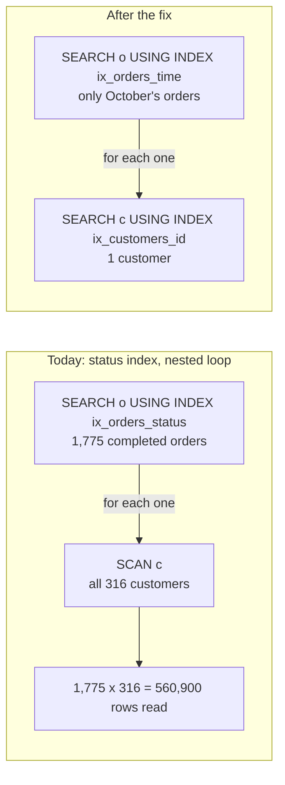

# Query plans and indexes

Why does the dashboard query take 40 seconds, and what does the query plan say?

## Before you start

- **Level 3** (advanced). About 2 hours.
- **Builds on:** [02 Joins without losing rows](../02-joins-without-losing-rows/) (what a join does row by row), [05 Dates and the date spine](../05-dates-and-the-date-spine/) (date text and half-open date ranges), [07 Subqueries and CTEs](../07-subqueries-and-ctes/) and [12 Review a query someone else wrote](../12-review-a-query-someone-else-wrote/) (checking a query against a second source before trusting it).
- **You need:** Python 3.9 or later. Nothing to install.

## The problem

You are an analyst at Tiffinbell, a fictional food delivery app in four cities of Maharashtra. Two weeks ago a developer added an index on the `status` column of `orders` "to speed up the dashboard". Since then the city operations dashboard has got slower every day, and this morning its month tile took 40 seconds to load. Meher, the head of city operations, opens it in the Monday review and asks you for a fix by Friday, and for a rule the team can follow so it does not happen again. The three tiles are in `dashboard.py`. You have a 1,900-order sample of the production tables in `data/`.

## In plain words

Think of a thick recipe book with an index at the back. To find every recipe with paneer you can turn every page (slow, but it always works), or look up "paneer" in the index and jump to pages 41, 88 and 203. The index only helps if you look up the word it is sorted by: an index sorted by ingredient is no use for "recipes that take under 20 minutes". And an index entry for "salt" that lists 400 of the book's 430 pages helps nobody: you would have been faster turning the pages.

A database works the same way.

- An **index** is a sorted copy of one or more columns, with a pointer back to each row. The database keeps it up to date on every insert, which costs a little time on every new order.
- The **query planner** is the part of the database that decides how to run a query: which table to read first, and whether to use an index.
- A **query plan** is the planner's decision, written out. In SQLite you see it with `EXPLAIN QUERY PLAN` in front of the query.
- A **scan** reads a table (or an index) from start to end. A **search** uses an index to jump straight to the matching rows.
- A **nested loop** is how a join runs: for each row of the first table, find the matching rows of the second. If finding them means a scan, the work is (rows of the first) times (rows of the second).
- **Selectivity** is how few rows a condition keeps. `customer_id = 'T00007'` keeps a handful of rows: very selective. `status = 'completed'` keeps 93 percent: hardly selective at all.
- A condition is **sargable** (from "search argument able") when the indexed column stands alone on one side of the comparison, so an index on it can be used. `ordered_at >= '2026-10-17'` is sargable; `date(ordered_at) = '2026-10-17'` is not, because the database would have to work out `date()` for every row first.

## What you will build from scratch

- `plan()`: the plan of any query, as a list of lines.
- `full_scans()`: the tables a plan reads from start to end.
- `count_steps()`: a deterministic measure of how much work a query does, so you can compare plans without a stopwatch.
- A recommendation: which index to drop, at most three to create, and the three tiles rewritten so they can use them, with the same answers.

The data in `data/` is synthetic. `make_data.py` builds it with a fixed random seed, and `make_data.build(n_orders=...)` builds a bigger copy in memory.

## The idea

**How to measure work without a stopwatch.** Timing a query on a laptop changes from run to run and with whatever else the laptop is doing. SQLite runs every query as a small program of internal instructions, and Python's `con.set_progress_handler(callback, 1)` makes SQLite call your function as it works through them. Counting the calls gives a number, which this lesson calls **steps**, that is the same every time for the same data, query and SQLite version, and grows with the work done. It is not milliseconds, but twice the steps is roughly twice the time. (The counts in this README come from SQLite 3.53.1; another version may print slightly different numbers, with the same pattern.)

**How to read a SQLite plan.** These are the lines you will meet, as SQLite prints them here:

| Plan line | What it means |
|---|---|
| `SCAN orders` | read every row of `orders` |
| `SCAN orders USING INDEX ix` | read every entry of the index `ix`, in its order (still every row) |
| `SEARCH orders USING INDEX ix (customer_id=?)` | jump through `ix` to the rows that match, read only those |
| `... USING COVERING INDEX ix` | the index holds every column the query needs, so the table itself is not read |
| `USE TEMP B-TREE FOR ORDER BY` | sort the rows while the query runs (a B-tree is the sorted structure indexes are made of) |
| `SEARCH c USING AUTOMATIC COVERING INDEX` | SQLite builds a throwaway index for this one query |
| `BLOOM FILTER ON c` | a quick test that rules out rows that cannot match before the real lookup |

Lines are in the order the loops nest: a line below another runs once for every row of the line above it.

**What went wrong.** The month tile joins `orders` to `customers`. Before the status index, SQLite read `orders` once and found each customer through a throwaway index it built for the query. With the status index, the planner sees `o.status = 'completed'`, an equality on an indexed column, and starts there. But that condition keeps 93 percent of orders, and with `orders` first and no index on `customers`, every one of those orders scans the whole customers table:



The work grows with orders times customers, so it gets worse every day the business grows. That is the 40 seconds.

**The fix has three parts, and each is a rule you can reuse.**

1. Index the columns your filters are selective on, not the ones they mention. `status` is in every tile, but it narrows almost nothing.
2. Put the equality column first in a composite index (an index on more than one column), then the column you sort or range on. An index on `(customer_id, ordered_at)` is sorted by customer, then by time inside each customer, so "one customer, newest first" is one short walk. The same columns the other way round are sorted by time first, and one customer's orders are spread through the whole index.
3. Keep the indexed column bare. Rewrite `date(ordered_at) = :day` as `ordered_at >= :day AND ordered_at < date(:day, '+1 day')`, the half-open range from [05](../05-dates-and-the-date-spine/). It returns the same rows and lets the index jump to the first one.

## Walk through

Each block is Python. Save it as a file in this folder and run it with `python3 <file>`, or paste it into `python3` started in this folder. `dashboard.py` gives you the three tiles and `open_db()`, which loads `data/*.csv` with today's indexes.

Step 1. Count the work of each tile, before the status index and today.

```python
from dashboard import QUERIES, EXAMPLE_PARAMS, open_db

def count_steps(con, sql, params=()):
    calls = [0]
    def tick():
        calls[0] += 1
        return 0
    con.set_progress_handler(tick, 1)
    con.execute(sql, params).fetchall()
    con.set_progress_handler(None, 1)
    return calls[0]

today = open_db()                # with ix_orders_status, as it runs now
before = open_db(indexes=[])     # the same data, before the index was added
for tile, sql in QUERIES.items():
    p = EXAMPLE_PARAMS[tile]
    print("%-17s before %7d   today %7d" % (tile, count_steps(before, sql, p), count_steps(today, sql, p)))
```

```text
customer_history  before    6005   today    6005
day_summary       before    7699   today   10714
city_month        before   21187   today  606786
```

`tick` returns 0, which tells SQLite to carry on (any other value stops the query). `set_progress_handler(None, 1)` removes it afterwards. The month tile does 29 times the work it did before, and the day tile got slower too: the index meant to speed things up did the opposite.

Step 2. Ask the planner what it does for the month tile.

```python
from dashboard import QUERIES, EXAMPLE_PARAMS, open_db

con = open_db()
for row in con.execute("EXPLAIN QUERY PLAN " + QUERIES["city_month"], EXAMPLE_PARAMS["city_month"]):
    print(row)
```

```text
(9, 0, 61, 'SEARCH o USING INDEX ix_orders_status (status=?)')
(17, 0, 216, 'SCAN c')
(22, 0, 0, 'USE TEMP B-TREE FOR GROUP BY')
(63, 0, 0, 'USE TEMP B-TREE FOR ORDER BY')
```

Each row is (id, parent, unused, detail). Only the detail matters to you. `SEARCH o` on the status index comes first, and `SCAN c` sits under it: for every order the status index finds, read all of `customers`.

Step 3. Check the planner's guess against the data.

```python
from dashboard import open_db

con = open_db()
completed = con.execute("SELECT COUNT(*) FROM orders WHERE status = 'completed'").fetchone()[0]
total = con.execute("SELECT COUNT(*) FROM orders").fetchone()[0]
customers = con.execute("SELECT COUNT(*) FROM customers").fetchone()[0]
print("completed", completed, "of", total, "orders:", round(100.0 * completed / total, 1), "percent")
print("customer rows read by the nested loop:", completed, "x", customers, "=", completed * customers)
```

```text
completed 1775 of 1900 orders: 93.4 percent
customer rows read by the nested loop: 1775 x 316 = 560900
```

The "search" on status keeps 93.4 percent of the table, and 560,900 customer rows are read for a tile that needs 316. Now watch it grow with the business:

```python
import make_data
from dashboard import QUERIES, EXAMPLE_PARAMS, open_db

def count_steps(con, sql, params=()):
    calls = [0]
    def tick():
        calls[0] += 1
        return 0
    con.set_progress_handler(tick, 1)
    con.execute(sql, params).fetchall()
    con.set_progress_handler(None, 1)
    return calls[0]

sql, p = QUERIES["city_month"], EXAMPLE_PARAMS["city_month"]
for n in (1900, 3800, 7600):
    tables = make_data.build(n_orders=n)
    print("%5d orders  before %7d   today %8d" % (
        n, count_steps(open_db(tables, indexes=[]), sql, p), count_steps(open_db(tables), sql, p)))
```

```text
 1900 orders  before   21187   today   606786
 3800 orders  before   41850   today  2351897
 7600 orders  before   83450   today  9316862
```

`build(n_orders=n)` makes a bigger copy in memory, with customers growing in step. Double the orders and the old plan doubles; today's plan roughly quadruples. A tile that was fine on launch day gets slower every week.

Step 4. Why an index on `ordered_at` alone does not save the day tile.

```python
from dashboard import open_db

con = open_db(indexes=["CREATE INDEX ix_orders_time ON orders (ordered_at)"])
wrapped = "SELECT COUNT(*) FROM orders WHERE date(ordered_at) = :day"
bare = "SELECT COUNT(*) FROM orders WHERE ordered_at >= :day AND ordered_at < date(:day, '+1 day')"
for sql in (wrapped, bare):
    print([r[3] for r in con.execute("EXPLAIN QUERY PLAN " + sql, {"day": "2026-10-17"})],
          con.execute(sql, {"day": "2026-10-17"}).fetchone()[0])
```

```text
['SCAN orders USING COVERING INDEX ix_orders_time'] 18
['SEARCH orders USING COVERING INDEX ix_orders_time (ordered_at>? AND ordered_at<?)'] 18
```

Same answer, 18 orders. With `date()` around the column, SQLite still reads every index entry (SCAN), because the index is sorted by `ordered_at`, not by `date(ordered_at)`. With the bare column, it SEARCHes straight to 17 October. `'2026-10-17 08:12:00' >= '2026-10-17'` is true because text compares character by character and the longer text sorts after its own start.

Step 5. Column order in a composite index.

```python
from dashboard import QUERIES, open_db

sql = QUERIES["customer_history"]
for cols in ["ordered_at, customer_id", "customer_id, ordered_at"]:
    con = open_db(indexes=["CREATE INDEX ix ON orders (%s)" % cols])
    print("(%s):" % cols, [r[3] for r in con.execute("EXPLAIN QUERY PLAN " + sql, {"customer_id": "T00007"})])
```

```text
(ordered_at, customer_id): ['SCAN orders USING INDEX ix', 'USE TEMP B-TREE FOR LAST TERM OF ORDER BY']
(customer_id, ordered_at): ['SEARCH orders USING INDEX ix (customer_id=?)', 'USE TEMP B-TREE FOR LAST TERM OF ORDER BY']
```

Same two columns, different order. Time first: SQLite walks the whole index newest first and checks each customer. Customer first: it jumps to T00007. `LAST TERM OF ORDER BY` means only the tie-break, `order_id DESC`, needs a small sort; the time order comes free from the index.

Step 6. The whole fix: drop one index, add three, rewrite two tiles. This runs the worked answer in `solution/solution.py`; you will write your own in the exercise.

```python
import importlib.util
from dashboard import QUERIES, EXAMPLE_PARAMS, open_db
spec = importlib.util.spec_from_file_location("solution", "solution/solution.py")
s = importlib.util.module_from_spec(spec)
spec.loader.exec_module(s)

before = open_db(indexes=[])
fixed = open_db()
for name in s.DROP_INDEXES:
    fixed.execute("DROP INDEX " + name)
for sql in s.CREATE_INDEXES:
    fixed.execute(sql)
for tile in QUERIES:
    p = EXAMPLE_PARAMS[tile]
    old, new = s.count_steps(before, QUERIES[tile], p), s.count_steps(fixed, s.FAST_QUERIES[tile], p)
    same = before.execute(QUERIES[tile], p).fetchall() == fixed.execute(s.FAST_QUERIES[tile], p).fetchall()
    print(tile, "same answer:", same, " steps before:", old, " now:", new)
    for line in s.plan(fixed, s.FAST_QUERIES[tile], p):
        print("    " + line)
```

```text
customer_history same answer: True  steps before: 6005  now: 293
    SEARCH orders USING INDEX ix_orders_customer_time (customer_id=?)
    USE TEMP B-TREE FOR LAST TERM OF ORDER BY
day_summary same answer: True  steps before: 7699  now: 168
    SEARCH orders USING INDEX ix_orders_time (ordered_at>? AND ordered_at<?)
city_month same answer: True  steps before: 21187  now: 11035
    SEARCH o USING INDEX ix_orders_time (ordered_at>? AND ordered_at<?)
    SEARCH c USING INDEX ix_customers_id (customer_id=?)
    USE TEMP B-TREE FOR GROUP BY
    USE TEMP B-TREE FOR ORDER BY
```

Every table is reached by SEARCH. The customer tile does 20 times less work and the day tile 45 times less. The month tile only halves, and that is honest: October is a quarter of the sample, so a quarter of the orders must still be read and added up. An index cannot make "add up a quarter of the table" cheap; for that, see the stretch task. `ix_customers_id` is UNIQUE, which also stops a duplicate customer row from ever doubling a city's numbers.

**In other databases (reference only, check your warehouse's docs).** Postgres shows the plan with `EXPLAIN`, and `EXPLAIN ANALYZE` runs the query and adds real row counts and times; its words are different (`Seq Scan` for a scan, `Index Scan` for a search). BigQuery and Snowflake are column stores without the `CREATE INDEX` you used here: they speed up queries by skipping whole blocks of data, using partitioning and clustering on columns such as the order date, and they show the work done as bytes or partitions scanned in the query's profile. The habits carry over: filter on the bare column, and filter on the column the data is organised by.

## Common mistakes

**1. Indexing a column because every query mentions it (the trap).** `status = 'completed'` is in all three tiles, so an index on it looks like a sure win. It keeps 93.4 percent of rows, so even used alone it costs more than a scan: in step 1, the day tile went from 7,699 steps to 10,714. Worse, the planner trusts an equality on an indexed column and builds the whole month tile around it, which is the 29 times slowdown. And if you add the right index but leave the status one in place, it can still steal the plan: with both `ix_orders_time` and `ix_orders_status`, SQLite picks the status index for the day tile and you are back above 9,600 steps. Drop indexes that do not narrow anything.

**2. Running ANALYZE and calling it fixed.** `ANALYZE` collects statistics (here: 1,900 rows, about 950 per status value) so the planner can guess better:

```python
from dashboard import QUERIES, EXAMPLE_PARAMS, open_db

con = open_db()
con.execute("ANALYZE")
print(con.execute("SELECT idx, stat FROM sqlite_stat1 WHERE tbl = 'orders'").fetchall())
for row in con.execute("EXPLAIN QUERY PLAN " + QUERIES["city_month"], EXAMPLE_PARAMS["city_month"]):
    print(row[3])
```

```text
[('ix_orders_status', '1900 950')]
SEARCH o USING INDEX ix_orders_status (status=?)
BLOOM FILTER ON c (customer_id=?)
SEARCH c USING AUTOMATIC COVERING INDEX (customer_id=?)
USE TEMP B-TREE FOR GROUP BY
USE TEMP B-TREE FOR ORDER BY
```

The nested scan of customers is gone, so the 40 seconds would drop. But it still starts from the useless status index, still reads every completed order for a one-month tile, and statistics go stale as data changes. It treats the symptom; the cause is the index and the unsargable filter.

**3. Wrapping the indexed column in a function.** `date(ordered_at)`, `strftime('%Y-%m', ordered_at)`, `LOWER(email)`, `amount * 1.18 > 500`: each one hides the column from its index (step 4). Move the work to the other side: `ordered_at >= :month || '-01' AND ordered_at < date(:month || '-01', '+1 month')`, `amount > 500 / 1.18`.

**4. Getting the composite order backwards, or adding one index per column.** `(ordered_at, customer_id)` cannot find one customer (step 5). And two separate indexes on `customer_id` and `ordered_at` are not the same as one on both: SQLite usually uses one index per table in a query. Every extra index also slows down every insert of a new order, so each one must earn its place.

**5. Judging speed by one stopwatch run on a sample.** On 1,900 rows even the bad plan finishes in well under a second on a laptop, so "it is fast for me" proves nothing. Compare plans and work counts, and check how the count grows when the data doubles, as in step 3.

## Your turn

Open `exercise.py` and fill in `plan`, `full_scans`, `count_steps`, `DROP_INDEXES`, `CREATE_INDEXES` (at most 3) and `FAST_QUERIES` (one per tile, same columns and answers as `dashboard.QUERIES`, same named parameters). Then run, from this folder:

```
python3 test_lesson.py
```

The test checks your three functions on tiny hand-made tables against its own reading of `EXPLAIN QUERY PLAN`. It applies your index changes to today's database and checks that every tile's plan has no SCAN line, that the customer and day tiles do at most a tenth of the steps the old dashboard did, and that the month tile does at most three quarters. It compares every tile's answers with a plain Python computation, for several parameters, on the committed data, on a second dataset from `make_data.build(seed=2027)`, and on edge cases: no orders, the first and last second of a day, December rolling into January, three orders at the same second, a NULL time, a cancelled order, and an order from a customer missing from `customers`.

Stretch: the month tile still reads a quarter of the table. Write a small summary table, one row per day and city with orders and revenue, that a nightly job would refresh, and point the tile at it. Count its steps. What does the tile lose (how fresh is it?) and what does the business gain?

## Check yourself

1. A query has `WHERE status = 'completed'` and an index on `status`. Why can using that index be slower than reading the whole table?
2. What does it mean when one plan line sits under another, and why is `SCAN` under a `SEARCH` a warning sign?
3. You need "orders for one customer in a date range, newest first". Which index, with which column order, and why?
4. Why does `WHERE date(ordered_at) = '2026-10-17'` not use an index on `ordered_at`, and how do you rewrite it?

<details>
<summary>Answers</summary>

1. An index search reads the index entry, then jumps to the row it points at. If the condition keeps 93 percent of rows, that is nearly every row plus nearly every index entry, in scattered order. A plain scan reads every row once, in order. Indexes pay off when they skip most of the table.
2. The lower line runs once for every row the upper line produces: a nested loop. `SCAN` under anything means the inner table is read in full again and again, so the work is the product of the two row counts and grows with the square of the business.
3. `(customer_id, ordered_at)`: the equality column first, so the index jumps to one customer, then the range and sort column, so that customer's orders are already in time order. `(ordered_at, customer_id)` would make the database walk the whole date range and check the customer on every entry.
4. The index is sorted by `ordered_at`, not by `date(ordered_at)`, so the database must compute `date()` for every entry before it can compare. Rewrite it as the half-open range `ordered_at >= '2026-10-17' AND ordered_at < '2026-10-18'`, which returns the same rows and keeps the column bare.

</details>

## What to tell the stakeholder

> Meher, the month tile slowed down because of the index added two weeks ago on order status: it made the database read the whole customer list once for every completed order, so the tile got slower every day as orders grew. I recommend we drop that index, add three narrower ones (customer and time, time, customer id) and change how two tiles filter dates. On our sample this gives the same numbers with 20 to 45 times less work for the customer and day tiles, and about half for the month tile.

The limits: these are work counts on a 1,900-order sample in SQLite, not seconds in production, so the developer should check the plan and the load time on the real database before and after. Each new index slightly slows down writing every new order, which is why I kept to three. The month tile still adds up a quarter of a month's orders on every load; if it needs to be instant, the next step is a daily summary table, which would be up to a day old.

## In real job postings

In the Real Analyst Jobs data drop of 25 October 2026 ([data/job-market/2026-10](../../../data/job-market/2026-10/)), 1,477 of the 2,056 US analyst postings that list tools (71.8%) ask for SQL, out of 2,789 US postings. Knowing why a query is slow, and fixing it without changing its answer, is what separates writing SQL from owning it; browse [SQL data analyst jobs](https://realanalystjobs.com/jobs/sql-data-analyst-jobs) and try the [SQL case study](https://realanalystjobs.com/tools/sql-case-study).

## Next

[14 SQL dialects for work and interviews](../14-sql-dialects/)
