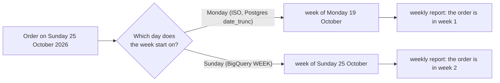

# SQL dialects for work and interviews

How do the same five queries look in SQLite, Postgres, BigQuery and Snowflake?

## Before you start

- **Level 3** (advanced). About 2 hours.
- **Builds on:** [03 Window functions](../03-window-functions/) (ROW_NUMBER), [05 Dates and the date spine](../05-dates-and-the-date-spine/) (date text and date ranges), [07 Subqueries and CTEs](../07-subqueries-and-ctes/), [12 Review a query someone else wrote](../12-review-a-query-someone-else-wrote/) (integer division and NULL comparisons) and [13 Query plans and indexes](../13-query-plans-and-indexes/).
- **You need:** Python 3.9 or later. Nothing to install. You do not need Postgres, BigQuery or Snowflake: the test runs everything in SQLite.

## The problem

You are an analyst at Tiffinbell, a fictional food delivery app in four cities of Maharashtra. The team is moving its weekly reports from a Postgres copy of the app database to a cloud warehouse, and has not yet decided between BigQuery and Snowflake. Arjun, the analytics lead, has seen two migrated reports come out with different numbers from the old ones, with no error anywhere. He asks you for the five most-used queries written so they give the same answer on any of the four databases, a translation table for the parts that cannot be the same, and a recommendation for the migration by the end of the month. The same table will go into the team's interview pack, because candidates are tested on whatever database the interview platform runs.

## In plain words

Think of a recipe written in India and cooked in the US. "One cup of rice" is a different amount, "bake at 180" means Celsius to one cook and a cold oven to the other, and the recipe never says which. Nothing goes wrong loudly: the dish just comes out different. A careful recipe says "250 grams" and "180 degrees Celsius" so it cannot be misread.

SQL has the same problem.

- A **dialect** is one database's version of SQL. The core (SELECT, JOIN, GROUP BY, CTEs, window functions) is shared; dates, text matching and some defaults are not.
- A **default** is what a database does when the query does not say. The defaults that change numbers here are: what whole number divided by whole number gives, whether LIKE cares about capital letters, which day a week starts on, and where NULLs go when you sort.
- **Portable SQL** is SQL that gives the same answer on every database you care about, because it states each of those choices instead of leaving them to the default.
- **Case-sensitive** means capital and small letters count as different: `'FEST10'` and `'fest10'` are different texts.
- **Translation** is the part you cannot make portable, mostly date functions, which have different names everywhere. You keep the logic and swap the function.

## What you will build from scratch

- Five portable queries in SQLite: monthly revenue, weekly orders, average order value with a promo share, each customer's latest order, and days to the second order.
- A translation table for the same five in Postgres, BigQuery and Snowflake.
- A short recommendation for the migration.

The data in `data/` is synthetic. `make_data.py` builds it with a fixed random seed. `ordered_at` is text, a time to the second; `promo_code` was typed by hand, so the same festival code appears in several spellings.

## The idea

Every query that moves between databases has two kinds of difference.

**Silent defaults: state them, and the query becomes portable.**

| Behaviour | SQLite (run here) | Write it like this, everywhere |
|---|---|---|
| Whole number / whole number | `7 / 2` is `3` | `1.0 * a / b`, or `CAST(a AS DECIMAL)` |
| LIKE and capital letters | `'FEST10' LIKE 'fest%'` is true | `LOWER(x) LIKE 'fest%'` |
| Sorting NULLs | first when sorting smallest first | `ORDER BY x ASC NULLS LAST` (or `NULLS FIRST`) |
| Which order is "latest" on a tie | whichever row comes up | add a tie-breaker: `ORDER BY ordered_at DESC, order_id DESC` |
| Which day a week starts | there is no week function | return the Monday's date, not a week number |

**Function names: translate them.** The table below is the logic of each query in four dialects. The SQLite column is exactly what the test runs. **Everything this lesson says about Postgres, BigQuery, Snowflake and MySQL is reference only, check your warehouse's docs:** it was written from the course authors' knowledge, it was not run for this lesson, and the vendors' documentation pages could not be opened when it was written (31 October 2026).

| Query | SQLite (run here) | Postgres | BigQuery | Snowflake |
|---|---|---|---|---|
| Month start | `date(ordered_at, 'start of month')` | `date_trunc('month', ordered_at)::date` | `DATE_TRUNC(DATE(ordered_at), MONTH)` | `DATE_TRUNC('month', ordered_at)::date` |
| Monday of the week | `date(ordered_at, 'weekday 0', '-6 days')` | `date_trunc('week', ordered_at)::date` (ISO weeks start on Monday) | `DATE_TRUNC(DATE(ordered_at), ISOWEEK)` (plain `WEEK` starts on Sunday) | `DATE_TRUNC('week', ordered_at)::date` (the start day follows the `WEEK_START` setting) |
| Decimal average | `ROUND(1.0 * SUM(amount) / COUNT(*), 2)` | same (whole / whole is a whole number) | same (`/` already gives a decimal; `SAFE_DIVIDE(a, b)` returns NULL for a zero) | same (`/` already gives a decimal; `DIV0(a, b)` returns 0 for a zero) |
| Starts with fest, any capitals | `LOWER(promo_code) LIKE 'fest%'` | same, or `promo_code ILIKE 'fest%'` | same (LIKE is case-sensitive) | same, or `promo_code ILIKE 'fest%'` |
| Latest order per customer | ROW_NUMBER in a subquery, keep `rn = 1` | same, or `DISTINCT ON (customer_id)` | same, or `QUALIFY ROW_NUMBER() OVER (...) = 1` | same, or `QUALIFY ROW_NUMBER() OVER (...) = 1` |
| Days between two dates | `julianday(d2) - julianday(d1)` | `d2::date - d1::date` | `DATE_DIFF(d2, d1, DAY)` | `DATEDIFF('day', d1, d2)` (note the order) |
| NULLs when sorting smallest first, by default | first | last | first | last |

Look at the last row: the same `ORDER BY days_to_second` puts the customers with no second order at the top of the report in SQLite and BigQuery, and at the bottom in Postgres and Snowflake. Writing `NULLS LAST` ends the argument. (MySQL, not in this table, has no `NULLS LAST`; there you write `ORDER BY x IS NULL, x`.)

The week start is the easiest one to get wrong without noticing, because both answers look like normal weeks:



Every Sunday order moves to the other week, so every weekly number changes a little and none of them looks wrong.

## Walk through

Run any query below from this folder with `python3 ../query.py "<the query>"`.

Step 1. See SQLite's defaults with your own eyes.

```sql
SELECT 7 / 2 AS int_div, 7 * 1.0 / 2 AS dec_div,
       'FEST10' LIKE 'fest%' AS like_match, 'FEST10' = 'fest10' AS equal,
       LOWER('FEST10') LIKE 'fest%' AS lower_like;
```

```text
int_div  dec_div  like_match  equal  lower_like
-------  -------  ----------  -----  ----------
3        3.5      1           0      1
```

Whole-number division drops the half. LIKE ignores capitals in SQLite (for the English letters A to Z), but `=` does not, so even inside one database the two disagree. `LOWER(...) LIKE` gives 1 here and would give 1 in a case-sensitive database too.

Step 2. Where NULLs sort.

```sql
SELECT x FROM (SELECT 3 AS x UNION ALL SELECT NULL UNION ALL SELECT 1) ORDER BY x;
```

```text
x
----
NULL
1
3
```

```sql
SELECT x FROM (SELECT 3 AS x UNION ALL SELECT NULL UNION ALL SELECT 1) ORDER BY x NULLS LAST;
```

```text
x
----
1
3
NULL
```

SQLite treats NULL as smaller than everything. `NULLS LAST` (SQLite 3.30 or later, so any recent Python) says what you mean.

Step 3. The Monday of the week.

```sql
SELECT column1 AS day,
       strftime('%w', column1) AS weekday_number,
       date(column1, 'weekday 0', '-6 days') AS week_start,
       strftime('%W', column1) AS week_number
FROM (VALUES ('2026-10-24'), ('2026-10-25'), ('2026-10-26'), ('2026-11-01'));
```

```text
day         weekday_number  week_start  week_number
----------  --------------  ----------  -----------
2026-10-24  6               2026-10-19  42
2026-10-25  0               2026-10-19  42
2026-10-26  1               2026-10-26  43
2026-11-01  0               2026-10-26  43
```

`strftime('%w')` numbers the days from 0 for Sunday. The modifier `'weekday 0'` moves a date forward to the next Sunday, or leaves a Sunday where it is; `'-6 days'` then steps back to that week's Monday. So Sunday 25 October belongs to the week of Monday 19 October. `week_number` is SQLite's own week count; other databases count weeks differently, especially around 1 January, which is why the portable output is the Monday's date, not a number.

Step 4. Which promo codes are "fest" codes?

```sql
SELECT promo_code, COUNT(*) AS orders,
       promo_code LIKE 'fest%' AS sqlite_like,
       LOWER(promo_code) LIKE 'fest%' AS portable
FROM orders
WHERE status = 'completed' AND promo_code IS NOT NULL
GROUP BY promo_code
ORDER BY promo_code;
```

```text
promo_code  orders  sqlite_like  portable
----------  ------  -----------  --------
BANKOFFER   35      0            0
FEST10      33      1            1
FESTIVE     32      1            1
Fest25      26      1            1
LOYALFEST   27      0            0
WELCOME50   21      0            0
fest10      32      1            1
welcome50   29      0            0
```

The two columns agree here, in SQLite. They will not agree in Postgres, BigQuery or Snowflake, where `promo_code LIKE 'fest%'` keeps only `fest10`. `LOYALFEST` contains "FEST" but does not start with it, so `'%fest%'` would be a different question.

Step 5. The five portable queries. The full text is in `solution/solution.sql`; here are the results on the lesson's data.

Monthly revenue, with the month as its first day:

```sql
SELECT date(ordered_at, 'start of month') AS month_start,
       COUNT(*) AS orders,
       SUM(amount) AS revenue
FROM orders
WHERE status = 'completed'
GROUP BY date(ordered_at, 'start of month')
ORDER BY month_start;
```

```text
month_start  orders  revenue
-----------  ------  -------
2026-08-01   48      15330
2026-09-01   178     55760
2026-10-01   558     181620
2026-11-01   22      7070
```

The weekly query is the same shape with `date(ordered_at, 'weekday 0', '-6 days')`; it gives 13 weeks, from the week of 3 August to the week of 26 October. Average order value and the share of orders with a fest code, by city:

```sql
SELECT c.city,
       COUNT(*) AS orders,
       SUM(o.amount) AS revenue,
       ROUND(1.0 * SUM(o.amount) / COUNT(*), 2) AS avg_order_value,
       ROUND(1.0 * SUM(CASE WHEN LOWER(o.promo_code) LIKE 'fest%' THEN 1 ELSE 0 END) / COUNT(*), 4) AS fest_share
FROM orders o
JOIN customers c ON c.customer_id = o.customer_id
WHERE o.status = 'completed'
GROUP BY c.city
ORDER BY c.city;
```

```text
city    orders  revenue  avg_order_value  fest_share
------  ------  -------  ---------------  ----------
Mumbai  271     90270    333.1            0.155
Nagpur  78      27570    353.46           0.1667
Nashik  129     39700    307.75           0.1783
Pune    328     102240   311.71           0.1372
```

`CASE WHEN ... THEN 1 ELSE 0 END` instead of summing the true or false value directly: SQLite lets you add up a comparison (true is 1), but Postgres and BigQuery do not let you SUM a true or false value without a cast. CASE works everywhere. A promo code that is NULL makes `LOWER(...) LIKE` NULL, and CASE sends that to the ELSE, so it counts as 0.

Each customer's latest order, with a tie-breaker:

```sql
SELECT customer_id, order_id, ordered_at, amount
FROM (
  SELECT customer_id, order_id, ordered_at, amount,
         ROW_NUMBER() OVER (PARTITION BY customer_id ORDER BY ordered_at DESC, order_id DESC) AS rn
  FROM orders
  WHERE status = 'completed'
) ranked
WHERE rn = 1
ORDER BY customer_id
LIMIT 5;
```

```text
customer_id  order_id  ordered_at           amount
-----------  --------  -------------------  ------
C0001        5471      2026-10-15 21:45:27  450
C0002        5723      2026-10-26 19:31:45  600
C0003        5591      2026-10-21 13:53:55  470
C0004        5882      2026-11-01 22:50:08  300
C0006        5052      2026-08-29 20:28:27  600
```

Some customers have two orders in the same second (a double tap on the app). Without `order_id DESC`, which one is "latest" is up to the database, and two databases can pick differently. `LIMIT 5` is only for this page; the test checks every row.

Days to the second order, customers with no second order last:

```sql
WITH ranked AS (
  SELECT customer_id, date(ordered_at) AS order_date,
         ROW_NUMBER() OVER (PARTITION BY customer_id ORDER BY ordered_at, order_id) AS rn
  FROM orders
  WHERE status = 'completed'
)
SELECT f.customer_id,
       f.order_date AS first_order_date,
       CAST(julianday(s.order_date) - julianday(f.order_date) AS INTEGER) AS days_to_second
FROM ranked f
LEFT JOIN ranked s ON s.customer_id = f.customer_id AND s.rn = 2
WHERE f.rn = 1
ORDER BY days_to_second ASC NULLS LAST, f.customer_id
LIMIT 5;
```

```text
customer_id  first_order_date  days_to_second
-----------  ----------------  --------------
C0010        2026-09-14        0
C0030        2026-10-07        0
C0046        2026-09-11        0
C0049        2026-10-17        0
C0080        2026-10-27        0
```

`julianday()` turns a date into a day number, so subtracting two of them gives days. The difference is taken between the two dates, not the two times (see Common mistakes). Drop `NULLS LAST` and the first rows are C0001, C0012 and C0016, all with NULL: 73 of the 211 customers ordered only once, and in SQLite they would fill the top of the report.

## Common mistakes

**1. Moving a LIKE to a case-sensitive database (the trap).** The fest share by city, written with a plain `LIKE`, run once with SQLite's defaults and once with LIKE made case-sensitive, as Postgres, BigQuery and Snowflake treat it. This is Python, run from this folder:

```python
import sys
sys.path.insert(0, "..")
from query import load_folder

sql = """SELECT c.city, ROUND(1.0 * SUM(o.promo_code LIKE 'fest%') / COUNT(*), 4) AS fest_share
FROM orders o JOIN customers c ON c.customer_id = o.customer_id
WHERE o.status = 'completed' GROUP BY c.city ORDER BY c.city"""
con = load_folder("data")
print("SQLite default:   ", con.execute(sql).fetchall())
con.execute("PRAGMA case_sensitive_like = ON")   # LIKE as Postgres, BigQuery and Snowflake do it
print("case-sensitive:   ", con.execute(sql).fetchall())
```

```text
SQLite default:    [('Mumbai', 0.155), ('Nagpur', 0.1667), ('Nashik', 0.1783), ('Pune', 0.1372)]
case-sensitive:    [('Mumbai', 0.0406), ('Nagpur', 0.0641), ('Nashik', 0.031), ('Pune', 0.0366)]
```

Pune's festival share falls from 13.7 percent to 3.7 percent, with no error and a number that still looks reasonable. This is how a migrated report "drops" a campaign. `load_folder` is the loader inside `../query.py`; `PRAGMA case_sensitive_like = ON` is SQLite's switch for the stricter rule, and the test runs your queries with it on.

**2. Reporting week numbers instead of week start dates.** `strftime('%W')` in SQLite, `EXTRACT(WEEK ...)` in Postgres and `EXTRACT(WEEK ...)` or `ISOWEEK` in BigQuery do not all count the same way, especially in the days around 1 January, and a BigQuery `WEEK` starts on Sunday. A column of Monday dates means the same thing everywhere and sorts correctly across years.

**3. Taking the difference of two times when you meant two dates.** Customer A orders at 23:59 on 5 October and again at 00:01 on 6 October.

```sql
SELECT julianday('2026-10-06 00:01:00') - julianday('2026-10-05 23:59:00') AS timestamp_days,
       julianday('2026-10-06') - julianday('2026-10-05') AS date_days;
```

```text
timestamp_days       date_days
-------------------  ---------
0.00138888880610466  1.0
```

On times, the gap is two minutes, 0 whole days. On dates, it is 1 day. Snowflake's `DATEDIFF('day', ...)` counts midnights crossed, so it says 1 even on the times, while a Postgres timestamp subtraction gives an interval of 2 minutes (reference only, check your warehouse's docs). Decide which you mean, turn both sides into dates first, and the answer is the same everywhere.

**4. Forgetting time zones in the warehouse.** In this lesson `ordered_at` is plain text in India time. In a warehouse it is often a timestamp stored in UTC, and taking its date gives the UTC date unless you say otherwise: an order at 01:30 in Pune is still the previous day in UTC. Check the column type and convert to the business's time zone before truncating to a day, week or month.

**5. Trusting a query because it ran without an error on the new database.** Every trap above runs cleanly. Before switching a report, run it on the old and the new database for the same month and compare every number, as in [08 Duplicates and reconciliation](../08-duplicates-and-reconciliation/).

## Your turn

Open `exercise.sql` and write the five queries under their markers: `monthly_revenue`, `weekly_orders`, `city_aov`, `latest_order` and `second_order_gap`, with the columns and order the file asks for. Write them so no default can change the answer. Then run, from this folder:

```
python3 test_lesson.py
```

The test compares every query with a plain Python computation on the committed data, on a second dataset from `make_data.build(seed=2028)`, and on hand-made edge cases: no orders, a Sunday and the Monday after it, a fest code in three spellings plus `LOYALFEST` and a NULL code, a non-whole average, two orders in the same second, a second order two minutes after midnight, and a customer with one order. It runs each query twice, once with LIKE case-sensitive, and both runs must give the right answer.

Stretch: write the Postgres version of `second_order_gap` and the BigQuery version of `latest_order` from the translation table, as text in a new file. If you have access to either database (for example a free trial or an online playground), run them on the same CSVs and compare the numbers with SQLite's.

## Check yourself

1. An interviewer's platform runs Postgres. You write `SUM(amount) / COUNT(*)` on whole-number amounts. What happens, and what do you write instead?
2. Why might `ORDER BY days_to_second` give a different first page in Postgres and in BigQuery?
3. What is the difference between `QUALIFY` and wrapping the window function in a subquery, and which would you use in an interview whose dialect you do not know?
4. A colleague says "LIKE is case-insensitive". When is that true?

<details>
<summary>Answers</summary>

1. Postgres divides two whole numbers as whole numbers, so the decimals are cut off: 333.1 becomes 333. Write `1.0 * SUM(amount) / COUNT(*)` or cast one side to a decimal; it gives the same answer in every database.
2. With no `NULLS FIRST` or `NULLS LAST`, Postgres sorts NULLs last when sorting smallest first and BigQuery sorts them first, so the customers with no second order are at the bottom in one and at the top in the other. Write the NULL order you want.
3. Both keep the rows where the window function equals 1. `QUALIFY` is a shorter way to write it, but only some databases have it (BigQuery and Snowflake among the four; SQLite takes the word QUALIFY for a table alias and stops with `near "ROW_NUMBER": syntax error`, and Postgres does not have it either). The subquery works everywhere, so use it when you do not know the dialect, and mention that QUALIFY exists.
4. In SQLite, for the letters A to Z, by default; and in MySQL with its usual settings. In Postgres, BigQuery and Snowflake, LIKE is case-sensitive (Postgres and Snowflake have ILIKE for the other behaviour). Do not rely on it: write `LOWER(x) LIKE 'abc%'`.

</details>

## What to tell the stakeholder

> Arjun, the two reports that changed after the move did so because of defaults, not bugs in the data: the old database ignored capital letters in LIKE and the new one does not, which on our sample takes the festival share in Pune from 13.7 percent to 3.7 percent. I have rewritten the five main queries so they state every such choice (decimal division, matching in lower case, NULLs last, Monday weeks, a tie-breaker for "latest"); they give the same answers whichever warehouse we pick.

My recommendation: adopt those five rules as the team's SQL style, and before switching each report, run it on the old and new database for the same month and compare every number. The limits: the date functions still have to be translated by hand, the translation table for Postgres, BigQuery and Snowflake has not been run on those systems yet and must be checked against their documentation and a real run, and time zones need a decision (India time or UTC) before any daily or weekly report is moved.

## In real job postings

In the Real Analyst Jobs data drop of 25 October 2026 ([data/job-market/2026-10](../../../data/job-market/2026-10/)), 3,966 of the 5,606 analyst postings that list tools (70.7%) ask for SQL, across all countries. Whichever warehouse a team uses, the job runs on SQL, and knowing the dialect traps lets you move between them; browse [SQL data analyst jobs](https://realanalystjobs.com/jobs/sql-data-analyst-jobs) and practise with the [data analyst interview questions](https://realanalystjobs.com/tools/data-analyst-interview-questions).

## Next

Back to the [Phase 01 overview](../README.md) for the next phase.
