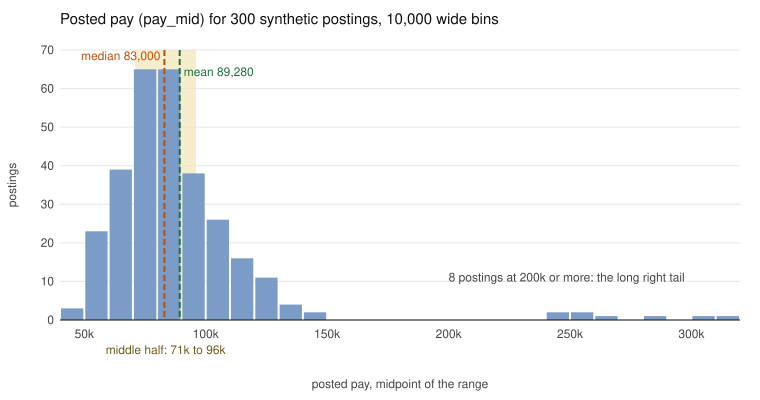

# Mean, median and skew

What is the typical posted pay for an analyst role, and which number should we put on the slide?

## Before you start

- Level: 1 (beginner). No statistics background needed.
- Time: about 2 hours.
- You need Python 3.9 or later and a terminal. Helpful but not required: [GROUP BY from raw rows](../../01-sql/01-group-by-from-raw-rows/), because a histogram is a count per group.

## The problem

Brightline Talent, a fictional recruiting firm, publishes a short pay report for its clients every quarter. Priya, the head of client services, needs the headline number for 300 analyst postings by Friday. Last quarter someone reported the average, and a client pointed out that most of their offers were well below it. Your job is to compute the mean, the median and the spread by hand, explain why the mean and median differ, and recommend which number goes on the slide.

The dataset in `data/postings.csv` is synthetic. It is generated by `make_data.py` with a fixed seed, so everyone gets the same 300 rows. No row is a real job posting.

## In plain words

Ten friends sit in a cafe. Nine of them earn about the same. The tenth is a company director who earns four times as much. If you add up all ten salaries and divide by ten, you get the **average**, which statisticians call the **mean**. The director pulls it up, so it lands above what nine of the ten people earn. If you instead line the ten people up from lowest to highest pay and look at the person in the middle, you get the **median**. The director is just "the last person in the line", and the middle person does not change.

So the mean answers "if we shared all the pay out equally, how much would each person get?" The median answers "what does the person in the middle earn?" For a pay report, the second question is usually the one the reader is asking.

Two more words you will use:

- **Spread** is how far apart the values are. One measure is the **standard deviation** (SD), roughly the typical distance of a value from the mean. Another is a pair of **percentiles**: the 25th percentile (P25) is the value a quarter of the postings fall below, and the 75th (P75) is the value three quarters fall below. The middle half of the postings sits between P25 and P75.
- **Skew** is a lopsided shape. **Right skew** means a long tail of high values, like pay.

## What you will build from scratch

- `mean(values)` and `median(values)`, with no `statistics` module.
- `std_dev(values)` and `percentile(values, p)`: two ways to measure spread.
- `histogram(values, width)`: counts per bin, with empty bins kept, so you can see the shape.
- `skew_label(values)`: says whether the data is pulled to the right, the left, or neither, by comparing mean and median.
- `read_pay(path)` and `summarise(path)`: read the pay column and report n, mean, median, gap, SD, P25, P75 and skew.

## The idea

The mean of n values x1, x2, ..., xn is

    mean = (x1 + x2 + ... + xn) / n

Every value pulls on the mean in proportion to its size. One very large value can move it a long way.

The median is the value in the middle once you sort the list:

    sorted list of n values, positions 0 to n - 1
    n odd:  median = value at position n // 2
    n even: median = (value at n // 2 - 1 + value at n // 2) / 2

The median only cares about order. If the top value doubles, the median does not move at all.

**Spread.** The standard deviation of the whole list is

    SD = sqrt( sum of (x - mean)^2 / n )

Square each distance from the mean, average the squares, then take the square root to get back to money. Because distances are squared, a few far-away values dominate it, just as they dominate the mean. (Lesson 02 divides by n - 1 instead of n, because there the data is a sample used to estimate something larger.)

A percentile only cares about order, like the median. With the values sorted in positions 0 to n - 1, the p-th percentile sits at position

    rank = p / 100 * (n - 1)

If rank falls between two positions, go that fraction of the way from the lower value to the upper one. This is linear interpolation, the same rule as Excel's `PERCENTILE.INC`. The median is the 50th percentile.

**Shape.** A histogram cuts the pay axis into equal bins (here 10,000 wide) and counts the postings in each. Here is the lesson's data, drawn by `python3 draw_histogram.py`:



Pay data has a floor (nobody posts a negative salary) and a long tail on the high side (a few senior and director roles). In right-skewed data the tail drags the mean above the median, so the mean describes a pay level that most postings do not reach. That is why pay reports usually lead with the median.

A quick rule of thumb used in this lesson:

- mean clearly above median: right skew (long high tail)
- mean clearly below median: left skew (long low tail)
- about equal: roughly symmetric

"Clearly" here means a gap bigger than 1% of the median. It is a simple screen, not a formal skewness statistic.

## Walk through

Run each block from this folder. Start with a tiny list and one outlier:

```python
pay = [60000, 70000, 80000, 90000, 100000]
print(sum(pay) / len(pay))
pay[-1] = 400000
print(sum(pay) / len(pay))
print(sorted(pay)[len(pay) // 2])
```

```text
80000.0
140000.0
80000
```

One value changed and the mean jumped from 80,000 to 140,000. The median, the third value of the sorted list, stayed at 80,000.

Now the even case for the median. With four values there is no single middle, so average the two middle ones:

```python
values = sorted([10, 1, 4, 3])
mid = len(values) // 2
print(values, mid, (values[mid - 1] + values[mid]) / 2)
```

```text
[1, 3, 4, 10] 2 3.5
```

A percentile by interpolation. For P25 of four values, rank = 0.25 * 3 = 0.75, so go three quarters of the way from the first value to the second:

```python
values = sorted([40, 10, 30, 20])
rank = 25 / 100 * (len(values) - 1)
low = int(rank)
print(rank, values[low] + (values[low + 1] - values[low]) * (rank - low))
```

```text
0.75 17.5
```

Read the pay column from the CSV:

```python
import csv
with open("data/postings.csv", newline="") as f:
    pay = [float(row["pay_mid"]) for row in csv.DictReader(f)]
print(len(pay), min(pay), max(pay))
```

```text
300 43000.0 315000.0
```

Draw the shape in the terminal. Each `#` is two postings. Bins with no postings still get a row, or the gap in the tail would vanish:

```python
import csv, math
with open("data/postings.csv", newline="") as f:
    pay = [float(row["pay_mid"]) for row in csv.DictReader(f)]
counts = {}
for v in pay:
    start = math.floor(v / 10000) * 10000
    counts[start] = counts.get(start, 0) + 1
start = min(counts)
while start <= max(counts):
    c = counts.get(start, 0)
    print("%4dk %3d %s" % (start // 1000, c, "#" * round(c / 2)))
    start += 10000
```

```text
  40k   3 ##
  50k  23 ############
  60k  39 ####################
  70k  65 ################################
  80k  65 ################################
  90k  38 ###################
 100k  26 #############
 110k  16 ########
 120k  11 ######
 130k   4 ##
 140k   2 #
 150k   0 
 160k   0 
 170k   0 
 180k   0 
 190k   0 
 200k   0 
 210k   0 
 220k   0 
 230k   0 
 240k   2 #
 250k   2 #
 260k   1 
 270k   0 
 280k   1 
 290k   0 
 300k   1 
 310k   1 
```

(Python rounds 0.5 to the nearest even number, so a bin with 1 posting gets no `#`. The count column is the truth.)

Run the worked answer, `python3 solution/solution.py`. It prints:

```
n 300
mean 89280.0
median 83000.0
gap 6280.0
sd 36021.31
p25 71000.0
p75 96000.0
skew right
```

The mean is 89,280 and the median is 83,000. The middle half of the postings pay between 71,000 and 96,000. Now take the director roles out and see what moves:

```python
import csv
with open("data/postings.csv", newline="") as f:
    rows = list(csv.DictReader(f))
pay = [float(r["pay_mid"]) for r in rows]
rest = [float(r["pay_mid"]) for r in rows if r["title"] != "Director of Analytics"]
mean_all, mean_rest = sum(pay) / len(pay), sum(rest) / len(rest)
print(len(pay) - len(rest), "director rows")
print("below the mean:", sum(1 for p in pay if p < mean_all), "of", len(pay))
print("mean without them:", round(mean_rest, 2))
print("part of the 6,280 gap they explain:", round(mean_all - mean_rest, 2))
sd_rest = (sum((p - mean_rest) ** 2 for p in rest) / len(rest)) ** 0.5
print("SD without them:", round(sd_rest, 2))
```

```text
8 director rows
below the mean: 195 of 300
mean without them: 84263.7
part of the 6,280 gap they explain: 5016.3
SD without them: 19261.96
```

195 of the 300 postings sit below the mean. Without the 8 director rows the mean drops to about 84,264, while the median of the remaining rows is still 83,000. So the mean still mostly reflects the bulk of postings, but most of the gap between mean and median (5,016 of the 6,280) comes from those eight rows. The SD is even more sensitive: it falls from 36,021 to 19,262. That is why P25 and P75 are the safer way to describe the spread of pay.

## Common mistakes

1. **Reporting the mean of skewed data as "typical".** This is the trap from last quarter. On this data the mean says 89,280, but 195 of 300 postings (65%) pay less than that. The median, 83,000, is the honest "typical" number.
2. **Taking the middle of an unsorted list.** The two middle rows of the file as it is stored are 83,000 and 109,000, so "the middle" without sorting gives 96,000, which is 13,000 too high. Always sort first.
3. **Quoting mean plus or minus one SD as "most roles pay between".** Here that range is 53,259 to 125,301. It is inflated by the 8 directors (the SD without them is 19,262) and it is not built from the postings in the middle. Say "the middle half pay between 71,000 and 96,000" (P25 to P75) instead.
4. **Deleting the outliers to fix the mean.** The director roles are real postings in this dataset. Dropping them changes the question to "pay for non-director roles". If that is the question, say so; otherwise keep them and report the median.

## Your turn

Open `exercise.py` and fill in the eight functions. Do not import `statistics` (or `numpy`, `pandas`, `scipy`); the point is to write the arithmetic yourself, and the test checks the imports. Then run, from this folder:

    python3 test_lesson.py

The tests compare your numbers with Python's `statistics` module on the committed data and on a second dataset built with another seed, plus small hand-made cases (an empty list, a tie, zeros). To see the reference solution pass, run `CHECK_SOLUTION=1 python3 test_lesson.py`.

Stretch: compute the median and P25 to P75 separately for each title. Which title has the widest middle half?

## Check yourself

1. A hiring manager says the average salary for the team is 150,000 but most people earn less than that. How is that possible?
2. When would you report the mean instead of the median?
3. How do you compute the median of an even number of values?
4. Why is P25 to P75 a better "most roles pay between" range for pay than mean plus or minus one SD?

<details>
<summary>Answers</summary>

1. A few very high salaries pull the mean up. With right-skewed pay, most people can sit below the mean. The median would show the typical salary.
2. When you need a total or a rate that adds up, for example revenue per user times users equals revenue, or when the data is roughly symmetric with no heavy tail.
3. Sort the values and average the two in the middle.
4. Percentiles only depend on order, so a few extreme values cannot stretch them. The SD squares distances, so the same few values inflate it. On this data the SD is 36,021 with the directors and 19,262 without them, while P25 and P75 stay where the bulk of postings are.

</details>

## What to tell the stakeholder

"The typical posted pay across the 300 analyst postings is 83,000 (the median), and the middle half pay between 71,000 and 96,000. The average is higher, 89,280, because 8 director roles pay 241,000 or more; 195 of the 300 postings pay below the average, so we lead with the median." Caveat: these are posted pay ranges (we use the midpoint), not accepted offers.

## In real job postings

In the Real Analyst Jobs data drop of 25 October 2026, 528 of the 2,789 US analyst postings (18.9%) were senior or lead/staff roles and 375 (13.4%) were entry level. Mixing levels like this is one reason real pay data has a long right tail, so always say which levels a pay figure covers. Browse the [data analyst jobs in the USA](https://realanalystjobs.com/jobs/data-analyst-jobs-in-usa) or see the [analyst job market report](https://realanalystjobs.com/analyst-job-market).

## Next

[02: Confidence interval by hand](../02-confidence-interval-by-hand/)
