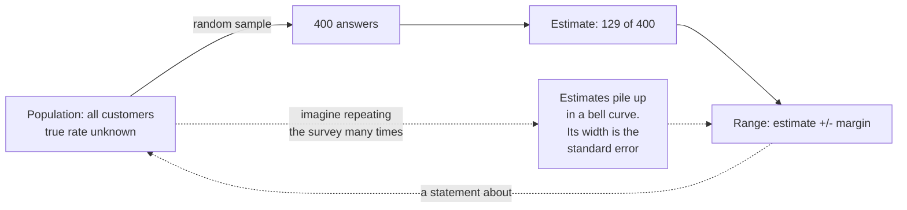

# Confidence interval by hand

How sure are we about an average or a rate measured on a sample?

## Before you start

- Level: 1 (beginner).
- Time: about 2 hours.
- Builds on [Mean, median and skew](../01-mean-median-and-skew/) (the mean and the standard deviation).
- Helps to have done [Probability by simulation](../05-probability-by-simulation/) and [Sampling and the central limit theorem](../07-sampling-and-the-clt/). If you skipped them, the section "The idea" below gives you the short version of both, with a simulation you can run.

## The problem

Harbor Mealkits, a fictional meal kit delivery startup, opened in a new pilot city this month. Its first 18 orders there are in `data/orders.csv`. Separately, the company asked a random sample of 400 of last month's customers, right after checkout, whether they would order again; their answers are in `data/survey.csv`. Marcus, the operations lead, wants to tell the board on Monday that "average order value in the new city is about 56 dollars and 32% of customers would reorder". A board member always asks the same follow-up: how much could those numbers move if you measured again? You will build both intervals from the formula so you can answer with a range, not a single point.

Both files are synthetic, generated by `make_data.py` with a fixed seed. They are not real customers.

## In plain words

You are cooking a big pot of soup. To check the salt you stir it and taste one spoonful. The spoonful is a **sample**; the pot is the **population**, everything you actually care about. One spoonful can be a little saltier or a little blander than the pot as a whole, just by chance. So instead of saying "the pot is exactly this salty", a careful cook says "the pot is somewhere between a bit less and a bit more salty than this spoon". That range is a **confidence interval**.

Two things make the range narrower: a bigger spoon (a larger sample) and a soup that is already evenly mixed (less variation between spoonfuls). Stirring matters too: if you only ever taste from the top, no range will fix it. In data, stirring is taking a **random sample**.

Here the "pots" are all of last month's customers (for the reorder rate) and orders like the first 18 in the new city (for the average order value). The numbers we computed from the data are **estimates** of the pot.

## What you will build from scratch

- `sample_sd(values)`: the sample standard deviation with the n - 1 denominator.
- `critical_value(df, confidence)`: picks a t value from a small table for small samples, and the normal z value otherwise.
- `mean_ci(values, confidence)`: interval for a mean.
- `proportion_ci(successes, n, confidence)`: interval for a rate.
- `read_column(path, column)`: reads a numeric CSV column.

## The idea

**Step 1: an estimate wobbles from sample to sample.** If Harbor ran the survey again with 400 different customers, it would not get exactly 129 yes answers again. Imagine running it many times. Each run gives one estimate, and the estimates pile up around the true rate:



The spread of that pile of estimates is the **standard error** (SE). It is not the spread of the data; it is the spread of the *estimate*. For a mean it is s / sqrt(n), and for a rate it is sqrt(p * (1 - p) / n). Both shrink as n grows.

**Step 2: the pile has a known shape.** When the sample is reasonably large, the pile of estimates follows the **normal distribution**, the symmetric bell curve. (That fact is the central limit theorem.) For the standard normal bell, centred on 0 with a spread of 1, the middle 95% lies between -1.96 and +1.96:

```
                      .-'''-.
                    .'       '.
                   /           \
                 .'             '.
              .-'                 '-.
   ........-''                       ''-........
   ---------|----------+----------|---------
          -1.96        0        +1.96
   2.5%   |<------- middle 95% ------->|   2.5%
```

So an estimate lands within 1.96 standard errors of the truth about 95% of the time. Turn that around and you get the interval: take the estimate and go 1.96 SE either side. The number 1.96 is called the **critical value** for 95% confidence. For 90% it is 1.6449 and for 99% it is 2.5758, the values in the `Z` table in `exercise.py`.

**Step 3: the interval.** Any confidence interval in this lesson has the same shape:

    estimate +/- critical value * standard error

**Mean.** With sample mean xbar, sample standard deviation s and sample size n:

    s  = sqrt( sum((x - xbar)^2) / (n - 1) )
    SE = s / sqrt(n)
    CI = xbar +/- t(df = n - 1) * SE

We divide by n - 1, not n, because the deviations are measured from xbar, which was fitted to the same data. That makes the plain average of squared deviations a little too small; n - 1 corrects it. The number n - 1 is called the **degrees of freedom** (df).

Why t and not z? With a small sample, s itself is uncertain. The **t distribution** is a bell curve with fatter tails than the normal to account for that, so its critical values are bigger. As df grows, t shrinks toward z: at 95% confidence t is 12.706 for df 1, 2.110 for df 17, 2.042 for df 30, while z is 1.96. This lesson stores t for df 1 to 30 in `T_TABLE` and uses z above 30. That switch is a textbook shortcut that a real tool would not take: at df 31 the true t is 2.040, so the margin drops by about 4% in one step. Statistical software always uses the exact t.

The t interval assumes the order values are roughly normal, or that n is large. With n = 18 that matters: check that there are no extreme values first. The 18 orders here run from 28.90 to 78.71 dollars with no extreme outliers, so the t interval is reasonable.

**Proportion.** With k successes out of n, p = k / n and

    SE = sqrt( p * (1 - p) / n )
    CI = p +/- z * SE

This is the normal approximation, often called the **Wald interval**. It works well when n * p and n * (1 - p) are both comfortably above about 10. Our survey has 129 yes and 271 no answers, so it qualifies. For small samples or rates near 0% or 100%, use the **Wilson interval** instead (see Common mistakes): the Wald interval's real coverage falls well below 95% there.

**What 95% means.** If we repeated the sampling many times and built an interval the same way each time, about 95% of those intervals would contain the true value. It does not mean there is a 95% chance that this one interval contains it, and it does not describe the people in the sample.

## Walk through

Run each block from this folder. The standard deviation, step by step:

```python
import math
vals = [2, 4, 4, 4, 5, 5, 7, 9]
mean = sum(vals) / len(vals)
squared = sum((x - mean) ** 2 for x in vals)
print(mean, squared, round(math.sqrt(squared / (len(vals) - 1)), 4))
```

```text
5.0 32.0 2.1381
```

Where 1.96 comes from. The share of the standard normal below a value z can be written with the error function `math.erf`. Below 1.96 sits 97.5%, so 2.5% is above it, 2.5% is below -1.96, and 95% is in between:

```python
import math
below = 0.5 * (1 + math.erf(1.96 / math.sqrt(2)))
print(round(below, 4), round(2 * below - 1, 4))
```

```text
0.975 0.95
```

Now see the wobble for yourself. Pretend the true reorder rate for all customers is 31% (the rate `make_data.py` used), run the survey of 400 a thousand times, and look at the pile of estimates:

```python
import math, random
rng = random.Random(1)
true_rate = 0.31
estimates, hits = [], 0
for _ in range(1000):
    k = sum(1 for _ in range(400) if rng.random() < true_rate)
    p = k / 400
    estimates.append(p)
    margin = 1.96 * math.sqrt(p * (1 - p) / 400)
    if p - margin <= true_rate <= p + margin:
        hits += 1
bins = {}
for p in estimates:
    b = math.floor(p * 100 / 2) * 2
    bins[b] = bins.get(b, 0) + 1
for b in sorted(bins):
    print("%2d%% to %2d%% %3d %s" % (b, b + 2, bins[b], "#" * round(bins[b] / 10)))
mean = sum(estimates) / 1000
spread = math.sqrt(sum((p - mean) ** 2 for p in estimates) / 999)
print("SD of the 1,000 estimates:", round(spread, 4))
print("formula SE for one survey:", round(math.sqrt(true_rate * (1 - true_rate) / 400), 4))
print("intervals that contain 31%:", hits, "of 1000")
```

```text
22% to 24%   1 
24% to 26%  10 #
26% to 28%  65 ######
28% to 30% 239 ########################
30% to 32% 346 ###################################
32% to 34% 247 #########################
34% to 36%  81 ########
36% to 38%   9 #
38% to 40%   1 
40% to 42%   1 
SD of the 1,000 estimates: 0.0221
formula SE for one survey: 0.0231
intervals that contain 31%: 959 of 1000
```

Three things to notice. The estimates form a bell around 31%. Their spread, 0.0221, is close to what the SE formula predicts from a single survey, 0.0231. And 959 of the 1,000 intervals caught the true rate, close to the promised 95%. In real life you only get one survey, and you never know whether yours is one of the lucky 95% or the unlucky 5%.

A mean interval for the numbers 1 to 10 (n = 10, df = 9, t = 2.262):

```python
import math
vals = list(range(1, 11))
mean = sum(vals) / 10
s = math.sqrt(sum((x - mean) ** 2 for x in vals) / 9)
margin = 2.262 * s / math.sqrt(10)
print(round(mean - margin, 4), round(mean + margin, 4))
```

```text
3.3343 7.6657
```

A proportion interval for 120 yes out of 400:

```python
import math
p = 120 / 400
margin = 1.96 * math.sqrt(p * (1 - p) / 400)
print(round(p - margin, 4), round(p + margin, 4))
```

```text
0.2551 0.3449
```

On the lesson data, `python3 solution/solution.py` prints:

```
orders n 18 mean 55.89 sd 15.54 95% CI [48.17, 63.62]
survey 129 of 400 95% CI [0.2767, 0.3683] 99% CI [0.2623, 0.3827]
```

- Orders: n = 18, mean 55.89 dollars, SD 15.54, 95% CI from 48.17 to 63.62.
- Survey: 129 of 400 said they would reorder (32.25%). The 95% CI runs from 27.67% to 36.83%. At 99% it widens to 26.23% to 38.27%.

## Common mistakes

1. **Saying the interval is about the people you surveyed.** "Between 28% and 37% of surveyed customers say they would reorder" is wrong. We know the surveyed share exactly: 129 of 400, 32.25%. The interval is about the population the sample came from: all of last month's customers. The same goes for "there is a 95% chance the true rate is between 28% and 37%"; the 95% describes the method over many repeats, not this one interval.
2. **Using z instead of t for a small sample.** For the 18 orders, z gives a margin of about 7.18 dollars against 7.73 with t (df 17). The z interval is too narrow, so it sounds more certain than the data allows.
3. **Dividing by n instead of n - 1.** On the orders that gives an SD of 15.10 instead of 15.54 and a margin of 7.51 instead of 7.73. Again too narrow.
4. **Using the Wald interval for small samples or rates near 0.** With 1 yes out of 20, the Wald interval goes below zero, which is impossible for a rate. The Wilson interval stays inside 0 to 1:

```python
import math
k, n, z = 1, 20, 1.96
p = k / n
margin = z * math.sqrt(p * (1 - p) / n)
print("Wald:  ", round(p - margin, 4), round(p + margin, 4))
centre = (p + z * z / (2 * n)) / (1 + z * z / n)
half = z * math.sqrt(p * (1 - p) / n + z * z / (4 * n * n)) / (1 + z * z / n)
print("Wilson:", round(centre - half, 4), round(centre + half, 4))
```

```text
Wald:   -0.0455 0.1455
Wilson: 0.0089 0.2361
```

5. **Forgetting what the interval cannot see.** It covers only the luck of the draw. If the first 18 orders in a new city are unusual (launch discounts, curious first-time buyers), or if only happy customers answer surveys, the interval is centred in the wrong place and no formula will tell you.

## Your turn

Open `exercise.py`. The tables are given; write the five functions without the `statistics` module (the test checks your imports). Then run, from this folder:

    python3 test_lesson.py

The test checks your intervals on the committed data, on a second dataset built with another seed, and on edge cases: one value, two equal values, zero successes, and n = 0. To see the reference solution pass: `CHECK_SOLUTION=1 python3 test_lesson.py`.

Stretch: add `wilson_ci(successes, n, confidence)` using the formula in Common mistakes, and compare it with `proportion_ci` on the survey. They should nearly agree, because n is large and the rate is far from 0 and 1.

Check your numbers against the [confidence interval calculator](https://realanalystjobs.com/tools/confidence-interval-calculator).

## Check yourself

1. What does a 95% confidence interval mean, in one sentence?
2. Why does the interval get narrower as n grows, and by how much if you quadruple n?
3. When should you use t instead of z?
4. A colleague writes "between 28% and 37% of the people we surveyed would reorder". What is wrong?

<details>
<summary>Answers</summary>

1. If we repeated the sampling many times and built an interval the same way each time, about 95% of those intervals would contain the true value. It is not a 95% chance that this particular interval contains it.
2. The standard error has sqrt(n) in the denominator. Quadrupling n halves the standard error, so the interval is half as wide.
3. For a mean when the population standard deviation is unknown and estimated from the sample, which is nearly always. The difference matters most for small samples, roughly under 30.
4. The share of the surveyed people is known exactly (32.25%). The interval describes all customers the sample stands for, not the sample itself.

</details>

## What to tell the stakeholder

"In the new city's first 18 orders the average order value was about 56 dollars; for orders like these the true average is plausibly anywhere from 48 to 64 dollars. Of the 400 customers we surveyed, 32% said they would reorder; for all of last month's customers the rate is plausibly between 28% and 37% (95% confidence)." Caveat: the ranges cover sampling luck only. First-week orders in a new city may not look like later ones, and "would reorder" is an intention, not a repeat order.

## In real job postings

In the Real Analyst Jobs data drop of 25 October 2026, 996 of the 2,056 US analyst postings that list any tool (48.4%) ask for Python, and 324 (15.8%) ask for R, the two languages analysts use to compute intervals like these. See [Python data analyst jobs](https://realanalystjobs.com/jobs/python-data-analyst-jobs).

## Next

[03: A/B test from scratch](../03-ab-test-from-scratch/)
