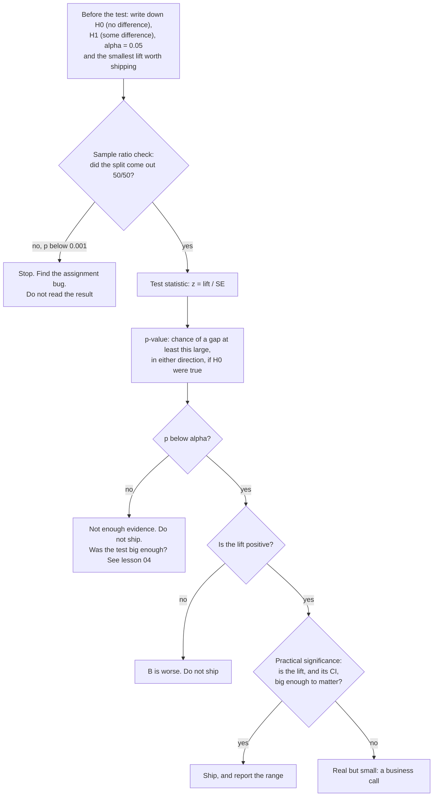

# A/B test from scratch

Did the new checkout page really convert better, or did we get lucky?

## Before you start

- Level: 2 (intermediate).
- Time: about 2 hours.
- Builds on [Confidence interval by hand](../02-confidence-interval-by-hand/): the standard error, the normal bell curve and the critical value 1.96. [Hypothesis testing by permutation](../08-hypothesis-test-by-permutation/) builds the same idea by shuffling the labels, with no formula; if you have not done it, "In plain words" below gives you the idea.

## The problem

Tidewater Outdoor, a fictional camping gear shop, tested a shorter checkout page against the current one. 1,900 visitors were split at random between variant A (current) and variant B (new). Dana, the product manager, sees B ahead and wants to ship it in Thursday's release, but the engineering lead asks whether the gap is bigger than random noise. You will check that the split worked, write the two-proportion z-test yourself, put a range on the lift, and give Dana a ship or do not ship answer with the reasoning.

The file `data/experiment.csv` is synthetic, generated by `make_data.py` with a fixed seed. Each row is one made-up user.

## In plain words

A friend says their coin is fair. You flip it 20 times and get 15 heads. Is the coin unfair, or was that just luck? You cannot prove either. What you can do is ask: **if the coin were fair, how often would 20 flips give a result at least this lopsided?** If the answer is "almost never", you stop believing the coin is fair. If it is "fairly often", you have no good reason to accuse it.

An A/B test asks the same question about two web pages. Assume the new page makes no difference. That assumption is the **null hypothesis**. Then ask how often pure luck, the random way visitors happened to land in A or B, would produce a gap at least as big as the one we saw. That chance is the **p-value**. A small p-value means "luck alone rarely does this", so we reject the null. It never tells you the chance that the new page is better.

Three more words you will need:

- **Conversion rate**: the share of users who placed an order.
- **Lift**: B's rate minus A's rate, in percentage points. (A relative lift divides that by A's rate.)
- **Alpha**: the p-value cut-off you pick before the test, usually 0.05. It is the false alarm rate you accept: how often you would "find" a difference that is not there.

## What you will build from scratch

- `normal_cdf(z)`: the standard normal CDF using `math.erf`.
- `count_conversions(path)`: conversions and users per variant from the raw rows.
- `srm_check(n_a, n_b)`: did the random split come out the way it was planned?
- `two_proportion_ztest(...)`: pooled rate, standard error, z and the two-sided p-value.
- `diff_ci(...)`: a 95% confidence interval for the lift.
- `decide(result, alpha, min_lift)`: the ship rule.

## The idea

The whole test, in the order you run it:



**Step 0. Check the split.** Before reading any result, check that the groups have the sizes the design promised. A **sample ratio mismatch** (SRM) means the assignment or the logging is broken, for example B's page crashed for some browsers and those users never got recorded. Then the groups are no longer comparable and every number after this is suspect. With expected counts E_a and E_b (half of all users each, for a 50/50 test):

    chi2    = (n_a - E_a)^2 / E_a + (n_b - E_b)^2 / E_b
    p_value = 2 * (1 - Phi(sqrt(chi2)))

This is a chi-square test with 1 degree of freedom, and a chi-square with 1 degree of freedom is just a z squared, so the normal CDF gives its p-value. Many teams sound the alarm only when this p-value is below 0.001, because the check runs on every test and a false alarm stops a good test.

Step 1. The two observed rates:

    p_a = conv_a / n_a
    p_b = conv_b / n_b
    lift = p_b - p_a

Step 2. Under the null both groups share one rate, so estimate it from everyone:

    p_pool = (conv_a + conv_b) / (n_a + n_b)

Step 3. The standard error of the difference between two independent proportions, using the pooled rate:

    SE = sqrt( p_pool * (1 - p_pool) * (1/n_a + 1/n_b) )

Step 4. How many standard errors away from zero is the lift? This is the **test statistic**:

    z = lift / SE

Step 5. The two-sided p-value is the chance of a z at least this far from zero, in either direction, if the null were true. The standard normal CDF can be written with the error function:

    Phi(z) = 0.5 * (1 + erf(z / sqrt(2)))
    p_value = 2 * (1 - Phi(|z|))

Step 6. Put a range on the lift. The test says whether the lift is distinguishable from zero; the confidence interval says how big it plausibly is. For the interval we do *not* assume the null, so each group keeps its own rate (the unpooled standard error):

    SE_diff = sqrt( p_a * (1 - p_a) / n_a + p_b * (1 - p_b) / n_b )
    CI = lift +/- 1.96 * SE_diff

Step 7. Decide with the rule you wrote before you looked. Ship only if p_value < alpha, the lift is in the direction you wanted, and the lift is at least the smallest change worth shipping. A significant drop is a reason not to ship, not a win.

The test assumes users are assigned at random, each user counts once, and both groups are large enough that the normal approximation holds (a rough check: at least 10 conversions and 10 non-conversions in each group).

Try it: the [A/B test calculator](../../../visuals/ab-test.html) (one HTML file, opens offline) runs these formulas live as you move the visitors and conversions, and simulates peeking from [lesson 13](../13-ab-test-pitfalls/).

## Walk through

Run each block from this folder. The CDF from `erf`:

```python
import math
def normal_cdf(z):
    return 0.5 * (1 + math.erf(z / math.sqrt(2)))
print(round(normal_cdf(1.96), 4))
```

```text
0.975
```

A worked example: 200 of 2,000 convert on A, 260 of 2,000 on B.

```python
import math
ca, na, cb, nb = 200, 2000, 260, 2000
lift = cb / nb - ca / na
pool = (ca + cb) / (na + nb)
se = math.sqrt(pool * (1 - pool) * (1 / na + 1 / nb))
z = lift / se
p = 2 * (1 - 0.5 * (1 + math.erf(abs(z) / math.sqrt(2))))
print(round(lift, 4), round(pool, 4), round(se, 5), round(z, 3), round(p, 4))
```

```text
0.03 0.115 0.01009 2.974 0.0029
```

The lift is 3 points, the pooled rate 11.5%, and the lift is 2.974 standard errors from zero. Luck alone would give a gap that large in either direction about 0.29% of the time.

Count from the raw rows, one pass over the file:

```python
import csv
counts = {"A": [0, 0], "B": [0, 0]}
with open("data/experiment.csv", newline="") as f:
    for row in csv.DictReader(f):
        counts[row["variant"]][0] += int(row["converted"])
        counts[row["variant"]][1] += 1
print(counts)
```

```text
{'A': [107, 976], 'B': [135, 924]}
```

Each pair is conversions, users. Check the split before anything else:

```python
import math
na, nb = 976, 924
expected = (na + nb) / 2
chi2 = (na - expected) ** 2 / expected + (nb - expected) ** 2 / expected
p = 2 * (1 - 0.5 * (1 + math.erf(math.sqrt(chi2) / math.sqrt(2))))
print(round(chi2, 4), round(p, 4))
```

```text
1.4232 0.2329
```

A 976 to 924 split would happen by chance about 23% of the time with a fair 50/50 assignment, far above 0.001. The split is fine, so we can read the result.

The confidence interval on the lift, with the unpooled standard error:

```python
import math
ca, na, cb, nb = 107, 976, 135, 924
pa, pb = ca / na, cb / nb
se = math.sqrt(pa * (1 - pa) / na + pb * (1 - pb) / nb)
lift = pb - pa
print(round(lift, 4), round(lift - 1.96 * se, 4), round(lift + 1.96 * se, 4))
```

```text
0.0365 0.0064 0.0665
```

On the lesson data, `python3 solution/solution.py` prints:

```
A 107 / 976 B 135 / 924
srm {'chi2': 1.4232, 'p_value': 0.2329}
{'p_a': 0.10963, 'p_b': 0.1461, 'lift': 0.03647, 'p_pool': 0.12737, 'se': 0.0153, 'z': 2.38345, 'p_value': 0.01715}
95% CI on the lift [0.0064, 0.0665]
decision: ship
```

A converted at 10.96% and B at 14.61%, a lift of 3.65 percentage points. The pooled rate is 12.74%, the standard error is 0.0153, z is 2.38 and the two-sided p-value is 0.017. That is below 0.05 and the lift is positive, so the rule says ship. The 95% interval on the lift runs from 0.6 to 6.7 points: B is very likely better, but the gain could be anywhere from barely noticeable to large.

Was the test big enough? `make_data.py` built in true rates of 10% for A and 13.5% for B. By the sample size formula in lesson 04, a test with about 950 users per group had only about a 66% chance (its **power**) of detecting that change. This test got a significant result, but a repeat of it would miss the same real effect about one time in three.

## Common mistakes

1. **Reading the p-value as the chance that B is better.** "p = 0.017, so we are 98.3% sure B wins" is wrong. The p-value is the chance of a gap at least this large if there were no difference. It is a statement about the data assuming the null, not about the hypothesis. Report the interval on the lift instead: 0.6 to 6.7 points.
2. **Mixing up absolute and relative lift.** B's rate is 3.65 percentage points higher, which is 33% higher relative to A's 10.96%. "Conversion up 33%" sounds like 11% became 44%. Always say which one you mean.
3. **Switching to a one-sided test after seeing B ahead.** A one-sided p-value only counts gaps in one direction, so it halves the p-value: here 0.0086 instead of 0.017. Choosing that after looking at the data is a way to manufacture significance. Pick one-sided or two-sided before the test.
4. **Skipping the sample ratio check.** Suppose a bug had silently dropped 100 of B's users, leaving 976 against 824:

```python
import math
na, nb = 976, 824
expected = (na + nb) / 2
chi2 = (na - expected) ** 2 / expected + (nb - expected) ** 2 / expected
print(round(chi2, 2), round(math.erfc(math.sqrt(chi2 / 2)), 5))
```

```text
12.84 0.00034
```

A p-value of 0.00034 means a fair 50/50 split would almost never produce this. The users who went missing were probably not random (for example, everyone on one browser), so comparing the rest is comparing different kinds of people. Fix the bug and rerun the test; do not "adjust" the result.

## Your turn

Open `exercise.py` and fill in the six functions using only `math` and `csv` (the test checks your imports). Then run, from this folder:

    python3 test_lesson.py

The test checks your code on the committed data, on a second experiment built with another seed, and on edge cases: no conversions at all, an empty group, a planned 90/10 split, and a p-value exactly equal to alpha. To see the reference solution pass: `CHECK_SOLUTION=1 python3 test_lesson.py`.

Stretch: Dana says a lift under 1 point is not worth the engineering time. Call `decide` with `min_lift=0.01`, then look at the interval. Would you still ship, and what would you tell her about the lower end of the range?

Check your answer with the [A/B test calculator](https://realanalystjobs.com/tools/ab-test-calculator) by entering the visitors and conversions for A and B.

## Check yourself

1. Why do we pool the two rates when computing the standard error for the test, but not for the confidence interval?
2. The p-value is 0.017. Does that mean there is a 1.7% chance B is not better?
3. The test ran for two days, you checked results every hour, and stopped the first time p dropped below 0.05. What is wrong?
4. B is significantly better but the lift is 0.1 percentage points. Do you ship?

<details>
<summary>Answers</summary>

1. The test is computed assuming the null hypothesis that both groups share one rate, and the pooled rate is the best estimate of that shared rate. The interval does not assume the null; it estimates how far apart the two rates are, so each group keeps its own rate.
2. No. It is the chance of seeing a gap at least this large, in either direction, if there were no real difference. It is a statement about the data given the null, not the probability that the null is true.
3. Peeking. Checking many times and stopping at the first significant result inflates the false positive rate well above alpha. Fix the sample size in advance (next lesson) and analyse once.
4. Not automatically. Significance says a gap this large would be unlikely if there were no effect. It says nothing about whether a 0.1 point lift is worth the engineering and maintenance cost; that is a business call. Decide the smallest lift worth shipping before the test, and check the confidence interval against it.

</details>

## What to tell the stakeholder

"B converted at 14.6% against 11.0% for A, a lift of 3.6 percentage points. A gap at least this large, in either direction, would show up only about 1.7% of the time if the pages were equally good, so we recommend shipping B. The true lift is plausibly anywhere from 0.6 to 6.7 points, so plan on a modest gain rather than the full 3.6." Caveat: the test was small (about 950 users per group), which is why the range is wide.

## In real job postings

In the Real Analyst Jobs data drop of 25 October 2026, 1,477 of the 2,056 US analyst postings that list any tool (71.8%) ask for SQL, which is usually how the experiment counts above get pulled before the test is run. See [SQL data analyst jobs](https://realanalystjobs.com/jobs/sql-data-analyst-jobs) and try the [SQL case study](https://realanalystjobs.com/tools/sql-case-study).

## Next

[04: Sample size before you test](../04-sample-size-before-you-test/): was this test big enough?
