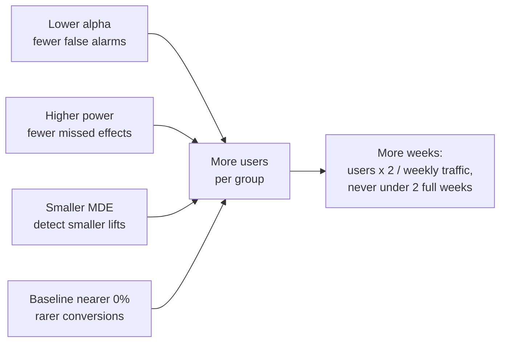

# Sample size before you test

How many users, and how many weeks, do we need before an A/B test can answer the question we care about?

## Before you start

- Level: 2 (intermediate).
- Time: about 2 hours.
- Builds on [A/B test from scratch](../03-ab-test-from-scratch/) (the z-test, alpha and the p-value) and [Confidence interval by hand](../02-confidence-interval-by-hand/) (the normal bell curve and critical values).

## The problem

Lanternway Courses, a fictional online course platform, wants to run tests on six pages this quarter. Sam, the growth lead, asks for a plan by the end of the week: which pages can be tested in a reasonable time, and which would take months. The team has been stopping tests "when the result looks clear", which is how they shipped two changes last year that later showed no effect. You will compute the required sample size from the formula, before any test starts, and turn it into weeks of traffic for every page.

The file `data/pages.csv` is synthetic, generated by `make_data.py` with a fixed seed. It holds a baseline conversion rate and the visits in a typical week for each page.

## In plain words

Imagine you want to know whether a new bowling style makes a cricketer take more wickets. If the change is huge (from 1 wicket a match to 4), two or three matches will show it. If it is small (from 1.0 to 1.1 a match), you would need a whole season or more, because ordinary match-to-match luck is bigger than the change. Deciding how many matches to watch *before* you start, and not stopping the moment the numbers look good, is the only way to trust the answer.

An A/B test is the same. Before it starts you choose:

- **Alpha**: how often you accept a false alarm, declaring a difference that is not there (a **false positive**, or type I error). Usually 0.05.
- **Power**: how often you want to catch a real difference of the size you care about. Usually 0.80. Missing a real effect is a **false negative** (type II error), and its rate, called beta, is 1 - power.
- **Minimum detectable effect (MDE)**: the smallest change that would be *worth* detecting, the smallest lift that would change the decision. It is not the lift you expect or hope for.
- **Baseline rate**: the conversion rate today.

From those four, a formula gives the users needed per group. Traffic then turns users into weeks.

## What you will build from scratch

- `z_quantile(p)`: the inverse of the normal CDF, found by bisection.
- `sample_size_per_group(p1, p2, alpha, power)`: users needed per group.
- `sample_size_for_lift(baseline, relative_lift, ...)`: the same, from a relative lift.
- `weeks_needed(n_per_group, weekly_visitors, min_weeks)`: turns users into calendar time, in full weeks.
- `plan(path, relative_lift)`: the per-page plan for Sam.

## The idea

The four choices pull on one number, and that number pulls on time:



For two proportions, baseline p1 and target p2, with a two-sided test:

    z_a   = z value with 1 - alpha/2 of the normal below it   (1.96 for alpha 0.05)
    z_b   = z value with power of the normal below it          (0.8416 for power 0.80)
    p_bar = (p1 + p2) / 2

    n per group = ( z_a * sqrt(2 * p_bar * (1 - p_bar)) + z_b * sqrt(p1*(1-p1) + p2*(1-p2)) )^2
                  / (p2 - p1)^2

Read the formula from the bottom. The difference (p2 - p1) is squared in the denominator. Halve the effect you want to detect and you need about four times as many users. That is the whole reason small lifts are expensive.

A relative lift is a share of the baseline: a 10% lift on a 5.6% baseline means p2 = 5.6% * 1.10 = 6.16%, a difference of only 0.56 percentage points.

The z values come from the inverse normal CDF. There is no closed form, but the CDF only goes up, so **bisection** works: guess the middle of an interval, check whether the CDF there is below or above the target, keep the half that contains the answer, and repeat. Each step halves the error.

**Users to weeks.** Both groups need n users, so a 50/50 test needs 2n users in total:

    weeks = ceil( 2 * n / weekly users ), and at least 2

Two rules sit on top of the arithmetic. First, run whole weeks, and at least two: people behave differently on a Monday and a Saturday, so a test that stops mid-week over-counts some days. Second, count **unique users**, not visits. The file counts visits, and a returning visitor is one user who shows up in several weeks, so real unique users per week are fewer and the real test takes longer than this estimate. Treat the weeks below as a minimum.

## Walk through

Run each block from this folder. Inverse normal by bisection:

```python
import math
def cdf(z):
    return 0.5 * (1 + math.erf(z / math.sqrt(2)))
low, high = -10.0, 10.0
for _ in range(100):
    mid = (low + high) / 2
    if cdf(mid) < 0.975:
        low = mid
    else:
        high = mid
print(round(mid, 4), round(cdf(mid), 4))
```

```text
1.96 0.975
```

Sample size for 10% to 12% (a 20% relative lift), alpha 0.05, power 0.80:

```python
import math
p1, p2, za, zb = 0.10, 0.12, 1.959964, 0.841621
p_bar = (p1 + p2) / 2
top = (za * math.sqrt(2 * p_bar * (1 - p_bar)) + zb * math.sqrt(p1 * (1 - p1) + p2 * (1 - p2))) ** 2
print(math.ceil(top / (p2 - p1) ** 2), "per group")
```

```text
3841 per group
```

The trade-off the other way round: keep the 10% to 12% change fixed and ask how likely a test of a given size is to catch it. This is the power, the same formula solved for z_b:

```python
import math
def cdf(z):
    return 0.5 * (1 + math.erf(z / math.sqrt(2)))
p1, p2, za = 0.10, 0.12, 1.959964
p_bar = (p1 + p2) / 2
for n in (500, 1000, 2000, 3841, 6000, 8000):
    z = (abs(p2 - p1) * math.sqrt(n) - za * math.sqrt(2 * p_bar * (1 - p_bar))) / math.sqrt(p1 * (1 - p1) + p2 * (1 - p2))
    print("%5d per group  power %3.0f%% %s" % (n, cdf(z) * 100, "#" * round(cdf(z) * 40)))
```

```text
  500 per group  power  17% #######
 1000 per group  power  30% ############
 2000 per group  power  52% #####################
 3841 per group  power  80% ################################
 6000 per group  power  94% ######################################
 8000 per group  power  98% #######################################
```

With 500 users per group the test would miss this real change more than 4 times in 5. Power climbs quickly at first and then flattens: going from 80% to 98% costs roughly twice the users. The checkout test in lesson 03, with about 950 users per group, had only about 66% power for the true change built into its data.

Now the plan for all six pages. `python3 solution/solution.py` prints the users per group and the weeks for a 20%, 10% and 5% relative lift (weeks include the two-week minimum):

```
page      baseline  visits  n at 20%  n at 10%   n at 5% wk 20% wk 10%  wk 5%
home          5.3%   27500      7670     29368    114838      2      3      9
search       35.8%   35000       730      2873     11380      2      2      2
product       5.6%   40000      7233     27702    108332      2      2      6
cart          5.6%   10500      7233     27702    108332      2      6     21
checkout     17.0%    8000      2064      7964     31262      2      2      8
signup        2.8%   43500     14942     57135    223262      2      3     11
```

Three patterns stand out.

- Each halving of the lift multiplies the users by roughly four: home needs 7,670, then 29,368, then 114,838.
- Low baselines need far more users for the same relative lift, because the absolute difference is tiny: 10% of 2.8% is 0.28 percentage points. Signup has the most traffic of any page and still needs 3 weeks at 10%.
- Traffic decides the calendar. Product and cart have the same baseline and need the same 27,702 users per group at 10%, but product gets 40,000 visits a week and cart 10,500, so product fits in the 2-week minimum and cart needs 6 weeks.

At a 10% MDE, search, product and checkout fit in two weeks; home and signup need three; cart needs six. At 5%, only search still fits in two weeks.

## Common mistakes

1. **Reading a relative lift as percentage points.** For cart, a 10% relative lift means 5.6% to 6.16%. Typing p2 = 0.056 + 0.10 = 15.6% instead asks the formula for a change almost 18 times bigger:

```python
import math
def n_for(p1, p2, za=1.959964, zb=0.841621):
    p_bar = (p1 + p2) / 2
    top = (za * math.sqrt(2 * p_bar * (1 - p_bar)) + zb * math.sqrt(p1 * (1 - p1) + p2 * (1 - p2))) ** 2
    return math.ceil(top / (p2 - p1) ** 2)
print("relative 10%:", n_for(0.056, 0.056 * 1.10))
print("10 points by mistake:", n_for(0.056, 0.056 + 0.10))
```

```text
relative 10%: 27702
10 points by mistake: 148
```

A plan built on 148 users per group would "finish" in a day and have almost no chance of detecting the change that matters.

2. **Counting only one group.** 27,702 per group on cart's 10,500 weekly visits is 3 weeks if you forget that B needs its own 27,702 users, and 6 weeks when you count both groups.
3. **Stopping when the result looks clear.** This is how the team shipped two changes that did nothing. In an A/A test both groups get the same page, so every "win" is a false alarm. Run 400 simulated A/A tests at a 10% rate with 2,000 users per group, and compare one look at the end with stopping at the first of ten looks that shows p below 0.05:

```python
import math, random
rng = random.Random(4)
def p_value(ca, cb, n):
    pool = (ca + cb) / (2 * n)
    se = math.sqrt(pool * (1 - pool) * 2 / n)
    return 1.0 if se == 0 else math.erfc(abs(cb / n - ca / n) / se / math.sqrt(2))
tests, users, looks = 400, 2000, 10
end_only = peeking = 0
for _ in range(tests):
    ca = cb = 0
    stopped = False
    for i in range(1, users + 1):
        ca += rng.random() < 0.10
        cb += rng.random() < 0.10
        if i % (users // looks) == 0 and p_value(ca, cb, i) < 0.05:
            stopped = True
    peeking += stopped
    end_only += p_value(ca, cb, users) < 0.05
print("false wins, one look at the end:", end_only, "of", tests)
print("false wins, stop at the first of 10 looks:", peeking, "of", tests)
```

```text
false wins, one look at the end: 20 of 400
false wins, stop at the first of 10 looks: 83 of 400
```

One look keeps false wins at the 5% you chose (20 of 400). Peeking ten times raises them to about 21% (83 of 400).

4. **Setting the MDE to the lift you hope for.** If you plan for the 20% lift the designer expects, the test has 80% power only for changes that big. A real 10% lift would usually be missed, and you would wrongly conclude the change does nothing. Set the MDE to the smallest lift that would still change your decision.
5. **Running for a few days, or counting visits as users.** Even when traffic fills the sample in under a week (search at 5% needs less than one week of visits), run whole weeks, at least two. And because visits overcount unique users, real tests usually take longer than the plan says.

## Your turn

Open `exercise.py` and fill in the functions marked TODO. `normal_cdf` is given. Then run, from this folder:

    python3 test_lesson.py

The test checks your plan on the committed data, on a second set of pages built with another seed, and on edge cases: equal rates, a zero lift, zero traffic and a test that needs fewer users than one week brings. To see the reference solution pass: `CHECK_SOLUTION=1 python3 test_lesson.py`.

Stretch: write `power(p1, p2, n_per_group, alpha)` from the walk through, and use it to answer Sam's follow-up: if cart can only run for 4 weeks, what is the chance of catching a real 10% lift?

Check your numbers with the [sample size calculator](https://realanalystjobs.com/tools/sample-size-calculator). Small differences of a user or two come from rounding in the z values.

## Check yourself

1. A stakeholder wants to detect a 2% relative lift on a page with a 3% baseline. What do you tell them?
2. What happens to the required sample size if you raise power from 0.80 to 0.90?
3. Why should the sample size be fixed before the test starts?
4. The traffic for the search page fills a 5% test in under five days. Why still run it for two full weeks?

<details>
<summary>Answers</summary>

1. The absolute effect is 0.06 percentage points, and the squared difference in the denominator makes the required sample enormous. Ask whether a bigger change is possible, whether a higher-traffic or higher-baseline metric could be used, or whether the decision can be made without a test.
2. It goes up, because z_b rises from about 0.84 to about 1.28. You are asking to miss a real effect less often, which costs more users.
3. If you keep checking and stop when the result looks good, the real false positive rate is much higher than alpha (about 21% instead of 5% with ten looks in the simulation above). A fixed sample size, set from alpha, power and the MDE, keeps the error rates you chose.
4. Behaviour changes with the day of the week, so a short test over-weights some days. Whole weeks, at least two, also give returning visitors time to show up, since the sample should count unique users, not visits.

</details>

## What to tell the stakeholder

"If the smallest lift worth shipping is 10%, we can test search, product and checkout in two weeks each, home and signup in three, and cart in six. Search is the only page where a 5% lift is detectable in two weeks; cart fits in two weeks only if the smallest lift that matters is 20%. We will fix each test's length before it starts and read the result once, at the end." Caveat: the weeks are minimums, because our traffic counts visits, and unique users grow more slowly than visits.

## In real job postings

In the Real Analyst Jobs data drop of 25 October 2026, India had 1,174 analyst postings; of the 900 that list any tool, 634 (70.4%) ask for SQL and 448 (49.8%) ask for Python, the two tools you need to pull traffic numbers and run a plan like this one. Browse [Python data analyst jobs](https://realanalystjobs.com/jobs/python-data-analyst-jobs) or see the [analyst job market report](https://realanalystjobs.com/analyst-job-market).

## Next

[09: Comparing categories, the chi-square test](../09-chi-square-test/): the same yes or no question when there are more than two groups.
