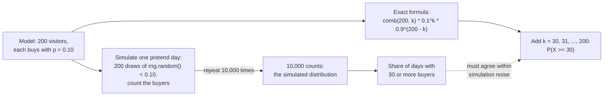

# Probability and distributions by simulation

If 10% of visitors buy, how many of 200 should buy, and how unusual is 30?

## Before you start

- Level: 1 (beginner). No probability background needed.
- Time: about 2 hours.
- Builds on [Mean, median and skew](../01-mean-median-and-skew/) (the mean, the standard deviation and a histogram drawn in the terminal). You need Python 3.9 or later and a terminal.

## The problem

Tidewater Outdoor, a fictional camping gear shop, launched a new gear guide page on Tuesday 27 October 2026. For months about 10% of the visitors who land on a product page have bought something. On launch day the new page had 200 visitors and 30 of them bought. Dana, the product manager, wants to tell the Thursday leadership meeting that the page "is clearly working", because 30 is half as much again as the 20 she expected. Before she does, she asks you one question: if the page were no better than the old ones, how unusual would a day with 30 buyers be? You will answer it twice, once by simulating thousands of pretend days and once with the exact formula, and check that the two agree.

The file `data/visitors.csv` is synthetic, generated by `make_data.py` with a fixed seed. Each of its 200 rows is one made-up visitor, with `bought` set to 1 or 0.

## In plain words

Take a coin that lands heads 1 time in 10. Flip it 200 times and count the heads. You will usually get somewhere near 20, but not exactly 20 every time: one day 17, the next 24. Now flip 200 times again and again, thousands of times, and write each count down. Some counts come up often (around 20), others almost never (40). That list of how often each count comes up is a **distribution**.

Each visitor to the page is one flip of that coin. "How unusual is 30?" means: if the coin really lands heads 1 time in 10, on what share of days would we see 30 or more heads? If that share is large, 30 is nothing special. If it is tiny, the coin (the page) has probably changed.

Words you will use:

- **Probability:** how often something happens in the long run, as a number from 0 (never) to 1 (always). A 10% chance is 0.10.
- **Random variable:** a number that comes out of a chance process, here X, the number of buyers among 200 visitors.
- **Binomial distribution:** the distribution of X when there are n independent tries (visitors), each with the same chance p of success (buying). Written X ~ Binomial(n, p).
- **Expected value:** the long-run average of X. For a binomial it is n * p.
- **Simulation:** making the computer play out the chance process many times with random numbers, then counting what happened.
- **Seed:** the starting point of a random number generator. The same seed gives the same "random" numbers every time, so a simulation can be repeated exactly.
- **Tail probability:** the chance of a result at least as extreme as the one you saw, here P(X >= 30).

## What you will build from scratch

- `count_buyers(path)`: visitors and buyers from the raw rows.
- `simulate_counts(n, p, runs, seed)`: thousands of pretend days, each a count of buyers, with `random.Random(seed)`.
- `share_at_least(counts, k)` and `share_exactly(counts, k)`: what share of pretend days reached k, or hit k exactly.
- `binom_pmf(k, n, p)` and `binom_at_least(k, n, p)`: the exact answers with `math.comb`.
- `simulation_se(share, runs)`: how much a simulated share can wobble because the number of runs is finite.
- `summarise(path)`: all of the above for the launch day.

## The idea

**The model.** Assume nothing changed: each of the n = 200 visitors buys with chance p = 0.10, independently of the others. Then X, the number of buyers, follows Binomial(200, 0.10).

    expected value  = n * p                  = 200 * 0.10 = 20
    standard dev.   = sqrt(n * p * (1 - p))  = sqrt(18)   = 4.24

So "about 20, give or take about 4" is what an ordinary day looks like.

**Two ways to get a probability.** You can simulate the model, or compute it exactly. The lesson does both, because each checks the other:



**Simulation.** `random.Random(seed).random()` returns a number between 0 and 1, every value equally likely. It is below 0.10 exactly 10% of the time, so `rng.random() < 0.10` is one visitor who buys with chance 10%. Do that 200 times and count: one pretend day. Repeat for 10,000 days and you have a pile of counts whose shape is the binomial distribution.

**The exact formula.** The chance of one particular pattern with k buyers and n - k non-buyers is p^k * (1 - p)^(n - k). The number of different patterns (which k of the 200 visitors bought) is "n choose k", written comb(n, k) = n! / (k! (n - k)!). So

    P(X = k)  = comb(n, k) * p^k * (1 - p)^(n - k)
    P(X >= k) = P(X = k) + P(X = k + 1) + ... + P(X = n)

The first line is the **probability mass function** (PMF). The second is the tail probability. Python 3.8 and later has `math.comb`.

**Exactly 30 is not 30 or more.** "How unusual is 30?" is a question about the tail: a day with 31 or 35 buyers would have surprised Dana even more, so those days count too. The chance of any one exact count is always small when n is large. Even the most likely count, 20, happens on only about 9% of days.

**Simulation noise.** A simulated share is itself an estimate from a sample of `runs` days, so it wobbles. Its standard error (SE, the typical size of that wobble) is the same formula as for any rate:

    SE = sqrt(share * (1 - share) / runs)

Quadruple the runs and the wobble halves. Rare events need many runs: a share near 0.016 from 100 runs has an SE of about 0.013, nearly as big as the share itself.

## Walk through

Run each block from this folder. First, one pretend day, then ten:

```python
import random
rng = random.Random(42)
day = [1 if rng.random() < 0.10 else 0 for _ in range(200)]
print(sum(day), "buyers on pretend day 1")
print([sum(1 for _ in range(200) if rng.random() < 0.10) for _ in range(10)])
```

```text
24 buyers on pretend day 1
[15, 20, 15, 16, 30, 14, 21, 13, 22, 21]
```

`random.Random(42)` makes a generator of its own with seed 42, so you get exactly these numbers. The page did not change between days; the counts still run from 13 to 30. One of these ten ordinary days already reached 30.

Now 10,000 pretend days, drawn as a histogram in the terminal (each `#` is 40 days):

```python
import random
rng = random.Random(7)
counts = [sum(1 for _ in range(200) if rng.random() < 0.10) for _ in range(10000)]
for k in range(4, 38, 2):
    c = sum(1 for x in counts if k <= x < k + 2)
    print("%2d-%2d %5d %s" % (k, k + 1, c, "#" * round(c / 40)))
print("days with 30 or more:", sum(1 for x in counts if x >= 30))
print("days with exactly 30:", sum(1 for x in counts if x == 30))
```

```text
 4- 5     1 
 6- 7     4 
 8- 9    32 #
10-11   139 ###
12-13   388 ##########
14-15   818 ####################
16-17  1512 ######################################
18-19  1805 #############################################
20-21  1803 #############################################
22-23  1514 ######################################
24-25  1031 ##########################
26-27   533 #############
28-29   271 #######
30-31   103 ###
32-33    32 #
34-35    12 
36-37     2 
days with 30 or more: 149
days with exactly 30: 68
```

That is the binomial distribution, built by brute force. It peaks around 20 and has a slightly longer tail to the right, because a count cannot go below 0. In this simulation 149 of 10,000 days (1.49%) had 30 or more buyers, and 68 (0.68%) had exactly 30.

The exact answer with `math.comb`:

```python
import math
n, p = 200, 0.10
def pmf(k):
    return math.comb(n, k) * p ** k * (1 - p) ** (n - k)
print(math.comb(200, 30))
print(round(pmf(20), 4), round(pmf(30), 4))
print(round(sum(pmf(k) for k in range(30, n + 1)), 4))
print(round(sum(pmf(k) for k in range(n + 1)), 10))
```

```text
409681705022127773530866523638950880
0.0936 0.0068
0.0163
1.0
```

There are about 4.1 times 10^35 ways to choose which 30 of 200 visitors bought. P(X = 20) is 0.0936, the peak. P(X = 30) is 0.0068. P(X >= 30) is 0.0163: about 1 day in 61. The last line checks the formula: all 201 probabilities add up to 1.

How many runs are enough? The same question with more and more pretend days:

```python
import math, random
for runs in (100, 1000, 10000, 100000):
    rng = random.Random(1)
    hits = 0
    for _ in range(runs):
        buyers = sum(1 for _ in range(200) if rng.random() < 0.10)
        if buyers >= 30:
            hits += 1
    share = hits / runs
    se = math.sqrt(share * (1 - share) / runs)
    print("%6d runs: share %.4f, give or take %.4f" % (runs, share, se))
```

```text
   100 runs: share 0.0300, give or take 0.0171
  1000 runs: share 0.0170, give or take 0.0041
 10000 runs: share 0.0155, give or take 0.0012
100000 runs: share 0.0159, give or take 0.0004
```

Every line is within about one standard error of the exact 0.0163, and the standard error shrinks as the runs grow. With 100 runs the answer could be anywhere from 0 to 0.05, which is no answer at all.

Run the worked answer, `python3 solution/solution.py`. It prints:

```
visitors 200
buyers 30
expected 20.0
sd 4.2426
p_exactly 0.0068
p_at_least 0.0163
sim_at_least 0.0155
sim_se 0.0012
```

The simulated tail, 0.0155 from 10,000 runs with seed 1, is within one standard error (0.0012) of the exact 0.0163.

## Common mistakes

1. **Answering with "exactly 30" instead of "30 or more" (the trap).** P(X = 30) is 0.0068, so it is tempting to tell Dana "a 0.7% chance, 1 day in 147". But a day with 31 or 36 buyers would have been at least as surprising, so they belong in the answer. The right number is P(X >= 30) = 0.0163, 1 day in 61: more than twice as common. The chance of any one exact count shrinks as the number of visitors grows, so with enough visitors every count looks "rare", even the expected one.
2. **Trusting a simulation with too few runs.** With 100 runs, eight different seeds give shares of 0.01, 0.02 or 0.03, a factor of three apart:

```python
import random
for seed in range(1, 9):
    rng = random.Random(seed)
    hits = sum(1 for _ in range(100) if sum(1 for _ in range(200) if rng.random() < 0.10) >= 30)
    print("seed", seed, "share", hits / 100)
```

```text
seed 1 share 0.03
seed 2 share 0.03
seed 3 share 0.01
seed 4 share 0.01
seed 5 share 0.02
seed 6 share 0.02
seed 7 share 0.01
seed 8 share 0.01
```

   Always print the simulation's standard error next to its answer, and add runs until the SE is small compared with the share.

3. **Using the normal bell curve for a skewed count.** The z-score is (30 - 20) / 4.2426 = 2.357, and the normal tail beyond it is 0.0092, about 44% too small:

```python
import math
n, p, k = 200, 0.10, 30
sd = math.sqrt(n * p * (1 - p))
z = (k - n * p) / sd
print(round(sd, 4), round(z, 4), round(0.5 * math.erfc(z / math.sqrt(2)), 4))
```

```text
4.2426 2.357 0.0092
```

   The binomial with p = 0.10 has a longer right tail than the bell curve, as the histogram shows. When the exact formula is one line of `math.comb`, use it.

4. **Reading "unusual" as "proof the page works".** A 1-in-61 day happens about 6 times a year on a page that never changed. If Tidewater checks 30 ordinary page-days like this one (200 visitors, 10% rate), the chance that at least one of them has 30 or more buyers by luck is 1 - (1 - 0.0163)^30 = 0.39. The model also assumes visitors decide independently; a group of friends buying together, or one customer placing several orders, breaks that.

## Your turn

Open `exercise.py` and fill in the eight functions. Use `random.Random(seed)` inside `simulate_counts`, not `random.random()`, so the same seed always gives the same days. Do not import `statistics`, `numpy` or `scipy`; the test checks the imports. Then run, from this folder:

    python3 test_lesson.py

The test compares your exact probabilities with exact fractions, and your simulation with the exact distribution within a tolerance set by the number of runs (the docstring at the top of `test_lesson.py` explains the numbers). It runs on the committed data and on a second dataset built with another seed, plus small cases: no visitors, p = 0, p = 1, a tie in the counts and an empty list. To see the reference solution pass, run `CHECK_SOLUTION=1 python3 test_lesson.py`.

Stretch: add `binom_at_most(k, n, p)` and compute the two-sided version of the question, P(X <= 10) + P(X >= 30), a count at least 10 away from 20 in either direction. Then find the smallest k with P(X >= k) below 0.01.

## Check yourself

1. 200 visitors, 10% buy. What count do you expect, and roughly how far from it does a normal day land?
2. Why is P(X >= 30) the right number to quote, and not P(X = 30)?
3. Your simulation of 1,000 days says 0.017 and a colleague's says 0.021. Is one of you wrong?
4. Someone asks how unusual 30 is "in either direction". What do you compute?

<details>
<summary>Answers</summary>

1. n * p = 20 buyers, with a standard deviation of sqrt(200 * 0.10 * 0.90) = 4.24. Most days land between about 12 and 28.
2. The question is "how surprised should we be?", and a day with more than 30 buyers would be at least as surprising. Any single exact count is unlikely when n is large: even P(X = 20), the most likely count, is only 0.094.
3. Probably not. With 1,000 runs the standard error of a share near 0.017 is sqrt(0.017 * 0.983 / 1000) = 0.004, so the two answers are about one standard error apart. Run more days, or compute the exact answer.
4. Add both tails: P(X <= 10) + P(X >= 30) = 0.0081 + 0.0163 = 0.0244. This is the idea behind a two-sided p-value in an A/B test.

</details>

## What to tell the stakeholder

"If the gear guide page converted at the usual 10%, a day with 30 or more buyers out of 200 would happen about 1 day in 61 (1.6%), by luck alone. So launch day is unusual, which is encouraging, but one unusual day is not proof: a page that never changed produces a day like this about six times a year." Caveat: this is one day and one page. To say the page is better, compare it with the old page over the same days in a proper test.

## In real job postings

In the Real Analyst Jobs data drop of 25 October 2026, 222 of the 413 UK analyst postings that list a tool (53.8%) ask for Python, the language you just used to simulate a distribution. Browse the [data analyst jobs in the UK](https://realanalystjobs.com/jobs/data-analyst-jobs-in-uk) or the [Python data analyst jobs](https://realanalystjobs.com/jobs/python-data-analyst-jobs).

## Next

[06: Outliers, box plots and robust summaries](../06-spread-percentiles-and-outliers/)
