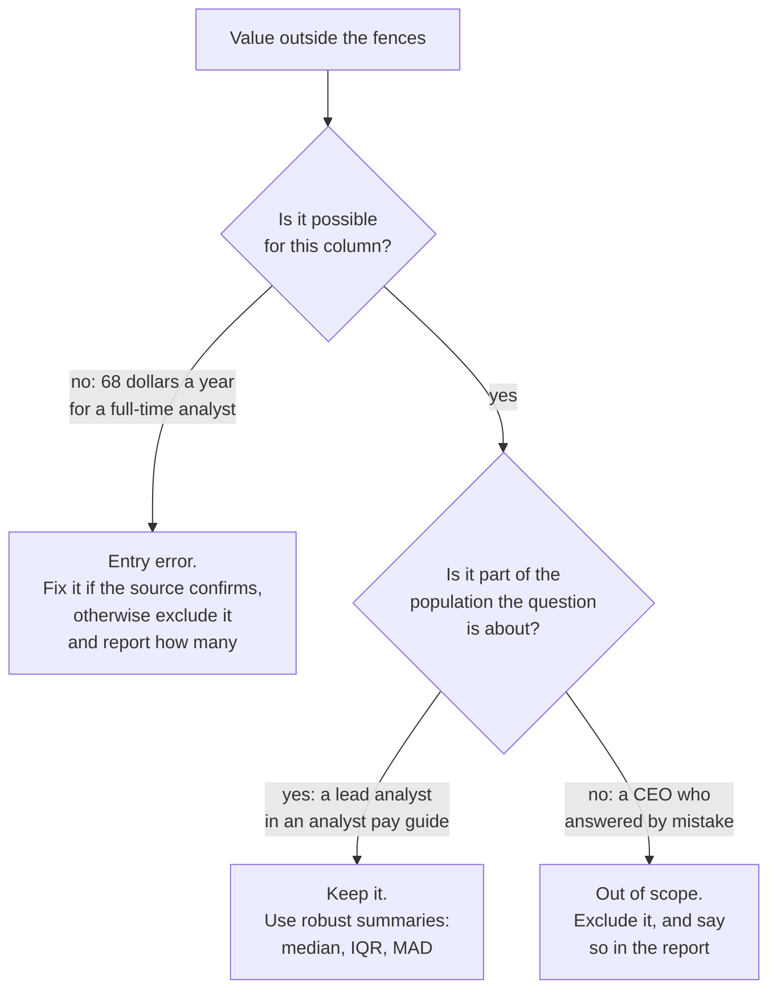

# Outliers, box plots and robust summaries

Which salaries are real outliers, and which summary survives them?

## Before you start

- Level: 1 (beginner).
- Time: about 2 hours.
- Builds on [Mean, median and skew](../01-mean-median-and-skew/) (the median, percentiles by interpolation and the standard deviation). [Probability and distributions by simulation](../05-probability-by-simulation/) comes before this lesson in the learning order but is not needed for it. You need Python 3.9 or later.

## The problem

Brightline Talent, a fictional recruiting firm, publishes a pay guide every year. This year 240 analysts in its network answered a short survey with their title, years of experience and yearly base pay. Priya, the head of client services, needs the pay section by Friday. A first draft says "average pay 82,253, lowest pay 68 dollars". A colleague suggests a quick fix: "delete everything outside the box plot whiskers". You will find the outliers with a rule anyone can repeat, decide which of them are mistakes and which are real people, and recommend summary numbers that do not swing on a handful of rows.

The file `data/salaries.csv` is synthetic, generated by `make_data.py` with a fixed seed. No row is a real person.

## In plain words

Picture a queue of 240 people sorted by how much they earn. Walk a quarter of the way along and note that person's pay: that is the **first quartile** (Q1). Halfway is the **median**. Three quarters of the way is the **third quartile** (Q3). The middle half of the queue sits between Q1 and Q3, and the gap between them is the **interquartile range** (IQR = Q3 - Q1).

Now someone at the very end of the queue says they earn ten times as much as everybody else. Maybe they do. Maybe they typed an extra zero. The queue position of the people in the middle does not change either way, so the median and the quartiles stay put. The **mean** and the **standard deviation** (SD) do not: they add up actual amounts, so one huge number drags both.

That is the whole lesson: find the unusual values with a fixed rule, check each one, fix only the mistakes, and describe the data with numbers that one strange row cannot move.

Words you will use:

- **Outlier:** a value far from the rest. Being far away does not make it wrong.
- **Fences:** the cut-offs Q1 - 1.5 * IQR and Q3 + 1.5 * IQR. Values outside them are flagged for a look. This is John Tukey's rule, and the one most box plots draw.
- **Box plot:** a picture of the quartiles. The box runs from Q1 to Q3 with a line at the median, the whiskers reach the smallest and largest values inside the fences, and anything beyond is drawn as a dot.
- **Robust summary:** a number that barely moves when a few values are wild, such as the median, the IQR or the MAD.
- **MAD (median absolute deviation):** take each value's distance from the median, then the median of those distances. It is a robust cousin of the SD.

## What you will build from scratch

- `percentile`, `median` and `quartiles`, by the inclusive method, written down so anyone can reproduce your numbers.
- `iqr_fences` and `flag_outliers`: Tukey's 1.5 x IQR rule.
- `mad`, `mean` and `sample_sd`: robust and classic spread side by side.
- `box_plot_stats`: every number a box plot draws.
- `entry_errors(rows)`: the rows that cannot be a yearly salary.
- `summarise(path)`: the summary three ways (all rows, errors removed, every outlier removed) so you can see which numbers hold still.

## The idea

**Quartiles, with the method written down.** Sort the n values into positions 0 to n - 1. The p-th percentile sits at

    rank = p / 100 * (n - 1)

and when the rank falls between two positions you go that fraction of the way from the lower value to the upper one. This is the **inclusive** method, the same rule as lesson 01. Q1 is p = 25, the median p = 50, Q3 p = 75. Other tools use other rules, and they give different quartiles on the same data (see Common mistakes), so always say which one you used.

**Fences.**

    IQR        = Q3 - Q1
    low fence  = Q1 - 1.5 * IQR
    high fence = Q3 + 1.5 * IQR

A value strictly outside a fence is flagged. A value exactly on a fence is not. The 1.5 is a convention, not a law; 3 is sometimes used for "far out" values.

**The box plot draws all of this.** Here is the lesson's data, drawn by `python3 draw_boxplot.py`:


**Flagged is not wrong.** The fences only tell you where to look. Each flagged value needs a reason before anything happens to it:



**Robust versus classic.** The mean and SD use every value's size. The median, IQR and MAD use only order and middle positions. To move the median you have to move half the data; to move the mean you only have to move one value a long way. For data shaped like a bell curve, 1.4826 * MAD is close to the SD, so the MAD can stand in for it when the data has wild values.

## Walk through

Run each block from this folder. Start with eight salaries and one high one. The inclusive quartiles by hand:

```python
pay = sorted([61000, 64000, 70000, 72000, 75000, 81000, 88000, 205000])
n = len(pay)
for p in (25, 50, 75):
    rank = p / 100 * (n - 1)
    low = int(rank)
    value = pay[low] + (pay[low + 1] - pay[low]) * (rank - low)
    print("P%d rank %.2f value %.1f" % (p, rank, value))
```

```text
P25 rank 1.75 value 68500.0
P50 rank 3.50 value 73500.0
P75 rank 5.25 value 82750.0
```

For Q1 the rank is 0.25 * 7 = 1.75, so go three quarters of the way from 64,000 to 70,000: 68,500.

The fences:

```python
pay = sorted([61000, 64000, 70000, 72000, 75000, 81000, 88000, 205000])
q1, q3 = 68500.0, 82750.0
iqr = q3 - q1
low, high = q1 - 1.5 * iqr, q3 + 1.5 * iqr
print(iqr, low, high)
print([v for v in pay if v < low or v > high])
```

```text
14250.0 47125.0 104125.0
[205000]
```

The median and the MAD. Distances from the median 73,500, sorted, then their median:

```python
def median(values):
    s = sorted(values)
    n = len(s)
    return s[n // 2] if n % 2 else (s[n // 2 - 1] + s[n // 2]) / 2
pay = [61000, 64000, 70000, 72000, 75000, 81000, 88000, 205000]
med = median(pay)
distances = [abs(v - med) for v in pay]
print(med, sorted(distances), median(distances))
```

```text
73500.0 [1500.0, 1500.0, 3500.0, 7500.0, 9500.0, 12500.0, 14500.0, 131500.0] 8500.0
```

The 205,000 salary is 131,500 from the median, but it is just the last of eight distances, so the MAD is 8,500.

Now add one absurd value, 2,050,000 (someone typed an extra zero), and compare:

```python
import math
def median(values):
    s = sorted(values)
    n = len(s)
    return s[n // 2] if n % 2 else (s[n // 2 - 1] + s[n // 2]) / 2
def report(values):
    n = len(values)
    m = sum(values) / n
    sd = math.sqrt(sum((v - m) ** 2 for v in values) / (n - 1))
    med = median(values)
    mad = median([abs(v - med) for v in values])
    print("mean %9.0f  sd %9.0f  median %7.0f  mad %6.0f" % (m, sd, med, mad))
pay = [61000, 64000, 70000, 72000, 75000, 81000, 88000, 205000]
report(pay)
report(pay + [2050000])
```

```text
mean     89500  sd     47470  median   73500  mad   8500
mean    307333  sd    655007  median   75000  mad  11000
```

One row more than triples the mean and multiplies the SD by almost 14. The median moves by 1,500 and the MAD by 2,500.

On the survey. Quartiles, fences and every flagged row:

```python
import csv
with open("data/salaries.csv", newline="") as f:
    rows = list(csv.DictReader(f))
pay = sorted(float(r["base_pay"]) for r in rows)
def pct(p):
    rank = p / 100 * (len(pay) - 1)
    low = int(rank)
    return pay[low] + (pay[min(low + 1, len(pay) - 1)] - pay[low]) * (rank - low)
q1, q3 = pct(25), pct(75)
low, high = q1 - 1.5 * (q3 - q1), q3 + 1.5 * (q3 - q1)
print("Q1", q1, "Q3", q3, "fences", low, high)
for r in sorted(rows, key=lambda r: float(r["base_pay"])):
    if not low <= float(r["base_pay"]) <= high:
        print(r["response_id"], r["title"], r["years_experience"], r["base_pay"])
```

```text
Q1 67875.0 Q3 92500.0 fences 30937.5 129437.5
42 Data Analyst 4 68
229 Business Analyst 2 81
33 Business Analyst 6 105
208 Senior Data Analyst 7 147000
125 Lead Analyst 15 191500
104 Lead Analyst 10 197000
19 Lead Analyst 10 202000
88 Lead Analyst 18 205500
198 Lead Analyst 11 206500
8 Lead Analyst 13 214000
```

Ten rows are flagged. Read them before you touch them:

- 68, 81 and 105 dollars a year are not possible for a full-time analyst. They look like pay typed in thousands. They are entry errors.
- The senior analyst at 147,000 with 7 years and the six lead analysts at 191,500 to 214,000 with 10 to 18 years are entirely believable. Lead roles pay more. They are real outliers, and they belong in an analyst pay guide.

Run the worked answer, `python3 solution/solution.py`. It summarises the pay three ways:

```
entry errors: [33, 42, 229]  flagged by the fences: 10
box: q1 67875 median 78250 q3 92500 iqr 24625 fences 30937.5 to 129437.5 whiskers 50000 to 123500
all      n 240  mean    82253  sd   26448  median   78250  iqr  24625  mad  11750
cleaned  n 237  mean    83293  sd   24929  median   78500  iqr  24500  mad  11500
trimmed  n 230  mean    79900  sd   15360  median   78000  iqr  22500  mad  10500
```

- **all**: the raw survey. The three typos pull the mean down and push the SD up.
- **cleaned**: only the three entry errors removed. This is the honest version.
- **trimmed**: every flagged row removed, the colleague's quick fix.

Across the three, the median stays between 78,000 and 78,500 and the MAD between 10,500 and 11,750. The mean moves by up to 3,393 and the SD by up to 11,087.

## Common mistakes

1. **Deleting outliers that are real (the trap).** The "trimmed" line looks tidy: mean 79,900, SD 15,360. But it deletes seven real analysts. It cuts the mean by 3,393 from the cleaned 83,293, makes the spread of pay look 38% narrower than it is (SD 15,360 against 24,929), and the guide would say the top of the range is 123,500 when seven respondents earn 147,000 to 214,000. A reader who is a lead analyst would conclude they are overpaid. Remove a value only with a reason that is about the value (impossible, duplicated, out of scope), never just because the fence flagged it.
2. **Leaving the entry errors in.** The draft's "lowest pay 68 dollars" is a typo, and the three typos drag the mean down by 1,040 (82,253 against 83,293). Fix a typo only if the source confirms it (ask Brightline to re-contact the respondents); otherwise exclude it and say "3 responses excluded because the pay was entered in thousands".
3. **Assuming every tool computes quartiles the same way.** On the eight salaries, the inclusive method gives Q1 68,500 and Q3 82,750; the exclusive method, which divides by n + 1 instead of n - 1, gives 65,500 and 86,250:

```python
import statistics
pay = [61000, 64000, 70000, 72000, 75000, 81000, 88000, 205000]
print("inclusive:", statistics.quantiles(pay, n=4, method="inclusive"))
print("exclusive:", statistics.quantiles(pay, n=4))
```

```text
inclusive: [68500.0, 73500.0, 82750.0]
exclusive: [65500.0, 73500.0, 86250.0]
```

   With the exclusive quartiles the high fence moves from 104,125 to 117,375. On the 240 survey rows the gap is small (Q1 is 67,875 inclusive and 67,625 exclusive; Q3 is 92,500 both ways), but on small groups it decides which rows get flagged. Who uses which:

| Tool | Inclusive (rank = p (n - 1)) | Other rule |
|---|---|---|
| Excel | `PERCENTILE.INC`, `QUARTILE.INC` | `PERCENTILE.EXC`, `QUARTILE.EXC` (exclusive) |
| Python `statistics.quantiles` | `method="inclusive"` | the default is exclusive |
| pandas `quantile`, numpy `percentile` | the default (`linear`) | other options by name |
| PostgreSQL | `percentile_cont` | `percentile_disc` returns an actual value from the data, no interpolation |
| SQLite | no percentile function in the SQLite built into Python (checked on 3.51) | sort and pick the rows yourself |

   Write the method next to the number: "quartiles by the inclusive method (Excel QUARTILE.INC)".

4. **Treating 1.5 x IQR as a verdict.** It is a screen. On right-skewed pay the high fence often flags real people, and when many values are tied the IQR can be 0, so every value that differs from the tie is flagged: in `[5, 5, 5, 5, 9]` the fences are both 5 and the 9 is an "outlier".

## Your turn

Open `exercise.py` and fill in the thirteen functions. Do not import `statistics`, `numpy` or `pandas`; the test checks the imports. Then run, from this folder:

    python3 test_lesson.py

The test compares your quartiles with `statistics.quantiles(..., method="inclusive")`, and your summaries with the `statistics` module, on the committed data and on a second dataset built with another seed. It also checks small hand-made cases: one value, an empty list, a value exactly on a fence, a tie that makes the IQR 0, and zeros in the MAD. To see the reference solution pass, run `CHECK_SOLUTION=1 python3 test_lesson.py`.

Stretch: compute the median and IQR per title. Then flag outliers within each title instead of across all 240 rows. Which rows are flagged now, and why is that a better question for a pay guide?

## Check yourself

1. What does a box plot's box show, and where do the whiskers stop?
2. A value is outside the 1.5 x IQR fence. Should you delete it?
3. Why does one huge salary move the mean and SD but hardly the median and MAD?
4. Your Q1 in Excel does not match a colleague's Q1 in Python. What do you check first?

<details>
<summary>Answers</summary>

1. The box runs from Q1 to Q3, so it holds the middle half of the values, with a line at the median. The whiskers reach the smallest and largest values that are still inside the fences; anything beyond is drawn as a separate point.
2. Not because of the fence. Look at it: if it is impossible (68 dollars a year) it is an entry error, so fix it with the source or exclude it and report the count. If it is real and in scope (a lead analyst), keep it and summarise with the median and IQR.
3. The mean and SD add up the sizes of the values, so one far value pulls them. The median and MAD depend on the middle positions of sorted lists, and one value at the end of a list does not change which value is in the middle.
4. The method. Excel's QUARTILE.INC and Python's `statistics.quantiles` default (exclusive) use different rules; set `method="inclusive"` or use QUARTILE.EXC so both sides match, and write the method down.

</details>

## What to tell the stakeholder

"Typical base pay among the 237 usable responses is 78,500 (the median), and the middle half earn between 67,875 and 92,500 (quartiles by the inclusive method, Excel QUARTILE.INC). Seven respondents, a senior analyst and six lead analysts with 10 or more years, earn 147,000 to 214,000; they are real and they are included. Three responses were excluded because the pay was entered in thousands." Caveat: this is a survey of Brightline's own network, not a random sample of all analysts, and the lead analyst group is only 6 people.

## In real job postings

In the Real Analyst Jobs data drop of 25 October 2026, 336 of the 2,789 US analyst postings (12.0%) were labelled Lead / Staff and 375 (13.4%) Entry Level. A pay summary across all of them mixes very different levels, which is exactly where a few high values sit beyond the fences. Browse the [data analyst jobs in the USA](https://realanalystjobs.com/jobs/data-analyst-jobs-in-usa) or see the [analyst job market report](https://realanalystjobs.com/analyst-job-market).

## Next

[07: Sampling and the central limit theorem](../07-sampling-and-the-clt/)
