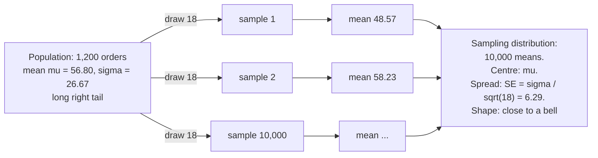

# Sampling and the central limit theorem

Why does the average of 18 orders wobble, and by how much?

## Before you start

- Level: 1 (beginner).
- Time: about 2 hours.
- Builds on [Probability and distributions by simulation](../05-probability-by-simulation/) (simulating with `random.Random(seed)` and the standard error of a simulated share) and [Mean, median and skew](../01-mean-median-and-skew/) (the mean, the standard deviation and right skew). You need Python 3.9 or later.

## The problem

Harbor Mealkits, a fictional meal kit delivery startup, runs pilots in new cities. Each pilot's dashboard has a tile with the average value of the first 18 orders of the week, so the number is ready by Tuesday. In the current pilot the tile said 50.94 dollars for the week of 12 October 2026 and 57.79 dollars for the week of 19 October: up 6.85 dollars, or 13%. Marcus, the operations lead, wants to tell the board on Monday that order value in the pilot is rising. Before he does, he asks how much an average of 18 orders moves around from week to week when nothing has changed. Harbor's home city has every one of its 1,200 September orders on file, so you can treat it as a population you know completely, draw thousands of 18-order samples from it, and measure the wobble directly. Then you will learn to estimate the same wobble from one week of 18 orders, which is all the pilot has.

Both files are synthetic, generated by `make_data.py` with a fixed seed: `data/population.csv` (1,200 home city orders) and `data/weeks.csv` (the pilot's two weeks of 18 orders). No row is a real order.

## In plain words

A cricket batter's average over a whole career is steady. Their average over the last three innings jumps around: one big score lifts it, two quick dismissals sink it. Nothing about the batter changed; three innings is just a small sample. Ten innings wobble less, a whole season less again.

An average of 18 orders is the same. One family box for 130 dollars in a week of regular 45-dollar boxes lifts the week's average by almost 5 dollars. So before you read a change in a small average as news, you need to know how big the ordinary wobble is.

Words you will use:

- **Population:** everything you care about, here all 1,200 home city orders.
- **Sample:** a few values drawn from it, here 18 orders.
- **Sampling distribution:** the pile of averages you would get if you drew a sample of 18 again and again. It is a distribution of averages, not of orders.
- **Standard error (SE):** the standard deviation of that pile, the typical size of the wobble of an average. For a mean, SE = sigma / sqrt(n).
- **Sigma:** the standard deviation of the population.
- **With replacement:** each draw can pick any order, even one already picked, like asking a random customer who might have ordered twice.
- **Central limit theorem (CLT):** for a large enough sample, the pile of averages is close to a bell-shaped normal curve, whatever the shape of the orders themselves.

## What you will build from scratch

- `mean`, `population_sd` (divide by N) and `sample_sd` (divide by n - 1).
- `standard_error(values)`: the estimated wobble of one sample's mean, sample SD / sqrt(n).
- `sample_means(population, n, draws, seed)`: thousands of samples of n orders, and their averages.
- `share_within(values, centre, half_width)`: how many averages land within a range.
- `read_orders`, `read_weeks` and `summarise`: the population, the simulation and the two pilot weeks in one report.

## The idea

**Draw, average, repeat.** You cannot see the wobble in one sample. You see it by drawing many:



**How big is the wobble?** The variance (the SD squared) of an average of n independent draws is sigma^2 / n, so

    SE = sigma / sqrt(n)

Two consequences. Bigger samples wobble less, but only with the square root: to halve the SE you need four times the orders, 72 instead of 18. And the SE is always smaller than sigma: single orders vary by about 26.67 dollars, averages of 18 by about 6.29.

**Estimating the wobble from one sample.** In the pilot there is no population on file, only 18 orders a week. So you estimate sigma with the sample standard deviation s, dividing by n - 1:

    s  = sqrt( sum((x - xbar)^2) / (n - 1) )
    SE = s / sqrt(n)

Why n - 1? The deviations are measured from the sample's own mean xbar, which sits in the middle of exactly these 18 values. So they come out a little smaller than deviations from the true mean would. On average, dividing the sum of squares by n gives (n - 1) / n of the population variance: 17/18 here, about 5.6% too small. Dividing by n - 1 makes the average come out right. You will see it happen in the walk through. Use N only for a complete population, such as the home city file.

**The shape.** The orders themselves are right-skewed: most orders are between 20 and 80 dollars, and 89 of the 1,200 are over 100. The CLT says the averages are much closer to a bell. It does not make the orders normal, and with only 18 orders the bell is still a little lopsided: the skew of an average of n draws is the skew of the population divided by sqrt(n). Here that is 2.22 / sqrt(18) = 0.52, small but not zero.

**Comparing two weeks.** Two independent averages each wobble. The difference between them wobbles more, because the variances add:

    SE of (week 2 - week 1) = sqrt(SE1^2 + SE2^2)

With equal SEs that is sqrt(2) times one SE.

## Walk through

Run each block from this folder. First the population, with a histogram (each `#` is 10 orders):

```python
import csv, math
with open("data/population.csv", newline="") as f:
    pop = [float(r["order_value"]) for r in csv.DictReader(f)]
N = len(pop)
mu = sum(pop) / N
sigma = math.sqrt(sum((x - mu) ** 2 for x in pop) / N)
print(N, round(mu, 2), round(sigma, 2), min(pop), max(pop))
for start in range(0, 220, 20):
    c = sum(1 for x in pop if start <= x < start + 20)
    print("%3d-%3d %4d %s" % (start, start + 19, c, "#" * round(c / 10)))
```

```text
1200 56.8 26.67 19.83 218.92
  0- 19    2 
 20- 39  283 ############################
 40- 59  558 ########################################################
 60- 79  204 ####################
 80- 99   64 ######
100-119   39 ####
120-139   23 ##
140-159   14 #
160-179    7 #
180-199    4 
200-219    2 
```

This is the whole population, so sigma divides by N = 1,200. The mean is 56.80 dollars and sigma is 26.67. The long tail to the right is the family and party boxes.

Five samples of 18, drawn with replacement by `rng.choices`:

```python
import csv, random
with open("data/population.csv", newline="") as f:
    pop = [float(r["order_value"]) for r in csv.DictReader(f)]
rng = random.Random(5)
for _ in range(5):
    sample = rng.choices(pop, k=18)
    print(round(sum(sample) / 18, 2), "from orders between", min(sample), "and", max(sample))
```

```text
48.57 from orders between 26.84 and 138.16
58.23 from orders between 23.07 and 146.71
61.75 from orders between 30.51 and 151.72
50.6 from orders between 31.29 and 110.6
61.07 from orders between 30.68 and 134.13
```

Same population, five averages from 48.57 to 61.75. That is a 13-dollar range with nothing changing at all.

Now 10,000 samples, and the pile of their averages (each `#` is 50 averages):

```python
import csv, math, random
with open("data/population.csv", newline="") as f:
    pop = [float(r["order_value"]) for r in csv.DictReader(f)]
mu = sum(pop) / len(pop)
sigma = math.sqrt(sum((x - mu) ** 2 for x in pop) / len(pop))
rng = random.Random(1)
means = [sum(rng.choices(pop, k=18)) / 18 for _ in range(10000)]
for start in range(36, 84, 4):
    c = sum(1 for x in means if start <= x < start + 4)
    print("%2d-%2d %5d %s" % (start, start + 3, c, "#" * round(c / 50)))
centre = sum(means) / len(means)
spread = math.sqrt(sum((x - centre) ** 2 for x in means) / (len(means) - 1))
se = sigma / math.sqrt(18)
print("SD of the 10,000 means:", round(spread, 2), " sigma / sqrt(18):", round(se, 2))
print("below mu - 1.96 SE:", sum(1 for x in means if x < mu - 1.96 * se))
print("above mu + 1.96 SE:", sum(1 for x in means if x > mu + 1.96 * se))
```

```text
36-39     1 
40-43    50 #
44-47   540 ###########
48-51  1628 #################################
52-55  2591 ####################################################
56-59  2336 ###############################################
60-63  1514 ##############################
64-67   804 ################
68-71   366 #######
72-75   129 ###
76-79    29 #
80-83    12 
SD of the 10,000 means: 6.27  sigma / sqrt(18): 6.29
below mu - 1.96 SE: 70
above mu + 1.96 SE: 391
```

Three things to see. The averages pile up in a hump around 56.80, much more bell-like than the orders. Their spread, 6.27, matches the formula sigma / sqrt(18) = 6.29. And 9,539 of the 10,000 averages (95.4%) land within 1.96 SE of the true mean, as a bell curve promises, but the misses are lopsided: 391 above and only 70 below. That is the leftover skew of averages of only 18 orders.

The square root rule. Four times the orders halves the wobble:

```python
import csv, math, random
with open("data/population.csv", newline="") as f:
    pop = [float(r["order_value"]) for r in csv.DictReader(f)]
mu = sum(pop) / len(pop)
sigma = math.sqrt(sum((x - mu) ** 2 for x in pop) / len(pop))
rng = random.Random(2)
for n in (18, 72, 288):
    means = [sum(rng.choices(pop, k=n)) / n for _ in range(4000)]
    c = sum(means) / len(means)
    sd = math.sqrt(sum((x - c) ** 2 for x in means) / (len(means) - 1))
    print("n = %3d  SD of means %.2f  sigma / sqrt(n) %.2f" % (n, sd, sigma / math.sqrt(n)))
```

```text
n =  18  SD of means 6.23  sigma / sqrt(n) 6.29
n =  72  SD of means 3.14  sigma / sqrt(n) 3.14
n = 288  SD of means 1.58  sigma / sqrt(n) 1.57
```

The pilot has no population on file, only each week's 18 orders. Estimate the SE from each week, with n - 1:

```python
import csv, math
weeks = {}
with open("data/weeks.csv", newline="") as f:
    for r in csv.DictReader(f):
        weeks.setdefault(r["week_start"], []).append(float(r["order_value"]))
for week, vals in sorted(weeks.items()):
    n = len(vals)
    xbar = sum(vals) / n
    s = math.sqrt(sum((x - xbar) ** 2 for x in vals) / (n - 1))
    print(week, n, "mean", round(xbar, 2), "s", round(s, 2), "SE", round(s / math.sqrt(n), 2))
```

```text
2026-10-12 18 mean 50.94 s 20.55 SE 4.84
2026-10-19 18 mean 57.79 s 21.02 SE 4.96
```

Each week's estimate, about 4.9 dollars, is below the 6.29 we measured on the home city. That is common with skewed data: a sample of 18 often catches few of the big boxes, so its s comes out low. In a simulation of 20,000 samples of 18 from the home city, 59% had s below sigma. Treat a small-sample SE as a rough guide, not a precise number.

Run the worked answer, `python3 solution/solution.py`. It prints:

```
pop_mean 56.8
pop_sd 26.67
true_se 6.29
mean_of_means 56.9
sd_of_means 6.27
share_within_1_96 0.9539
week1_mean 50.94
week1_se 4.84
week2_mean 57.79
week2_se 4.96
change 6.85
change_se 6.93
```

The weekly change is 6.85 dollars. Its SE, from the two weeks' own SEs, is sqrt(4.84^2 + 4.96^2) = 6.93; from the home city's sigma it would be sqrt(2) * 6.29 = 8.89. Either way the change is about one SE of a difference, the size of an ordinary week.

## Common mistakes

1. **Dividing by n instead of n - 1 for a sample (the trap).** It looks harmless, but it makes every SE too small, so every change looks more significant than it is. Draw 20,000 samples of 18 and average their variances both ways:

```python
import csv, random
with open("data/population.csv", newline="") as f:
    pop = [float(r["order_value"]) for r in csv.DictReader(f)]
mu = sum(pop) / len(pop)
print("population variance:", round(sum((x - mu) ** 2 for x in pop) / len(pop), 1))
rng = random.Random(3)
with_n, with_n_minus_1 = [], []
for _ in range(20000):
    s = rng.choices(pop, k=18)
    xbar = sum(s) / 18
    squares = sum((x - xbar) ** 2 for x in s)
    with_n.append(squares / 18)
    with_n_minus_1.append(squares / 17)
print("average sample variance, divide by n:    ", round(sum(with_n) / 20000, 1))
print("average sample variance, divide by n - 1:", round(sum(with_n_minus_1) / 20000, 1))
```

```text
population variance: 711.5
average sample variance, divide by n:     672.0
average sample variance, divide by n - 1: 711.5
```

   Dividing by n lands on 672.0, which is 17/18 of the truth. Dividing by n - 1 lands on 711.5, the population variance. On the pilot's first week, dividing by n gives an SE of 4.71 instead of 4.84. Use N only when the list is the entire population.

2. **Thinking the CLT makes the data normal.** It is about the pile of averages, not the orders. The orders keep their long tail, and at n = 18 the averages keep some of it too:

```python
import csv, random
def skew(values):
    n = len(values)
    m = sum(values) / n
    sd = (sum((x - m) ** 2 for x in values) / n) ** 0.5
    return sum((x - m) ** 3 for x in values) / n / sd ** 3
with open("data/population.csv", newline="") as f:
    pop = [float(r["order_value"]) for r in csv.DictReader(f)]
rng = random.Random(1)
means = [sum(rng.choices(pop, k=18)) / 18 for _ in range(10000)]
print("skew of the orders:", round(skew(pop), 2))
print("skew of the means of 18:", round(skew(means), 2), " theory:", round(skew(pop) / 18 ** 0.5, 2))
```

```text
skew of the orders: 2.22
skew of the means of 18: 0.53  theory: 0.52
```

   Skew is the average cubed distance from the mean, in units of the SD: 0 for a symmetric shape, positive for a long right tail. Averaging 18 orders cuts it from 2.22 to about 0.5, close to the theory of 2.22 / sqrt(18). Still lopsided, which is why 3.9% of the averages fell above the 95% band and only 0.7% below it. "We can use the normal curve because of the CLT" needs the sample to be big enough for the data's skew.

3. **Confusing the SD with the SE.** "Order values vary by about 6 dollars" is wrong: single orders vary by about 26.67 dollars (the SD). Averages of 18 vary by about 6.29 (the SE). Say which one you mean.
4. **Expecting double the orders to halve the wobble.** SE falls with the square root of n. 36 orders a week would cut it only from 6.29 to 4.45. To halve it you need 72.

## Your turn

Open `exercise.py` and fill in the nine functions. Use `random.Random(seed)` inside `sample_means`, and do not import `statistics`, `numpy` or `scipy`; the test checks the imports. Then run, from this folder:

    python3 test_lesson.py

The test checks your SDs against Python's `statistics` module, and your simulated averages against theory: their centre and spread must be within 5 standard errors computed from the population (the docstring at the top of `test_lesson.py` shows the formulas). It runs on the committed data and on a second dataset built with another seed, plus small cases: a single value, a tie, an empty list and zero draws. To see the reference solution pass, run `CHECK_SOLUTION=1 python3 test_lesson.py`.

Stretch: repeat the simulation for n = 5, 18 and 72 and print the share of averages above mu + 1.96 SE and below mu - 1.96 SE for each. At which n do the two tails look roughly even?

## Check yourself

1. Single orders have an SD of about 27 dollars. Roughly how much does an average of 18 orders wobble?
2. Why do we divide by n - 1 for a sample SD, and when is dividing by N right?
3. Does the central limit theorem mean that order values are normally distributed?
4. The weekly average rose 6.85 dollars. What would you need to know before calling it a real rise?

<details>
<summary>Answers</summary>

1. About 27 / sqrt(18), roughly 6.3 dollars. That is the standard error of the mean.
2. The deviations are measured from the sample's own mean, which makes them a little too small; dividing by n - 1 corrects that on average (17/18 of the truth becomes the truth). Divide by N only when the values are the whole population, as with the home city file.
3. No. The orders keep their long right tail. The CLT says the averages of many orders get closer to a bell as the sample grows, and at 18 orders they are still a little skewed.
4. The size of the ordinary wobble of a difference: sqrt(SE1^2 + SE2^2), about 7 dollars here. A 6.85 rise is about one SE, which happens often by chance. You would want several weeks moving the same way, or bigger samples.

</details>

## What to tell the stakeholder

"The 6.85 dollar rise in the pilot's weekly average is the size of an ordinary week. An average of 18 orders moves by about 6 dollars from week to week with nothing changing; we measured that on 10,000 samples from the home city's September orders, where the averages ranged from under 40 to over 80 dollars. So we cannot say order value is rising yet." Caveat: the first 18 orders of a week are not a random sample of the week (they all come from the start of the week), and with skewed order values the SE estimated from 18 orders tends to come out low, so if anything the true wobble is bigger.

## In real job postings

In the Real Analyst Jobs data drop of 25 October 2026, 324 of the 2,056 US analyst postings that list a tool (15.8%) ask for R, and 996 (48.4%) ask for Python, the two languages analysts use to simulate a sampling distribution like this one. See the [Python data analyst jobs](https://realanalystjobs.com/jobs/python-data-analyst-jobs) and the [analyst job market report](https://realanalystjobs.com/analyst-job-market).

## Next

[02: Confidence interval by hand](../02-confidence-interval-by-hand/), which turns the standard error into a range you can put on a slide.
