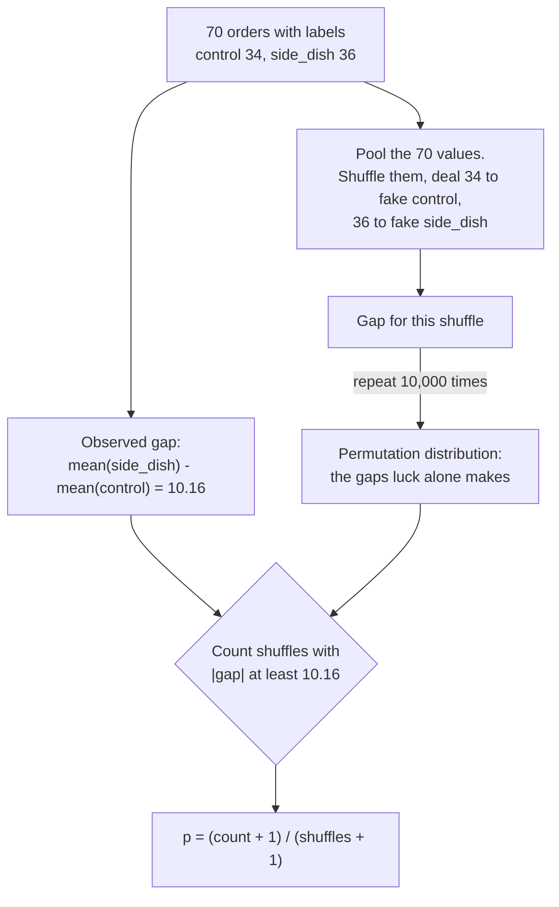

# Hypothesis testing by permutation

Could this gap appear just by shuffling the labels?

## Before you start

- Level: 2 (intermediate).
- Time: about 2 hours.
- Builds on [Probability and distributions by simulation](../05-probability-by-simulation/) (a tail probability, and `random.Random(seed)` so a simulation repeats), [Sampling and the central limit theorem](../07-sampling-and-the-clt/) (why a small average wobbles) and [Mean, median and skew](../01-mean-median-and-skew/). You need Python 3.9 or later.

## The problem

Harbor Mealkits, a fictional meal kit delivery startup, tested a suggested side dish on its recipe page. 72 customers were split at random: 36 saw the usual page (control) and 36 saw the page with the suggestion (side_dish). Two control orders lost their value in a logging glitch, so 70 orders are left. The side_dish group spent 10.16 dollars more per order on average. Priya, the growth lead, wants to roll the suggestion out to every city on Friday, and asks you one question first: could a gap this big turn up by luck alone, if the suggestion did nothing? You will answer it without any formula from a textbook, by shuffling the group labels thousands of times, and check your shuffle against an exact count on the 10-customer pilot from the week before.

Both files are synthetic, generated by `make_data.py` with a fixed seed: `data/orders.csv` (72 customers, two with a blank order value) and `data/pilot.csv` (10 customers). No row is a real customer.

## In plain words

Two friends argue over whose cricket bat is better. Each takes five shots at a target, and Asha's bat scores higher on average. Was it the bat, or did she just get the easier throws? Here is a fair way to check. Write all ten scores on cards, shuffle them, and deal five to "Asha" and five to "Ben" at random. Do it again and again. If dealing at random often gives a gap as big as the real one, the bat proves nothing. If random deals almost never do, something real is going on.

That is a permutation test. If the side dish had no effect, then each customer would have spent the same amount whichever page they saw, and the labels "control" and "side_dish" are just names stuck on at random. So we can stick them on again at random, many times, and see how big the gap usually is.

Words you will use:

- **Null hypothesis (H0):** the claim we test against. Here: the suggestion changes no customer's order value.
- **Test statistic:** the one number that sums up the gap. Here: mean(side_dish) - mean(control).
- **Permutation:** a reshuffle of the labels. The values stay; only which group they belong to changes.
- **Permutation distribution:** the pile of test statistics from many shuffles. It shows how big a gap luck alone makes.
- **p-value:** the share of shuffles whose gap is at least as extreme as the real one. Small means luck rarely does this.
- **Two-sided:** "extreme" counts a gap that big in either direction. **One-sided** counts one direction only.
- **Exact test:** instead of random shuffles, list every possible split. Only possible for tiny groups.

## What you will build from scratch

- `read_groups(path)`: order values per group, skipping blank values instead of reading them as 0.
- `mean_diff(a, b)`: the test statistic.
- `permutation_test(a, b, n_perm, seed, alternative)`: shuffle, count, and the p-value with the +1 correction.
- `exact_test(a, b, alternative)`: every split listed with `itertools.combinations`.
- `summarise(...)`: the test on the orders, and exact against shuffled on the pilot.

## The idea



**Why shuffling is allowed.** The customers were assigned to the two pages at random. Under H0 every customer would have spent the same on either page, so the real split of values into groups is just one of the many splits the coin flips could have made. Any other split was equally likely. That is the only assumption the test needs. It does not need the values to follow a bell curve, which matters here: meal kit orders have a long right tail of family boxes.

**The p-value with the +1.** After n shuffles, with `extreme` of them at least as far out as the observed gap:

    p = (extreme + 1) / (n + 1)

The real labelling is itself one of the possible labellings, so it counts as one of the "shuffles", in both the top and the bottom. Two things follow. The p-value can never be 0: with 10,000 shuffles the smallest possible answer is 1/10,001, not "impossible". And a test that rejects when p is below 0.05 then really does raise a false alarm at most 5% of the time when H0 is true. Without the +1 it raises slightly more.

**Two-sided or one-sided.** Before the test you decide what "extreme" means:

    two-sided:  |shuffled gap| >= |observed gap|
    greater:    shuffled gap  >=  observed gap
    less:       shuffled gap  <=  observed gap

Priya would want to know if the suggestion *lowered* order value too (customers buying the side instead of a bigger box), so the honest choice is two-sided. A one-sided p-value is about half the two-sided one when the pile is symmetric, which is exactly why switching after you see the data is a trap.

**Exact test.** With 5 customers per group there are comb(10, 5) = 252 ways to choose which 5 are control. List all of them and count: p = extreme / 252. There is no +1, because the real split is already one of the 252. With 34 and 36 customers there are comb(70, 34), about 1.1 times 10 to the power 20 splits, so we sample them at random instead. The random version estimates the exact one; with 10,000 shuffles its p-value is within about 0.005 of the exact answer (two standard errors, sqrt(p * (1 - p) / 10,000), when p is near 0.07).

**Comparing values within 1e-9.** Two different splits can have the same gap, but floating point sums can differ in the last digit. Compare with a tolerance of 1e-9 so a tie counts as "at least as extreme".

## Walk through

Run each block from this folder. Read the orders, skipping the two blank values:

```python
import csv
groups = {"control": [], "side_dish": []}
with open("data/orders.csv", newline="") as f:
    for row in csv.DictReader(f):
        if row["order_value"] == "":
            continue
        groups[row["group"]].append(float(row["order_value"]))
a, b = groups["control"], groups["side_dish"]
print(len(a), len(b), round(sum(a) / len(a), 2), round(sum(b) / len(b), 2))
print("observed gap:", round(sum(b) / len(b) - sum(a) / len(a), 2))
```

```text
34 36 52.26 62.43
observed gap: 10.16
```

Control averaged 52.26 dollars, side_dish 62.43. `if row["order_value"] == ""` drops the blanks. Reading them as 0 would add two 0 dollar orders to control and inflate the gap.

Three shuffles. `pooled` holds all 70 values, `rng.shuffle` reorders them in place, and the first 34 become a fake control group:

```python
import csv, random
groups = {"control": [], "side_dish": []}
with open("data/orders.csv", newline="") as f:
    for row in csv.DictReader(f):
        if row["order_value"]:
            groups[row["group"]].append(float(row["order_value"]))
a, b = groups["control"], groups["side_dish"]
pooled = a + b
rng = random.Random(1)
for _ in range(3):
    rng.shuffle(pooled)
    fake_a, fake_b = pooled[:len(a)], pooled[len(a):]
    print(round(sum(fake_b) / len(fake_b) - sum(fake_a) / len(fake_a), 2))
```

```text
-2.3
-5.84
-11.58
```

Pure luck already made a gap of 11.58 dollars once in three tries, in the other direction. Now 10,000 shuffles, a histogram of their gaps (each `#` is 50 shuffles), and the count:

```python
import csv, random
groups = {"control": [], "side_dish": []}
with open("data/orders.csv", newline="") as f:
    for row in csv.DictReader(f):
        if row["order_value"]:
            groups[row["group"]].append(float(row["order_value"]))
a, b = groups["control"], groups["side_dish"]
observed = sum(b) / len(b) - sum(a) / len(a)
pooled = a + b
rng = random.Random(0)
diffs = []
for _ in range(10000):
    rng.shuffle(pooled)
    diffs.append(sum(pooled[len(a):]) / len(b) - sum(pooled[:len(a)]) / len(a))
for start in range(-20, 20, 4):
    c = sum(1 for d in diffs if start <= d < start + 4)
    print("%4d to %3d %5d %s" % (start, start + 4, c, "#" * round(c / 50)))
extreme = sum(1 for d in diffs if abs(d) >= abs(observed) - 1e-9)
print("as extreme as", round(observed, 2), "in either direction:", extreme)
print("p-value:", round((extreme + 1) / (10000 + 1), 4))
```

```text
 -20 to -16    16 
 -16 to -12   158 ###
 -12 to  -8   686 ##############
  -8 to  -4  1626 #################################
  -4 to   0  2486 ##################################################
   0 to   4  2570 ###################################################
   4 to   8  1630 #################################
   8 to  12   667 #############
  12 to  16   150 ###
  16 to  20    11 
as extreme as 10.16 in either direction: 725
p-value: 0.0726
```

The pile is centred on 0, as it must be when labels mean nothing, and has a standard deviation of about 5.7 dollars. 725 of 10,000 shuffles gave a gap of at least 10.16 dollars in one direction or the other, so p = 726 / 10,001 = 0.0726. Luck alone produces a gap this big about 7 times in 100.

Is 10,000 shuffles enough? Check against the exact answer on the pilot, where all 252 splits can be listed:

```python
import csv, itertools, math
pilot = {"control": [], "side_dish": []}
with open("data/pilot.csv", newline="") as f:
    for row in csv.DictReader(f):
        pilot[row["group"]].append(float(row["order_value"]))
a, b = pilot["control"], pilot["side_dish"]
print("control", a)
print("side_dish", b)
observed = sum(b) / len(b) - sum(a) / len(a)
pooled = a + b
splits = extreme = 0
for idx in itertools.combinations(range(10), 5):
    fake_a = [pooled[i] for i in idx]
    fake_b = [pooled[i] for i in range(10) if i not in idx]
    d = sum(fake_b) / 5 - sum(fake_a) / 5
    splits += 1
    extreme += abs(d) >= abs(observed) - 1e-9
print(round(observed, 2), splits, math.comb(10, 5), extreme, round(extreme / splits, 4))
```

```text
control [25.36, 59.06, 46.56, 37.01, 49.63]
side_dish [38.41, 72.91, 52.35, 57.06, 45.37]
9.7 252 252 70 0.2778
```

`itertools.combinations(range(10), 5)` yields every set of 5 positions out of 10, 252 in all, and the 5 chosen become control. 70 of the 252 splits are at least as extreme as the pilot's 9.70 dollar gap, so the exact p-value is 70 / 252 = 0.2778. We pick positions rather than values so that two customers who spent the same still count as two different people.

The worked solution runs both tests. `python3 solution/solution.py` prints:

```
n_control 34
n_side_dish 36
observed 10.1649
p_two_sided 0.0726
pilot_observed 9.696
pilot_exact_p 0.2778
pilot_splits 252
pilot_permutation_p 0.2693
```

On the pilot the 10,000 random shuffles gave 0.2693 against the exact 0.2778, a difference of 0.0085, inside the 0.009 you expect from two standard errors at p near 0.28. The method works; on the full test it says p = 0.073.

One more fact, which Priya cannot see but `make_data.py` can: the data was built with a real effect. About 30% of side_dish customers add a side worth 6 to 14 dollars, a true average lift of about 3 dollars. The test did not reach 0.05, and the observed 10.16 dollar gap is much bigger than the truth, pushed up by which group happened to get the family boxes. A p-value above 0.05 does not mean "no effect"; it means this test cannot tell.

## Common mistakes

1. **Switching to one-sided after seeing the gap (the trap).** The side dish group is ahead, so it is tempting to say "we only care if it helps" and count one tail:

```python
import csv, random
groups = {"control": [], "side_dish": []}
with open("data/orders.csv", newline="") as f:
    for row in csv.DictReader(f):
        if row["order_value"]:
            groups[row["group"]].append(float(row["order_value"]))
a, b = groups["control"], groups["side_dish"]
observed = sum(b) / len(b) - sum(a) / len(a)
pooled = a + b
rng = random.Random(0)
two = one = 0
for _ in range(10000):
    rng.shuffle(pooled)
    d = sum(pooled[len(a):]) / len(b) - sum(pooled[:len(a)]) / len(a)
    two += abs(d) >= abs(observed) - 1e-9
    one += d >= observed - 1e-9
print("two-sided:", round((two + 1) / 10001, 4), " one-sided, chosen after looking:", round((one + 1) / 10001, 4))
```

```text
two-sided: 0.0726  one-sided, chosen after looking: 0.0341
```

   The same data goes from "not significant" to "significant at 0.05" by changing one word after the fact. If the gap had gone the other way, you would have picked the other tail, so the real false alarm rate of "pick the tail you see" is 10%, not 5%. Choose the side before the test, and write it down.

2. **Forgetting the +1.** When the real gap is far out, few or no shuffles reach it. Eight orders around 46 dollars against eight around 75:

```python
import itertools, random
a = [41.0, 43.5, 44.0, 46.5, 47.0, 48.5, 49.0, 50.5]
b = [70.0, 71.5, 72.0, 74.5, 75.0, 76.5, 78.0, 79.5]
observed = sum(b) / 8 - sum(a) / 8
pooled = a + b
rng = random.Random(2)
extreme = 0
for _ in range(500):
    rng.shuffle(pooled)
    d = sum(pooled[8:]) / 8 - sum(pooled[:8]) / 8
    extreme += abs(d) >= abs(observed) - 1e-9
print("extreme:", extreme, " without +1:", extreme / 500, " with +1:", round((extreme + 1) / 501, 4))
exact = sum(1 for c in itertools.combinations(a + b, 8) if abs((sum(a + b) - 2 * sum(c)) / 8) >= abs(observed) - 1e-9)
print("exact: %d of 12870 splits, p = %.5f" % (exact, exact / 12870))
```

```text
extreme: 0  without +1: 0.0  with +1: 0.002
exact: 2 of 12870 splits, p = 0.00016
```

   "p = 0" claims the result is impossible under H0. It is not: the real split and its mirror image are 2 of the 12,870 splits. With 500 shuffles the honest statement is "p is at most about 0.002"; run more shuffles if you need a sharper number.

3. **Peeking.** Checking the p-value as orders arrive and stopping the first time it dips below 0.05 raises false alarms even when nothing is going on. Here both groups are drawn from the same control orders, so every "significant" result is a false alarm:

```python
import csv, random
with open("data/orders.csv", newline="") as f:
    control = [float(r["order_value"]) for r in csv.DictReader(f) if r["group"] == "control" and r["order_value"]]

def p_value(a, b, rng, n_perm=400):
    observed = sum(b) / len(b) - sum(a) / len(a)
    pooled = a + b
    extreme = 0
    for _ in range(n_perm):
        rng.shuffle(pooled)
        d = sum(pooled[len(a):]) / len(b) - sum(pooled[:len(a)]) / len(a)
        extreme += abs(d) >= abs(observed) - 1e-9
    return (extreme + 1) / (n_perm + 1)

rng = random.Random(8)
once = peeked = 0
for _ in range(400):
    a = rng.choices(control, k=36)
    b = rng.choices(control, k=36)
    looks = [p_value(a[:n], b[:n], rng) for n in (6, 12, 18, 24, 30, 36)]
    once += looks[-1] < 0.05
    peeked += min(looks) < 0.05
print("no real difference, 400 experiments")
print("test once at the end:", once, "false alarms")
print("peek 6 times, stop at the first p below 0.05:", peeked, "false alarms")
```

```text
no real difference, 400 experiments
test once at the end: 16 false alarms
peek 6 times, stop at the first p below 0.05: 65 false alarms
```

   Testing once gives 16 of 400 (4%), close to the promised 5%. Peeking six times gives 65 of 400 (16%). Fix the sample size before the test (lesson 04) and test once.

4. **Reading "not significant" as "no effect".** This test missed a real 3 dollar lift. With 35 customers per group and order values with a standard deviation of about 19 to 27 dollars, a 3 dollar lift is far too small to see. The right sentence is "we cannot tell yet", followed by how many customers it would take.

## Your turn

Open `exercise.py` and fill in the five functions. Decide for yourself how to structure the loop; the docstrings say what each function must return. Then run, from this folder:

    python3 test_lesson.py

The test lists every split itself to get exact p-values, runs its own shuffle loop as a reference, and checks your p-values within 5 standard errors of it. It runs on the committed data and on a second dataset built with another seed, plus hand-made cases: a tie between splits, groups of all zeros, a gap so extreme that no shuffle reaches it, and an enumeration too big to list. To see the reference solution pass: `CHECK_SOLUTION=1 python3 test_lesson.py`.

Stretch: change the test statistic to the difference in medians and rerun the permutation test. Nothing else in the method changes. Does the conclusion move, and why might the median be less affected by the family boxes?

## Check yourself

1. What does a shuffle assume, and why is that assumption safe in a randomised test but not in a comparison of customers who chose a page themselves?
2. With 10,000 shuffles, none reach the observed gap. What p-value do you report?
3. Why is there a +1 for random shuffles but not for the exact test?
4. The two-sided p-value is 0.073. A colleague says "it is clearly working, the one-sided p is 0.034". What do you say?

<details>
<summary>Answers</summary>

1. It assumes the labels are exchangeable: under H0, any split of the values into groups was as likely as the real one. Random assignment makes that true. If customers chose the page themselves, the groups could differ in who they are (big families might choose differently), so a shuffle would not reproduce how the groups were formed.
2. (0 + 1) / (10,000 + 1), about 0.0001, and say so plainly: "about 1 in 10,000 or less". Never 0.
3. The real labelling is one possible labelling. The exact test lists it among its splits already. Random shuffles almost never draw it, so we add it by hand, once in the count and once in the total.
4. The side was chosen after seeing which group was ahead, which doubles the real false alarm rate. Before the test we agreed a drop would matter too, so the two-sided 0.073 is the answer: not enough evidence yet.

</details>

## What to tell the stakeholder

"Customers who saw the side dish suggestion spent 10.16 dollars more per order (62.43 against 52.26), but in a test of 70 orders a gap that big appears about 7 times in 100 by luck alone (p = 0.073), so we cannot yet say the suggestion works. We recommend not rolling it out on Friday and running the test on more customers, sized in advance." Caveat: a non-significant result is not proof of no effect, and if the suggestion does help, the true lift is probably smaller than 10 dollars.

## In real job postings

In the Real Analyst Jobs data drop of 25 October 2026, 996 of the 2,056 US analyst postings that list a tool (48.4%) ask for Python, where a permutation test like this one is a dozen lines. See [Python data analyst jobs](https://realanalystjobs.com/jobs/python-data-analyst-jobs) and the [A/B test calculator](https://realanalystjobs.com/tools/ab-test-calculator) for the conversion rate version.

## Next

[09: Comparing categories: the chi-square test](../09-chi-square-test/). The [A/B test from scratch](../03-ab-test-from-scratch/) lesson then gives the formula shortcut for conversion rates.
