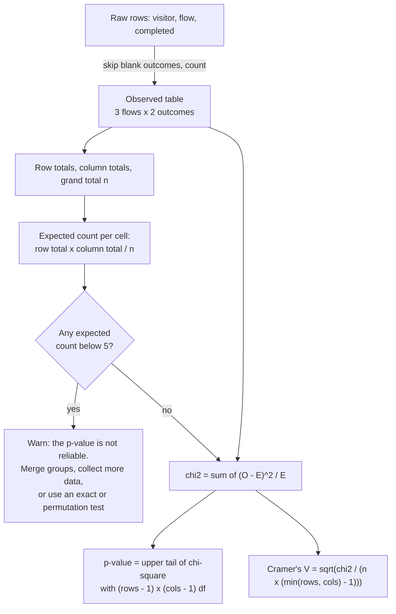

# Comparing categories: the chi-square test

Do the three signup flows differ in completion rate?

## Before you start

- Level: 2 (intermediate).
- Time: about 2 hours.
- Builds on [Hypothesis testing by permutation](../08-hypothesis-test-by-permutation/) (the null hypothesis and what a p-value is) and [A/B test from scratch](../03-ab-test-from-scratch/) (the two-proportion z-test, and the sample ratio check, which was already a small chi-square test). You need Python 3.9 or later.

## The problem

Lanternway Courses, a fictional online course company, tested three ways to sign up: the current long form, a short form with three fields, and a magic link sent by email. 1,350 visitors who started signing up were assigned to a flow at random. Omar, the head of growth, has a slide that says "short form wins, 65.7% against 55.5%" and wants to remove the other two flows in next sprint's release. Before he does, he asks you: are the three flows really different, or is this the kind of spread three identical flows would give by chance? And if they differ, by how much?

The file `data/signups.csv` is synthetic, generated by `make_data.py` with a fixed seed. Each row is one made-up visitor. 13 visitors were still on the signup page when the data was pulled, so their `completed` is blank.

## In plain words

Three pizza shops each get a few hundred orders, and you note whether each order arrived on time. Shop A was on time 55% of the time, shop B 63%, shop C 66%. Are the shops really different, or would three equally good shops wobble this much anyway?

Start from the boring answer: the shop makes no difference. Then the best guess for every shop is the overall on-time rate. Multiply that rate by each shop's number of orders and you get what each shop *should* have scored if the shops were the same. Compare those **expected counts** with what really happened. If the gaps are small, the boring answer stands. If they are large, adding up all the gaps in a fair way gives one number, and that number tells you how surprised to be.

Words you will use:

- **Contingency table:** a table of counts, one row per group (flow) and one column per outcome (completed, gave up). Each box is a **cell**.
- **Independence:** the row does not change the chance of each column. Here: the flow does not change the completion rate. This is the null hypothesis.
- **Expected count:** what a cell would hold on average if the null were true.
- **Chi-square statistic** (chi is the Greek letter, said "kai"): the sum over every cell of (observed - expected)^2 / expected. 0 means the table matches the null perfectly.
- **Degrees of freedom (df):** how many cells could vary freely once the row and column totals are fixed. It sets the shape of the chi-square distribution.
- **Chi-square distribution:** the spread of chi-square statistics you would get from many experiments where the null is true. Its upper tail gives the p-value.
- **Cramer's V:** an effect size between 0 (no relation) and 1 (the row decides the column completely). The p-value says whether there is a difference; V says how big it is.

## What you will build from scratch

- `read_table(path)`: a contingency table from raw rows, skipping visitors whose outcome is not known yet.
- `expected_counts(observed)`: the table you would expect under independence, with checks that refuse rates and percentages.
- `chi_square_statistic` and `degrees_of_freedom`.
- `chi2_sf(x, df)`: the chi-square p-value from the regularized incomplete gamma function, with only `math`.
- `cramers_v(...)`, and `chi_square_test(observed)` that also warns about expected counts below 5.

## The idea



**Expected counts.** If the flow does not matter, every flow should complete at the overall rate. The overall completion rate is (column total for completed) / n, and a flow with r visitors should then have r times that many completions. Written for any cell in row i and column j:

    E[i][j] = row_total[i] * col_total[j] / n

**The statistic.** For each cell, square the gap, and divide by the expected count so that a gap of 10 counts more in a small cell than in a big one:

    chi2 = sum over all cells of (O[i][j] - E[i][j])^2 / E[i][j]

**Degrees of freedom.** With the row and column totals fixed, once you fill (rows - 1) x (cols - 1) cells the rest are forced. Three flows and two outcomes give (3 - 1) x (2 - 1) = 2.

**The p-value.** When the null is true and the expected counts are not tiny, chi2 follows a chi-square distribution with df degrees of freedom. The p-value is the chance that such a distribution gives a value at least as large as ours. Its formula uses the **regularized upper incomplete gamma function** Q(a, h), the share of a gamma distribution that lies above h:

    p = Q(df / 2, chi2 / 2)

No module in the standard library has Q, but two classic recipes compute it with `math.lgamma` (the log of the gamma function, which generalizes the factorial: Gamma(n) = (n - 1)!):

- For h < a + 1, a power series for the lower part P = 1 - Q converges fast:

      P(a, h) = exp(-h + a * log(h) - lgamma(a)) * (1/a + h/(a(a+1)) + h^2/(a(a+1)(a+2)) + ...)

- For h >= a + 1, a continued fraction for Q converges fast. It is evaluated with the modified Lentz method, a loop that updates two running ratios; the partial terms are a_i = -i * (i - a) and b_i = h + 1 - a + 2i.

You do not need to remember these. You need to know that they exist, that you can check them, and how: for df = 2 the answer has a closed form, p = exp(-chi2 / 2), and for df = 1 it is the two-sided normal tail, erfc(sqrt(chi2 / 2)). A 2 x 2 chi-square is exactly z squared from the pooled two-proportion z-test of lesson 03.

**Cramer's V.** chi2 grows with the number of people: the same rates on ten times the visitors give ten times the chi2. Dividing it out gives an effect size:

    V = sqrt(chi2 / (n * (min(rows, cols) - 1)))

**When to trust it.** The chi-square distribution is an approximation. The usual rule of thumb: every expected count should be at least 5. Below that, merge sparse groups, collect more data, or use an exact or permutation test (lesson 08 works here too: shuffle the flow labels and recompute chi2).

## Walk through

Run each block from this folder. Build the table from the raw rows. A blank `completed` is a visitor still on the page, not a visitor who gave up:

```python
import csv
counts = {}
blank = 0
with open("data/signups.csv", newline="") as f:
    for row in csv.DictReader(f):
        if row["completed"] == "":
            blank += 1
            continue
        cell = counts.setdefault(row["flow"], [0, 0])
        cell[0 if row["completed"] == "1" else 1] += 1
for flow in sorted(counts):
    c, g = counts[flow]
    print(flow, c, g, round(c / (c + g), 4))
print("skipped", blank)
```

```text
long_form 252 202 0.5551
magic_link 276 164 0.6273
short_form 291 152 0.6569
skipped 13
```

Each line is a flow, its completions, its give-ups, and its completion rate. Short form leads with 65.7%, long form trails with 55.5%.

Row totals, column totals, and the expected table:

```python
observed = [[252, 202], [276, 164], [291, 152]]   # long_form, magic_link, short_form
rows = [sum(r) for r in observed]
cols = [sum(c) for c in zip(*observed)]
n = sum(rows)
expected = [[r * c / n for c in cols] for r in rows]
print("rows", rows, "cols", cols, "n", n)
for r in expected:
    print([round(v, 2) for v in r])
```

```text
rows [454, 440, 443] cols [819, 518] n 1337
[278.1, 175.9]
[269.53, 170.47]
[271.37, 171.63]
```

Overall, 819 of 1,337 visitors completed (61.3%). If the flow made no difference, long form's 454 visitors would have about 278 completions. It had 252.

The statistic, cell by cell, and the degrees of freedom:

```python
observed = [[252, 202], [276, 164], [291, 152]]
rows = [sum(r) for r in observed]
cols = [sum(c) for c in zip(*observed)]
n = sum(rows)
chi2 = 0.0
for i, r in enumerate(observed):
    parts = []
    for j, o in enumerate(r):
        e = rows[i] * cols[j] / n
        parts.append(round((o - e) ** 2 / e, 3))
        chi2 += (o - e) ** 2 / e
    print(parts)
df = (len(rows) - 1) * (len(cols) - 1)
print("chi2", round(chi2, 4), "df", df)
```

```text
[2.45, 3.874]
[0.155, 0.246]
[1.42, 2.246]
chi2 10.392 df 2
```

Long form contributes 6.3 of the 10.4: its completions are well below what independence predicts. Short form, above its expected count, adds most of the rest, and magic link sits close to its expected counts.

The p-value with the power series, checked against the df = 2 closed form:

```python
import math
chi2, df = 10.392, 2
a, h = df / 2, chi2 / 2
print("h < a + 1?", h < a + 1)
# h is large here, so the continued fraction is the right recipe. For the check,
# the series still converges, just more slowly:
term = total = 1 / a
k = a
while term > total * 1e-15:
    k += 1
    term *= h / k
    total += term
lower = total * math.exp(-h + a * math.log(h) - math.lgamma(a))
print("series p", round(1 - lower, 6))
print("closed form p", round(math.exp(-chi2 / 2), 6))
```

```text
h < a + 1? False
series p 0.005539
closed form p 0.005539
```

Both give p = 0.0055 (to 4 decimals). If the three flows were equally good, a spread at least this large would show up about 5.5 times in 1,000 experiments. That is strong evidence the flows differ.

How big is the difference?

```python
import math
chi2, n = 10.392, 1337
v = math.sqrt(chi2 / (n * (min(3, 2) - 1)))
print(round(v, 4))
```

```text
0.0882
```

V is 0.088: a small association. The flow explains only a little of who completes. That is normal for product changes and does not make the result unimportant: 10 percentage points of completion is a lot of signups.

On the lesson data, `python3 solution/solution.py` prints:

```
flows ['long_form', 'magic_link', 'short_form']
observed [[252, 202], [276, 164], [291, 152]]
rates [0.5551, 0.6273, 0.6569]
expected [[278.1, 175.9], [269.53, 170.47], [271.37, 171.63]]
chi2 10.392
df 2
p_value 0.0055
cramers_v 0.0882
n 1337
small_cells []
```

No cell has an expected count below 5, so the approximation is safe. One more fact, which Omar cannot see but `make_data.py` can: the true completion rates are 58%, 66% and 62% for long form, short form and magic link.

## Common mistakes

1. **Running the test on percentages (the trap).** Omar's slide shows rates, so it is tempting to type the rounded percentages in as if they were counts:

```python
import math
def chi2_of(t):
    rows = [sum(r) for r in t]
    cols = [sum(c) for c in zip(*t)]
    n = sum(rows)
    return sum((t[i][j] - rows[i] * cols[j] / n) ** 2 / (rows[i] * cols[j] / n)
               for i in range(len(t)) for j in range(len(cols)))
real = chi2_of([[252, 202], [276, 164], [291, 152]])
pct = chi2_of([[56, 44], [63, 37], [66, 34]])
print("counts:      chi2 %.3f  p %.4f" % (real, math.exp(-real / 2)))
print("percentages: chi2 %.3f  p %.4f" % (pct, math.exp(-pct / 2)))
```

```text
counts:      chi2 10.392  p 0.0055
percentages: chi2 2.228  p 0.3282
```

   The same rates now look like noise (p = 0.33), because the test thinks there were 100 visitors per flow instead of about 450. Feed it per-mille numbers and it would think there were 1,000 and "find" a difference anywhere. chi2 is built on counts: always go back to the raw rows. Your `expected_counts` refuses non-whole cells like 55.5, but rounded percentages are whole numbers and slip through, so this check is on you.

2. **Reading a blank outcome as "gave up".** Treating the 13 visitors still on the page as failures changes the table to [[252, 206], [276, 168], [291, 157]] and chi2 from 10.39 to 9.99. Small here, but the visitors who are still mid-signup are usually on the slowest flow, so the bias points at the flow you are testing. Skip unknown outcomes, or wait until they resolve.

3. **Saying which flow won from the overall test.** A significant chi-square says the three flows are not all the same. It does not say which pairs differ. Compare pairs with 2 x 2 tests, and because you now run three tests, divide alpha by 3 (the **Bonferroni correction**): 0.05 / 3 = 0.0167.

```python
import math
data = {"long_form": [252, 202], "magic_link": [276, 164], "short_form": [291, 152]}
names = sorted(data)
for i in range(3):
    for j in range(i + 1, 3):
        t = [data[names[i]], data[names[j]]]
        rows = [sum(r) for r in t]
        cols = [sum(c) for c in zip(*t)]
        n = sum(rows)
        chi2 = sum((t[a][b] - rows[a] * cols[b] / n) ** 2 / (rows[a] * cols[b] / n) for a in range(2) for b in range(2))
        p = math.erfc(math.sqrt(chi2 / 2))
        print(names[i], "vs", names[j], round(p, 4), "significant" if p < 0.05 / 3 else "not significant")
```

```text
long_form vs magic_link 0.0282 not significant
long_form vs short_form 0.0018 significant
magic_link vs short_form 0.3587 not significant
```

   Only long form against short form survives. Short form and magic link cannot be told apart with this data, so "remove magic link" is not supported.

4. **Ignoring small expected counts.** A pilot with 31 visitors, [[4, 6], [7, 3], [9, 2]], has three cells whose expected count is under 5 (3.5 to 3.9). `chi_square_test` still returns a p-value, 0.12, but the chi-square approximation is poor there. Use a permutation test instead, or wait for more data.

5. **Adding a continuity correction by default.** Some tools apply the Yates correction to 2 x 2 tables, which shrinks each |O - E| by 0.5 and makes the test more conservative. It is off in this lesson, so a 2 x 2 chi2 equals z squared from lesson 03. When you compare your number with a tool's, check which one it used.

## Your turn

Open `exercise.py` and fill in the eight functions. The docstrings say what each must return, including the recipe for `chi2_sf`; how you organise the loops is up to you. Then run, from this folder:

    python3 test_lesson.py

The test checks `chi2_sf` against closed forms for 1, 2, 3, 4 and 6 degrees of freedom and against printed chi-square table values, checks that a 2 x 2 chi-square equals z squared from the two-proportion test, and refuses tables of rates, empty rows and ragged tables. It runs your pipeline on the committed data and on a second dataset built with another seed. To see the reference solution pass: `CHECK_SOLUTION=1 python3 test_lesson.py`.

Stretch: write a permutation version. Shuffle the flow labels of the 1,337 visitors, rebuild the table, recompute chi2, and count how often it reaches 10.392. Compare that p-value with 0.0055.

## Check yourself

1. Why is the expected count row total x column total / n?
2. A 4 x 3 table has how many degrees of freedom, and why?
3. Two tests both have p = 0.001. One has V = 0.03, the other V = 0.40. What is different?
4. A colleague enters the completion percentages into an online chi-square calculator and gets p = 0.33. What went wrong?

<details>
<summary>Answers</summary>

1. Under independence, the share of visitors who complete is the same in every row, so it is best estimated by the overall share, column total / n. A row with row total visitors should then have row total x (column total / n) of them in that column.
2. (4 - 1) x (3 - 1) = 6. Once the row and column totals are fixed, you can choose 3 x 2 cells freely and the last row and last column are forced.
3. The p-values say both differences are unlikely to be luck. V says the first is a tiny effect detected because n is huge, and the second is a strong relationship. Report both.
4. The chi-square statistic is built on counts. Percentages pretend every group had 100 people, which here throws away three quarters of the data and makes a real difference look like noise. Use the raw counts.

</details>

## What to tell the stakeholder

"Completion differs across the three flows: 55.5% for the long form, 62.7% for magic link and 65.7% for the short form, and a spread this large would turn up only about 5 times in 1,000 if the flows were equally good (chi-square p = 0.0055). The clear finding is that the long form does worse than the short form; short form and magic link are not distinguishable with this data, so we suggest dropping the long form and keeping both of the others running." Caveat: the effect is modest (Cramer's V 0.09), and 13 visitors whose outcome was not yet known are left out.

## In real job postings

In the Real Analyst Jobs data drop of 25 October 2026, 996 of the 2,056 US analyst postings that list a tool (48.4%) ask for Python, and 1,477 (71.8%) ask for SQL, the usual way a flow-by-outcome table like this one is pulled. See [Python data analyst jobs](https://realanalystjobs.com/jobs/python-data-analyst-jobs) and [product analyst jobs](https://realanalystjobs.com/jobs/product-analyst-jobs).

## Next

[10: Correlation, causation and Simpson's paradox](../10-correlation-causation-and-simpson/).
