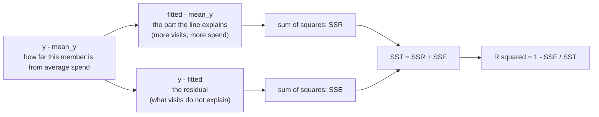

# Linear regression from scratch

How much does each extra visit add to monthly spend, and what does R squared really say?

## Before you start

- Level: 2 (intermediate).
- Time: about 2 hours.
- Builds on [Correlation, causation and Simpson's paradox](../10-correlation-causation-and-simpson/) (deviations, Pearson's r, and why a slope is not a cause) and [Confidence interval by hand](../02-confidence-interval-by-hand/) (a standard error and estimate +/- 1.96 standard errors). You need Python 3.9 or later; one optional check uses Python 3.10.

## The problem

Larkspur Coffee, a fictional coffee chain, is planning a "come back this week" offer for its loyalty app. Mei, the finance lead, needs one number for the business case by Thursday: how many dollars of monthly spend does one extra visit bring in? A vendor's dashboard already shows a fitted line with "R squared = 0.85", and Mei's draft says "the model is 85% accurate". You will fit the line yourself from the formulas, put a range on the slope, and work out what that 0.85 does and does not mean.

The file `data/members.csv` is synthetic, generated by `make_data.py` with a fixed seed. Each row is one made-up loyalty member over 30 days. Six members have a blank spend because it failed to sync from the till.

## In plain words

Your phone bill has a fixed charge plus a price per gigabyte. If you plotted many months of gigabytes against the bill, the points would lie on a straight line: the height where the line starts is the fixed charge, and how steeply it climbs is the price per gigabyte.

Coffee spend is messier: people buy a pastry one day and a small coffee the next. The points scatter around a line instead of lying on it. **Linear regression** finds the straight line that sits closest to the points, and gives you its fixed part and its per-visit part.

Words you will use:

- **Slope:** how much the line rises when x goes up by 1. Here: dollars per extra visit.
- **Intercept:** the line's height at x = 0.
- **Fitted value:** the line's prediction for one member, intercept + slope x visits.
- **Residual:** the actual value minus the fitted value. How far a point sits above or below the line.
- **Ordinary least squares (OLS):** choose the line that makes the sum of squared residuals as small as possible.
- **R squared:** the share of the spread in y (around its average) that the line accounts for. 0 means the line is no better than the average; 1 means every point is on the line.
- **Standard error of the slope:** how much the slope would wobble if you drew a fresh sample of members. It gives the slope a confidence interval.

## What you will build from scratch

- `read_members(path)`: visits and spend, skipping members whose spend is unknown.
- `fit_line(xs, ys)`: the OLS slope and intercept from two sums.
- `predict` and `r_squared`: fitted values, and the share of variation explained.
- `slope_se` and `slope_ci`: how sure we are about the slope.

## The idea

**The formulas.** With deviations from the means, as in lesson 10:

    Sxx = sum((x - mean_x)^2)
    Sxy = sum((x - mean_x) * (y - mean_y))
    slope     = Sxy / Sxx
    intercept = mean_y - slope * mean_x

The best line always passes through the point (mean_x, mean_y). The slope is also r x (SD of y) / (SD of x): the correlation, converted into y units per x unit.

**R squared splits the spread in two.** For each member, the gap between their spend and the average spend splits into the part the line explains and the part it does not:



    SST = sum((y - mean_y)^2)          total spread of spend
    SSE = sum((y - fitted)^2)          spread the line leaves over
    R^2 = 1 - SSE / SST

With a single x, R squared equals r squared. R squared is about how tightly the points hug the line. It is *not* the chance that the model is right, and it is *not* about how steep the line is: a steep line with big scatter and a flat line with small scatter can have the same R squared.

**How sure is the slope?** The residuals tell you how far points typically stray from the line. Their standard deviation, the **residual standard deviation**, divides by n - 2, because the slope and intercept were both estimated from the same data:

    residual_sd = sqrt( SSE / (n - 2) )
    SE(slope)   = residual_sd / sqrt(Sxx)
    95% CI      = slope +/- 1.96 x SE(slope)

The slope is better pinned down when there is less scatter (small residual_sd) and when x is spread out (big Sxx). The exact multiplier comes from a t distribution with n - 2 degrees of freedom; above about 100 points it is close to 1.96, which this lesson uses.

**What a regression slope assumes.** The relationship is roughly a straight line, members are independent of each other, and the scatter around the line is about the same size everywhere. It describes how spend differs between members who visit more and less often. Whether *making* a member visit once more adds that much is a causal question (lesson 10).

## Walk through

Run each block from this folder. The formulas by hand on 5 points:

```python
xs = [1, 2, 3, 4, 5]
ys = [3, 5, 4, 7, 8]
mx, my = sum(xs) / 5, sum(ys) / 5
sxx = sum((x - mx) ** 2 for x in xs)
sxy = sum((x - mx) * (y - my) for x, y in zip(xs, ys))
slope = sxy / sxx
intercept = my - slope * mx
print("means", mx, my, "Sxx", sxx, "Sxy", round(sxy, 4))
print("slope", round(slope, 4), "intercept", round(intercept, 4))
print("fitted", [round(intercept + slope * x, 2) for x in xs])
```

```text
means 3.0 5.4 Sxx 10.0 Sxy 12.0
slope 1.2 intercept 1.8
fitted [3.0, 4.2, 5.4, 6.6, 7.8]
```

The slope is 12 / 10 = 1.2 and the line passes through the means (3, 5.4), so the intercept is 5.4 - 1.2 x 3 = 1.8.

Now the members. Read them, skip the blank spends, fit:

```python
import csv
xs, ys = [], []
with open("data/members.csv", newline="") as f:
    for row in csv.DictReader(f):
        if row["spend_30d"] == "":
            continue
        xs.append(int(row["visits_30d"]))
        ys.append(float(row["spend_30d"]))
n = len(xs)
mx, my = sum(xs) / n, sum(ys) / n
sxx = sum((x - mx) ** 2 for x in xs)
sxy = sum((x - mx) * (y - my) for x, y in zip(xs, ys))
slope = sxy / sxx
print(n, "members, mean visits", round(mx, 2), "mean spend", round(my, 2))
print("slope", round(slope, 4), "intercept", round(my - slope * mx, 4))
```

```text
414 members, mean visits 7.8 mean spend 42.11
slope 4.7298 intercept 5.2232
```

Each extra visit goes with about 4.73 dollars more spend in 30 days. R squared and the residual spread:

```python
import csv, math
xs, ys = [], []
with open("data/members.csv", newline="") as f:
    for row in csv.DictReader(f):
        if row["spend_30d"]:
            xs.append(int(row["visits_30d"]))
            ys.append(float(row["spend_30d"]))
n = len(xs)
mx, my = sum(xs) / n, sum(ys) / n
sxx = sum((x - mx) ** 2 for x in xs)
slope = sum((x - mx) * (y - my) for x, y in zip(xs, ys)) / sxx
intercept = my - slope * mx
sse = sum((y - intercept - slope * x) ** 2 for x, y in zip(xs, ys))
sst = sum((y - my) ** 2 for y in ys)
print("SST", round(sst, 1), "SSE", round(sse, 1), "R squared", round(1 - sse / sst, 4))
print("residual sd", round(math.sqrt(sse / (n - 2)), 2))
se = math.sqrt(sse / (n - 2)) / math.sqrt(sxx)
print("slope SE", round(se, 4), "95% CI", round(slope - 1.96 * se, 3), "to", round(slope + 1.96 * se, 3))
```

```text
SST 225851.9 SSE 34257.0 R squared 0.8483
residual sd 9.12
slope SE 0.0985 95% CI 4.537 to 4.923
```

Visits account for 85% of the variation in spend around the average. A typical member still sits about 9 dollars above or below the line. The slope is pinned down to roughly 4.54 to 4.92 dollars per visit.

On the lesson data, `python3 solution/solution.py` prints:

```
n 414
slope 4.7298
intercept 5.2232
r_squared 0.8483
slope_se 0.0985
slope_ci (4.5367, 4.9229)
residual_sd 9.1186
```

On Python 3.10 or later, `statistics.linear_regression(xs, ys)` gives the same slope and intercept; the test checks that when it can. One more fact, which Mei cannot see but `make_data.py` can: the data was built with 4.60 dollars per visit plus a base of 6 dollars, and noise with a standard deviation of 9 dollars. The interval 4.54 to 4.92 contains the true 4.60.

## Common mistakes

1. **Reading R squared as accuracy (the trap).** "R squared 0.85, so the model is 85% accurate" sounds right and is not. R squared depends on how spread out x is, not only on how good the line is. Fit the same kind of members, only those with 5 to 8 visits:

```python
import csv, math
pts = []
with open("data/members.csv", newline="") as f:
    for row in csv.DictReader(f):
        if row["spend_30d"]:
            pts.append((int(row["visits_30d"]), float(row["spend_30d"])))

def fit(pts):
    n = len(pts)
    mx = sum(p[0] for p in pts) / n
    my = sum(p[1] for p in pts) / n
    sxx = sum((p[0] - mx) ** 2 for p in pts)
    slope = sum((p[0] - mx) * (p[1] - my) for p in pts) / sxx
    sse = sum((p[1] - my - slope * (p[0] - mx)) ** 2 for p in pts)
    sst = sum((p[1] - my) ** 2 for p in pts)
    return n, round(slope, 2), round(1 - sse / sst, 3), round(math.sqrt(sse / (n - 2)), 2)

print("all members      n, slope, R2, residual sd:", fit(pts))
print("5 to 8 visits    n, slope, R2, residual sd:", fit([p for p in pts if 5 <= p[0] <= 8]))
```

```text
all members      n, slope, R2, residual sd: (414, 4.73, 0.848, 9.12)
5 to 8 visits    n, slope, R2, residual sd: (189, 4.47, 0.22, 9.27)
```

   The slope stays close (4.47 against 4.73) and predictions miss by about the same 9 dollars, yet R squared falls from 0.85 to 0.22. Nothing got less accurate: there is just less spread in visits to explain. For a business case, report the slope with its interval and the typical miss (the residual standard deviation), not R squared alone.

2. **Extrapolating past the data.** The intercept, 5.22 dollars, is the line's value at 0 visits, but every member in the file visited at least twice. And "a member who visits 60 times spends 289 dollars" uses a line fitted on 2 to 28 visits. Only predict inside the range you fitted.

3. **Flipping x and y.** Regressing visits on spend and turning that slope upside down gives about 5.58 dollars per visit, not 4.73. The two lines differ whenever r is not exactly 1 or -1, because each one minimises misses in a different direction. Put the thing you want to predict on the y side.

4. **Dividing by n in the residual variance.** The slope and intercept were chosen to make the residuals small, so dividing by n understates the scatter and makes the slope look surer than it is. Divide by n - 2. With 414 members the difference is small; with 10 it is not.

5. **Turning the slope into a promise.** Members who visit more spend more per month, by about 4.73 dollars a visit. An offer that pulls in an *extra* visit may bring a cheaper basket (just a coffee). The slope is a description; an experiment on the offer is what measures its effect.

## Your turn

Open `exercise.py` and fill in the seven functions. Then run, from this folder:

    python3 test_lesson.py

The test checks your slope, intercept, R squared and standard error against formulas written a different way (one-pass sums, R squared as r squared, the SE from r), on a toy example you can do by hand, on a perfect line, on flat y, on too few points, and on the committed data and a second dataset built with another seed. On Python 3.10 or later it also compares your fit with `statistics.linear_regression`. To see the reference solution pass: `CHECK_SOLUTION=1 python3 test_lesson.py`.

Stretch: plot the residuals against visits (a text histogram per visit count is enough). Is the scatter about the same size for 3 visits as for 20? If it grew with visits, what would that do to the slope's standard error?

## Check yourself

1. Why does the least squares line always pass through (mean_x, mean_y)?
2. A colleague's model has R squared 0.22. Is it useless?
3. Why does the residual variance divide by n - 2?
4. How would you get a narrower interval on the slope without collecting more members?

<details>
<summary>Answers</summary>

1. The intercept is defined as mean_y - slope x mean_x, so at x = mean_x the line's value is exactly mean_y. Equivalently, the residuals of a least squares line with an intercept add up to 0.
2. Not necessarily. On the members with 5 to 8 visits, R squared is 0.22 and the slope is still clearly positive and close to the full-data slope. A low R squared means a lot of variation is left unexplained, which can be fine if you want the slope, not individual predictions.
3. Two numbers, the slope and the intercept, were estimated from the same data to make the residuals as small as possible. That uses up two degrees of freedom, and dividing by n - 2 corrects the resulting understatement of the scatter.
4. Spread x out: SE(slope) = residual_sd / sqrt(Sxx), so members with a wider range of visits pin the slope down better. Less noise in y (for example a cleaner spend measure) also helps.

</details>

## What to tell the stakeholder

"Across 414 loyalty members, each extra visit in a month goes with about 4.73 dollars more spend (95% interval 4.54 to 4.92), and individual members still land about 9 dollars above or below that line. R squared of 0.85 means visits account for most of the differences in spend between members; it is not an accuracy rate." Caveat: this compares members who already visit more with those who visit less; an offer that adds a visit may bring in less per visit, so test the offer before banking on 4.73 dollars each.

## In real job postings

In the Real Analyst Jobs data drop of 25 October 2026, 996 of the 2,056 US analyst postings that list a tool (48.4%) ask for Python and 324 (15.8%) ask for R, the two usual places to fit a regression like this one. See [Python data analyst jobs](https://realanalystjobs.com/jobs/python-data-analyst-jobs) and the [data analyst interview questions](https://realanalystjobs.com/tools/data-analyst-interview-questions), where R squared comes up often.

## Next

[12: Bootstrap confidence intervals](../12-bootstrap-intervals/).
