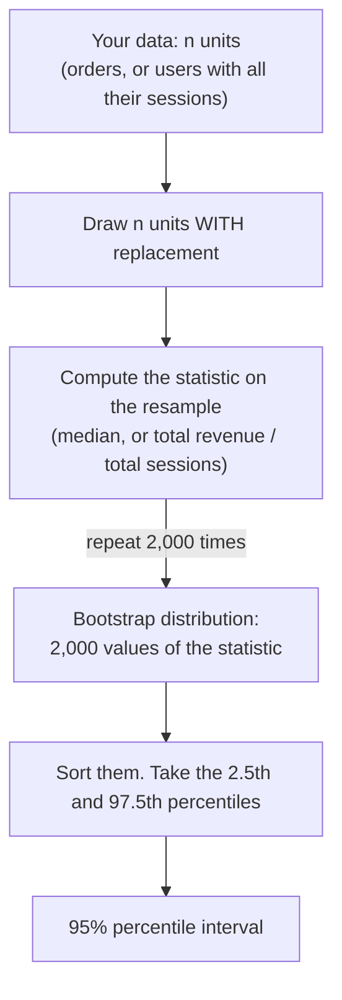

# Bootstrap confidence intervals

How sure are we about a median or a ratio when no simple formula exists?

## Before you start

- Level: 2 (intermediate).
- Time: about 2 hours.
- Builds on [Confidence interval by hand](../02-confidence-interval-by-hand/) (what a 95% interval means), [Sampling and the central limit theorem](../07-sampling-and-the-clt/) (a statistic wobbles from sample to sample, and sampling with replacement), [Outliers, box plots and robust summaries](../06-spread-percentiles-and-outliers/) (percentiles, and why the median survives a long tail) and [Hypothesis testing by permutation](../08-hypothesis-test-by-permutation/) (letting a simulation replace a formula). You need Python 3.9 or later.

## The problem

Kestrel Home, a fictional online furniture shop, is writing its October board update. Sam, the head of ecommerce, wants two numbers with ranges on them: the typical first order from a new customer, and revenue per website session. The finance team has formulas for an average and for a simple rate, but order values have a long tail of sofas, so the board deck uses the median, and revenue per session is one total divided by another. Neither has a formula Sam's team trusts. The deck locks on Monday. You will build both intervals with the bootstrap, and show why resampling sessions instead of users would give the board a range that is too narrow.

Both files are synthetic, generated by `make_data.py` with a fixed seed: `data/orders.csv` (160 first orders, two with a value not confirmed yet) and `data/sessions.csv` (1,340 sessions from 240 users). No row is a real customer.

## In plain words

You want to know how much the median delivery time in your city wobbles, but you only have one month of 160 deliveries. You cannot go back and live October again. The next best thing: treat the 160 deliveries you have as a stand-in for all deliveries. Write each on a card, put the cards in a hat, and draw 160 cards *putting each card back after you draw it*. Some deliveries get drawn twice, some not at all. That is a new, slightly different "month". Compute its median. Do it 2,000 times, and the spread of those 2,000 medians shows how much the median wobbles.

That is the **bootstrap**. It works for any statistic you can compute, whether or not a textbook has a formula for it.

Words you will use:

- **Resample:** a new dataset the same size as yours, drawn from yours **with replacement** (each draw can pick any row again).
- **Bootstrap distribution:** the statistic computed on each of many resamples.
- **Percentile interval:** the 2.5th and 97.5th percentiles of the bootstrap distribution, used as a 95% confidence interval.
- **Percentile:** the value below which a given share of sorted values fall. The 2.5th percentile has 2.5% of values below it.
- **Ratio of sums:** a metric made of one total divided by another, here total revenue / total sessions.
- **Unit of resampling:** the thing you draw as a whole. It must be the thing that is independent: here the user, because one user's sessions are alike.

## What you will build from scratch

- `read_orders(path)` and `read_sessions(path)`: order values, and sessions both one row each and rolled up per user.
- `median` and `ratio_of_sums`: the two statistics.
- `bootstrap(units, statistic, n_boot, seed)`: a general bootstrap for any statistic.
- `percentile` and `percentile_interval`: the 95% percentile interval.

## The idea



**Why it works.** The interval for a statistic should reflect how much it changes from one sample to the next. We cannot draw new samples from the real world, but a large enough sample looks like the population it came from, so drawing from the sample imitates drawing from the population. The bootstrap distribution's spread estimates the real sampling spread.

**The percentile.** Sort the B bootstrap values and look at position q x (B - 1), counting from 0. If that position falls between two values, interpolate:

    pos  = q * (B - 1)
    low  = floor(pos)
    value = sorted[low] + (sorted[low + 1] - sorted[low]) * (pos - low)

The 95% interval is the percentiles at q = 0.025 and q = 0.975. It does not have to be symmetric around the estimate, which suits skewed data like order values.

**Resample the unit that is independent.** A user with 20 sessions who loves your shop buys in many of them; a user who is just browsing buys in none. Sessions from one user rise and fall together. If you resample *sessions*, you pretend each session is a separate person, and the interval comes out too narrow. Resample *users*, each with all of their sessions, and recompute the ratio from the resampled totals:

    revenue per session = sum of user revenue / sum of user sessions   (over the resampled users)

The rule: resample whatever was drawn independently, the unit of randomisation in an experiment, or the customer in most product data.

**When the bootstrap is not enough.** It cannot invent what the sample never saw: with 10 orders, no resample can have a median above the largest of them. It struggles with extreme statistics such as the maximum. And it needs enough resamples for the 2.5th percentile to settle: 2,000 is a sensible minimum for a 95% interval.

## Walk through

Run each block from this folder. The orders, skipping the two values not confirmed yet:

```python
import csv
values = []
with open("data/orders.csv", newline="") as f:
    for row in csv.DictReader(f):
        if row["order_value"]:
            values.append(float(row["order_value"]))
s = sorted(values)
n = len(s)
median = (s[n // 2 - 1] + s[n // 2]) / 2 if n % 2 == 0 else s[n // 2]
print(n, "orders, mean", round(sum(s) / n, 2), "median", round(median, 2), "largest", s[-3:])
```

```text
158 orders, mean 386.4 median 172.19 largest [1843.34, 1919.34, 2024.28]
```

The mean is more than twice the median, pulled up by a few big sofa and bed orders. The median is the honest "typical" order. One resample, on six numbers so you can see it:

```python
import random
rng = random.Random(4)
data = [120, 150, 180, 210, 900, 1400]
for _ in range(3):
    print(sorted(rng.choices(data, k=len(data))))
```

```text
[120, 120, 120, 150, 180, 180]
[150, 150, 210, 900, 900, 1400]
[120, 150, 150, 900, 900, 1400]
```

`rng.choices(data, k=6)` draws 6 values with replacement: some repeat, some are missing. Each resample has its own median. Now 2,000 resamples of the real orders:

```python
import csv, random
values = []
with open("data/orders.csv", newline="") as f:
    for row in csv.DictReader(f):
        if row["order_value"]:
            values.append(float(row["order_value"]))

def median(v):
    s = sorted(v)
    n = len(s)
    return (s[n // 2 - 1] + s[n // 2]) / 2 if n % 2 == 0 else s[n // 2]

def percentile(v, q):
    s = sorted(v)
    pos = q * (len(s) - 1)
    lo = int(pos)
    hi = min(lo + 1, len(s) - 1)
    return s[lo] + (s[hi] - s[lo]) * (pos - lo)

rng = random.Random(0)
meds = [median(rng.choices(values, k=len(values))) for _ in range(2000)]
for start in range(110, 290, 20):
    c = sum(1 for m in meds if start <= m < start + 20)
    print("%3d to %3d %5d %s" % (start, start + 20, c, "#" * round(c / 20)))
print("95% interval:", round(percentile(meds, 0.025), 2), "to", round(percentile(meds, 0.975), 2))
```

```text
110 to 130     2 
130 to 150    48 ##
150 to 170   686 ##################################
170 to 190   807 ########################################
190 to 210   310 ################
210 to 230    86 ####
230 to 250    57 ###
250 to 270     4 
270 to 290     0 
95% interval: 151.09 to 230.06
```

The interval runs from about 151 to 230 dollars around a median of 172. It is lopsided: the median could be a lot higher than 172, but not much lower, because just above the middle of the data the order values are spread out. A plus-or-minus formula could not show that.

Now revenue per session. Roll the sessions up per user, then compute the ratio:

```python
import csv
users = {}
sessions = 0
with open("data/sessions.csv", newline="") as f:
    for row in csv.DictReader(f):
        cell = users.setdefault(int(row["user_id"]), [0, 0.0])
        cell[0] += 1
        cell[1] += float(row["revenue"])
        sessions += 1
per_user = [users[u] for u in sorted(users)]
counts = sorted(p[0] for p in per_user)
print(len(per_user), "users,", sessions, "sessions, sessions per user from", counts[0], "to", counts[-1])
print("revenue per session", round(sum(p[1] for p in per_user) / sum(p[0] for p in per_user), 2))
print("users who never bought:", sum(1 for p in per_user if p[1] == 0))
```

```text
240 users, 1340 sessions, sessions per user from 1 to 25
revenue per session 48.73
users who never bought: 168
```

The bootstrap on the right unit (users) and on the wrong one (sessions):

```python
import csv, random
users = {}
per_session = []
with open("data/sessions.csv", newline="") as f:
    for row in csv.DictReader(f):
        rev = float(row["revenue"])
        per_session.append((1, rev))
        cell = users.setdefault(int(row["user_id"]), [0, 0.0])
        cell[0] += 1
        cell[1] += rev
per_user = [tuple(users[u]) for u in sorted(users)]

def ratio(pairs):
    return sum(p[1] for p in pairs) / sum(p[0] for p in pairs)

def percentile(v, q):
    s = sorted(v)
    pos = q * (len(s) - 1)
    lo = int(pos)
    hi = min(lo + 1, len(s) - 1)
    return s[lo] + (s[hi] - s[lo]) * (pos - lo)

for name, units in (("users", per_user), ("sessions", per_session)):
    rng = random.Random(0)
    stats = [ratio(rng.choices(units, k=len(units))) for _ in range(2000)]
    low, high = percentile(stats, 0.025), percentile(stats, 0.975)
    print("resample %-8s %6.2f to %6.2f  width %5.2f" % (name, low, high, high - low))
```

```text
resample users     37.76 to  59.68  width 21.92
resample sessions  41.32 to  56.19  width 14.87
```

Resampling users gives a range about one and a half times as wide. That wider range is the honest one: 168 of the 240 users never bought, so a few keen users carry most of the revenue, and whether a resample happens to include them moves the ratio a lot.

On the lesson data, `python3 solution/solution.py` prints:

```
n_orders 158
median 172.19
median_ci (151.09, 230.06)
n_users 240
n_sessions 1340
revenue_per_session 48.73
ratio_ci_users (37.76, 59.68)
ratio_ci_sessions (41.32, 56.19)
```

## Common mistakes

1. **Resampling rows instead of the independent unit (the trap).** The sessions interval above, 41.32 to 56.19 dollars, looks tighter and more impressive than the users interval, 37.76 to 59.68. It is tighter because it ignores that a few keen users produce many of the buying sessions. If the board planned on "at least 41 dollars per session", they would be planning on a number the data does not support. The same trap appears in A/B tests: if users were randomised, resample users, even when the metric is per session, per page view or per order.

2. **Averaging per-user ratios instead of dividing totals.** "Revenue per session" for the shop is total revenue / total sessions. The average of each user's own revenue per session is a different metric that gives a one-session visitor the same weight as a twenty-session regular:

```python
import csv
users = {}
with open("data/sessions.csv", newline="") as f:
    for row in csv.DictReader(f):
        cell = users.setdefault(row["user_id"], [0, 0.0])
        cell[0] += 1
        cell[1] += float(row["revenue"])
total = sum(c[1] for c in users.values()) / sum(c[0] for c in users.values())
mean_of_ratios = sum(c[1] / c[0] for c in users.values()) / len(users)
print("ratio of sums", round(total, 2), " mean of per-user ratios", round(mean_of_ratios, 2))
```

```text
ratio of sums 48.73  mean of per-user ratios 27.0
```

   Both are legitimate numbers, but they answer different questions. Decide which one the dashboard means, then bootstrap that one.

3. **Too few resamples.** The 2.5th percentile sits in the thin tail, so with few resamples it jumps around. Five runs of the median interval with different seeds:

```python
import csv, random
values = [float(r["order_value"]) for r in csv.DictReader(open("data/orders.csv", newline="")) if r["order_value"]]

def median(v):
    s = sorted(v)
    n = len(s)
    return (s[n // 2 - 1] + s[n // 2]) / 2 if n % 2 == 0 else s[n // 2]

def percentile(v, q):
    s = sorted(v)
    pos = q * (len(s) - 1)
    lo = int(pos)
    hi = min(lo + 1, len(s) - 1)
    return s[lo] + (s[hi] - s[lo]) * (pos - lo)

for b in (100, 2000):
    ends = []
    for seed in range(5):
        rng = random.Random(seed)
        meds = [median(rng.choices(values, k=len(values))) for _ in range(b)]
        ends.append((round(percentile(meds, 0.025)), round(percentile(meds, 0.975))))
    print(b, "resamples:", ends)
```

```text
100 resamples: [(145, 224), (153, 237), (152, 236), (153, 230), (149, 235)]
2000 resamples: [(151, 230), (151, 234), (147, 231), (149, 231), (148, 230)]
```

   With 100 resamples the ends move by up to 13 dollars from one seed to the next; with 2,000 they move by about 4. Use at least 2,000 for a 95% interval, and fix the seed so the deck shows the same number every time it is rebuilt.

4. **Using the mean's formula for a median.** mean +/- 1.96 x SD / sqrt(n) is an interval for the *mean*, 386 dollars here, not for the median of 172. There is no equally simple formula for the median's standard error that works on skewed data, which is exactly the job the bootstrap does.

5. **Expecting the bootstrap to rescue a tiny sample.** With 8 orders, every resample is built from those 8 values, so the interval can never reach outside them, and it is usually too narrow. The bootstrap needs a sample big enough to look like the population.

## Your turn

Open `exercise.py` and fill in the eight functions. `bootstrap` must take any statistic, so the same function serves the median, the per-user ratio and the per-session ratio. Then run, from this folder:

    python3 test_lesson.py

The test checks your percentiles against `statistics.quantiles` (inclusive method), rebuilds each bootstrap with the resampling rule from the docstring, and runs on the committed data and on a second dataset built with another seed, plus small cases: an even count, a single unit, a zero denominator and q outside 0 to 1. To see the reference solution pass: `CHECK_SOLUTION=1 python3 test_lesson.py`.

Stretch: bootstrap the *difference* in revenue per session between users whose id is odd and users whose id is even (a made-up split, so the true difference is 0). Resample users within each group separately. Does the 95% interval contain 0?

## Check yourself

1. Why is the bootstrap drawn with replacement? What would you get without it?
2. The median interval is 151 to 230 around 172. Why is it not symmetric, and is that a problem?
3. An experiment randomised users, and the metric is orders per session. Which unit do you resample, and why?
4. When would you not trust a bootstrap interval?

<details>
<summary>Answers</summary>

1. Drawing n rows without replacement from n rows just reshuffles the same data, so every resample has the same median and the interval has width 0. With replacement, each resample is a different plausible sample, which is what imitates drawing a new sample from the population.
2. The order values just above the middle are more spread out than those just below it, so a resample's median can move further up than down. That is a feature: the percentile interval follows the shape of the data instead of forcing a symmetric plus-or-minus.
3. Users. They were the unit of randomisation and are independent of each other; sessions from one user are not. Resampling sessions would make the interval too narrow and the test too likely to declare a winner.
4. With a small sample (it cannot reach beyond the values it has), for extreme statistics such as the maximum, when the rows are not independent and you resampled them anyway, or with too few resamples for the tail percentiles to settle.

</details>

## What to tell the stakeholder

"The typical first order in October was 172 dollars (median of 158 orders), and we are 95% confident the true median is between 151 and 230 dollars. Revenue per session was 48.73 dollars, with a 95% range of 37.76 to 59.68 dollars." Caveat: both ranges come from resampling (the bootstrap) rather than a textbook formula, and the session range is wide because a small group of frequent buyers drives much of the revenue.

## In real job postings

In the Real Analyst Jobs data drop of 25 October 2026, 996 of the 2,056 US analyst postings that list a tool (48.4%) ask for Python, where a bootstrap like this one is a few lines. See [Python data analyst jobs](https://realanalystjobs.com/jobs/python-data-analyst-jobs) and the [confidence interval calculator](https://realanalystjobs.com/tools/confidence-interval-calculator) for the formula version of an interval on a mean or a rate.

## Next

[13: A/B test pitfalls](../13-ab-test-pitfalls/).
