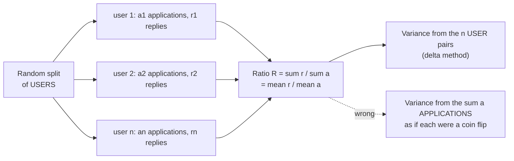

# Ratio metrics and the delta method

Is the drop in replies per application real when one user sends many?

## Before you start

- Level: 3 (advanced).
- Time: about 2 hours.
- Builds on [A/B test from scratch](../03-ab-test-from-scratch/) (the z-test and a confidence interval on a difference), [Bootstrap confidence intervals](../12-bootstrap-intervals/) (a ratio of sums, and resampling the independent unit) and [Sampling and the central limit theorem](../07-sampling-and-the-clt/) (variance of a mean). [A/B test pitfalls](../13-ab-test-pitfalls/) is useful but not required. You need Python 3.9 or later.

## The problem

Cobblewick, a fictional job board, tested a "quick apply" button that sends an application in one click. Job seekers were split at random between the current form (control) and quick apply. Tomas, who runs the employer side, is worried: replies per application fell from 7.9% to 6.9%, an analyst's dashboard says p = 0.025, and employers have started to complain about low-effort applications. He wants to know by the Thursday product review whether the drop is real and whether quick apply should be switched off. You will find that the dashboard's p-value treats every application as independent when the coin that was flipped was the user, rebuild the test with the delta method, check it against a bootstrap, and make a recommendation.

`data/users.csv` is synthetic, generated by `make_data.py` with a fixed seed: one row per job seeker with their variant, applications sent and replies received. No row is a real person.

## In plain words

A cricket team's season strike rate is total runs divided by total balls faced. Suppose one batter faces 600 balls and the other ten face 40 each. If you treat all 1,000 balls as separate, independent coin flips, you would think the team's strike rate is known very precisely. But most of those balls came from one batter: if a different batter had been the one who stayed in all season, the team number would be quite different. The real uncertainty comes from *which batters you happened to have*, not from the number of balls.

Replies per application is the same. The random split assigned **users**, not applications. One user who sends 136 applications with a weak CV gets few replies on all of them. Those applications are not 136 separate pieces of evidence; they rise and fall together.

Words you will use:

- **Ratio metric:** a metric made of one total divided by another, where both totals grow with the number of users: total replies / total applications, revenue / sessions, clicks / impressions.
- **Unit of randomisation:** the thing the coin was flipped for, here the user. Independent evidence comes in units of users.
- **Unit of analysis:** the thing in the metric's denominator, here the application. When it differs from the unit of randomisation, the usual formula is wrong.
- **Naive standard error:** the binomial formula sqrt(R x (1 - R) / applications), which assumes each application is independent.
- **Delta method:** a way to get the variance of a function of averages (here one average divided by another) from the variances and covariance of those averages.
- **Covariance:** how two quantities move together. Positive when users who send more applications also tend to get more replies.
- **Design effect:** the true variance divided by the naive variance. A design effect of 3 means the naive formula claims three times as much information as you really have.
- **Cluster bootstrap:** the bootstrap from lesson 12, resampling whole users with all their applications.

## What you will build from scratch

- `read_users(path)`: one (applications, replies) pair per user, by variant.
- `ratio`, `naive_var`, `delta_var`: the metric and two variances for it.
- `compare(control, treatment, method)`: the difference, standard error, z, p-value and 95% interval.
- `summarise(path)`: both tests side by side and the design effect.

## The idea



**The ratio is a ratio of two means.** With n users, each with a_i applications and r_i replies:

    R = sum(r_i) / sum(a_i) = mean(r) / mean(a)

Both mean(r) and mean(a) are averages over independent users, so the central limit theorem applies to each. Their ratio is not an average, so there is no ready formula for its variance. The delta method makes one: near the true values, a smooth function is close to a straight line, and the variance of a straight line of averages is easy. For f(x, y) = y / x, the straight-line version of R minus its true value is

    (mean(r) - R * mean(a)) / mean(a)

which is an average of the per-user quantity (r_i - R a_i), divided by a constant. So

    Var(R) = Var(r - R a) / (n * mean(a)^2)
           = (var_r - 2 R cov_ra + R^2 var_a) / (n * mean(a)^2)

where var_r and var_a are the sample variances of replies and applications per user, and cov_ra their sample covariance, each with n - 1 in the denominator. Users with zero applications stay in: they are part of n and pull mean(a) down.

Two checks that the formula makes sense:

- If every user sends exactly one application, var_a = 0 and cov_ra = 0, and the formula becomes var_r / n, the binomial variance with n - 1 instead of n. The naive formula is right in that case, and only then.
- If users send many applications and users differ in their reply rate, the per-user quantity r_i - R a_i varies a lot, so the variance is much bigger than the naive one.

**Comparing two groups.** The groups are independent, so variances add:

    diff = R_treatment - R_control
    SE   = sqrt(Var(R_treatment) + Var(R_control))
    z    = diff / SE,    p = 2 * (1 - Phi(|z|)),    95% CI = diff +/- 1.96 * SE

**Check it against a bootstrap.** The delta method is an approximation, so check it once on your data with a cluster bootstrap: resample users with replacement within each group, recompute the difference in ratios, and take the standard deviation of those differences. The two should agree closely. If they do not (very few users, or a handful of users with huge counts), trust the bootstrap.

## Walk through

Run each block from this folder. First, the totals, and how lopsided the applications are:

```python
import csv
groups = {}
with open("data/users.csv", newline="") as f:
    for row in csv.DictReader(f):
        groups.setdefault(row["variant"], []).append((int(row["applications"]), int(row["replies"])))
for name in ("control", "quick_apply"):
    pairs = groups[name]
    apps = sum(a for a, _ in pairs)
    replies = sum(r for _, r in pairs)
    print("%-11s users %d  applications %d  replies %d  replies per application %.4f" % (
        name, len(pairs), apps, replies, replies / apps))
everyone = sorted((a for g in groups.values() for a, _ in g), reverse=True)
top = everyone[:len(everyone) // 10]
print("users with 0 applications:", everyone.count(0), " most by one user:", everyone[0])
print("share of all applications sent by the top 10%% of users: %.2f" % (sum(top) / sum(everyone)))
```

```text
control     users 823  applications 5751  replies 456  replies per application 0.0793
quick_apply users 777  applications 6752  replies 464  replies per application 0.0687
users with 0 applications: 182  most by one user: 136
share of all applications sent by the top 10% of users: 0.52
```

A tenth of the users sent just over half of all applications. The dashboard's test, treating the 12,503 applications as independent:

```python
import math
apps = {"control": 5751, "quick_apply": 6752}
replies = {"control": 456, "quick_apply": 464}
r = {k: replies[k] / apps[k] for k in apps}
se = math.sqrt(sum(r[k] * (1 - r[k]) / apps[k] for k in apps))
diff = r["quick_apply"] - r["control"]
z = diff / se
p = 2 * (1 - 0.5 * (1 + math.erf(abs(z) / math.sqrt(2))))
print("diff %+.4f  naive se %.4f  z %.2f  p %.4f" % (diff, se, z, p))
```

```text
diff -0.0106  naive se 0.0047  z -2.24  p 0.0248
```

That is the p = 0.025 on the dashboard. Are applications from the same user alike? Group users by how many they sent:

```python
import csv
buckets = {"1 to 4": [0, 0, 0], "5 to 19": [0, 0, 0], "20 or more": [0, 0, 0]}
with open("data/users.csv", newline="") as f:
    for row in csv.DictReader(f):
        a, r = int(row["applications"]), int(row["replies"])
        if a == 0:
            continue
        key = "1 to 4" if a < 5 else ("5 to 19" if a < 20 else "20 or more")
        buckets[key][0] += 1
        buckets[key][1] += a
        buckets[key][2] += r
for key, (users, a, r) in buckets.items():
    print("%-10s applications: %4d users, %5d applications, %.3f replies per application" % (key, users, a, r / a))
```

```text
1 to 4     applications:  742 users,  1620 applications, 0.114 replies per application
5 to 19    applications:  533 users,  4674 applications, 0.072 replies per application
20 or more applications:  143 users,  6209 applications, 0.064 replies per application
```

143 heavy users sent half the applications, at a lower reply rate. Which heavy users landed in which group moves the ratio, and the naive formula knows nothing about that. Now the delta method, by hand:

```python
import csv, math
groups = {}
with open("data/users.csv", newline="") as f:
    for row in csv.DictReader(f):
        groups.setdefault(row["variant"], []).append((int(row["applications"]), int(row["replies"])))

def delta_var(pairs):
    n = len(pairs)
    mean_a = sum(a for a, _ in pairs) / n
    mean_r = sum(r for _, r in pairs) / n
    big_r = mean_r / mean_a
    var_a = sum((a - mean_a) ** 2 for a, _ in pairs) / (n - 1)
    var_r = sum((r - mean_r) ** 2 for _, r in pairs) / (n - 1)
    cov = sum((a - mean_a) * (r - mean_r) for a, r in pairs) / (n - 1)
    print("  n %d  mean_a %.3f  mean_r %.3f  var_a %.2f  var_r %.3f  cov %.3f" % (n, mean_a, mean_r, var_a, var_r, cov))
    return (var_r - 2 * big_r * cov + big_r ** 2 * var_a) / (n * mean_a ** 2)

v = {}
for name in ("control", "quick_apply"):
    print(name)
    v[name] = delta_var(groups[name])
se = math.sqrt(v["control"] + v["quick_apply"])
diff = 464 / 6752 - 456 / 5751
z = diff / se
p = 2 * (1 - 0.5 * (1 + math.erf(abs(z) / math.sqrt(2))))
print("diff %+.4f  delta se %.4f  z %.2f  p %.4f" % (diff, se, z, p))
print("95%% CI %+.4f to %+.4f" % (diff - 1.96 * se, diff + 1.96 * se))
```

```text
control
  n 823  mean_a 6.988  mean_r 0.554  var_a 181.71  var_r 1.831  cov 10.649
quick_apply
  n 777  mean_a 8.690  mean_r 0.597  var_a 222.25  var_r 2.444  cov 12.285
diff -0.0106  delta se 0.0079  z -1.33  p 0.1821
95% CI -0.0261 to +0.0050
```

The same 1.06 point drop, but the standard error is 0.0079, not 0.0047. The p-value is 0.18 and the interval runs from a 2.6 point drop to a 0.5 point rise. Is the delta method right? Check it with a cluster bootstrap, which uses no formula at all:

```python
import csv, math, random
groups = {}
with open("data/users.csv", newline="") as f:
    for row in csv.DictReader(f):
        groups.setdefault(row["variant"], []).append((int(row["applications"]), int(row["replies"])))

def ratio(pairs):
    return sum(r for _, r in pairs) / sum(a for a, _ in pairs)

rng = random.Random(0)
c, t = groups["control"], groups["quick_apply"]
diffs = [ratio(rng.choices(t, k=len(t))) - ratio(rng.choices(c, k=len(c))) for _ in range(2000)]
mean = sum(diffs) / len(diffs)
print("cluster bootstrap se %.4f" % math.sqrt(sum((d - mean) ** 2 for d in diffs) / (len(diffs) - 1)))
```

```text
cluster bootstrap se 0.0079
```

They agree. The design effect is (0.0079 / 0.0047)^2, about 2.8: the naive test acted as if it had almost three times the information it had.

The strongest check is to ask how often each test raises a false alarm when there is nothing to find. Shuffle the users into two made-up groups (an A/A test on this data), 1,000 times, and count p below 0.05:

```python
import csv, math, random
users = []
with open("data/users.csv", newline="") as f:
    for row in csv.DictReader(f):
        users.append((int(row["applications"]), int(row["replies"])))

def ratio(pairs):
    return sum(r for _, r in pairs) / sum(a for a, _ in pairs)

def naive_var(pairs):
    r = ratio(pairs)
    return r * (1 - r) / sum(a for a, _ in pairs)

def delta_var(pairs):
    n = len(pairs)
    mean_a = sum(a for a, _ in pairs) / n
    big_r = ratio(pairs)
    return sum((r - big_r * a) ** 2 for a, r in pairs) / (n * (n - 1) * mean_a ** 2)

def p_value(c, t, var):
    z = (ratio(t) - ratio(c)) / math.sqrt(var(c) + var(t))
    return 2 * (1 - 0.5 * (1 + math.erf(abs(z) / math.sqrt(2))))

rng = random.Random(1)
hits = {"naive": 0, "delta": 0}
runs = 1000
for _ in range(runs):
    shuffled = users[:]
    rng.shuffle(shuffled)
    c, t = shuffled[:800], shuffled[800:]
    hits["naive"] += p_value(c, t, naive_var) < 0.05
    hits["delta"] += p_value(c, t, delta_var) < 0.05
print({k: v / runs for k, v in hits.items()})
```

```text
{'naive': 0.224, 'delta': 0.035}
```

`delta_var` here uses the residual form, sum of (r_i - R a_i)^2 / (n (n - 1) mean(a)^2), which is the same number as the formula above written another way. With no real difference, the naive test calls about 22% of splits significant, more than four times the 5% it promises. The delta method stays near 5%.

Finally, what did quick apply do to each user? Compare the per-user averages (plain means, so the usual standard error of a mean is right here):

```python
import csv, math
groups = {}
with open("data/users.csv", newline="") as f:
    for row in csv.DictReader(f):
        groups.setdefault(row["variant"], []).append((int(row["applications"]), int(row["replies"])))
for i, label in ((0, "applications per user"), (1, "replies per user")):
    stats = {}
    for name, pairs in groups.items():
        x = [p[i] for p in pairs]
        mean = sum(x) / len(x)
        stats[name] = (mean, sum((v - mean) ** 2 for v in x) / (len(x) - 1) / len(x))
    diff = stats["quick_apply"][0] - stats["control"][0]
    se = math.sqrt(stats["quick_apply"][1] + stats["control"][1])
    p = 2 * (1 - 0.5 * (1 + math.erf(abs(diff / se) / math.sqrt(2))))
    print("%-22s control %.3f  quick_apply %.3f  diff %+.3f  p %.4f" % (
        label, stats["control"][0], stats["quick_apply"][0], diff, p))
```

```text
applications per user  control 6.988  quick_apply 8.690  diff +1.702  p 0.0168
replies per user       control 0.554  quick_apply 0.597  diff +0.043  p 0.5565
```

Quick apply clearly made people send more applications (about 1.7 more each, p = 0.017). Replies per job seeker did not fall; if anything it rose a little, with no clear evidence either way. The ratio can drop simply because the denominator grew: more applications, sent more easily, by the same people.

On the lesson data, `python3 solution/solution.py` prints:

```
users {'control': 823, 'quick_apply': 777} applications {'control': 5751, 'quick_apply': 6752}
naive control 0.0793  quick_apply 0.0687  diff -0.0106  se 0.0047  z -2.24  p 0.0248  ci (-0.0198, -0.0013)
delta control 0.0793  quick_apply 0.0687  diff -0.0106  se 0.0079  z -1.33  p 0.1821  ci (-0.0261, +0.0050)
design_effect 2.83
```

## Common mistakes

1. **Using the binomial formula on a ratio metric (the trap).** The naive test says p = 0.025 and an interval of -1.98 to -0.13 points, entirely below zero. The delta method and the bootstrap both say p = 0.18 and an interval that includes zero. The naive version is not slightly off: in the shuffle check above it raised a false alarm in 22% of splits where nothing changed. Any time the denominator is not the thing you randomised (applications, sessions, page views, orders, impressions when users were randomised), use the delta method or a cluster bootstrap.

2. **Fixing it by averaging per-user rates.** Computing each user's reply rate and averaging them gives a plain mean with an easy standard error, but it is a different metric:

```python
import csv
groups = {}
with open("data/users.csv", newline="") as f:
    for row in csv.DictReader(f):
        a, r = int(row["applications"]), int(row["replies"])
        if a > 0:
            groups.setdefault(row["variant"], []).append(r / a)
for name, rates in sorted(groups.items()):
    print("%-11s mean of per-user reply rates %.4f  (%d users who applied)" % (name, sum(rates) / len(rates), len(rates)))
```

```text
control     mean of per-user reply rates 0.1052  (733 users who applied)
quick_apply mean of per-user reply rates 0.0945  (685 users who applied)
```

   10.5% is not the 7.9% the dashboard and the employers see. It gives a user with 1 application the same weight as one with 136, and it silently drops the 182 users who sent nothing. If the business metric is total replies over total applications, test that metric with the delta method; do not swap in an easier one without saying so.

3. **Dropping users with zero applications.** They were randomised, so they belong in n. In the formula they add nothing to the sums but they change mean(a) and n. Dropping them also opens a door to bias: if quick apply turns some non-appliers into appliers, the two groups' "users who applied" are no longer comparable.

4. **Treating "not significant" as "no drop".** The 95% interval runs from a 2.6 point drop to a 0.5 point rise. A drop of 2 points would matter to employers and is still possible. The honest answer is "not shown", plus the range.

5. **Reading a ratio change as a change in each unit.** The ratio fell partly because the mix of applications shifted toward easy, low-effort ones; replies per user did not fall. A ratio metric always needs its numerator and denominator reported beside it.

## Your turn

Open `exercise.py` and write the six functions. The formulas are in The idea; the docstrings say what each returns. Then run, from this folder:

    python3 test_lesson.py

The test checks your delta method against the residual form computed separately, against a 2,000-resample cluster bootstrap (within 10%), on hand-made cases (one application per user, identical users, users with zero applications, a single user), on the committed data and on a second dataset built with another seed. To see the reference solution pass: `CHECK_SOLUTION=1 python3 test_lesson.py`.

Stretch: report the change as a relative change, R_t / R_c - 1. Use the delta method again with f(x, y) = y / x on the two group ratios: Var(R_t / R_c) is about (R_t / R_c)^2 x (Var(R_t) / R_t^2 + Var(R_c) / R_c^2). Check your interval against a cluster bootstrap of the relative change.

## Check yourself

1. Why is the binomial standard error wrong for replies per application, but right for replies per user turned into "did this user get any reply, yes or no"?
2. In one sentence, what does the delta method do?
3. Your delta method SE and your cluster bootstrap SE differ by 40%. What do you suspect, and which do you report?
4. The click-through rate on a search results page (clicks / impressions) dropped in a test that randomised users. Name two things you check before telling anyone it dropped.

<details>
<summary>Answers</summary>

1. The binomial formula assumes the units in the denominator are independent. Applications from one user are not, because the user was the unit randomised and users differ. "Got any reply" is one yes or no per user, and users are independent, so the binomial formula fits.
2. It replaces the ratio by its straight-line approximation around the true values, which turns it into an average of per-user quantities, whose variance is easy.
3. Too few users or a few users with enormous counts, so the straight-line approximation is poor (or a bug, such as resampling rows instead of users). Report the bootstrap, and look at the heaviest users.
4. That the standard error accounts for users (delta method or cluster bootstrap, not the binomial formula), and what happened to the numerator and denominator separately (did impressions per user change, for example because the page loads more results?). Also the sample ratio check from lesson 13.

</details>

## What to tell the stakeholder

"Replies per application fell from 7.9% to 6.9%, but once we account for some job seekers sending dozens of applications, that drop is not statistically clear (p = 0.18; the change is somewhere between a 2.6 point fall and a 0.5 point rise). What quick apply clearly did is make people send more applications, about 1.7 more each, while replies per job seeker held steady. I would not switch quick apply off on this evidence. If employer workload is the concern, track applications per job posting directly, and if a 1 point drop matters, a test that detects it reliably (80% power) needs about five times as many users as this one." Limits: one test of about 1,600 users, and the delta method is an approximation that we checked against a bootstrap on this data only.

## In real job postings

In the Real Analyst Jobs data drop of 25 October 2026, 996 of the 2,056 US analyst postings that list a tool (48.4%) ask for Python, where checking a formula against a bootstrap like this one takes a few lines. See [product analyst jobs](https://realanalystjobs.com/jobs/product-analyst-jobs) and the [data analyst interview questions](https://realanalystjobs.com/tools/data-analyst-interview-questions).

## Next

[15: Variance reduction with CUPED](../15-variance-reduction-with-cuped/).
