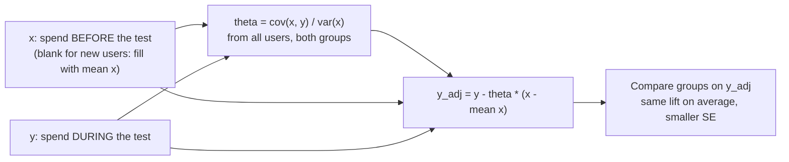

# Variance reduction with CUPED

Can pre-test behaviour make the test finish in half the time?

## Before you start

- Level: 3 (advanced).
- Time: about 2 hours.
- Builds on [Sample size before you test](../04-sample-size-before-you-test/) (how variance sets the number of users and days), [Linear regression from scratch](../11-linear-regression-from-scratch/) (covariance, the least squares slope and R squared), [A/B test from scratch](../03-ab-test-from-scratch/) (a difference, its standard error and interval) and [Ratio metrics and the delta method](../14-ratio-metrics-and-the-delta-method/) (the user as the unit, and checking a formula with a simulation). You need Python 3.9 or later.

## The problem

Pantrywren, a fictional grocery delivery app, ran a 14-day test of a "reorder your favourites" shelf on its home screen. Spend per user rose by 3.65 dollars, but with p = 0.08 the team cannot call it. Leah, the head of experimentation, says spend tests at Pantrywren always need about a month, which slows every team down. She has heard that using each user's spend from *before* the test can make tests shorter, and asks two things before next week's planning meeting: does it change the answer on the shelf test, and can spend tests run in half the time from now on? You will build CUPED from scratch, check it two independent ways, and give her an answer with its limits.

`data/users.csv` is synthetic, generated by `make_data.py` with a fixed seed: one row per user with their group, their spend in the 28 days before the test (blank for new users), their spend during the test, and their app sessions during the test. No row is a real person.

## In plain words

You want to know whether a new training plan makes runners faster. You time 100 runners on the new plan and 100 on the old one. The trouble is that runners differ hugely: some run 5 km in 18 minutes, some in 35. That spread swamps a small training effect. But you also have each runner's time from *last month*, before anyone started a plan. If you compare each runner with their own past, the spread between fast and slow runners mostly cancels and the training effect stands out.

CUPED does this, carefully. It uses something measured **before** the test to explain away part of the user-to-user spread in the test metric, so the same number of users gives a more precise answer, or the same precision needs fewer users.

Words you will use:

- **Covariate:** a number known about each user that may help explain the metric. Here, pre-test spend.
- **Pre-period:** the time before the test starts. A covariate from the pre-period cannot have been changed by the test.
- **CUPED (Controlled-experiment Using Pre-Experiment Data):** replace each user's metric y by y - theta x (x - mean(x)), where x is the covariate.
- **Theta:** how much of the covariate to subtract. The best theta is cov(x, y) / var(x), the least squares slope of y on x from lesson 11.
- **Variance reduction:** the share of the variance that CUPED removes, 1 - (new SE / old SE)^2. It is close to the squared correlation between x and y.
- **Correlation (r):** a number from -1 to 1 for how tightly two quantities move together; r squared is the share of variance one explains in the other.

## What you will build from scratch

- `read_users(path)` and `fill_missing(xs)`: the data, with a rule for users who have no pre-period.
- `theta(xs, ys)`: the coefficient.
- `cuped_adjust(xs, ys, theta)`: the adjusted metric.
- `diff_in_means(control, treatment)`: difference, unpooled standard error, p-value and interval.
- `summarise(path, covariate)`: raw and CUPED side by side, the variance reduction, and the share of users you would need.

## The idea



**Why the estimate stays honest.** The groups were split at random, so on average they have the same mean x. Subtracting theta x (x - mean(x)) therefore subtracts the same amount from both groups on average, and the difference in means of y_adj estimates the same lift as the difference in means of y. In any one test the groups differ a little in x by chance; CUPED corrects for that chance gap:

    lift_cuped = lift_raw - theta * (mean x in treatment - mean x in control)

**Why the variance falls.** For any theta,

    Var(y - theta x) = Var(y) - 2 theta Cov(x, y) + theta^2 Var(x)

This is a U-shaped curve in theta. Its lowest point is at theta = Cov(x, y) / Var(x), and the variance there is

    Var(y) * (1 - r^2)

where r is the correlation of x and y. So a covariate with r = 0.7 removes about 49% of the variance. Picking theta = 1 ("compare with the user's own past") is only best when x and y are on the same scale; otherwise it can make things worse.

**Why the test gets shorter.** The users you need for a given power is proportional to the variance (lesson 04):

    n per group = 2 * (z_alpha/2 + z_power)^2 * variance / (smallest lift worth detecting)^2

so a 50% variance reduction halves the users, and at a steady flow of new users, halves the days.

**Rules that keep it safe.**

1. The covariate must be measured before the split. Anything measured after can be changed by the treatment, and then subtracting it removes part of the effect itself.
2. Estimate theta once, from all users in both groups. That keeps the adjustment the same for both groups.
3. Users with no pre-period (new users) get x = mean(x), so their adjustment is 0. They stay in the test; they just get no help.
4. Decide the covariate before the test, as you decide the metric. Trying covariates until one gives a small p-value is the multiple comparisons problem from lesson 13.

## Walk through

Run each block from this folder. First, how strongly does pre-test spend predict test spend?

```python
import csv, math
users = list(csv.DictReader(open("data/users.csv", newline="")))
returning = [(float(u["pre_spend"]), float(u["spend"])) for u in users if u["pre_spend"]]
print(len(users), "users,", len(users) - len(returning), "with no pre-test history")
n = len(returning)
mx = sum(x for x, _ in returning) / n
my = sum(y for _, y in returning) / n
cov = sum((x - mx) * (y - my) for x, y in returning)
vx = sum((x - mx) ** 2 for x, _ in returning)
vy = sum((y - my) ** 2 for _, y in returning)
print("mean pre_spend %.2f  mean spend %.2f  correlation %.3f" % (mx, my, cov / math.sqrt(vx * vy)))
```

```text
1800 users, 219 with no pre-test history
mean pre_spend 108.25  mean spend 56.34  correlation 0.790
```

Among users with history, r = 0.79, so r squared is about 0.62. Pre-spend covers 28 days and test spend 14, so they are on different scales; theta will take care of that. The raw test:

```python
import csv, math
groups = {"control": [], "shelf": []}
for u in csv.DictReader(open("data/users.csv", newline="")):
    groups[u["variant"]].append(float(u["spend"]))

def mean_var(v):
    m = sum(v) / len(v)
    return m, sum((x - m) ** 2 for x in v) / (len(v) - 1)

(mc, vc), (ms, vs) = mean_var(groups["control"]), mean_var(groups["shelf"])
se = math.sqrt(vc / len(groups["control"]) + vs / len(groups["shelf"]))
diff = ms - mc
p = 2 * (1 - 0.5 * (1 + math.erf(abs(diff / se) / math.sqrt(2))))
print("control %.2f  shelf %.2f  diff %+.2f  se %.2f  p %.4f" % (mc, ms, diff, se, p))
print("95%% CI %+.2f to %+.2f" % (diff - 1.96 * se, diff + 1.96 * se))
```

```text
control 53.87  shelf 57.53  diff +3.65  se 2.07  p 0.0777
95% CI -0.41 to +7.71
```

Now theta, from every user in both groups, with new users filled at the mean:

```python
import csv, math
users = list(csv.DictReader(open("data/users.csv", newline="")))
present = [float(u["pre_spend"]) for u in users if u["pre_spend"]]
fill = sum(present) / len(present)
xs = [float(u["pre_spend"]) if u["pre_spend"] else fill for u in users]
ys = [float(u["spend"]) for u in users]
mx, my = sum(xs) / len(xs), sum(ys) / len(ys)
theta = sum((x - mx) * (y - my) for x, y in zip(xs, ys)) / sum((x - mx) ** 2 for x in xs)
adjusted = [y - theta * (x - mx) for x, y in zip(xs, ys)]
print("fill value %.2f  theta %.4f" % (fill, theta))
print("mean spend %.4f  mean adjusted %.4f" % (my, sum(adjusted) / len(adjusted)))
for name, v in (("spend", ys), ("adjusted", adjusted)):
    m = sum(v) / len(v)
    print("%-9s variance %.1f" % (name, sum((a - m) ** 2 for a in v) / (len(v) - 1)))
```

```text
fill value 108.25  theta 0.4376
mean spend 55.6843  mean adjusted 55.6843
spend     variance 1931.9
adjusted  variance 828.9
```

Theta is 0.44: every extra dollar of 28-day pre-spend predicts 44 cents more test spend. The adjusted metric has the same mean and less than half the variance. The test on it:

```python
import csv, math
users = list(csv.DictReader(open("data/users.csv", newline="")))
present = [float(u["pre_spend"]) for u in users if u["pre_spend"]]
fill = sum(present) / len(present)
xs = [float(u["pre_spend"]) if u["pre_spend"] else fill for u in users]
ys = [float(u["spend"]) for u in users]
mx, my = sum(xs) / len(xs), sum(ys) / len(ys)
theta = sum((x - mx) * (y - my) for x, y in zip(xs, ys)) / sum((x - mx) ** 2 for x in xs)

def test(values):
    g = {"control": [], "shelf": []}
    for u, v in zip(users, values):
        g[u["variant"]].append(v)
    out = []
    for name in ("control", "shelf"):
        m = sum(g[name]) / len(g[name])
        out.append((m, sum((a - m) ** 2 for a in g[name]) / (len(g[name]) - 1) / len(g[name])))
    diff = out[1][0] - out[0][0]
    se = math.sqrt(out[0][1] + out[1][1])
    p = 2 * (1 - 0.5 * (1 + math.erf(abs(diff / se) / math.sqrt(2))))
    return diff, se, p

raw = test(ys)
cuped = test([y - theta * (x - mx) for x, y in zip(xs, ys)])
for name, (diff, se, p) in (("raw", raw), ("cuped", cuped)):
    print("%-5s diff %+.2f  se %.2f  p %.4f  95%% CI %+.2f to %+.2f" % (name, diff, se, p, diff - 1.96 * se, diff + 1.96 * se))
print("variance reduction %.3f  users needed %.3f of the raw test" % (1 - (cuped[1] / raw[1]) ** 2, (cuped[1] / raw[1]) ** 2))
```

```text
raw   diff +3.65  se 2.07  p 0.0777  95% CI -0.41 to +7.71
cuped diff +4.27  se 1.35  p 0.0016  95% CI +1.61 to +6.92
variance reduction 0.573  users needed 0.427 of the raw test
```

The standard error falls from 2.07 to 1.35 dollars. The variance reduction, 0.573, is a little below the 0.62 among returning users, because the 219 new users get no help. Why did the lift itself move from 3.65 to 4.27? The control group happened to contain slightly heavier spenders before the test began:

```python
import csv
users = list(csv.DictReader(open("data/users.csv", newline="")))
present = [float(u["pre_spend"]) for u in users if u["pre_spend"]]
fill = sum(present) / len(present)
means = {}
for name in ("control", "shelf"):
    xs = [float(u["pre_spend"]) if u["pre_spend"] else fill for u in users if u["variant"] == name]
    means[name] = sum(xs) / len(xs)
    print("%-7s mean pre_spend %.2f" % (name, means[name]))
print("raw diff + theta x (control - shelf) = %.2f + %.2f = %.2f" % (
    3.6538, 0.4376 * (means["control"] - means["shelf"]), 3.6538 + 0.4376 * (means["control"] - means["shelf"])))
```

```text
control mean pre_spend 108.95
shelf   mean pre_spend 107.54
raw diff + theta x (control - shelf) = 3.65 + 0.62 = 4.27
```

The raw comparison was slightly handicapped by that chance gap; CUPED removes it. Both estimates are unbiased; CUPED's is the more precise one.

Now Leah's question. How many days does a spend test need to detect a 4 dollar lift with 80% power, at the 1,800 users per 14 days this test saw?

```python
import math
z = 1.959964 + 0.841621          # 95% two-sided, 80% power
mde = 4.0                        # the smallest lift worth detecting, dollars
per_day = 1800 / 14              # users entering the test each day
for name, var in (("raw", 1931.9), ("cuped", 828.9)):
    n = 2 * z ** 2 * var / mde ** 2
    print("%-5s %5d users per group  %3d days" % (name, math.ceil(n), math.ceil(2 * n / per_day)))
```

```text
raw    1896 users per group   30 days
cuped   814 users per group   13 days
```

That is where "spend tests need a month" comes from, and CUPED brings it to about two weeks, a little under half.

On the lesson data, `python3 solution/solution.py` prints:

```
covariate pre_spend n {'control': 908, 'shelf': 892} missing 219 theta 0.4376
  raw   diff +3.65  se 2.07  p 0.0777  ci (-0.41, +7.71)
  cuped diff +4.27  se 1.35  p 0.0016  ci (+1.61, +6.92)
  variance_reduction 0.573  users_needed_share 0.427
covariate test_sessions n {'control': 908, 'shelf': 892} missing 0 theta 6.8576
  raw   diff +3.65  se 2.07  p 0.0777  ci (-0.41, +7.71)
  cuped diff -18.92  se 1.28  p 0.0000  ci (-21.43, -16.40)
  variance_reduction 0.616  users_needed_share 0.384
```

The second block is the trap below.

## Common mistakes

1. **Using a covariate measured after the split (the trap).** Sessions during the test predict spend even better than pre-spend, and the solution's second block shows an even bigger "variance reduction", 0.616. But the lift becomes *minus* 18.92 dollars with p below 0.0001: the shelf now looks like it destroys spend.

```python
import csv, math
users = list(csv.DictReader(open("data/users.csv", newline="")))
ys = [float(u["spend"]) for u in users]

def adjusted_test(xs, theta):
    mx = sum(xs) / len(xs)
    g = {"control": [], "shelf": []}
    for u, x, y in zip(users, xs, ys):
        g[u["variant"]].append(y - theta * (x - mx))
    out = []
    for name in ("control", "shelf"):
        m = sum(g[name]) / len(g[name])
        out.append((m, sum((a - m) ** 2 for a in g[name]) / (len(g[name]) - 1) / len(g[name])))
    return out[1][0] - out[0][0], math.sqrt(out[0][1] + out[1][1])

xs = [float(u["test_sessions"]) for u in users]
mx, my = sum(xs) / len(xs), sum(ys) / len(ys)
theta = sum((x - mx) * (y - my) for x, y in zip(xs, ys)) / sum((x - mx) ** 2 for x in xs)
diff, se = adjusted_test(xs, theta)
print("covariate test_sessions: theta %.2f  diff %+.2f  se %.2f" % (theta, diff, se))
for name in ("control", "shelf"):
    s = [float(u["test_sessions"]) for u in users if u["variant"] == name]
    print("  mean test_sessions %-7s %.2f" % (name, sum(s) / len(s)))
```

```text
covariate test_sessions: theta 6.86  diff -18.92  se 1.28
  mean test_sessions control 7.55
  mean test_sessions shelf   10.84
```

   The shelf made people open the app more often, so the shelf group has more sessions. Subtracting 6.86 dollars per extra session takes out far more than the shelf's real effect on spend. The randomisation only guarantees that the groups match on things fixed *before* the split. A covariate that the treatment can move is not a covariate, it is a second outcome.

2. **Setting theta to 1 ("compare each user with their own past").** It sounds natural, but pre-spend covers 28 days and test spend 14:

```python
import csv, math
users = list(csv.DictReader(open("data/users.csv", newline="")))
present = [float(u["pre_spend"]) for u in users if u["pre_spend"]]
fill = sum(present) / len(present)
xs = [float(u["pre_spend"]) if u["pre_spend"] else fill for u in users]
ys = [float(u["spend"]) for u in users]
mx = sum(xs) / len(xs)
for theta in (0.0, 0.4376, 1.0):
    g = {"control": [], "shelf": []}
    for u, x, y in zip(users, xs, ys):
        g[u["variant"]].append(y - theta * (x - mx))
    var = 0.0
    for v in g.values():
        m = sum(v) / len(v)
        var += sum((a - m) ** 2 for a in v) / (len(v) - 1) / len(v)
    print("theta %.4f  se %.2f" % (theta, math.sqrt(var)))
```

```text
theta 0.0000  se 2.07
theta 0.4376  se 1.35
theta 1.0000  se 2.42
```

   Theta = 0 is the raw test. Theta = 1 is *worse* than doing nothing, because it subtracts a quantity about twice the size of the metric. Estimate theta; do not assume it.

3. **Dropping users with no pre-period.** Removing the 219 new users makes the correlation look better, but it changes who the result is about: the shelf's effect on returning users only. If new users react differently (a shelf of "favourites" is empty for them), the launch decision is made on the wrong population. Keep them, filled at the mean.

4. **Estimating theta separately in each group, or after looking.** Separate thetas adjust the two groups by different rules, which makes the estimate harder to reason about and can add bias in small samples; one theta from both groups keeps the adjustment identical. Searching for the covariate that gives the smallest p-value is a hidden family of tests (lesson 13). Fix the covariate and the rule before the test.

5. **Promising the same speed-up for every test.** The reduction is about r squared for the users who have history. A test on a new-user onboarding flow has no pre-period at all and gets nothing. A metric that is weakly tied to past behaviour (for example, use of a brand new feature) gets little.

## Your turn

Open `exercise.py` and write the six functions. The formulas are in The idea. Then run, from this folder:

    python3 test_lesson.py

The test checks theta against the least squares slope computed from raw sums and checks that nudging theta either way increases the variance. It checks the variance reduction against the observed variances, against the squared correlation, and against 1,000 A/A shuffles of the group labels, where the CUPED estimates must spread less than the raw ones by about the reduction you report and must average about zero. All of this runs on the committed data and on a second dataset built with another seed. To see the reference solution pass: `CHECK_SOLUTION=1 python3 test_lesson.py`.

Stretch: add a second pre-period covariate, such as pre-test order count, and fit theta for both at once with least squares on two variables. How much more variance does it remove than pre-spend alone, and is it worth the extra rule to explain?

## Check yourself

1. Why does CUPED not change what the test estimates, only how precisely?
2. Your covariate has a correlation of 0.5 with the metric. About how much shorter can the test be?
3. Someone proposes using "number of times the user saw the new shelf" as the CUPED covariate. What do you say?
4. A test has 60% new users with no history and r = 0.8 among the rest. Roughly what variance reduction do you expect, and why less than 0.64?

<details>
<summary>Answers</summary>

1. Because the groups were randomised, the mean of the covariate is the same in both groups on average, so the subtracted term cancels in the difference on average. It removes noise that is unrelated to the treatment, not the treatment's effect.
2. r squared is 0.25, so about 25% less variance, users and days: a 4-week test becomes about 3 weeks.
3. No: it is measured after the split and the treatment changes it (control users never see the shelf). Subtracting it would remove part of the effect, or reverse it, as test_sessions did. Use only pre-period data.
4. Only the 40% with history get help, so roughly 0.4 x 0.64, about 0.26. New users are filled at the mean, so their spread stays as it was.

</details>

## What to tell the stakeholder

"Yes, for spend tests on existing customers. Adjusting for each user's spend in the 28 days before the test (CUPED) removed 57% of the noise on the shelf test, which means a spend test that needed about 30 days to detect a 4 dollar lift needs about 13. On the shelf itself, the adjusted result is a 4.27 dollar rise in spend per user over 14 days (95% range 1.61 to 6.92 dollars, p = 0.002), so I recommend shipping it. I recommend we make CUPED with pre-test spend the default for spend tests, written into the plan before each test starts." Limits: the gain depends on how well past behaviour predicts the metric, so tests on new users or brand new features get little or none; the covariate must come from before the split; and the speed-up should be re-checked on each test rather than assumed.

## In real job postings

In the Real Analyst Jobs data drop of 25 October 2026, 528 of the 2,789 US analyst postings (18.9%) were labelled Senior or Lead / Staff, the levels where running a faster, well-powered experiment programme is part of the job. See [product analyst jobs](https://realanalystjobs.com/jobs/product-analyst-jobs) and the [sample size calculator](https://realanalystjobs.com/tools/sample-size-calculator) to see how variance drives the number of users a test needs.

## Next

This is the last lesson in the phase. Back to the [phase overview](../README.md), or go on to [03 Metrics and product analytics](../../03-metrics-and-product-analytics/).
