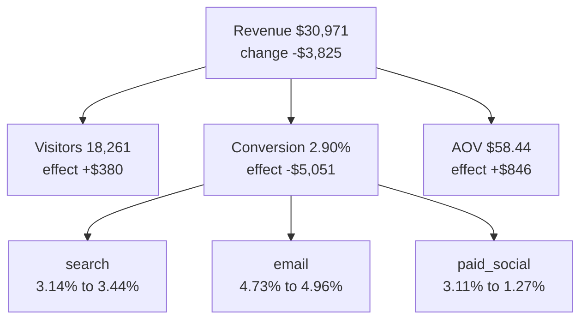

# Metric trees

Business question: revenue fell this week, so which part of the business made it fall?

## Before you start

- **Level:** 2 (intermediate).
- **Time:** about 2 hours.
- **Builds on:** [GROUP BY from raw rows](../../01-sql/01-group-by-from-raw-rows/) (adding up rows per group) and basic Python: a loop, a dictionary and reading a CSV with `csv.DictReader`.
- **You need:** Python 3.9 or later. Nothing to install.

## The problem

Brightloom, a fictional home goods shop, made less money in the week of 12 October than in the week before. Priya, the head of growth, has a Monday standup and wants one sentence: did we lose traffic, did people stop buying, or did they buy cheaper things? Looking at revenue alone cannot answer that, because revenue is the product of several smaller numbers. You will break revenue into a tree, measure how much of the drop each branch explains, and then drill one level down into traffic channels to find where it started.

The file `data/daily_channels.csv` is synthetic, generated by `make_data.py` with a fixed seed. It has one row per day and channel (search, email, paid_social) from 5 to 18 October 2026, with visitors, orders and revenue.

## In plain words

Think of a street food stall. Takings for the day are the number of people who walk past, times the share of them who stop and buy, times how much each buyer spends. If takings fall, the owner wants to know which of the three moved: fewer people on the street, fewer people stopping, or smaller orders. Each one has a different fix (a better spot, a better sign, a combo deal).

A **metric tree** is that idea written down. The top number (revenue) is split into branches (visitors, conversion, average order value) that multiply back to it. When the top number changes, you hand out the change to the branches, in dollars, so the parts add up to the whole.

Terms used in this lesson:

- **Visitors:** people who came to the website in the week.
- **Conversion:** the share of visitors who placed an order, orders / visitors.
- **AOV (average order value):** revenue / orders, the average basket in dollars.
- **Effect of a branch:** how many dollars of the revenue change that branch explains.
- **Drill down:** split a branch by a dimension (here, traffic channel) and look at each slice.
- **Mix effect:** a total average that moves only because the share of each group changed, not because any group changed.

## What you will build from scratch

- `build_tree(visitors, orders, revenue)`: the three branches of the revenue tree.
- `load_weeks(path, split_date, channel=None)`: prior week and current week trees from the raw daily rows, optionally for one channel.
- `log_mean(a, b)`: the logarithmic mean, the weight that makes the split exact.
- `decompose(prior, current)`: how many dollars of the change each branch explains, with effects that add up exactly to the total, including when revenue is flat.
- `main_driver(effects)`: the branch that explains the most.

## The idea

A metric tree writes a top-line number as a product (or sum) of smaller numbers that different teams own. For an online shop:

    revenue    = visitors x conversion x aov
    conversion = orders / visitors
    aov        = revenue / orders        (average order value)

Multiply the right side out and the visitors and orders cancel, so the identity is exact for any period. Marketing owns visitors, product owns conversion, merchandising and pricing own AOV. Here is the tree for this lesson's current week, with each branch's effect on the change from the prior week (computed in the walk through below):



The three effects add up to the change: 380 - 5,051 + 846 = -3,825. The channel boxes under conversion are the drill down: only paid social fell.

**Why logs.** When revenue changes from R0 to R1, every factor changes too, and the question is how to split the dollar change R1 - R0 between them. A product is hard to split; a sum is easy. The natural log (written ln, the `math.log` function in Python) turns multiplication into addition:

    ln(2 x 3) = ln 2 + ln 3        1.792 = 0.693 + 1.099

So the log of the revenue ratio is a sum of one term per branch:

    ln(R1 / R0) = ln(V1 / V0) + ln(C1 / C0) + ln(A1 / A0)

**From log points to dollars.** Multiply every term by the same weight L, chosen so that L x ln(R1 / R0) equals the dollar change R1 - R0. That weight is the **logarithmic mean** of the two revenues:

    L(a, b) = (a - b) / (ln a - ln b)      and L(a, a) = a
    effect_f = L(R1, R0) x ln(f1 / f0)

This method is called **LMDI** (logarithmic mean Divisia index), so you can look it up. Three properties make it the right tool:

1. The three effects always add up exactly to R1 - R0.
2. The answer does not depend on the order you list the factors in.
3. It still works when revenue did not change. L(a, a) = a is the limit of the formula as b gets close to a, so there is no division by zero. If visitors rose 10% and conversion fell by the same ratio, revenue is flat, but the split is +$228.74 for visitors and -$228.74 for conversion, not zero. Two things moved and cancelled, and that is worth reporting.

**The one case logs cannot handle is a zero.** ln 0 is undefined, so if revenue or any factor is 0 in either week (a channel slice with no orders, for example), there is no log split. `decompose` then returns None for the three effects and only fills in the total. Report that slice by its raw numbers ("0 orders last week, 10 this week") instead.

A tree tells you which branch moved, not why. Once you know the branch, cut it by a dimension (channel, device, country) and run the same decomposition on each slice.

## Walk through

Step 1. A small worked example. Last week 1,000 visitors placed 40 orders worth $2,400. This week 1,100 visitors placed 33 orders worth $1,980.

```python
import math

def log_mean(a, b):
    return float(a) if a == b else (a - b) / (math.log(a) - math.log(b))

prior = {"visitors": 1000, "conversion": 40 / 1000, "aov": 2400 / 40, "revenue": 2400.0}
current = {"visitors": 1100, "conversion": 33 / 1100, "aov": 1980 / 33, "revenue": 1980.0}
w = log_mean(current["revenue"], prior["revenue"])
effects = {f: w * math.log(current[f] / prior[f]) for f in ("visitors", "conversion", "aov")}
print(round(w, 2))
print(round(current["revenue"] - prior["revenue"], 2), {f: round(v, 2) for f, v in effects.items()})
print(round(sum(effects.values()), 2))
```

Line by line: `log_mean` returns `a` when the two values are equal and the formula otherwise. Each tree holds the three factors and the revenue. `w` is the weight that turns log changes into dollars. Each effect is that weight times the log of the factor's ratio. It prints:

```
2183.27
-420.0 {'visitors': 208.09, 'conversion': -628.09, 'aov': 0.0}
-420.0
```

Traffic grew and added about $208, AOV stayed at $60, and the conversion drop from 4.0% to 3.0% cost about $628. The effects add up to the $420 drop.

Step 2. Now the lesson data. Sum the daily rows into two weeks, split on 12 October. Dates are text in `YYYY-MM-DD` form, so comparing them as text puts them in date order.

```python
import csv
sums = {"prior": [0, 0, 0.0], "current": [0, 0, 0.0]}
with open("data/daily_channels.csv", newline="") as f:
    for row in csv.DictReader(f):
        k = "prior" if row["date"] < "2026-10-12" else "current"
        sums[k][0] += int(row["visitors"])
        sums[k][1] += int(row["orders"])
        sums[k][2] += float(row["revenue"])
print({k: [v[0], v[1], round(v[2], 2)] for k, v in sums.items()})
```

```
{'prior': [18051, 611, 34796.15], 'current': [18261, 530, 30971.09]}
```

Step 3. Build the two trees and decompose. Running `python3 solution/solution.py` (after you have tried the exercise) prints:

```
prior    visitors  18051  orders  611  revenue  34796.15  conversion 0.0338  aov 56.95
current  visitors  18261  orders  530  revenue  30971.09  conversion 0.0290  aov 58.44
{'total': -3825.06, 'visitors': 379.92, 'conversion': -5051.35, 'aov': 846.37} driver: conversion
search       revenue change    972.83  conversion 0.0314 -> 0.0344  aov 57.04 -> 56.85  driver: conversion
email        revenue change   1263.29  conversion 0.0473 -> 0.0496  aov 62.25 -> 63.97  driver: visitors
paid_social  revenue change  -6061.18  conversion 0.0311 -> 0.0127  aov 53.15 -> 53.75  driver: conversion
```

| week | visitors | orders | revenue | conversion | AOV |
|---|---|---|---|---|---|
| prior | 18,051 | 611 | $34,796.15 | 3.38% | $56.95 |
| current | 18,261 | 530 | $30,971.09 | 2.90% | $58.44 |

Revenue fell by $3,825.06. Visitors explain +$379.92, conversion explains -$5,051.35 and AOV explains +$846.37. Conversion is the driver: without the conversion drop, revenue would have gone up.

Step 4. Drill down by channel with the same functions (the last three lines above). Search revenue rose $972.83 and email rose $1,263.29, while paid_social fell $6,061.18. Paid social conversion went from 3.11% to 1.27% while its traffic grew.

The AOV rise is a side effect. Fewer orders came from paid social, which has the cheapest baskets, so the average order across all channels went up, even though no channel's AOV moved by more than about 3% (the biggest move is email, $62.25 to $63.97). That is a mix effect, and it is why you always drill down before you report a branch as good news.

## Common mistakes

**1. The flat-revenue shortcut (the trap).** A popular way to write the split is `effect_f = total x ln(f1/f0) / ln(R1/R0)`. It gives the same numbers as LMDI whenever revenue changed. But when revenue is flat, `ln(R1/R0)` is 0, the formula is 0 / 0, and a common patch is "then every effect is 0". That is wrong:

```python
import math
r0 = r1 = 2400.0
print(r1 - r0, math.log(r1 / r0))
print(round(2400.0 * math.log(1100 / 1000), 2), round(2400.0 * math.log((40 / 1100) / (40 / 1000)), 2))
```

```
0.0 0.0
228.74 -228.74
```

The first line is the 0 / 0. The second is the LMDI answer for 1,000 to 1,100 visitors with 40 orders and $2,400 both weeks: visitors added $228.74 and the conversion drop took the same amount away. The shortcut reports 0, 0, 0 and hides both moves. The test `test_flat_revenue_with_moving_factors` checks exactly this case.

**2. Changing one factor at a time.** Swap in this week's visitors, then this week's conversion, then this week's AOV, and record how revenue moves at each swap. The effects do add up, but they depend on the order you swap in:

```python
prior = {"visitors": 18051, "conversion": 611 / 18051, "aov": 34796.15 / 611}
current = {"visitors": 18261, "conversion": 530 / 18261, "aov": 30971.09 / 530}

def one_at_a_time(order):
    tree, out = dict(prior), {}
    for f in order:
        before = tree["visitors"] * tree["conversion"] * tree["aov"]
        tree[f] = current[f]
        out[f] = round(tree["visitors"] * tree["conversion"] * tree["aov"] - before, 2)
    return out

print(one_at_a_time(["visitors", "conversion", "aov"]))
print(one_at_a_time(["aov", "conversion", "visitors"]))
```

```
{'visitors': 404.81, 'conversion': -5017.72, 'aov': 787.85}
{'aov': 908.26, 'conversion': -5089.48, 'visitors': 356.16}
```

The AOV effect is $787.85 or $908.26 depending on a choice nobody can defend. LMDI gives $846.37 whatever the order.

**3. Adding percentage changes.** Visitors rose 1.16%, conversion fell 14.25% and AOV rose 2.61%. Those add to -10.48%, but revenue fell 10.99%. Percentage changes multiply (1.0116 x 0.8575 x 1.0261), they do not add. Use the dollar effects when you want parts that add up.

**4. Reporting a branch as good news without drilling down.** AOV rose, but only because the cheap paid social orders disappeared. Check the mix before you credit a branch.

## Your turn

Open `exercise.py` and fill in the five functions using only `csv` and `math`. Then run, from this folder:

    python3 test_lesson.py

The tests use the committed data, a second dataset built with another seed, and small hand-made cases: flat revenue with moving factors, a slice with zero orders, and a tie. To see the reference solution pass: `CHECK_SOLUTION=1 python3 test_lesson.py`. To print the full tree and channel drill down: `python3 solution/solution.py`.

Stretch: write `decompose_channels(path, split_date)` that splits the total revenue change into one effect per channel (a sum tree: total revenue is the sum of channel revenues) and check that the three channel changes add up to -$3,825.06.

Check week over week changes by hand with the [percentage change calculator](https://realanalystjobs.com/tools/percentage-change-calculator).

## Check yourself

1. Revenue is down 11%. Why is "revenue is down" not a useful answer for a standup?
2. Why use the log method instead of changing one factor at a time?
3. Revenue was exactly flat week over week. Can a metric tree still tell you something?
4. AOV went up this week. Is that good news?
5. Name another metric tree you could build for a subscription app.

<details>
<summary>Answers</summary>

1. Nobody can act on it. Each branch has an owner and a different fix, so the useful answer names the branch (conversion) and the slice (paid social) that moved.
2. One at a time gives a different split depending on the order you swap the factors in (here the AOV effect is $787.85 or $908.26). The LMDI split is symmetric and the parts always add up to the total.
3. Yes. Flat revenue can hide two branches moving in opposite directions, for example more visitors and worse conversion. LMDI shows both effects (+$228.74 and -$228.74 in the example), and the conversion drop may need fixing before traffic stops growing.
4. Not on its own. Here it rose because the channel mix shifted away from low-value paid social orders, so it is a side effect of the problem, not a win. Check the mix before you credit a branch.
5. For example: revenue = paying users x revenue per paying user, and paying users = active users x paid conversion rate. Or monthly recurring revenue = new + expansion - contraction - churned revenue, which is a sum tree instead of a product.

</details>

## What to tell the stakeholder

To Priya: "Revenue fell $3.8k (11%) week over week. Traffic was flat and order values were fine; the drop is conversion, which cost about $5.1k, and it is all in paid social, where conversion fell from 3.1% to 1.3% while traffic grew. The small AOV rise is a side effect of losing cheap paid social orders, not a win. Check the paid social landing page and ad targeting first. The split says which branch moved, not why."

## In real job postings

In the Real Analyst Jobs data drop of 25 October 2026, 71.8% of the 2,056 US analyst postings that name a tool ask for SQL and 36.0% ask for Tableau, the tools usually used to build and show a revenue tree like this one. See [SQL data analyst jobs](https://realanalystjobs.com/jobs/sql-data-analyst-jobs) and [Tableau for analyst jobs](https://realanalystjobs.com/skills/tableau).

## Next

[02: Funnel conversion](../02-funnel-conversion/)

This is the first lesson of the phase. The previous phase is [02 Statistics and experiments](../../02-statistics-and-experiments/).
