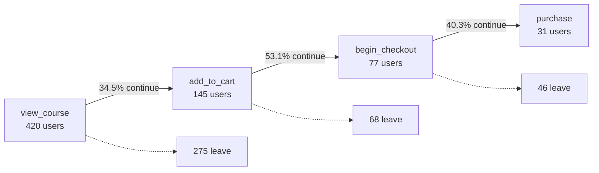

# Funnel conversion

Business question: of the people who look at a course, how many buy it, and at which step do we lose the most of them?

## Before you start

- **Level:** 1 (beginner).
- **Time:** about 2 hours.
- **Builds on:** [GROUP BY from raw rows](../../01-sql/01-group-by-from-raw-rows/) (COUNT, GROUP BY) and [Window functions](../../01-sql/03-window-functions/) (LAG). The [metric trees](../01-metric-trees/) lesson helps but is not required.
- **You need:** Python 3.9 or later, which includes SQLite. Nothing to install.

## The problem

Learnhaven, a fictional online course shop, has a four-step path to a sale: view a course page, add it to the cart, begin checkout, purchase. Marco, the product lead, has budget for one design sprint this quarter and must name the step it will work on by Friday. A dashboard tile says checkout converts at 15%, which sounds alarming, but nobody has checked how it was counted. You have the raw event log for two weeks of October 2026. You will build the funnel in SQL from those events, user by user, and show Marco where people really drop.

The file `data/events.csv` is synthetic, generated by `make_data.py` with a fixed seed. It has 1,971 events from 435 made-up users.

## In plain words

Picture a food delivery app. Of 100 people who open a restaurant's menu, 35 put something in the basket, 18 tap "checkout" and 7 pay. Each step loses some people. A **funnel** is that list of steps with the number of people still there at each one, like a kitchen funnel that gets narrower as you go down.

The important word is *people*. If one hungry person opens the menu six times, that is still one person at the first step. Counting taps instead of people makes every step look different from what it is.

Terms used in this lesson:

- **Event:** one row in the log, one thing a user did at one time (viewed a page, clicked a button).
- **Step:** one stage of the funnel, defined by an event name.
- **Step conversion:** of the users who reached the previous step, the share who reached this one.
- **Overall conversion:** of the users who reached step 1, the share who reached this step.
- **Drop-off:** the users who reached a step but not the next one.

## What you will build from scratch

- `events_per_step`: raw event counts next to distinct user counts, to see the trap.
- `funnel`: users who reached each step in order, with step conversion and overall conversion.
- `biggest_drop`: the transition that loses the largest share of users.

## The idea

A funnel is an ordered list of steps. A user reaches step n only if they did steps 1 to n, in that order. For each step:

    users(n)              = distinct users who reached step n in order
    step_conversion(n)    = users(n) / users(n - 1)
    overall_conversion(n) = users(n) / users(1)

Overall conversion is the product of the step conversions, so the funnel is a metric tree like the one in [lesson 01](../01-metric-trees/): improve any single step and the end number moves. Here is this lesson's funnel, with the drop-off at each step (computed in the walk through below):



Three rules decide whether the funnel is right.

1. **Count users, not events.** A user who views a course six times is one user at step 1. Events measure activity, not progress. If you divide purchase events by checkout events, every retry of a failed card counts against you.
2. **Require the earlier steps.** A user who added to cart from a saved link but never viewed a course page did not enter this funnel. Counting them at step 2 makes step 2 look better than it is.
3. **Require the order.** Use the first time each user did each step and check that it is at or after the first time they did the step before. This simplified rule is good enough for most dashboards; a strict version would also check that every step happened inside one session or time window.

In SQL, the clean way is one row per user with the first time of each step:

    MIN(CASE WHEN event_name = 'view_course' THEN event_time END) AS t1

`CASE WHEN ... THEN ... END` keeps the time when the row is that step and gives NULL (no value) otherwise, and `MIN` skips NULLs, so `t1` is the user's first course view, or NULL if they never viewed one.

Then a 0 or 1 flag per step, for example step 3 is reached when `t1 IS NOT NULL AND t2 >= t1 AND t3 >= t2`:

    CASE WHEN t1 IS NOT NULL AND t2 >= t1 AND t3 >= t2 THEN 1 ELSE 0 END AS s3

A comparison with NULL is never true, so a user missing a step gets 0. `SUM(s3)` counts the users who reached step 3.

Two notes on portability:

- **SQLite only:** SQLite also lets you write `SUM(t2 >= t1)`, because it stores a comparison as 0 or 1. PostgreSQL, SQL Server and BigQuery do not add up true/false values that way, so use `SUM(CASE WHEN ... THEN 1 ELSE 0 END)`, which works everywhere.
- **Text timestamps:** `event_time` is text like `2026-10-01 09:15:00`. Comparing text gives the right time order only because this ISO format puts the biggest unit first and every part has a fixed width. `1/10/2026 9:15` would sort wrongly. In other databases, store a real timestamp type.

Window functions (functions that look at other rows without collapsing them) turn the counts into rates: `LAG(users)` is the previous step and `FIRST_VALUE(users)` is step 1.

## Walk through

Step 1. Look at the trap first: events and users per step.

```sql
SELECT event_name, COUNT(*) AS events, COUNT(DISTINCT user_id) AS users
FROM events
GROUP BY event_name
ORDER BY CASE event_name
  WHEN 'view_course' THEN 1 WHEN 'add_to_cart' THEN 2
  WHEN 'begin_checkout' THEN 3 WHEN 'purchase' THEN 4 END;
```

`COUNT(*)` counts rows (events). `COUNT(DISTINCT user_id)` counts each user once. The `ORDER BY CASE` puts the steps in funnel order instead of alphabetical order.

| event_name | events | users |
|---|---|---|
| view_course | 1,498 | 420 |
| add_to_cart | 231 | 160 |
| begin_checkout | 211 | 86 |
| purchase | 31 | 31 |

The dashboard's 15% is 31 purchase events over 211 checkout events (14.7%). Checkout events are inflated by users who started checkout several times.

Step 2. One row per user with the first time of each step.

```sql
SELECT
  user_id,
  MIN(CASE WHEN event_name = 'view_course' THEN event_time END) AS t1,
  MIN(CASE WHEN event_name = 'add_to_cart' THEN event_time END) AS t2,
  MIN(CASE WHEN event_name = 'begin_checkout' THEN event_time END) AS t3,
  MIN(CASE WHEN event_name = 'purchase' THEN event_time END) AS t4
FROM events
GROUP BY user_id
ORDER BY user_id
LIMIT 5;
```

| user_id | t1 | t2 | t3 | t4 |
|---|---|---|---|---|
| 1 | 2026-10-09 18:41:20 | NULL | NULL | NULL |
| 2 | 2026-10-10 17:50:51 | 2026-10-10 18:17:55 | NULL | NULL |
| 3 | 2026-10-12 21:43:11 | NULL | NULL | NULL |
| 4 | 2026-10-10 16:42:03 | NULL | NULL | NULL |
| 5 | 2026-10-12 21:29:10 | NULL | NULL | NULL |

User 2 viewed a course and added it to the cart 27 minutes later; the others only viewed.

Step 3. Turn those times into a flag per step and count. Here is the count for step 2 alone, to show the saved cart users dropping out. `WITH firsts AS (...)` names the per-user table so the next query can read from it (a CTE, common table expression).

```sql
WITH firsts AS (
  SELECT user_id,
    MIN(CASE WHEN event_name = 'view_course' THEN event_time END) AS t1,
    MIN(CASE WHEN event_name = 'add_to_cart' THEN event_time END) AS t2
  FROM events
  GROUP BY user_id
)
SELECT
  SUM(CASE WHEN t2 IS NOT NULL THEN 1 ELSE 0 END) AS added_to_cart_any_way,
  SUM(CASE WHEN t1 IS NOT NULL AND t2 >= t1 THEN 1 ELSE 0 END) AS added_to_cart_in_funnel
FROM firsts;
```

That returns 160 and 145. The 15 users who came in through a saved cart link never viewed a course, so they are not in this funnel.

Step 4. Build one flag per step, then stack the four counts into one table with `UNION ALL` (it puts the rows of several SELECTs one under the other and keeps every row; plain `UNION` would also remove duplicate rows). Add the rates with `LAG` and `FIRST_VALUE`. The full query is in `solution/solution.sql` once you have tried it. The result:

| step | users | step conversion | overall conversion |
|---|---|---|---|
| view_course | 420 | 100.0% | 100.0% |
| add_to_cart | 145 | 34.5% | 34.5% |
| begin_checkout | 77 | 53.1% | 18.3% |
| purchase | 31 | 40.3% | 7.4% |

Checkout converts at 40.3% of users, not 15%. The leakiest step is view to cart: 275 of the 420 viewers (65.5%) never add the course to the cart. That is what `biggest_drop` returns: `view_course, add_to_cart, 275, 34.5`.

Step 5. Leakiest is not the same as best to fix. Overall conversion is the product of the step conversions, so the same relative improvement at any step moves purchases by the same percentage. Lift view to cart by a tenth, or checkout to purchase by a tenth, and you get the same result:

```sql
SELECT
  ROUND(100.0 * 145 / 420 * 1.1, 1) AS view_to_cart_after,
  ROUND(100.0 * 31 / 77 * 1.1, 1) AS checkout_to_purchase_after,
  ROUND(31 * 1.1, 1) AS purchases_after_either;
```

That returns 38.0, 44.3 and 34.1. Either change takes purchases from 31 to about 34. The first step of most funnels also converts lowest for a reason that is not a design flaw: many viewers are only browsing. So the question for Marco is which step can most cheaply get a given lift, and the course page is a strong hypothesis (most people lost, plenty of room), not a verdict.

## Common mistakes

**1. Dividing events by events (the trap).** Purchase events over checkout events gives 14.7%, because 86 users fired 211 checkout events. By users, checkout converts at 40.3%. The dashboard tile makes a healthy step look broken.

**2. Not requiring the earlier steps.** Counting every user who added to cart gives 160 at step 2; only 145 of them viewed a course first. The 15 saved cart users inflate step 2 and then shrink step 3 for no reason.

**3. Writing `SUM(t2 >= t1)` and moving to another database.** It works in SQLite and fails or behaves differently elsewhere. Write `SUM(CASE WHEN t2 >= t1 THEN 1 ELSE 0 END)`.

**4. Adding a time window without handling late starters.** If the rule is "purchase within 24 hours of the first view", a user who first viewed a course 2 hours before the data ends has not had 24 hours yet. Counting them as lost makes the newest days look worse. This is called **right censoring**: their outcome is not known yet. Only judge users whose first view is at least 24 hours before the end of the data:

```sql
WITH firsts AS (
  SELECT user_id, MIN(CASE WHEN event_name = 'view_course' THEN event_time END) AS t1
  FROM events
  GROUP BY user_id
)
SELECT COUNT(*) AS too_new_to_judge
FROM firsts
WHERE t1 > datetime((SELECT MAX(event_time) FROM events), '-1 day');
```

That returns 22. (`datetime(x, '-1 day')` is SQLite; PostgreSQL writes `x - INTERVAL '1 day'`.) In this log every purchase happens within 2 hours of the user's first view (the slowest takes 1 hour 45 minutes), so a 24 hour window changes no counts here, but on a real product with slow buyers it would.

**5. Picking the step with the lowest conversion and stopping there.** See step 5: the same relative lift anywhere gives the same gain. Compare how much lift each step can realistically get and what it costs.

## Your turn

Open `exercise.sql` and write the three queries under their markers. Then run, from this folder:

    python3 test_lesson.py

The tests run your queries on the committed data, on a second dataset built with another seed, and on tiny hand-made logs: a tie between two steps, a NULL time, a cart before the first view, zero purchases and an empty table. On a tie, `biggest_drop` returns the earlier transition. To see the reference solution pass: `CHECK_SOLUTION=1 python3 test_lesson.py`.

Stretch: add a `funnel_24h` query that only counts a step if it happened within 24 hours of the user's first view, and leaves out users whose first view is less than 24 hours before the end of the data.

For more practice on the same skills, try the [SQL case study](https://realanalystjobs.com/tools/sql-case-study).

## Check yourself

1. Why is purchase events divided by checkout events a bad checkout conversion rate?
2. Step conversion and overall conversion: which do you use to pick the step to work on?
3. A user added to cart before ever viewing a course. Should they count at step 2?
4. The funnel above has no time limit. What changes if you require purchase within 24 hours of the first view?

<details>
<summary>Answers</summary>

1. One user can fire many checkout events (retries, page reloads, a declined card), so the denominator counts activity, not people. Divide distinct users who purchased by distinct users who began checkout.
2. Step conversion shows where the funnel leaks, relative to the users who got that far. Overall conversion shows the end result. Because overall conversion is a product of the steps, a 10% relative lift at any step raises purchases by 10%. So use step conversion and users lost to find candidates, then choose by how much lift each step can realistically get and what that work costs.
3. Not in this funnel. The funnel describes the path from viewing a course. Those users came in another way, and you can build a separate funnel for them.
4. Slow buyers who take longer than 24 hours drop out, so later steps get smaller, and the funnel becomes comparable across weeks because every user had the same time to finish. But that only holds if you also exclude users whose first view is less than 24 hours before the end of the data. They have not had their full 24 hours yet (right censoring), and counting them as lost makes the latest days look worse.

</details>

## What to tell the stakeholder

To Marco: "7.4% of people who view a course buy it. Checkout is not the problem: by people it converts at 40%, and the 15% on the dashboard counts retries as separate people. The most people leave at the course page, where only 34.5% of viewers add to cart and 275 of 420 leave. I suggest the sprint tests the course page, because that is where the most people are, but a 10% lift at any step adds the same 3 or so purchases, so if checkout work is much cheaper it is worth comparing. These are two weeks of data with 31 buyers, so treat small differences between steps with care."

## In real job postings

In the Real Analyst Jobs data drop of 25 October 2026, 71.8% of the 2,056 US analyst postings that name a tool ask for SQL, and 70.4% of the 900 India postings that name a tool do too. Funnel queries from raw events are a standard SQL interview task; see [SQL data analyst jobs](https://realanalystjobs.com/jobs/sql-data-analyst-jobs) and [data analyst interview questions](https://realanalystjobs.com/tools/data-analyst-interview-questions).

## Next

[03: Active users and stickiness](../03-active-users-and-stickiness/)
