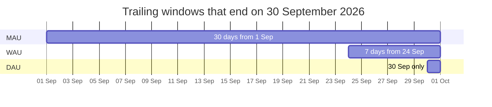

# Active users and stickiness

Business question: how many people really use the app, and how often do they come back?

## Before you start

- **Level:** 1 (beginner).
- **Time:** about 2 hours.
- **Builds on:** [GROUP BY from raw rows](../../01-sql/01-group-by-from-raw-rows/) (a loop with a dictionary) and [Funnel conversion](../02-funnel-conversion/) (count users, not events). Basic Python: a loop, a dictionary, a set.
- **You need:** Python 3.9 or later. Nothing to install.

## The problem

Fitloop, a fictional workout tracking app, is writing its September update for investors. Jo, the founder, wants to report monthly active users and asks you for the number by Wednesday. The growth team counts anyone who opened the app, for any reason, including a tap on the daily reminder notification, even if the user does nothing else. You have the raw event log for 1 to 30 September 2026. You will compute DAU, WAU, MAU and DAU/MAU from the events, under two definitions of active, and show Jo how much the definition changes the answer.

The file `data/events.csv` is synthetic, generated by `make_data.py` with a fixed seed. It has 1,990 rows for 170 made-up users: at most one `app_open` and one `log_workout` row per user per day.

## In plain words

Think of a gym. "How many members use the gym?" has two honest answers depending on what you count: people who walked through the door, or people who actually trained. And it depends on the period: how many came today, this week, or at least once this month.

The month count is not the daily counts added up. If Asha comes on 20 days in September, she is 20 visits but one member. To count members you need the names, not the daily totals.

Terms used in this lesson:

- **Active user:** a user who did a qualifying action in a time window. You choose both the action and the window.
- **DAU, WAU, MAU:** daily, weekly and monthly active users: distinct users active in the last 1, 7 or 30 days.
- **Distinct:** each user counted once, however many times they appear.
- **Trailing window:** the last d days up to and including a chosen end date.
- **Stickiness (DAU/MAU):** average daily active users divided by monthly active users, roughly the share of the month a typical monthly user shows up.
- **Set:** a Python collection that keeps each value once. Joining two sets with `|` (the union) keeps everyone in either.

## What you will build from scratch

- `active_by_day(path, actions)`: the set of active users on each day, for a chosen definition of active.
- `window(end_date, days)`: the dates in a trailing window.
- `dau`, `active_in_window`: DAU, WAU (7 days) and MAU (30 days).
- `stickiness`: DAU/MAU, the share of the month an average monthly user shows up.

## The idea

An active user is a user who did a qualifying action in a time window. Both halves are choices you have to write down:

1. **The action.** "Any event" is the loosest. A better definition is the action that delivers the product's value; for a workout tracker, that is logging a workout. App opens are easy to inflate (a reminder notification produces them) and say little about value.
2. **The window.** For a window of d days ending on date T:

        active(T, d) = number of DISTINCT users with a qualifying action on any day in [T - d + 1, T]
        DAU = active(T, 1)    WAU = active(T, 7)    MAU = active(T, 30)

The three windows all end on the same day and nest inside each other:



Distinct is the whole point. Here is one week for five users (x means active that day):

| user | Thu 24 | Fri 25 | Sat 26 | Sun 27 | Mon 28 | Tue 29 | Wed 30 | in WAU? |
|---|---|---|---|---|---|---|---|---|
| 1 | x | x | x | x | x | x | x | yes |
| 2 | x | | x | | x | | x | yes |
| 3 | | x | | | | | | yes |
| 4 | | | | | | x | x | yes |
| 5 | | | | | | | | no |
| **DAU** | 2 | 2 | 2 | 1 | 2 | 2 | 3 | **WAU = 4** |

The DAU row adds up to 14, but only 4 different people were active this week. WAU is the union of the daily sets, not the sum of the daily counts. That is why MAU is not 30 times DAU, and why you cannot add up daily counts to get a monthly one.

Stickiness compares the two:

    DAU/MAU = (average DAU over the 30 days) / MAU

If every monthly user came every day, DAU/MAU would be 1. If each came on exactly one day, it would be 1/30, about 0.033. Read it as the fraction of days in the month the average monthly user is active: 0.25 means about 7.5 days out of 30. Use the average DAU across the window, not a single day, or one quiet Sunday decides your stickiness. In the grid above, average DAU is 14 / 7 = 2.0 and WAU is 4, so DAU/WAU is 0.5: the average weekly user came on half the days.

Whether a value is good depends on the product. A daily habit app and a tax filing app should not be judged on the same scale, so compare a product against itself over time and keep the definition fixed while you do.

## Walk through

Step 1. The set of users per day, under a definition.

```python
import csv
def active_by_day(path, actions=None):
    days = {}
    with open(path, newline="") as f:
        for row in csv.DictReader(f):
            if actions is None or row["event_name"] in actions:
                days.setdefault(row["event_date"], set()).add(int(row["user_id"]))
    return days

loose = active_by_day("data/events.csv")
strict = active_by_day("data/events.csv", {"log_workout"})
print(len(loose["2026-09-30"]), len(strict["2026-09-30"]))
```

`actions=None` means any event counts. `setdefault` creates an empty set the first time a date appears, and `.add` puts the user in it once, however many rows they have that day. It prints:

```
41 18
```

On 30 September, 41 users opened the app and 18 logged a workout.

Step 2. A trailing window is a union of daily sets, not a sum of daily counts.

```python
import datetime
def window(end_date, days):
    end = datetime.date.fromisoformat(end_date)
    return [(end - datetime.timedelta(days=i)).isoformat() for i in range(days - 1, -1, -1)]

week = window("2026-09-30", 7)
print(week[0], week[-1])
by_day = {"2026-09-29": {1, 2}, "2026-09-30": {1, 3}}
print(sum(len(by_day[d]) for d in by_day))
print(len(by_day["2026-09-29"] | by_day["2026-09-30"]))
```

`window` steps back one day at a time from the end date, oldest first. Using real dates (not text arithmetic) means a window that crosses a month end still works. It prints:

```
2026-09-24 2026-09-30
4
3
```

The sum (4) counts user 1 twice. The union (3) is right.

Step 3. Run `python3 solution/solution.py` (after you have tried the exercise) for the full comparison, with 30 September as the end date:

```
any event         DAU on 2026-09-30:  41  avg DAU:  48.4  WAU: 128  MAU: 170  DAU/MAU: 0.285
logged a workout  DAU on 2026-09-30:  18  avg DAU:  17.9  WAU:  52  MAU:  85  DAU/MAU: 0.211
```

| definition | DAU on 30 Sep | average DAU | WAU | MAU | DAU/MAU |
|---|---|---|---|---|---|
| any event | 41 | 48.4 | 128 | 170 | 0.285 |
| logged a workout | 18 | 17.9 | 52 | 85 | 0.211 |

Same users, same month, and MAU is 170 or 85 depending on one sentence in the definition. Every one of the 170 users opened the app at least once, but only 85 logged a workout.

Step 4. Why does average DAU drop by almost two thirds? Check the data before you explain it.

```python
import csv
rows = list(csv.DictReader(open("data/events.csv", newline="")))
opens = [(r["user_id"], r["event_date"]) for r in rows if r["event_name"] == "app_open"]
workout_days = {(r["user_id"], r["event_date"]) for r in rows if r["event_name"] == "log_workout"}
workout_users = {u for u, _ in workout_days}
no_workout_that_day = [o for o in opens if o not in workout_days]
never_work_out = [o for o in opens if o[0] not in workout_users]
print(len(opens), len(no_workout_that_day), len(never_work_out))
```

```
1453 916 266
```

Of 1,453 app opens, 916 (63%) happen on a day with no workout logged. Only 266 of those (18% of all opens) come from the 85 users who never log a workout. The other 650 are opens by people who do work out, on their rest days. So average DAU drops by almost two thirds (48.4 to 17.9) because most opens happen on days with no workout logged, mostly by people who work out on other days. The log has no notification flag, so it cannot tell you how many of those opens were reminder taps.

## Common mistakes

**1. Letting the definition pick the number (the trap).** "Any event" gives MAU 170; "logged a workout" gives 85. Neither is wrong, but only one says the product did its job, and switching definitions between months makes growth appear from nowhere. Write the definition down next to the number.

**2. Adding daily counts to get a weekly or monthly one.** The 30 daily "any event" counts add up to 1,453, but MAU is 170. In the five-user grid, 14 is not 4. Always union the users.

**3. Using one day's DAU for stickiness.** DAU on 30 September is 41, but the 30-day average is 48.4. 41 / 170 is 0.241, against the right 0.285. One quiet day moves the ratio.

**4. Explaining a number with a story the data does not contain.** "The opens are notification taps from people who do not work out" sounds right but the data says otherwise: only 266 of 1,453 opens come from people who never work out, and there is no notification field at all. Count before you explain.

## Your turn

Open `exercise.py` and fill in the five functions using only `csv` and `datetime`. Then run, from this folder:

    python3 test_lesson.py

The tests use the committed data, a second dataset built with another seed, and small hand-made cases: an empty log, an empty set of actions (nothing counts, which is not the same as `None`), a window across a month end, and the five-user grid above. To see the reference solution pass: `CHECK_SOLUTION=1 python3 test_lesson.py`.

Stretch: compute WAU for every day from 7 to 30 September and print it as a list. Does it move smoothly or jump around, and why?

## Check yourself

1. DAU is 50 every day of a 30-day month. Is MAU 1,500?
2. Why is "opened the app" a weak definition of active?
3. DAU/MAU went from 0.20 to 0.25 this month. Name two very different reasons that could happen.
4. Why compute DAU/MAU with the average DAU over the window instead of DAU on the last day?

<details>
<summary>Answers</summary>

1. No. MAU counts distinct users, so it is somewhere between 50 (the same 50 people every day) and 1,500 (different people every day). You need the user ids, not the daily totals.
2. It does not require the user to get any value, and it is easy for the company itself to move: more push notifications raise it without changing how useful the product is. Pick the action that shows the product did its job.
3. Engaged users came back more often (good), or occasional users stopped coming at all so MAU shrank while the core stayed (not good). Always look at DAU and MAU alongside the ratio.
4. One day is noisy and depends on the weekday. The average across the same window as MAU gives a stable number that compares like with like. Here the last day gives 0.241 and the average gives 0.285.

</details>

## What to tell the stakeholder

To Jo: "Report 85 monthly active users, defined as people who logged at least one workout in September. 170 people opened the app, but half of them never logged anything, so the bigger number would not survive a question from an investor. The users who do work out log on about 6 days a month (DAU/MAU 0.21). Whichever definition we pick, we keep it fixed so next month is comparable. One caveat: this is one month, and we cannot yet say how many app opens come from the reminder notification, because the log does not record it."

## In real job postings

In the Real Analyst Jobs data drop of 25 October 2026, 48.4% of the 2,056 US analyst postings that name a tool ask for Python, often for product work like turning raw events into active user metrics. See [Python data analyst jobs](https://realanalystjobs.com/jobs/python-data-analyst-jobs) and the [analyst job market report](https://realanalystjobs.com/analyst-job-market).

## Next

[04: North star and guardrails](../04-north-star-and-guardrails/)
