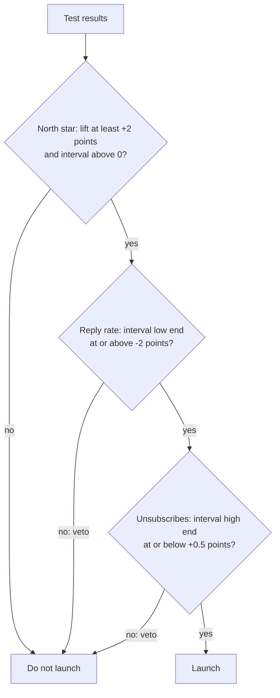

# North star and guardrails

Business question: the new feature moved our main metric up, so should we launch it?

## Before you start

- **Level:** 2 (intermediate).
- **Time:** about 2 hours.
- **Builds on:** [Confidence interval by hand](../../02-statistics-and-experiments/02-confidence-interval-by-hand/), [A/B test from scratch](../../02-statistics-and-experiments/03-ab-test-from-scratch/) and [Sample size before you test](../../02-statistics-and-experiments/04-sample-size-before-you-test/). [Metric trees](../01-metric-trees/) helps with picking metrics.
- **You need:** Python 3.9 or later. Nothing to install.

## The problem

Jobnest, a fictional job marketplace, tested a "quick apply" button that sends a saved profile to an employer in one tap. 1,800 job seekers were split at random between the current flow (control) and quick apply for two weeks. Lena, the product director, sees more people applying and wants to launch on Monday. The employer team is worried that one-tap applications are lower quality and that employers will stop replying. You will define the north star and two guardrails, compute all three from the raw data, and apply a launch rule that was written before anyone looked at the results and that allows for noise.

The file `data/experiment.csv` is synthetic, generated by `make_data.py` with a fixed seed. Each row is one made-up job seeker: variant, applications sent, employer replies received and whether they unsubscribed from emails.

## In plain words

A cricket captain wants more runs, so the team agrees one main number to chase: runs per over. But they also agree, before the match, on things that must not get worse while they chase it: wickets lost and catches dropped. If the batters swing at everything, runs per over may go up while wickets fall, and the team loses. The main number is the **north star**; the "must not get worse" numbers are the **guardrails**; and agreeing the limits before the match means nobody can move them after seeing the score.

One more thing a good captain knows: one lucky over proves little. A rule that looks at results has to allow for luck.

Terms used in this lesson:

- **North star metric:** the one number the team agrees best captures the value the product delivers.
- **Guardrail metric:** a number that must not get worse past an agreed limit while you push the north star.
- **Tolerance:** that agreed limit, for example "the reply rate may fall by at most 2 points".
- **Percentage point (point):** the absolute difference between two percentages. 20% to 13% is a drop of 7 points.
- **Noise:** the chance difference between two random groups even when the feature does nothing.
- **95% interval (confidence interval):** the range of true changes that are consistent with the data; values outside it are unlikely given what you saw.
- **Pre-registered rule:** the decision rule, with numbers, written down before the test starts.

## What you will build from scratch

- `summarize(path)`: users, applying users, applications, replies and unsubscribes per variant, from raw rows.
- `metrics(summary)`: the north star and the two guardrail metrics, with the sample sizes behind them.
- `diff_interval(p0, n0, p1, n1)`: the change between two rates and its 95% interval.
- `decide(control, treatment, ...)`: the noise-aware launch rule, as code, with its tolerances as parameters.

## The idea

A **north star metric** should be the number that, if it grows, means the business grows for the right reasons. A good one:

1. Measures value delivered to the customer, not activity the company can inflate.
2. Is a rate or count of users, so it can move week by week and be compared across tests.
3. Leads revenue instead of being revenue, so teams can act on it.

For Jobnest the team picked:

    north_star = applying users / users     (share of job seekers who send at least one application)

No single number is safe on its own. Any metric you push hard can be gamed, by the product as much as by people. **Guardrail metrics** are the things that must not get worse while you push the north star. A marketplace has two sides, so pick one guardrail per side:

    reply_rate       = employer replies / applications   (are employers still getting applications worth answering?)
    unsubscribe_rate = unsubscribed users / users        (are we annoying job seekers?)

**The rule must allow for noise.** Two random halves of 1,800 people never behave exactly alike. With about 900 users per arm, the 95% margin of error on the change in a 2% rate is about 1.3 points (step 5 computes it). A rule that compares raw differences would launch or block on luck. So for each metric we compute the change and its 95% interval:

    change = p1 - p0
    se     = sqrt(p0 (1 - p0) / n0 + p1 (1 - p1) / n1)      (standard error: the typical size of the noise)
    95% interval = change - 1.96 se  to  change + 1.96 se

and the **decision rule**, written before the test, uses the interval, not just the change:

    launch only if
        north star lift >= +2.0 points  AND  its interval is above 0      (big enough, and not noise)
        AND the reply rate interval's low end   >= -2.0 points            (a drop beyond 2 points is ruled out)
        AND the unsubscribe interval's high end <= +0.5 points            (a rise beyond 0.5 points is ruled out)
    otherwise do not launch



For the guardrails the burden of proof is on safety: a guardrail passes only if the whole interval stays inside the tolerance. "We saw no harm" is not enough; the data has to rule out harm bigger than the tolerance. Statisticians call this a **non-inferiority** check.

A guardrail is a veto: a breach blocks the launch however much the north star went up. That is the point of writing the rule first. After the results are in, a big north star win always makes a guardrail breach look acceptable, and a rule chosen afterwards is a rule chosen to fit the answer.

A breach does not mean the idea is dead. It means this version does not ship, and the team either fixes the cause and tests again or makes the trade explicitly, with the people who own the guardrail in the room.

## Walk through

Step 1. Summarize the raw rows per variant.

```python
import csv
out = {}
with open("data/experiment.csv", newline="") as f:
    for row in csv.DictReader(f):
        s = out.setdefault(row["variant"], [0, 0, 0, 0, 0])
        apps = int(row["applications"])
        s[0] += 1
        s[1] += 1 if apps > 0 else 0
        s[2] += apps
        s[3] += int(row["replies"])
        s[4] += int(row["unsubscribed"])
print(out)
```

The five numbers per variant are users, applying users, applications, replies and unsubscribes. It prints:

```
{'control': [889, 269, 658, 133, 21], 'quick_apply': [911, 333, 1190, 156, 16]}
```

Step 2. The three changes and their 95% intervals. The north star and unsubscribe rate are per user, so n is users; the reply rate is per application, so n is applications.

```python
import math
def diff_interval(p0, n0, p1, n1, z=1.96):
    change = p1 - p0
    se = math.sqrt(p0 * (1 - p0) / n0 + p1 * (1 - p1) / n1)
    return round(100 * change, 2), round(100 * (change - z * se), 2), round(100 * (change + z * se), 2)

print(diff_interval(269 / 889, 889, 333 / 911, 911))
print(diff_interval(133 / 658, 658, 156 / 1190, 1190))
print(diff_interval(21 / 889, 889, 16 / 911, 911))
```

Each line is the change, the low end and the high end, in points:

```
(6.29, 1.95, 10.64)
(-7.1, -10.72, -3.49)
(-0.61, -1.92, 0.71)
```

`python3 solution/solution.py` (after you have tried the exercise) prints the same, with the decision:

| metric | control | quick apply | change | 95% interval | rule | result |
|---|---|---|---|---|---|---|
| north star (applying users) | 30.26% | 36.55% | +6.29 points | +1.95 to +10.64 | lift at least +2, interval above 0 | pass |
| reply rate | 20.21% | 13.11% | -7.10 points | -10.72 to -3.49 | low end at or above -2 | breach |
| unsubscribe rate | 2.36% | 1.76% | -0.61 points | -1.92 to +0.71 | high end at or below +0.5 | breach (not shown safe) |

Step 3. The same question as a significance test. The two-proportion z-test from phase 02 asks how surprising a 6.29 point lift would be if quick apply did nothing.

```python
import math
ca, na, cb, nb = 269, 889, 333, 911
pool = (ca + cb) / (na + nb)
se = math.sqrt(pool * (1 - pool) * (1 / na + 1 / nb))
z = (cb / nb - ca / na) / se
p = math.erfc(abs(z) / math.sqrt(2))
print(round(z, 2), round(p, 4))
```

```
2.83 0.0047
```

A p-value of 0.005 means a lift this large would be very unlikely if the feature did nothing. It agrees with the interval being above 0. In the rule, this is the "not noise" half of the north star check.

Step 4. Apply the rule. The north star passes: +6.29 points, and the interval is above 0. The reply rate is a clear breach: even the most favourable end of its interval is a drop of 3.49 points, past the 2 point tolerance. Decision: do not launch.

Look at why. Quick apply users sent 1,190 applications against 658 in control, but employers replied to 156 of them against 133. Employers got 81% more applications and sent 17% more replies, so most of the extra applications were not worth answering. Over time, employers who stop replying make the marketplace worse for every job seeker.

Step 5. The unsubscribe guardrail also fails, and the reason is a planning lesson. Unsubscribes fell from 21 to 16, but that is noise: there is no detectable change. The interval runs from -1.92 to +0.71 points, so the data cannot rule out a rise of more than the 0.5 point tolerance. (The data is synthetic, and `make_data.py` shows the true rates: 2.0% for control and 2.2% for quick apply. The real direction was up; this sample fell by chance.)

With about 900 users per arm, the margin of error on a 2% rate is bigger than the tolerance, so this guardrail could never have passed. That is a **minimum detectable change** problem, and it should have been caught before the test:

```python
import math
p = 0.02
for n in (900, 6100):
    print(n, round(100 * 1.96 * math.sqrt(2 * p * (1 - p) / n), 2))
print(math.ceil((1.96 / 0.005) ** 2 * 2 * p * (1 - p)))
```

```
900 1.29
6100 0.5
6024
```

At 900 users per arm the margin is about 1.29 points; it takes about 6,024 users per arm to get it down to 0.5 points. When you write the rule, check each tolerance against the margin the planned sample gives, and either plan a bigger test or agree a wider tolerance with the guardrail's owner.

## Common mistakes

**1. Comparing point estimates only (the trap).** The old version of this rule compared raw changes: "reply rate drop at most 2 points, unsubscribe rise at most 0.5 points". On this data it says unsubscribes passed, because they went down by 0.61 points. But a 0.61 point change is well inside the noise (the interval is -1.92 to +0.71), and the true rate in the generator went up. A point-estimate rule would also launch a 3 point lift measured on 300 users per arm, where the interval runs from about -4.4 to +10.4 points. The test `test_noisy_win_does_not_launch` checks that case.

**2. Reading "no significant change" as "no harm".** Not significant means the test could not tell. For a guardrail, ask the opposite question: does the interval rule out harm bigger than the tolerance? Here it does not.

**3. Treating every application as independent.** The reply rate is per application, and one user sends several. If some users send many weak applications, their applications fail together, and the per-application standard error is too small. A per-user check treats each user as one unit (the delta method, for a ratio of two sums):

```python
import csv, math
per_user = {"control": [], "quick_apply": []}
with open("data/experiment.csv", newline="") as f:
    for row in csv.DictReader(f):
        per_user[row["variant"]].append((int(row["applications"]), int(row["replies"])))

def ratio_se(rows):
    apps = sum(a for a, _ in rows)
    rate = sum(r for _, r in rows) / apps
    return math.sqrt(sum((r - rate * a) ** 2 for a, r in rows)) / apps

se0, se1 = ratio_se(per_user["control"]), ratio_se(per_user["quick_apply"])
print(round(100 * se0, 2), round(100 * se1, 2), round(100 * math.sqrt(se0 ** 2 + se1 ** 2), 2))
```

```
1.59 0.96 1.85
```

The standard error of the change is 1.85 points either way here, because in this synthetic data every reply is an independent coin flip. On real data, users differ, and the per-user standard error is usually wider. The reply breach would survive a wider one: the change of -7.10 points is 2.8 standard errors past the 2 point tolerance, so the per-user standard error would have to be about 41% wider (2.60 points instead of 1.85) before the interval reached -2.

**4. Moving a threshold after seeing the results.** A 7 point drop against a 2 point tolerance tempts people to say "2 was too strict". If the tolerance was wrong, change it for the next test, with the guardrail owner, before the data arrives.

## Your turn

Open `exercise.py` and fill in the four functions using only `csv` and `math`. Then run, from this folder:

    python3 test_lesson.py

The tests check the rule on hand-made cases (huge samples where noise is tiny, small samples where a lift or a guardrail is lost in noise, an arm with zero applications), on the committed data and on a second dataset built with another seed. To see the reference solution pass: `CHECK_SOLUTION=1 python3 test_lesson.py`.

Stretch: add a `min_detectable_change(p, n, z=1.96)` function that returns the margin of error for a rate p with n per arm, and use it to print, before any test, whether each tolerance in the rule can be checked with 900 users per arm.

## Check yourself

1. What makes a good north star metric? Why not use revenue?
2. Why write the decision rule before the test starts, and why should it use intervals instead of raw changes?
3. The north star rose 6 points and a guardrail fell 7. The CEO says ship it anyway. What do you say?
4. Unsubscribes went from 21 to 16. Is that good news for the launch?
5. Suggest a north star for Jobnest that would not have rewarded this launch.

<details>
<summary>Answers</summary>

1. It measures the value customers get, it moves often enough to steer by, and teams can influence it. Revenue is a result of value, it lags, and it can rise for bad reasons (price rises, dark patterns) that hurt later.
2. So the results cannot change the rule. Once you see a big win, any breach looks small. A rule written in advance, with numbers, keeps the decision honest. Intervals make it fair to chance: without them the rule launches or blocks on random differences between the two groups.
3. That is a legitimate business call, but it should be made openly as a trade: name the guardrail, the size of the breach and who pays for it (here, employers), and agree how it will be watched after launch. It should not be made by quietly moving the threshold.
4. No. The change is -0.61 points with an interval of -1.92 to +0.71, so there is no detectable change, and the data cannot rule out a rise bigger than the 0.5 point tolerance. The test was too small for that guardrail; about 6,024 users per arm would be needed.
5. Something closer to the outcome both sides want, for example the share of job seekers who receive at least one employer reply in a week. Spamming applications would not move it much, because employers would not reply.

</details>

## What to tell the stakeholder

To Lena: "Quick apply raised the share of people applying from 30.3% to 36.6%, a 6.3 point lift that is very unlikely to be noise (p = 0.005; 95% interval +1.95 to +10.6 points). It also dropped the employer reply rate from 20.2% to 13.1%, and even the most favourable end of the interval is a 3.5 point drop, past the 2 point limit we agreed before the test, so by our own rule it does not ship. Unsubscribes showed no detectable change, but at 900 users per arm we could not have seen a rise of 0.5 points; the next test needs about 6,000 per arm or a wider agreed limit. Next step: test a version that asks one question about fit before the tap, and check the reply rate again."

## In real job postings

In the Real Analyst Jobs data drop of 25 October 2026, 23.9% of the 2,056 US analyst postings that name a tool ask for Power BI and 36.0% ask for Tableau, the tools where a north star and its guardrails usually end up on one dashboard. See [Power BI for analyst jobs](https://realanalystjobs.com/skills/power-bi) and the [analyst job market report](https://realanalystjobs.com/analyst-job-market).

## Next

[Phase 04: Dashboards](../../04-dashboards/)
