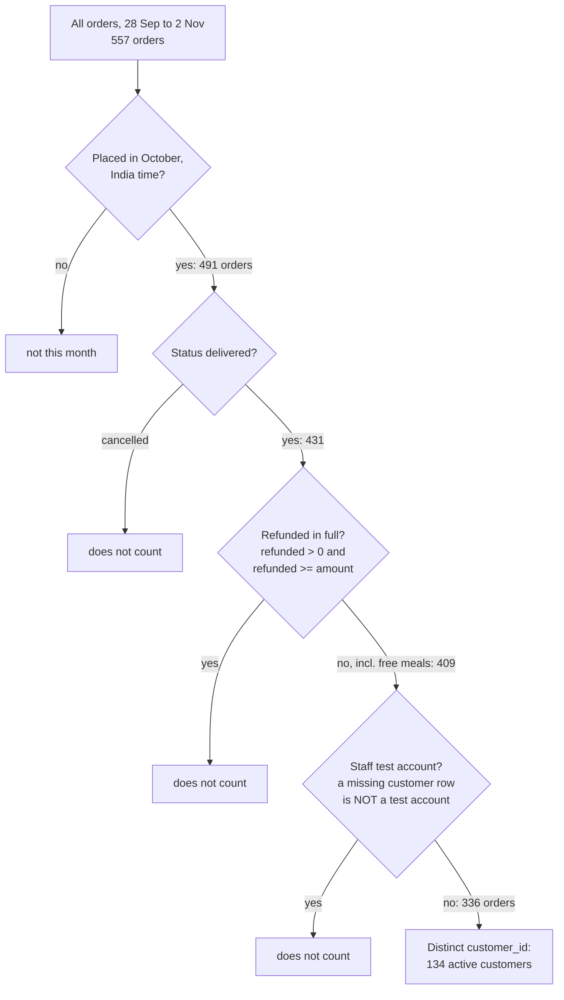

# Define a metric precisely

Business question: what exactly counts as an active customer, and what goes in the metric spec?

## Before you start

- **Level:** 1 (beginner).
- **Time:** about 2 hours.
- **Builds on:** [Active users and stickiness](../03-active-users-and-stickiness/) (a definition of active has an action and a window, and you count distinct users). Helpful but not required: [NULLs, CASE and COALESCE](../../00-start-here/05-nulls-case-and-coalesce/) (a blank is not a zero) and [Dates, weeks and time zones](../../05-python-for-analysts/03-dates-weeks-and-time-zones/).
- **You need:** Python 3.9 or later. Nothing to install.

## The problem

Tiffinbell, a fictional food delivery app with kitchens in Pune, reports "monthly active customers" to its investors. For October 2026 the growth dashboard says 146 and the finance team says 134. Kavya, who runs finance, has to send one number on Monday and explain the other. Both teams wrote SQL that looked reasonable, and neither wrote down what it counted. The definition finance agreed with the founders is one sentence: "A monthly active customer is a real customer (not a staff test account) with at least one delivered order placed in that calendar month, India time, that was not refunded in full. Customers who later deleted their account, or had their data erased, still count for the months they were active." You will turn that sentence into a spec that code can run, test it on every edge case in the data, and build a bridge that explains the 12-customer gap rule by rule.

The files `data/customers.csv` and `data/orders.csv` are synthetic, generated by `make_data.py` with a fixed seed. No row is a real person.

## In plain words

"How many members does the gym have?" sounds like a simple question until you ask: do staff passes count? What about someone whose card was cancelled for not paying? Someone who left in November, are they a member for October? Does a visit at 12:30 at night count for today or yesterday? Each answer is reasonable. Two people who answer differently will report different numbers from the same records, and both will be "right".

A **metric spec** is the written answer to every one of those questions, decided once, before anyone looks at the number. It turns a sentence into rules a computer can apply the same way every month.

Words you will use:

- **Metric:** a number the business tracks, defined by a rule.
- **Spec (specification):** the full definition of a metric: what is counted, from which data, in which time window, what is included and excluded, and why.
- **Edge case:** a row where a rule could go either way, such as an order at 00:30 on 1 October.
- **UTC:** Coordinated Universal Time, the clock most databases store times in. **IST** (India Standard Time) is UTC plus 5 hours 30 minutes, all year round.
- **Half-open window:** a time range that includes its start and excludes its end: 1 October 00:00 up to but not including 1 November 00:00. Every moment falls in exactly one month.
- **Soft delete:** the account is marked deleted (a `deleted_at` time) but the row stays. **Erasure:** the customer asked for their data to be removed, so their customers row is gone, while the orders keep the `customer_id` for the accounts.
- **Bridge (reconciliation):** a list that walks from one number to another, one rule at a time, so every bit of the gap has a reason.

## What you will build from scratch

- `SPEC`: the finance sentence as a dictionary of values a test can check.
- `parse_utc` and `local_month`: which month an order belongs to, in India time.
- `read_customers` and `read_orders`: the two tables, with blank cells handled.
- `is_full_refund` and `qualifies`: one order against every rule in a spec.
- `active_customers(orders, customers, month, spec)`: the distinct customers who count, under any spec.
- `reconcile(...)`: the bridge from the dashboard's number to finance's number.

## The idea

**Write the spec as a table first.** A good spec answers the same questions for every metric:

| Field | Monthly active customers |
|---|---|
| Question it answers | How many real customers got value from Tiffinbell this month? |
| Counted | Distinct `customer_id` |
| Event | An order |
| Included | Status `delivered`; partial refunds; free meals (amount 0) |
| Excluded | Cancelled orders; orders refunded in full; staff test accounts (`is_test = 1`) |
| Window | Calendar month, half-open: from the 1st at 00:00 up to the next 1st at 00:00 |
| Time zone | India Standard Time (UTC+05:30), because customers and kitchens are in India |
| Deleted customers | Still count for months they were active, whether soft-deleted or erased |
| Source tables | `orders` (all rows), `customers` (for `is_test`), joined so that no order is lost |
| Owner | Finance; changes need a new version and a note |

Then write the same thing as data, so code and tests can read it:

    SPEC = {"utc_offset_minutes": 330, "statuses": ["delivered"],
            "exclude_full_refunds": True, "exclude_test_accounts": True,
            "keep_deleted_customers": True, ...}

The growth dashboard's definition fits the same shape: offset 0 (UTC), statuses delivered and cancelled, no refund or test exclusions. Because both are just dictionaries, one function can count under either, and you can switch one rule at a time to see what each rule is worth.

**Each rule as a filter.** An order makes its customer active if it passes every rule. The customer counts once, however many orders pass:



**Time zones.** Orders are stored in UTC. An order at 19:00 UTC on 30 September was placed at 00:30 on 1 October in Pune. Convert to India time first, then take the month. India has no daylight saving, so a fixed offset of 330 minutes is exact. For a zone with daylight saving, use `zoneinfo` instead of a fixed offset.

**Refunds and zero.** "Refunded in full" means refunded_amount >= amount. But a free meal has amount 0 and refund 0, and 0 >= 0 is true. So the precise rule is refunded_amount > 0 and refunded_amount >= amount. A blank refund cell means no refund, which is 0, not "unknown".

**Missing rows are not test accounts.** If you join orders to customers and keep only rows where `is_test = 0`, an erased customer has no row, so `is_test` is blank (NULL in SQL), and NULL is not 0. Those customers silently disappear. Ask "is this a test account?" (`is_test = 1`), and treat a missing row as "no".

## Walk through

Step 1. One edge case, by hand. An order stored as 19:00 on 30 September UTC:

```python
import datetime
IST = datetime.timezone(datetime.timedelta(minutes=330))
utc = datetime.datetime.strptime("2026-09-30T19:00:00Z", "%Y-%m-%dT%H:%M:%SZ")
utc = utc.replace(tzinfo=datetime.timezone.utc)
print(utc.isoformat(), "is", utc.astimezone(IST).isoformat())
print("UTC month:", utc.strftime("%Y-%m"), " India month:", utc.astimezone(IST).strftime("%Y-%m"))
```

```text
2026-09-30T19:00:00+00:00 is 2026-10-01T00:30:00+05:30
UTC month: 2026-09  India month: 2026-10
```

`strptime` reads the text. `replace(tzinfo=...)` says "this clock time is UTC". `astimezone(IST)` moves it to India time. Python 3.9's `fromisoformat` does not accept the trailing `Z`, which is why the lesson uses `strptime`.

Step 2. Which customers does the time zone move?

```python
import csv, datetime
with open("data/customers.csv", newline="") as f:
    customers = {r["customer_id"]: r for r in csv.DictReader(f)}
with open("data/orders.csv", newline="") as f:
    orders = list(csv.DictReader(f))
def month(o, minutes):
    t = datetime.datetime.strptime(o["created_at"], "%Y-%m-%dT%H:%M:%SZ")
    return (t + datetime.timedelta(minutes=minutes)).strftime("%Y-%m")
utc = {o["customer_id"] for o in orders if month(o, 0) == "2026-10"}
ist = {o["customer_id"] for o in orders if month(o, 330) == "2026-10"}
print(len(orders), "orders,", len(customers), "customer rows")
print("UTC October:", len(utc), " India October:", len(ist))
print("only in India October:", sorted(ist - utc, key=int))
print("only in UTC October:  ", sorted(utc - ist, key=int))
```

```text
557 orders, 252 customer rows
UTC October: 146  India October: 147
only in India October: ['250', '251', '252', '253']
only in UTC October:   ['254', '255', '256']
```

Adding 330 minutes to the stored time gives the India clock time. The net change is only one customer, but seven customers change month: four ordered just after midnight on 1 October India time (still September in UTC), and three just after midnight on 1 November (still October in UTC). A net number can hide churn underneath it, which is why the bridge in step 4 compares sets, not just totals.

Step 3. Apply the rest of the rules in order, and watch orders and customers fall away:

```python
import csv, datetime
with open("data/customers.csv", newline="") as f:
    customers = {r["customer_id"]: r for r in csv.DictReader(f)}
with open("data/orders.csv", newline="") as f:
    orders = list(csv.DictReader(f))
def month(o, minutes):
    t = datetime.datetime.strptime(o["created_at"], "%Y-%m-%dT%H:%M:%SZ")
    return (t + datetime.timedelta(minutes=minutes)).strftime("%Y-%m")
def full_refund(o):
    refunded = float(o["refunded_amount"] or 0)
    return refunded > 0 and refunded >= float(o["amount"])
def test_account(o):
    c = customers.get(o["customer_id"])
    return c is not None and c["is_test"] == "1"
october = [o for o in orders if month(o, 330) == "2026-10"]
delivered = [o for o in october if o["status"] == "delivered"]
kept = [o for o in delivered if not full_refund(o)]
real = [o for o in kept if not test_account(o)]
for label, rows in (("India October", october), ("delivered", delivered),
                    ("not fully refunded", kept), ("not a test account", real)):
    print("%-20s %3d orders %3d customers" % (label, len(rows), len({o["customer_id"] for o in rows})))
```

```text
India October        491 orders 147 customers
delivered            431 orders 141 customers
not fully refunded   409 orders 139 customers
not a test account   336 orders 134 customers
```

`float(o["refunded_amount"] or 0)` turns a blank cell into 0. `customers.get(...)` returns None for an erased customer, and `test_account` says "no" for them. Notice how unequal orders and customers are: the 5 staff test accounts placed 73 orders but are only 5 customers.

Step 4. The bridge. Run `python3 solution/solution.py` (after you have tried the exercise). It starts from the dashboard's definition and switches one rule at a time to the finance spec:

```
dashboard: any order, UTC month  146
+ India time month               147
+ delivered only                 141
+ no full refunds                139
+ no test accounts               134
```

| Step | Active customers | Change |
|---|---|---|
| Dashboard: any order, UTC month | 146 | |
| India time month | 147 | +1 (4 in, 3 out) |
| Delivered only | 141 | -6 |
| No full refunds | 139 | -2 |
| No test accounts | 134 | -5 |

Every one of the 12 customers between 146 and 134 now has a reason. That table is what Kavya sends with the number.

## Common mistakes

**1. Two reasonable definitions, two numbers, no spec (the trap).** The dashboard's 146 and finance's 134 are both correct answers to different questions. The mistake is publishing either without its definition. Next month someone "fixes" the dashboard, the number drops by 8%, and the investors hear that customers left. Put the spec next to the number and version it when it changes.

**2. A refund rule that forgets zero.** Writing "refunded >= amount" without "refunded > 0" counts a free meal as fully refunded, and drops a real customer whose only October order was free:

```python
import csv, datetime
with open("data/customers.csv", newline="") as f:
    customers = {r["customer_id"]: r for r in csv.DictReader(f)}
with open("data/orders.csv", newline="") as f:
    orders = list(csv.DictReader(f))
def month(o):
    t = datetime.datetime.strptime(o["created_at"], "%Y-%m-%dT%H:%M:%SZ")
    return (t + datetime.timedelta(minutes=330)).strftime("%Y-%m")
base = [o for o in orders if month(o) == "2026-10" and o["status"] == "delivered"
        and not (o["customer_id"] in customers and customers[o["customer_id"]]["is_test"] == "1")]
right = {o["customer_id"] for o in base if not (float(o["refunded_amount"] or 0) > 0
                                               and float(o["refunded_amount"] or 0) >= float(o["amount"]))}
naive = {o["customer_id"] for o in base if not float(o["refunded_amount"] or 0) >= float(o["amount"])}
print(len(right), len(naive), "lost:", sorted(right - naive))
print([(o["order_id"], o["amount"], o["refunded_amount"]) for o in base if o["customer_id"] in right - naive])
```

```text
134 133 lost: ['206']
[('149', '0', '')]
```

Customer 206's only October order is order 149: amount 0, no refund. The naive rule loses them.

**3. Losing deleted and erased customers in a join.** The spec keeps them. Two common pieces of SQL drop them without anyone deciding to:

```python
import csv, datetime
with open("data/customers.csv", newline="") as f:
    customers = {r["customer_id"]: r for r in csv.DictReader(f)}
with open("data/orders.csv", newline="") as f:
    orders = list(csv.DictReader(f))
def month(o):
    t = datetime.datetime.strptime(o["created_at"], "%Y-%m-%dT%H:%M:%SZ")
    return (t + datetime.timedelta(minutes=330)).strftime("%Y-%m")
def counts(o):
    refunded = float(o["refunded_amount"] or 0)
    c = customers.get(o["customer_id"])
    return (month(o) == "2026-10" and o["status"] == "delivered"
            and not (refunded > 0 and refunded >= float(o["amount"]))
            and not (c is not None and c["is_test"] == "1"))
active = {o["customer_id"] for o in orders if counts(o)}
erased = {c for c in active if c not in customers}
deleted = {c for c in active if c in customers and customers[c]["deleted_at"]}
print("spec:", len(active))
print("erased (no customers row):", len(erased), " deleted later:", len(deleted))
print("inner join to customers:", len(active - erased))
print("only accounts that still exist:", len(active - erased - deleted))
```

```text
spec: 134
erased (no customers row): 3  deleted later: 10
inner join to customers: 131
only accounts that still exist: 121
```

An `INNER JOIN customers` (or `WHERE is_test = 0`, which is false for NULL) loses the 3 erased customers. Adding `AND deleted_at IS NULL` loses 10 more. Worse, the October number would then shrink every time someone deletes their account in a later month, so history would change after it was reported.

**4. Counting the month in the database's time zone.** Taking the month straight from the stored UTC time moves seven customers across the month boundary here. Any business that runs on local time (deliveries, shifts, store days) should count in local time, and say so in the spec.

## Your turn

Open `exercise.py`. First fill in the `SPEC` values from the finance sentence at the top of the file, then the eight functions. Use only `csv` and `datetime`. Run, from this folder:

    python3 test_lesson.py

The test checks your SPEC against the sentence, then your functions on the committed data and on a second dataset built with another seed, under three specs (finance, the dashboard, and "accounts that still exist") so a function that ignores its spec fails. Small hand-made orders test one edge each: both month boundaries in India time, a cancelled order, a full refund, a partial refund, a free meal, a blank refund, a test account, a deleted and an erased customer, and an empty list. To see the reference solution pass: `CHECK_SOLUTION=1 python3 test_lesson.py`.

Stretch: add a `"min_order_amount"` key to the spec (for example, only orders of at least 100 rupees count) and see how many customers it removes. Would you add it? Write one sentence for the spec explaining why or why not.

## Check yourself

1. Name four questions a metric spec for "active customers" must answer.
2. Why count the month in India time when the database stores UTC?
3. A customer deleted their account on 20 November. Do they count as active for October? What happens to old reports if they do not?
4. The dashboard says 146 and finance says 134. How do you explain the gap?

<details>
<summary>Answers</summary>

1. Any four of: what is counted (distinct customers or orders), which event qualifies (delivered orders), what is excluded (cancellations, full refunds, test accounts), the time window and its edges (calendar month, half-open), the time zone, how deleted or erased customers are handled, which tables and joins are used, and who owns the definition.
2. The business runs on India time: an order at 00:30 on 1 October in Pune is an October order to the kitchen and the customer. In UTC it is 19:00 on 30 September. Whatever you pick, write it in the spec and use it everywhere.
3. Yes: they were a real customer with a delivered order in October. If deleted customers are dropped, October's number shrinks every time someone deletes an account later, so a number already sent to investors would change.
4. With a bridge: start at 146 and switch one rule at a time. India time +1 (4 in, 3 out), delivered only -6, no full refunds -2, no test accounts -5, landing on 134. Every customer of the gap has a named reason.

</details>

## What to tell the stakeholder

To Kavya: "Report 134 monthly active customers for October 2026, using the definition finance agreed: real customers with at least one delivered October order (India time) that was not fully refunded. The dashboard's 146 counts any order in the UTC month, including 5 staff test accounts, cancelled orders and full refunds; the attached bridge accounts for every one of the 12. Customers who later deleted their accounts are included, so this number will not change after we send it." Caveat: the spec is version 1; if finance changes a rule, we restate earlier months under the new version rather than mixing definitions.

## In real job postings

In the Real Analyst Jobs data drop of 25 October 2026, 1,477 of the 2,056 US analyst postings that list a tool (71.8%) ask for SQL, and 232 (11.3%) ask for Looker, a tool built around writing metric definitions down once so every dashboard uses the same one. See the [SQL data analyst jobs](https://realanalystjobs.com/jobs/sql-data-analyst-jobs) and the [analyst job market report](https://realanalystjobs.com/analyst-job-market).

## Next

[06: Percent vs points, ratio of sums vs average of ratios](../06-percent-points-and-averages-of-ratios/)
