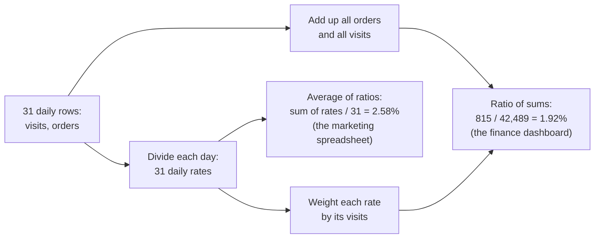

# Percent vs points, ratio of sums vs average of ratios

Business question: did conversion rise 2% or 2 points, and why do two dashboards disagree?

## Before you start

- **Level:** 1 (beginner).
- **Time:** about 2 hours.
- **Builds on:** [Funnel conversion](../02-funnel-conversion/) (a conversion rate is one count divided by another) and [Define a metric precisely](../05-define-a-metric-precisely/) (two reasonable definitions can give two numbers). [North star and guardrails](../04-north-star-and-guardrails/) uses percentage points; this lesson explains them from scratch.
- **You need:** Python 3.9 or later. Nothing to install.

## The problem

Learnhaven, a fictional online course shop, holds its monthly business review on Tuesday 3 November 2026. The marketing slide says "Conversion up 2% in October". The finance dashboard says conversion fell from 2.37% in September to 1.92% in October. Asha, the CEO, read the marketing slide as "conversion went up 2 points", which would be a near doubling, and now has three stories for one number. She asks you which is right before the meeting. You have the daily visits and orders for September and October. You will compute conversion both ways the two teams did, explain why they move in opposite directions, and write the sentence that says the change correctly.

The file `data/daily.csv` is synthetic, generated by `make_data.py` with a fixed seed. It has one row per day: date, visits and orders.

## In plain words

Two cricket matches. In the first, a batter scores 10 runs off 100 balls. In the second, 9 runs off 900 balls. What is their strike rate over the two matches? Add up the runs and the balls: 19 runs off 1,000 balls, 1.9 runs per 100 balls. Now average the two match strike rates instead: 10 per 100 and 1 per 100 average to 5.5 per 100. The second number pretends the 100-ball match and the 900-ball match were the same size. They were not.

That is the whole disagreement between the two dashboards: one adds up first and divides once (a **ratio of sums**), the other divides every day and then averages the results (an **average of ratios**). They only agree when every day has the same traffic.

The second confusion is about the word "percent". If conversion goes from 2.0% to 2.5%, it rose by **0.5 percentage points** (the difference between the two percentages) and by **25 percent** (relative to where it started). Both are true. Saying "up 25%" about a rate is easily heard as "now 27%"; saying "up 0.5" without "points" is ambiguous.

Words you will use:

- **Conversion rate:** orders divided by visits, the share of visits that ended in an order.
- **Ratio of sums:** total orders divided by total visits over the period.
- **Average of ratios:** the plain average of each day's rate. Every day counts the same, big or small.
- **Weighted average:** an average where each item counts in proportion to a weight, here its visits. The weighted average of daily rates is exactly the ratio of sums.
- **Percentage point (point):** the unit for the difference between two percentages. 2.37% to 1.92% is -0.45 points.
- **Percent change (relative change):** the difference divided by the starting value. 2.37% to 1.92% is -19.1%.

## What you will build from scratch

- `ratio_of_sums(rows)` and `average_of_ratios(rows)`: the finance and the marketing calculation.
- `weighted_average_of_ratios(rows)`: proof that weighting by visits gives the ratio of sums back.
- `by_month(rows)`: split the days into months.
- `point_change`, `percent_change` and `describe_change`: one line that states a change in both units.
- `summarise(path)`: both months, both methods, both changes.

## The idea

**Two ways to turn daily rows into one rate.**



Written out, for days i = 1 to n with visits v_i and orders o_i:

    ratio of sums      = (o_1 + o_2 + ... + o_n) / (v_1 + v_2 + ... + v_n)
    average of ratios  = (o_1/v_1 + o_2/v_2 + ... + o_n/v_n) / n
    weighted average   = sum of (o_i/v_i * v_i) / sum of v_i = sum of o_i / sum of v_i

The last line shows why the weighted average is the ratio of sums: each rate times its own visits gives back that day's orders.

**Which one answers the question?** "What share of October's visits ended in an order?" is a question about visits, so every visit should count once: the ratio of sums. The average of ratios answers a different question, "what was the conversion rate on a typical day?", where every day counts once. That can be useful, but it is not the month's conversion rate. When traffic is uneven, the two answers can even move in opposite directions, and on this data they do.

**Points versus percent.** For an old rate a and a new rate b, both as fractions:

    change in points  = (b - a) * 100
    percent change    = (b - a) / a * 100

A point change is the same size going up or down. A percent change is not: 2.0% to 2.5% is +25%, but 2.5% back to 2.0% is -20%. And a percent change from 0 does not exist. The safest sentence states both units: "2.37% to 1.92%: -0.45 points (-19.1%)".

## Walk through

Step 1. The words, on one example. Marketing's "+2%" was relative. From 2.50%, a 2% rise lands on 2.55%. A 2 point rise would land on 4.50%:

```python
old, new = 0.025, 0.0255
print("points: %+.2f" % ((new - old) * 100))
print("percent: %+.1f%%" % ((new - old) / old * 100))
print("up 2 points would be %.2f%%" % ((old + 0.02) * 100))
```

```text
points: +0.05
percent: +2.0%
up 2 points would be 4.50%
```

`%+.2f` prints the sign even for a rise, and `%%` prints a literal percent sign.

Step 2. The two methods on two days with very different traffic:

```python
days = [(100, 10), (900, 9)]
rates = [o / v for v, o in days]
print("daily rates:", rates)
print("average of ratios:", sum(rates) / len(rates))
print("ratio of sums:", sum(o for _, o in days) / sum(v for v, _ in days))
print("weighted average:", sum(r * v for r, (v, _) in zip(rates, days)) / sum(v for v, _ in days))
```

```text
daily rates: [0.1, 0.01]
average of ratios: 0.055
ratio of sums: 0.019
weighted average: 0.019
```

The small day converts at 10% and the big day at 1%. Averaging the rates gives 5.5%, as if each day had the same number of visits. The 19 orders really came from 1,000 visits: 1.9%. Weighting each rate by its visits gives 1.9% again.

Step 3. Both methods on Learnhaven's two months:

```python
import csv
with open("data/daily.csv", newline="") as f:
    rows = [(r["date"], int(r["visits"]), int(r["orders"])) for r in csv.DictReader(f)]
for month in ("2026-09", "2026-10"):
    days = [(v, o) for d, v, o in rows if d.startswith(month)]
    ros = sum(o for _, o in days) / sum(v for v, _ in days)
    aor = sum(o / v for v, o in days) / len(days)
    print(month, len(days), "days", sum(v for v, _ in days), "visits", sum(o for _, o in days), "orders",
          "ratio of sums %.2f%%  average of ratios %.2f%%" % (ros * 100, aor * 100))
```

```text
2026-09 30 days 27490 visits 652 orders ratio of sums 2.37%  average of ratios 2.53%
2026-10 31 days 42489 visits 815 orders ratio of sums 1.92%  average of ratios 2.58%
```

The ratio of sums falls from 2.37% to 1.92%. The average of ratios rises from 2.53% to 2.58%. Same rows, opposite directions.

Step 4. Find the days that cause it. The five October days with the most visits:

```python
import csv
with open("data/daily.csv", newline="") as f:
    rows = [(r["date"], int(r["visits"]), int(r["orders"])) for r in csv.DictReader(f)]
october = [r for r in rows if r[0].startswith("2026-10")]
total = sum(v for _, v, _ in october)
for d, v, o in sorted(october, key=lambda r: -r[1])[:5]:
    print(d, v, "visits", o, "orders", "rate %.2f%%" % (o / v * 100), "share of the month's visits %.1f%%" % (v / total * 100))
```

```text
2026-10-14 5962 visits 59 orders rate 0.99% share of the month's visits 14.0%
2026-10-15 5745 visits 50 orders rate 0.87% share of the month's visits 13.5%
2026-10-16 5646 visits 52 orders rate 0.92% share of the month's visits 13.3%
2026-10-19 1238 visits 39 orders rate 3.15% share of the month's visits 2.9%
2026-10-27 1213 visits 21 orders rate 1.73% share of the month's visits 2.9%
```

14 to 16 October were the three days of an influencer campaign. Together they brought 17,353 visits, 40.8% of October's traffic, converting at under 1%. In the ratio of sums they carry 40.8% of the weight. In the average of ratios they are 3 days out of 31, 9.7% of the weight, the same as three quiet Sundays.

Step 5. Run `python3 solution/solution.py` (after you have tried the exercise):

```
2026-09 visits 27490 orders 652 ratio of sums 0.0237 average of ratios 0.0253
2026-10 visits 42489 orders 815 ratio of sums 0.0192 average of ratios 0.0258
change_ratio_of_sums: 2.37% to 1.92%: -0.45 points (-19.1%)
change_average_of_ratios: 2.53% to 2.58%: +0.05 points (+1.9%)
```

The marketing slide's "+2%" is the last line: an average of daily rates, rounded, and relative. The finance dashboard's fall is the line above it.

## Common mistakes

**1. Averaging daily rates on uneven traffic (the trap).** It gives a quiet Sunday the same weight as a campaign day with 11 to 14 times as many visits. Here it turns a 0.45 point fall into a 0.05 point rise. For "what share of visits converted", always add up the counts and divide once. The same trap appears whenever you average ratios from groups of different size: average order value across stores, click-through rate across ads, pass rates across schools.

**2. Saying "%" when you mean points, or the other way round.** "+2%" about a 2.5% rate means 2.55%; "+2 points" means 4.50%. Write "points" (or "pp") for differences between rates and "%" only for relative changes, and when it matters, give both: "-0.45 points (-19.1%)".

**3. Stopping at the overall number.** The overall rate fell, but not because the shop got worse at selling. Leave out the three campaign days and compare like with like:

```python
import csv
with open("data/daily.csv", newline="") as f:
    rows = [(r["date"], int(r["visits"]), int(r["orders"])) for r in csv.DictReader(f)]
campaign = {"2026-10-14", "2026-10-15", "2026-10-16"}
for month in ("2026-09", "2026-10"):
    days = [(v, o) for d, v, o in rows if d.startswith(month) and d not in campaign]
    print(month, "without the campaign days: %.2f%%" % (sum(o for _, o in days) / sum(v for v, _ in days) * 100))
```

```text
2026-09 without the campaign days: 2.37%
2026-10 without the campaign days: 2.60%
```

   On ordinary days, conversion rose 0.23 points (+9.7%). The overall fall comes from the mix: 40.8% of October's visits came from a source that converts at under 1%. Orders rose 25.0%, from 652 to 815. A rate that falls while the count rises usually means the denominator changed.

**4. Averaging in a zero for a day with no data.** If tracking breaks and a day records 0 visits, that day has no rate. Counting it as 0% drags the average of ratios down; skip it. The ratio of sums is not affected, because a day with 0 visits and 0 orders adds nothing to either total.

## Your turn

Open `exercise.py` and fill in the nine functions. Use only `csv`. Then run, from this folder:

    python3 test_lesson.py

The test computes the expected rates with exact fractions on the committed data and on a second dataset built with another seed, and checks `describe_change` to the character. Small cases cover an empty list, a day with 0 visits, a day with 0 orders, two days with equal traffic (where both methods agree) and a change from 0%. To see the reference solution pass: `CHECK_SOLUTION=1 python3 test_lesson.py`.

Stretch: write `ratio_of_sums_excluding(rows, dates)` and reproduce the "without the campaign days" numbers. Then compute the campaign days' own rate and check that the October total is the visit-weighted mix of the two.

## Check yourself

1. Conversion went from 4% to 5%. State the change in points and in percent.
2. Why can the average of daily conversion rates rise while the monthly conversion rate falls?
3. When is the average of ratios the right number to report?
4. Asha asks, "did conversion go up or down in October?" What do you answer?

<details>
<summary>Answers</summary>

1. +1 percentage point, and +25% relative (1 / 4). Going back from 5% to 4% is -1 point but -20%.
2. The monthly rate weights each day by its visits; the average of daily rates weights every day the same. If the busiest days convert worst (a campaign, a sale, a bot spike), they pull the monthly rate down a lot but the daily average only a little.
3. When the question is about the typical unit rather than the total, for example "on a typical day, what was the conversion rate?" or "what is the pass rate of a typical school?". Say so explicitly, because readers will assume the total.
4. Down overall, from 2.37% to 1.92% (-0.45 points), because the October campaign brought 40.8% of the month's visits and they converted at under 1%. On ordinary days conversion rose from 2.37% to 2.60%, and total orders rose 25%. The "+2%" on the marketing slide averages the daily rates, so it hides the campaign.

</details>

## What to tell the stakeholder

To Asha: "October conversion was 1.92% of visits, down from 2.37% in September: -0.45 percentage points, or -19.1%. That is because the three-day influencer campaign brought 40.8% of October's visits, and they converted at under 1%. On the other 28 days conversion rose to 2.60% (+0.23 points), and total orders rose 25%, from 652 to 815. The '+2%' on the marketing slide averages the daily rates, which gives each campaign day the same weight as a quiet Sunday; it is not the month's conversion rate." Caveat: one month and one campaign; whether the campaign's visitors buy later is a question for a cohort view.

## In real job postings

In the Real Analyst Jobs data drop of 25 October 2026, 860 of the 2,056 US analyst postings that list a tool (41.8%) ask for Excel, where an AVERAGE over a column of daily rates is one keystroke away. Check a change by hand with the [percentage change calculator](https://realanalystjobs.com/tools/percentage-change-calculator), or browse the [Excel skills page](https://realanalystjobs.com/skills/excel).

## Next

[07: Growth accounting](../07-growth-accounting/)
