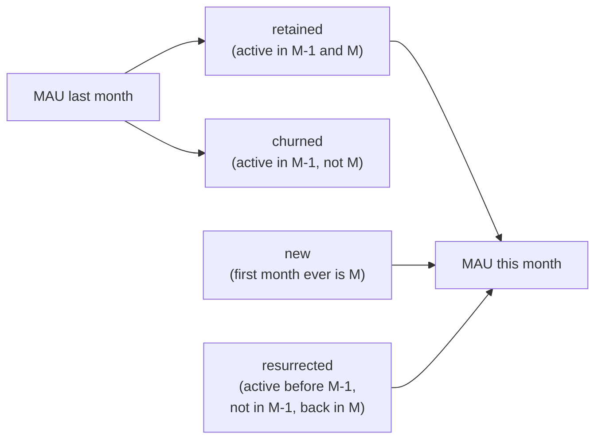

# Growth accounting

Business question: where did this month's MAU change come from: new, retained, resurrected or churned users?

## Before you start

- **Level:** 2 (intermediate).
- **Time:** about 2 hours.
- **Builds on:** [Active users and stickiness](../03-active-users-and-stickiness/) (MAU counts distinct users, not sessions), [Cohort retention](../../01-sql/04-cohort-retention/) (following users from a starting month) and [Metric trees](../01-metric-trees/) (splitting a change into parts that add up). Basic Python: a dictionary of sets.
- **You need:** Python 3.9 or later. Nothing to install.

## The problem

Fitloop, a fictional workout tracking app, grew monthly active users from 172 in August to 206 in September 2026. Jo, the founder, is writing the investor update this week and wants to say the paid ads are working, because "new users" on the team dashboard jumped from 73 to 91. Marketing actually cut its ad budget in September, so the number looks odd. You have the raw session log from January to September. You will split every month's MAU change into new, retained, resurrected and churned users, and find out what really drove September.

The file `data/activity.csv` is synthetic, generated by `make_data.py` with a fixed seed. It has 1,605 rows, one per session: `user_id` and `session_date`. Some users have two sessions in a month, and 3 rows have a blank `user_id` (sessions by people who were not logged in).

## In plain words

Think of a cricket club's monthly nets session. This month 30 people came. Last month 25 came. The secretary wants to know why the number went up. Of last month's 25, 18 came again (they stayed) and 7 did not (they dropped off). The other 12 people this month are of two kinds: some have never been to the club before (brand new), and some came in spring, skipped a few months and turned up again (they came back). 25 - 7 + 12 = 30. Every person in either month lands in exactly one box, so the boxes add up to the change.

The club would act very differently on "we attracted new members" and "old members came back". Growth accounting is that split for users.

Terms used in this lesson:

- **MAU (monthly active users):** distinct users with at least one session in the calendar month.
- **New user:** active this month, and this is the first month they were ever active.
- **Retained user:** active last month and this month.
- **Resurrected user:** active this month, not active last month, but active in some month before that. Also called reactivated or returning.
- **Churned user:** active last month, not active this month.
- **Quick ratio:** (new + resurrected) / churned. Users gained for every user lost. Above 1 means MAU grew.
- **Identity:** an equation that is true by definition, whatever the data.

## What you will build from scratch

- `load_activity(path)`: each user's set of active months from the raw sessions, with blank ids removed and repeat sessions counted once.
- `prev_month(month)` and `month_range(first, last)`: calendar arithmetic on `YYYY-MM` text, including the year boundary.
- `account(activity, month)`: the four counts for one month.
- `growth_table(activity)`: one row per calendar month, including months with no activity at all.
- `quick_ratio(row)`: users gained per user lost, or None when nobody churned.

## The idea

Look at one month, M, and the month before it, M - 1. Every user who was active in either month falls into exactly one box:



Write it as two sums:

    MAU(M - 1) = retained + churned
    MAU(M)     = retained + new + resurrected

Subtract the first from the second and retained cancels:

    MAU(M) - MAU(M - 1) = new + resurrected - churned

That is the **growth accounting identity**. It is exact for any data, which makes it a good self-check: if your four counts do not satisfy it, one of them is wrong.

The **quick ratio** compares the two inflows with the outflow:

    quick ratio = (new + resurrected) / churned

A quick ratio of 1.6 means 1.6 users arrived (or came back) for every user who left. It is undefined when churned is 0 (the first month of a product, or a tiny segment), so return None, not a huge number.

**The distinction that matters: new versus resurrected.** Both groups were "not active last month", so a lazy definition lumps them together. But a new user needs a full history to identify: you have to look at every earlier month, not just the previous one. Note also that "new" here means first active month, not signup month. A user who signed up in June but first opened the app in July counts as new in July. Write that down in the metric spec.

**Calendar months, not data months.** Build the list of months from the calendar (January, February, ...), not from the months that happen to appear in the data. If a whole month is missing from the log, everyone active the month before churned in it, and the month after shows them as resurrected. Skipping the empty month would hide both.

## Walk through

Step 1. Four users, three months. Label each user for September, looking back at August.

```python
activity = {
    "asha": {"2026-07", "2026-08", "2026-09"},
    "ben": {"2026-07", "2026-09"},
    "chen": {"2026-08"},
    "dev": {"2026-09"},
}
last, now = "2026-08", "2026-09"
for user, months in sorted(activity.items()):
    earlier = any(mo < last for mo in months)
    if now in months and last in months:
        label = "retained"
    elif now in months and earlier:
        label = "resurrected"
    elif now in months:
        label = "new"
    elif last in months:
        label = "churned"
    else:
        label = "-"
    print(user, sorted(months), label)
```

Each user has a set of `YYYY-MM` months. Text months compare in date order, so `mo < last` means "before August". The `if` chain checks retained first, then resurrected, then new, then churned. It prints:

```
asha ['2026-07', '2026-08', '2026-09'] retained
ben ['2026-07', '2026-09'] resurrected
chen ['2026-08'] churned
dev ['2026-09'] new
```

August MAU was 2 (asha, chen). September MAU is 3 (asha, ben, dev). The identity: 2 + 1 new + 1 resurrected - 1 churned = 3.

Step 2. Load the real log. Skip blank ids, and keep only the month part of the date, in a set, so two sessions in one month count once.

```python
import csv
rows, blank, activity = 0, 0, {}
with open("data/activity.csv", newline="") as f:
    for row in csv.DictReader(f):
        rows += 1
        if not row["user_id"].strip():
            blank += 1
            continue
        activity.setdefault(row["user_id"], set()).add(row["session_date"][:7])
print(rows, blank, len(activity), sum(len(v) for v in activity.values()))
```

```
1605 3 439 1121
```

1,605 sessions, 3 with no user, 439 distinct users, and 1,121 user-months. The blank rows cannot be counted as users: you cannot tell whether they are one person or three, or whether that person is new.

Step 3. The full table. Running `python3 solution/solution.py` (after you have tried the exercise) prints:

```
month    prev_mau  new  retained  resurrected  churned  mau  quick_ratio
2026-01         0   43         0            0        0   43  -
2026-02        43   41        30            0       13   71  3.15
2026-03        71   45        49            1       22   95  2.09
2026-04        95   51        63            1       32  115  1.62
2026-05       115   53        65            6       50  124  1.18
2026-06       124   57        76            9       48  142  1.38
2026-07       142   55        90            8       52  153  1.21
2026-08       153   58        99           15       54  172  1.35
2026-09       172   36       115           55       57  206  1.60
```

Read September: 172 last month, 57 churned, 115 retained, 36 new, 55 resurrected, 206 now. Check: 172 + 36 + 55 - 57 = 206.

Step 4. What it says. New users fell from 58 in August to 36 in September, the lowest of the year, which fits the ad budget cut. MAU still grew because resurrected users jumped from 15 to 55. Something brought lapsed users back in September. Churn was flat (54 to 57). The quick ratio rose from 1.35 to 1.60, but the gain came from returning users, not from acquisition.

In January the quick ratio is `-`: nobody could churn in the first month, so the ratio has no value.

## Common mistakes

**1. Counting resurrected users as new (the trap).** The team dashboard defined "new" as "active this month and not active last month". That is one line shorter, and it is wrong:

```python
import csv
activity = {}
with open("data/activity.csv", newline="") as f:
    for row in csv.DictReader(f):
        if row["user_id"].strip():
            activity.setdefault(row["user_id"], set()).add(row["session_date"][:7])

for month, last in (("2026-08", "2026-07"), ("2026-09", "2026-08")):
    naive_new = sum(1 for ms in activity.values() if month in ms and last not in ms)
    real_new = sum(1 for ms in activity.values() if min(ms) == month)
    print(month, "naive new", naive_new, "real new", real_new, "resurrected", naive_new - real_new)
```

```
2026-08 naive new 73 real new 58 resurrected 15
2026-09 naive new 91 real new 36 resurrected 55
```

That is exactly the dashboard's 73 and 91. The naive count says acquisition grew 25% in the month the ad budget was cut. The real count says acquisition fell 38% and returning users carried the month. The identity still balances with the naive count (it just has one box fewer), so the self-check does not catch this mistake. Only the definition does.

**2. Counting sessions instead of users.** September has 289 session rows but 206 active users. A user with two sessions is one active user. Any count of rows (or `COUNT(*)` in SQL) instead of distinct users breaks the identity.

**3. Building the months from the data instead of the calendar.** If a tracking outage wiped out a whole month, a list built from the data would jump straight from the month before to the month after, and every user would look retained across the gap. Use a calendar range. The test `test_gap_month_in_table` checks this.

**4. Reading the quick ratio alone.** A quick ratio of 3 with 2 churned users is 6 users gained, which is noise. And a quick ratio cannot tell new from resurrected. Always show the four counts next to it.

## Your turn

Open `exercise.py` and fill in the six functions using only `csv`. The docstrings are shorter than in Level 1 lessons: you decide the details, and the tests tell you if a definition is off. Then run, from this folder:

    python3 test_lesson.py

The tests use the committed data, a second dataset built with another seed, and small hand-made cases: an empty log, a blank user id, two sessions in one month, a month with no activity, the January year boundary and a quick ratio with zero churn. To see the reference solution pass: `CHECK_SOLUTION=1 python3 test_lesson.py`. To print the full table: `python3 solution/solution.py`.

Stretch: split the September resurrected users by how long they had been away (2 months, 3 to 5 months, 6 or more). A win-back email to everyone who lapsed would bring back long-lapsed users too; a seasonal effect might not.

## Check yourself

1. MAU grew by 34. Name three different combinations of the four counts that give +34 and say which one you would want.
2. Why does the identity still balance when resurrected users are counted as new?
3. A user signed up in June and had a first session in July. Are they new in June or July, and where do you record that choice?
4. The quick ratio is None in January. Why not report it as infinity?

<details>
<summary>Answers</summary>

1. For example: +40 new, +0 resurrected, -6 churned (strong acquisition, low churn); +36 new, +55 resurrected, -57 churned (September: weak acquisition rescued by returners); +90 new, +0 resurrected, -56 churned (strong acquisition, normal churn). The best one depends on the goal, but low churn is the most durable.
2. The identity only needs every active user to be in one inflow box. Moving people from resurrected to new keeps the total the same. That is why a definition check is needed in addition to the arithmetic check.
3. With an activity-based definition they are new in July, their first active month. Write it in the metric spec, so nobody later compares it with a signup-based "new users" count and finds a mismatch.
4. Nobody could churn in the first month, so there is nothing to compare with. Infinity would top every chart and every average it is put into. None says "not defined".

</details>

## What to tell the stakeholder

To Jo: "MAU grew from 172 to 206 in September, but not because of ads. New users fell from 58 to 36, the lowest month this year, in line with the budget cut. The growth came from 55 lapsed users coming back, up from 15 in August, while churn stayed flat at 57. The 91 on the dashboard counted returning users as new. Before we claim credit for the returners, let us check what brought them back; this log does not record campaigns or emails."

## In real job postings

In the Real Analyst Jobs data drop of 25 October 2026, 1,477 of the 2,056 US analyst postings that list a tool (71.8%) ask for SQL, the usual place a growth accounting table is built from an events table. See [product analyst jobs](https://realanalystjobs.com/jobs/product-analyst-jobs) and [SQL data analyst jobs](https://realanalystjobs.com/jobs/sql-data-analyst-jobs).

## Next

[08: Retention curves and churn](../08-retention-curves-and-churn/)
