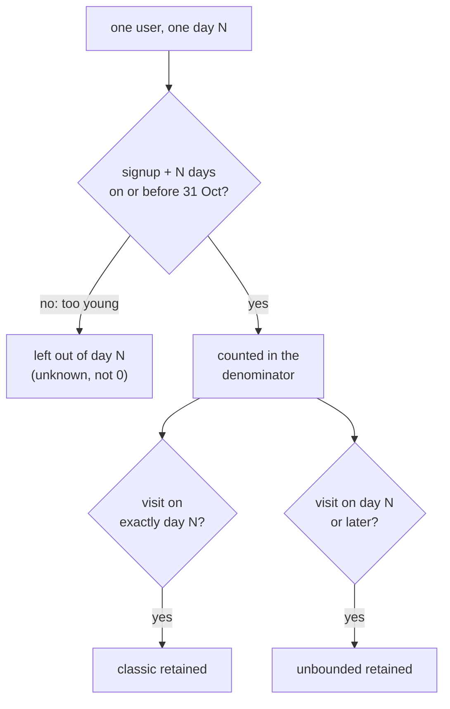

# Retention curves and churn

Business question: what share of users are still here on day 7 and day 30, and which retention definition fits?

## Before you start

- **Level:** 2 (intermediate).
- **Time:** about 2 hours.
- **Builds on:** [Cohort retention](../../01-sql/04-cohort-retention/) (cohorts, and why a month that has not happened is unknown, not zero), [Growth accounting](../07-growth-accounting/) (churned and resurrected users) and [Dates and the date spine](../../01-sql/05-dates-and-the-date-spine/) (date arithmetic). Basic Python: `datetime.date` and sets.
- **You need:** Python 3.9 or later. Nothing to install.

## The problem

Jobnest, a fictional job marketplace, shipped a new onboarding flow for job seekers on 28 September 2026. Rahul, the product manager, ran a quick query on Friday and is worried: of the people who signed up with the new flow, only 5% came back on day 30 or later, against 11% for the old flow. He wants to roll the change back at Tuesday's product review. You have the signup date of every job seeker from 3 August to 25 October and every day they visited, pulled on 31 October. You will build classic and unbounded retention curves, handle users who are too young to have a day 30, and tell Rahul what the data can and cannot say yet.

The files are synthetic, generated by `make_data.py` with a fixed seed. `data/users.csv` has 191 users (`user_id`, `signup_date`). `data/visits.csv` has 805 rows (`user_id`, `visit_date`), at most one per user per day, including 6 rows dated before the user signed up (a known tracking glitch).

## In plain words

Think of a gym that sells memberships every week. The owner asks: "What share of people who join are still coming after a month?" Two things make this harder than it sounds.

First, what does "still coming" mean? You could ask "did they come in on exactly day 30?" Many loyal members skip a given day, so that number is small and jumpy. Or you could ask "did they come in on day 30 or any day after it?" That counts anyone who has not given up.

Second, the people who joined last week. They cannot have a day 30 yet. If you count them as "not coming after a month", you blame them for the calendar. They have to be left out of the day-30 question until day 30 arrives.

Terms used in this lesson:

- **Cohort:** users who share a starting point, here the week they signed up.
- **Day offset:** days between signup and a visit. The signup day is day 0.
- **Classic retention (day N):** share of users who visited on exactly day N. Also called N-day retention.
- **Unbounded retention (day N):** share of users who visited on day N or any later day. Also called rolling retention. It is never lower than classic.
- **Retention curve:** retention plotted against N. It falls as N grows.
- **Churned by day N:** the user was never seen again from day N on. Churn by day N = 1 - unbounded retention on day N.
- **As-of date:** the last day the data covers, here 31 October 2026.
- **Eligible for day N:** the user signed up at least N days before the as-of date, so day N has happened.
- **Right-censoring:** for a user who is not yet eligible, we do not know the answer yet. The data is cut off on the right (the future side) of their timeline.

## What you will build from scratch

- `load(users_path, visits_path)`: the day offsets of each user's visits, with glitch rows dropped and silent users kept.
- `classic_retention` and `unbounded_retention`: the retained count and the eligible count for day N.
- `rate(pair)`: the share, or None when nobody is eligible.
- `week_start(day)` and `cohort_curves(...)`: one retention curve per signup week, with None where the cohort is too young.

## The idea

For each user and each N, ask two questions in order: is day N in the past, and did they visit?



Written out, with as_of the last day of data:

    eligible(N)   = users with (as_of - signup_date) >= N days
    classic(N)    = |eligible users with a visit on day N|        / |eligible(N)|
    unbounded(N)  = |eligible users with a visit on day N or later| / |eligible(N)|
    churned by N  = 1 - unbounded(N)

The denominator changes with N. Day 7 has more eligible users than day 30, because the last 30 days of signups have had a day 7 but not a day 30. That is correct, and it is the whole defence against right-censoring.

**Which definition fits.** Classic retention suits products people should use on a fixed rhythm, such as a daily game or a messaging app: missing day 7 is a real signal. Unbounded retention suits products people return to when they need them, such as a job board: a job seeker who skips day 7 but applies on day 10 is not lost. Classic is noisy for any single day, so analysts often use a window instead (active on any of days 7 to 13). Unbounded is smooth but has its own catch, covered in Common mistakes: users with more time ahead of them have more chances to come back.

**Cohort curves.** Running the same calculation for each signup week gives a table with a staircase edge: older cohorts have values out to day 30, the youngest cohorts stop at day 1 or day 7. The empty cells are None, never 0.

## Walk through

Step 1. Three users, with the day offsets of their visits.

```python
offsets = {"asha": {0, 1, 7, 20}, "ben": {0, 3}, "chen": {0, 9}}
for n in (1, 7):
    classic = sum(1 for days in offsets.values() if n in days)
    unbounded = sum(1 for days in offsets.values() if any(d >= n for d in days))
    print("day", n, "classic", classic, "of 3   unbounded", unbounded, "of 3")
```

`n in days` asks "a visit on exactly day n". `any(d >= n for d in days)` asks "a visit on day n or later". It prints:

```
day 1 classic 1 of 3   unbounded 3 of 3
day 7 classic 1 of 3   unbounded 2 of 3
```

Only asha visited on day 1, but all three came back at some point from day 1 on. On day 7, ben is churned (his last visit was day 3), while chen skipped day 7 and came back on day 9.

Step 2. Load the real files. Turn each visit date into a day offset and drop negative offsets. Every signed-up user gets an entry, even with no visits, so silent users stay in the denominator.

```python
import csv
import datetime

def to_date(t):
    return datetime.date(int(t[:4]), int(t[5:7]), int(t[8:10]))

with open("data/users.csv", newline="") as f:
    signups = {r["user_id"]: to_date(r["signup_date"]) for r in csv.DictReader(f)}
offsets = {u: set() for u in signups}
dropped = 0
with open("data/visits.csv", newline="") as f:
    for r in csv.DictReader(f):
        d = (to_date(r["visit_date"]) - signups[r["user_id"]]).days
        if d < 0:
            dropped += 1
        else:
            offsets[r["user_id"]].add(d)
as_of = datetime.date(2026, 10, 31)
print(len(signups), dropped, sum(1 for u in signups if (as_of - signups[u]).days >= 30))
```

```
191 6 141
```

191 users, 6 glitch rows dropped, and only 141 users are old enough to have a day 30. The other 50 signed up after 1 October.

Step 3. The overall curve and the cohort table. Running `python3 solution/solution.py` (after you have tried the exercise) prints:

```
day  1  eligible 191  classic 0.251  unbounded 0.592
day  7  eligible 191  classic 0.141  unbounded 0.393
day 14  eligible 175  classic 0.114  unbounded 0.246
day 30  eligible 141  classic 0.050  unbounded 0.121
classic retention by signup week (- = cohort too young)
2026-08-03  16 users d1  0.31   d7  0.19   d14 0.00   d30 0.12 
2026-08-10  15 users d1  0.27   d7  0.13   d14 0.20   d30 0.00 
2026-08-17  16 users d1  0.19   d7  0.06   d14 0.19   d30 0.06 
2026-08-24  15 users d1  0.20   d7  0.00   d14 0.13   d30 0.00 
2026-08-31  18 users d1  0.17   d7  0.22   d14 0.28   d30 0.06 
2026-09-07  15 users d1  0.20   d7  0.13   d14 0.07   d30 0.07 
2026-09-14  19 users d1  0.32   d7  0.11   d14 0.05   d30 0.00 
2026-09-21  16 users d1  0.38   d7  0.06   d14 0.00   d30 0.00 
2026-09-28  14 users d1  0.29   d7  0.14   d14 0.00   d30 0.18 
2026-10-05  14 users d1  0.21   d7  0.14   d14 0.21   d30   -  
2026-10-12  18 users d1  0.33   d7  0.28   d14 0.12   d30   -  
2026-10-19  19 users d1  0.13   d7  0.20   d14   -    d30   -  
```

Two things to read. The eligible count shrinks as N grows (191, 191, 175, 141). And the classic cohort cells jump around: 0.00, 0.20, 0.06 for neighbouring weeks on day 14. With 15 users a cohort, one person is 7 points. Classic day N on small cohorts is mostly noise, which is one reason a job board should use unbounded retention.

Step 4. Rahul's comparison, done with eligible users only. Group the users by onboarding flow and compute unbounded retention.

```python
import datetime
import sys
sys.path.insert(0, "solution")
from solution import load, unbounded_retention, rate

signups, offsets = load("data/users.csv", "data/visits.csv")
as_of = datetime.date(2026, 10, 31)
launch = datetime.date(2026, 9, 28)
groups = {"old flow": {u: s for u, s in signups.items() if s < launch},
          "new flow": {u: s for u, s in signups.items() if s >= launch}}
for name, group in groups.items():
    cells = []
    for n in (1, 7, 14, 30):
        kept, elig = unbounded_retention(group, offsets, n, as_of)
        cells.append("d%d %s (n=%d)" % (n, "-" if not elig else "%.2f" % (kept / elig), elig))
        # naive: everyone in the group in the denominator
    naive30 = sum(1 for u in group if any(d >= 30 for d in offsets[u])) / len(group)
    print(name, len(group), "users  ", "  ".join(cells), "  naive d30 %.2f" % naive30)
```

`unbounded_retention` accepts any dictionary of signups, so passing one group gives that group's curve. The last line repeats Rahul's query, which divides by every user in the group.

```
old flow 130 users   d1 0.59 (n=130)  d7 0.37 (n=130)  d14 0.22 (n=130)  d30 0.11 (n=130)   naive d30 0.11
new flow 61 users   d1 0.59 (n=61)  d7 0.44 (n=61)  d14 0.31 (n=45)  d30 0.27 (n=11)   naive d30 0.05
```

Rahul's 5% is the naive number: 3 of 61 new-flow users came back on day 30 or later, but 50 of those 61 have not reached day 30. Of the 11 who have, 3 came back (27%). On day 7, where all 61 are eligible, the new flow is at 44% against 37%.

## Common mistakes

**1. Putting cohorts that are too young in the denominator (the trap).** Rahul divided by every user. On the whole data set:

```python
import datetime
import sys
sys.path.insert(0, "solution")
from solution import load, unbounded_retention, classic_retention, rate

signups, offsets = load("data/users.csv", "data/visits.csv")
as_of = datetime.date(2026, 10, 31)
for n in (7, 30):
    naive = sum(1 for u in signups if n in offsets[u])
    right = classic_retention(signups, offsets, n, as_of)
    print("day", n, "naive %d / %d = %.3f" % (naive, len(signups), naive / len(signups)),
          "  right %d / %d = %.3f" % (right[0], right[1], rate(right)))
```

```
day 7 naive 27 / 191 = 0.141   right 27 / 191 = 0.141
day 30 naive 7 / 191 = 0.037   right 7 / 141 = 0.050
```

On day 7 every user is eligible, so the two agree. On day 30 the naive denominator includes 50 users whose day 30 is in November, and classic day-30 retention looks 26% lower than it is (3.7% against 5.0%). By flow it is worse, because all 50 young users are on the new flow: 5% naive against 27% on eligible users. The newest change always looks worst under this mistake, which is exactly when people check.

**2. Reading a small cell as a result.** The new flow's 27% on day 30 is 3 of 11 users. One more or one fewer returning user moves it by 9 points. Report the count with the share, and wait for more cohorts to age before calling day 30.

**3. Comparing unbounded retention across cohorts of different ages.** Unbounded day 14 counts any visit from day 14 up to 31 October. An August user has had over two months of "later"; a user who signed up on 17 October has had one day of it (31 October). Older cohorts get more chances, so unbounded retention leans in their favour. Here that works against the new flow, so its lead on day 14 is, if anything, understated. To compare fairly, cap "later" at the same horizon for everyone (for example days 14 to 28), and require users to be eligible for the end of that window.

**4. Counting a user with no visits as missing.** A user who signed up and never came back has no rows in `visits.csv`. If you build the users from the visits table, that user disappears and retention looks better. Start from the users table.

## Your turn

Open `exercise.py` and fill in the six functions using only `csv` and `datetime`. The docstrings leave the rules to you; "The idea" above has them. Then run, from this folder:

    python3 test_lesson.py

The tests use the committed data, a second dataset built with another seed, and small hand-made cases: an empty table, a user with no visits, a visit before signup, a user exactly 30 days old on the as-of date (eligible), a user one day younger (not eligible), and a cohort with nobody old enough (None). To see the reference solution pass: `CHECK_SOLUTION=1 python3 test_lesson.py`.

Stretch: write `window_retention(signups, offsets, start, end, as_of)` for "visited on any day from start to end", eligible only when day `end` has passed. Compare old and new flow on days 7 to 13 and days 14 to 27.

## Check yourself

1. Why is the day-30 denominator smaller than the day-7 denominator, and why is that correct?
2. A meditation app and a tax filing app both ask you for day-30 retention. Which definition would you use for each?
3. Unbounded day-30 retention for last month's cohort went up between Monday and Friday, with no product change. How?
4. Why is a young cohort's missing day-30 cell None and not 0?

<details>
<summary>Answers</summary>

1. Users who signed up in the last 30 days have not reached day 30. Their answer is unknown, so they belong in neither the numerator nor the denominator. Including them counts the calendar as churn.
2. Meditation is meant to be daily, so classic (or a short window such as days 28 to 34) fits. A tax app is used when needed, so unbounded fits better: coming back months later is still retention.
3. Unbounded retention counts visits on day 30 or any later day up to the as-of date. Moving the as-of date from Monday to Friday gave every user four more days in which to come back, so some users moved from "churned" to "retained". Unbounded numbers for recent cohorts keep rising as data arrives.
4. 0 would say "everyone left", which is a claim about the future. None says "not known yet". A chart or an average that treats None as 0 drags the newest cohorts down.

</details>

## What to tell the stakeholder

To Rahul: "The 5% day-30 figure divides by all 61 new-flow users, but 50 of them signed up in October and have not reached day 30 yet. Counting only users old enough, the new flow is at 27% on day 30 (3 of 11), against 11% for the old flow, and ahead on day 7 (44% against 37%, all 61 users) and day 14 (31% against 22%). The day-30 number is too small to trust either way, so let us not roll back; I will rerun this when the October cohorts reach day 30, by 24 November."

## In real job postings

In the Real Analyst Jobs data drop of 25 October 2026, 996 of the 2,056 US analyst postings that list a tool (48.4%) ask for Python, the usual tool for date arithmetic like day offsets and censoring. See [product analyst jobs](https://realanalystjobs.com/jobs/product-analyst-jobs) and [Python data analyst jobs](https://realanalystjobs.com/jobs/python-data-analyst-jobs).

## Next

[09: Segmentation and mix effects](../09-segmentation-and-mix-effects/)
