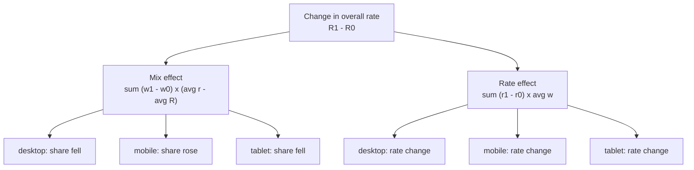

# Segmentation and mix effects

Business question: did conversion fall, or did the traffic mix change?

## Before you start

- **Level:** 2 (intermediate).
- **Time:** about 2 hours.
- **Builds on:** [Percent vs points, ratio of sums vs average of ratios](../06-percent-points-and-averages-of-ratios/) (a total rate is a weighted average of segment rates), [Metric trees](../01-metric-trees/) (splitting a change into parts that add up exactly) and [Funnel conversion](../02-funnel-conversion/). Basic Python: dictionaries and `csv.DictReader`.
- **You need:** Python 3.9 or later. Nothing to install.

## The problem

Brightloom, a fictional home goods shop, ran a paid social campaign through October 2026. At the monthly review on Tuesday 3 November, Dana, the head of e-commerce, will show that site conversion fell from 2.62% in September to 2.33% in October, and she is about to ask the product team to rework checkout. Priya, the head of growth, thinks the campaign simply brought in a lot of phone traffic, which always converts worse. Dana asks you on Friday which of them is right. You will split the conversion change into the part that came from the traffic mix and the part that came from each device converting better or worse, with parts that add up exactly to the total.

The file `data/daily_devices.csv` is synthetic, generated by `make_data.py` with a fixed seed. It has 183 rows, one per day and device (desktop, mobile, tablet) from 1 September to 31 October 2026, with sessions and orders.

## In plain words

Think of a cricket team's batting average across a season. In the first half, the top order played most of the innings. In the second half, injuries meant the tail-enders batted much more. Every single batter scored a little better in the second half, yet the team average fell, because a bigger share of the innings went to players who score less. Nobody got worse; the mix changed.

Website conversion works the same way. The overall rate is a blend of the device rates, weighted by how much traffic each device brings. It can fall because a device got worse (a **rate effect**) or because more traffic came from a device that always converts less (a **mix effect**). The fixes are completely different: a rate problem means fix the product, a mix problem may need no fix at all.

Terms used in this lesson:

- **Segment:** one slice of the traffic, here a device type.
- **Conversion rate:** orders / sessions. A session is one visit to the site.
- **Share (or weight), w:** a segment's sessions / all sessions in the period. The shares add up to 1.
- **Segment rate, r:** the segment's orders / its sessions.
- **Mix effect:** the part of the change in the overall rate caused by the shares moving, with each segment's rate held at its average.
- **Rate effect:** the part caused by the segment rates moving, with each share held at its average.
- **Points:** the difference between two percentages. 2.62% to 2.33% is a fall of 0.29 points.
- **Simpson's paradox:** every segment moves one way and the total moves the other way, because the mix changed.

## What you will build from scratch

- `load_periods(path, split_date)`: sessions and orders per device for the prior and the current period.
- `overall_rate(period)`: total orders / total sessions, or None with no sessions.
- `decompose(prior, current)`: the mix effect and the rate effect, overall and per segment, adding up exactly to the total change. It handles a segment that appears in only one period.
- `main_cause(result)`: "mix" or "rate".

## The idea

The overall rate is a weighted average of the segment rates:

    R = sum over segments of  w_s x r_s

So when R changes from R0 to R1, two things can have moved: the weights w and the rates r. Write the change for one segment and split it with the averages of the two periods:

    w1 r1 - w0 r0 = (w1 - w0) x (r0 + r1) / 2   +   (r1 - r0) x (w0 + w1) / 2
                    \_______ mix part _______/     \_______ rate part ______/

Expand the right side and the cross terms cancel, so the split is exact for every segment, and so for the sum. This is the **midpoint** (or Shapley) split: it gives the same answer as averaging "change the mix first, then the rates" and "change the rates first, then the mix", so it does not depend on an arbitrary order.



**Make each segment's mix effect readable.** The share changes add up to 0 (shares always sum to 1), so you can subtract any constant from the segment rate in the mix part without changing the total mix effect. Subtract the average overall rate, centre = (R0 + R1) / 2:

    mix_s  = (w1_s - w0_s) x ((r0_s + r1_s) / 2 - centre)
    rate_s = (r1_s - r0_s) x (w0_s + w1_s) / 2

Now a segment's mix effect has the sign you expect: a segment that grew and converts below average pulls the total down (negative), and one that shrank and converts above average also pulls it down. Without the centre, every growing segment looks like it added conversion, which is wrong (see Common mistakes).

**A segment in only one period.** A new segment (an app launched in October) has no prior rate. Borrow its current rate as the prior rate, so its rate change is 0 and all of its contribution is mix: it changed the total only by showing up. A segment that disappears borrows the other way. A segment with no sessions in either period is skipped.

## Walk through

Step 1. A tiny case by hand. Desktop converts at 4%, mobile at 1%, in both periods. Only the mobile traffic triples.

```python
prior = {"desktop": (1000, 40), "mobile": (1000, 10)}
current = {"desktop": (1000, 40), "mobile": (3000, 30)}
for name, period in (("prior", prior), ("current", current)):
    sessions = sum(s for s, _ in period.values())
    orders = sum(o for _, o in period.values())
    parts = ["%s share %.2f rate %.3f" % (seg, s / sessions, o / s) for seg, (s, o) in period.items()]
    print(name, "overall %.3f" % (orders / sessions), " | ".join(parts))
```

Each period holds (sessions, orders) per device. The loop prints the overall rate, then each device's share and rate:

```
prior overall 0.025 desktop share 0.50 rate 0.040 | mobile share 0.50 rate 0.010
current overall 0.018 desktop share 0.25 rate 0.040 | mobile share 0.75 rate 0.010
```

Overall conversion fell from 2.5% to 1.75% (printed rounded as 0.018), yet neither device changed. Step 2 splits that change.

```python
w0 = {"desktop": 0.50, "mobile": 0.50}
w1 = {"desktop": 0.25, "mobile": 0.75}
r0 = {"desktop": 0.04, "mobile": 0.01}
r1 = {"desktop": 0.04, "mobile": 0.01}
R0 = sum(w0[s] * r0[s] for s in w0)
R1 = sum(w1[s] * r1[s] for s in w1)
centre = (R0 + R1) / 2
for s in w0:
    mix = (w1[s] - w0[s]) * ((r0[s] + r1[s]) / 2 - centre)
    rate = (r1[s] - r0[s]) * (w0[s] + w1[s]) / 2
    print(s, "mix %+.4f rate %+.4f" % (mix, rate))
print("total %+.4f" % (R1 - R0))
```

`R0` and `R1` are the weighted averages. `centre` is their average. Each segment's mix and rate effects follow the two formulas above:

```
desktop mix -0.0047 rate +0.0000
mobile mix -0.0028 rate +0.0000
total -0.0075
```

All -0.75 points is mix: desktop lost share while converting above average, mobile gained share while converting below average. Both rate effects are 0, because no rate moved.

Step 3. The real data. Sum sessions and orders per month and device.

```python
import csv
cells = {}
with open("data/daily_devices.csv", newline="") as f:
    for row in csv.DictReader(f):
        month = row["date"][:7]
        c = cells.setdefault((month, row["device"]), [0, 0])
        c[0] += int(row["sessions"])
        c[1] += int(row["orders"])
for (month, device), (s, o) in sorted(cells.items()):
    print(month, "%-8s sessions %6d  orders %4d  rate %.4f" % (device, s, o, o / s))
```

```
2026-09 desktop  sessions  14576  orders  534  rate 0.0366
2026-09 mobile   sessions  13419  orders  194  rate 0.0145
2026-09 tablet   sessions   2573  orders   72  rate 0.0280
2026-10 desktop  sessions  14887  orders  564  rate 0.0379
2026-10 mobile   sessions  26095  orders  384  rate 0.0147
2026-10 tablet   sessions   2538  orders   66  rate 0.0260
```

Mobile sessions almost doubled, from 13,419 to 26,095. Desktop and mobile both converted slightly better in October. Only tablet, the smallest segment, converted worse.

Step 4. The decomposition. Running `python3 solution/solution.py` (after you have tried the exercise) prints:

```
device    sessions Sep  Oct    share Sep  Oct    rate Sep  Oct
desktop          14576  14887        47.7% 34.2%      3.66% 3.79%
mobile           13419  26095        43.9% 60.0%      1.45% 1.47%
tablet            2573   2538         8.4%  5.8%      2.80% 2.60%
overall rate 2.62% -> 2.33%
change -0.287 points = mix -0.338 + rate +0.050   main cause: mix
  desktop  mix -0.169  rate +0.051
  mobile   mix -0.163  rate +0.013
  tablet   mix -0.006  rate -0.014
```

Conversion fell 0.287 points. The mix effect is -0.338 points: mobile went from 43.9% to 60.0% of sessions. The rate effect is +0.050 points: on a fixed mix, the devices converted slightly better. So the mix explains more than all of the fall, and the rates partly offset it. This is Simpson's paradox: the two big segments improved, the total got worse.

Step 5. Check the identity. The two effects must add up to the total.

```python
import sys
sys.path.insert(0, "solution")
from solution import load_periods, decompose

p = load_periods("data/daily_devices.csv", "2026-10-01")
r = decompose(p["prior"], p["current"])
print("total %.6f  mix + rate %.6f" % (r["total"], r["mix"] + r["rate"]))
print("share of the change from mix: %.0f%%" % (100 * r["mix"] / r["total"]))
```

```
total -0.002872  mix + rate -0.002872
share of the change from mix: 118%
```

A share above 100% is not an error: the mix pushed down by more than the total fall, and the rate effect pushed back up.

## Common mistakes

**1. Splitting the mix effect per segment without the centre (the trap).** The plain midpoint formula, (w1 - w0) x (r0 + r1) / 2, gives the right total mix effect, so the top line looks fine. Per segment it says something false:

```python
import sys
sys.path.insert(0, "solution")
from solution import load_periods, decompose

p = load_periods("data/daily_devices.csv", "2026-10-01")
r = decompose(p["prior"], p["current"])
for seg, c in r["segments"].items():
    plain = (c["w1"] - c["w0"]) * (c["r0"] + c["r1"]) / 2
    print("%-8s share %+.3f  plain mix %+.3f points  centred mix %+.3f points" % (
        seg, c["w1"] - c["w0"], 100 * plain, 100 * c["mix"]))
```

```
desktop  share -0.135  plain mix -0.502 points  centred mix -0.169 points
mobile   share +0.161  plain mix +0.234 points  centred mix -0.163 points
tablet   share -0.026  plain mix -0.070 points  centred mix -0.006 points
```

The plain version says the extra mobile traffic added 0.234 points of conversion and the loss of desktop share cost 0.502 points. Both sums give -0.338 in total, but only the centred version tells the true per-segment story: more low-converting mobile traffic pulled the rate down. A slide built from the plain column would credit the campaign with raising conversion. The test `test_segment_effects` checks the centred formula.

**2. Changing one thing first.** "Swap in October's mix, then October's rates" and "swap in the rates first" give different splits:

```python
import sys
sys.path.insert(0, "solution")
from solution import load_periods

p = load_periods("data/daily_devices.csv", "2026-10-01")
segs = sorted(p["prior"])
n0 = sum(s for s, _ in p["prior"].values())
n1 = sum(s for s, _ in p["current"].values())
w0 = {s: p["prior"][s][0] / n0 for s in segs}
w1 = {s: p["current"][s][0] / n1 for s in segs}
r0 = {s: p["prior"][s][1] / p["prior"][s][0] for s in segs}
r1 = {s: p["current"][s][1] / p["current"][s][0] for s in segs}

def total(w, r):
    return sum(w[s] * r[s] for s in segs)

mix_first = total(w1, r0) - total(w0, r0)
rate_first = total(w0, r1) - total(w0, r0)
print("mix first:  mix %+.3f  rate %+.3f" % (100 * mix_first, 100 * (total(w1, r1) - total(w1, r0))))
print("rate first: mix %+.3f  rate %+.3f" % (100 * (total(w1, r1) - total(w0, r1)), 100 * rate_first))
```

```
mix first:  mix -0.334  rate +0.047
rate first: mix -0.341  rate +0.054
```

Here the gap is small, but when rates and shares both move a lot it can be large, and the choice of order is arbitrary. The midpoint split is the average of the two (-0.338 and +0.050), so nobody can argue about the order.

**3. Averaging the segment rates.** The unweighted average of the three device rates is 2.64% in September and 2.62% in October, which says "flat" and hides both the mix and the fall. The overall rate is the session-weighted average, never the plain average (lesson 06).

**4. Picking segments after the fact, or too many of them.** Cut traffic into enough slices (device by country by hour) and almost every change can be labelled mix. Choose the segment from a hypothesis (the campaign targeted phones, so device), and check that the segment rates are not noise: tablet's fall from 2.80% to 2.60% rests on 72 and 66 orders.

## Your turn

Open `exercise.py` and fill in the four functions using only `csv`. The docstrings are short on purpose: the formulas are in The idea, and you decide how to handle a segment that appears in only one period. Then run, from this folder:

    python3 test_lesson.py

The tests use the committed data, a second dataset built with another seed, and small hand-made cases: identical periods, a pure mix change, a pure rate change, a new segment, an empty period, a segment with zero sessions in both periods, and a tie in `main_cause`. To see the reference solution pass: `CHECK_SOLUTION=1 python3 test_lesson.py`.

Stretch: run the same split day by day for October and find the days where the rate effect, not the mix, drove the change. Then compare the split by device with a split by weekday versus weekend.

## Check yourself

1. Conversion fell, but every segment's conversion rose. Is that possible, and what is it called?
2. Why does the per-segment mix effect subtract the average overall rate, when the total mix effect does not need it?
3. A new app channel launched this month. What are its mix and rate effects?
4. The mix explains 118% of a fall. What does that mean?

<details>
<summary>Answers</summary>

1. Yes. It is Simpson's paradox: the total is a weighted average, so a shift of weight towards a low-rate segment can pull it down even when every segment improves. Here desktop and mobile improved and the total still fell 0.29 points.
2. The share changes add up to 0, so subtracting a constant from every segment's rate leaves the total mix effect unchanged. Per segment it fixes the sign: a growing segment that converts below average pulls the total down, which the plain formula shows as a positive number.
3. It has no prior rate, so it borrows its current rate: its rate effect is 0 and all of its contribution is mix. If it converts above the average overall rate, its mix effect is positive.
4. The mix alone would have pulled the rate down by more than it actually fell; segment rates improved and offset part of it (here mix -0.338 points, rate +0.050 points, total -0.287 points).

</details>

## What to tell the stakeholder

To Dana: "Site conversion fell from 2.62% to 2.33% in October, but checkout did not get worse: desktop and mobile both converted slightly better than in September. The fall is mix. The campaign nearly doubled mobile sessions, and mobile converts at about 1.5% against 3.8% on desktop, which alone pulls the total down 0.34 points; better device rates gave back 0.05. Orders actually rose from 800 to 1,014. The only device that converted worse is tablet, on too few orders to call. I would judge the campaign on the orders and the cost per order it brought, not on the site-wide rate."

## In real job postings

In the Real Analyst Jobs data drop of 25 October 2026, 860 of the 2,056 US analyst postings that list a tool (41.8%) ask for Excel, where a segment table like this one is often first built as a pivot. See [product analyst jobs](https://realanalystjobs.com/jobs/product-analyst-jobs) and [Excel for analyst jobs](https://realanalystjobs.com/skills/excel).

## Next

[10: Diagnose a metric drop](../10-diagnose-a-metric-drop/)
