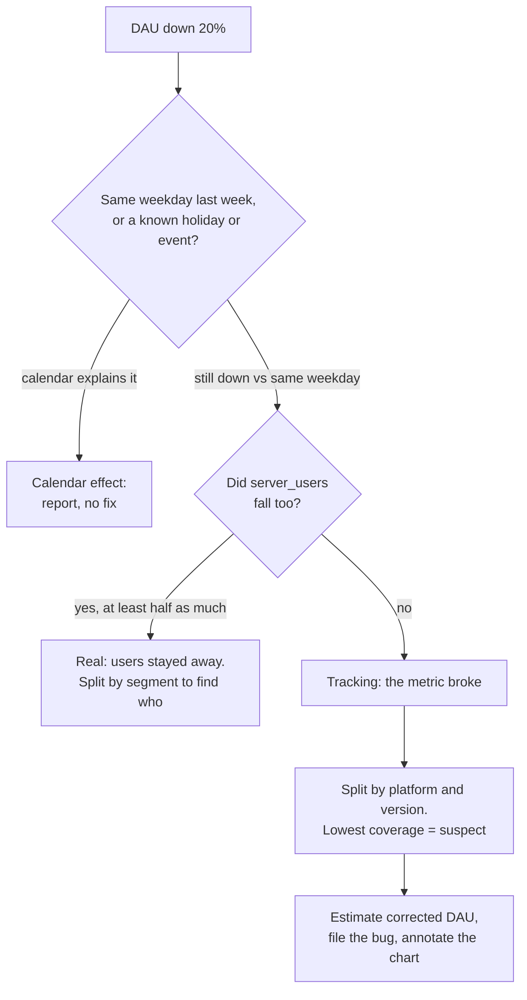

# Diagnose a metric drop

Business question: DAU fell 20% overnight. Tracking bug, holiday, segment, or real?

## Before you start

- **Level:** 2 (intermediate).
- **Time:** about 2 hours.
- **Builds on:** [Active users and stickiness](../03-active-users-and-stickiness/) (what DAU counts), [Define a metric precisely](../05-define-a-metric-precisely/) (the event behind a metric), [Metric trees](../01-metric-trees/) (drilling into a slice) and [Segmentation and mix effects](../09-segmentation-and-mix-effects/) (a total moving because of one segment). Basic Python: dictionaries, tuples as keys and `csv.DictReader`.
- **You need:** Python 3.9 or later. Nothing to install.

## The problem

Tiffinbell, a fictional food delivery app in four cities of Maharashtra, opened its dashboard on Friday 23 October 2026 to find that daily active users (DAU) for Thursday 22 October were 1,299, against 1,635 the Thursday before: down 20.6%. Meera, the chief operating officer, has a call with investors at 4 pm and needs to know whether people stopped using the app. The mobile team shipped app version 7.4 this week. You have one row per day, platform, app version and city for 8 to 22 October, with two counts: DAU from the analytics events and the number of users the backend servers saw. You will work through the standard checklist and give Meera an answer she can repeat.

The file `data/daily_users.csv` is synthetic, generated by `make_data.py` with a fixed seed. It has 196 rows with the columns `date`, `platform` (android, ios, web), `app_version` (7.3, 7.4, or web), `city`, `server_users` and `dau`.

## In plain words

A shop counts customers with a sensor on the door. One morning the count is down by a fifth. Before the owner panics, three questions: Is today a day that is always quiet (a weekday after a busy weekend)? Do the till receipts show fewer sales too, or only the door sensor? And if it is the sensor, is it the side door, where a new sensor was fitted yesterday?

Diagnosing a metric drop is that order of questions. Compare like with like, check a second source that does not share the first one's plumbing, find the slice that holds the drop, and only then decide if it is real.

Terms used in this lesson:

- **DAU (daily active users):** distinct users active on a day. Here, users whose app sent an `app_open` analytics event.
- **Analytics event:** a message the app sends to the analytics system when something happens. If the app stops sending it, the user is still there but the metric cannot see them.
- **server_users:** distinct users the backend saw that day (any logged-in request). It comes from the servers, not from the analytics events, so a bug in the app's analytics code does not touch it.
- **Coverage:** dau / server_users, the share of real users the analytics events captured. It is normally steady (here about 96%), because some events are always lost.
- **Tracking bug:** the measurement broke, not the behaviour. Usually a new app version, a renamed event or a broken data pipeline.
- **Same weekday comparison:** comparing Thursday with the previous Thursday, so the weekly pattern (busier weekends) cancels out.
- **Share of change:** a slice's change divided by the total change. The shares add up to 1.

## What you will build from scratch

- `load(path)`, `totals(rows, date, dims)` and `pct_change(old, new)`: the basic counts.
- `contributions(rows, dim, base_date, date)`: how much of the change each slice holds.
- `coverage(rows, date, dims)`: dau / server_users per slice.
- `diagnose(rows, base_date, date)`: a verdict ("no drop", "real" or "tracking") and, for tracking, the suspect platform and version.
- `corrected_dau(rows, date, suspect)`: what DAU would have been with normal tracking.

## The idea

Work through the questions in this order, because each one rules out a whole class of causes cheaply:



**1. Compare like with like.** Food delivery is busier at weekends, so Thursday against Wednesday is fine but Monday against Sunday shows a drop every week. Use the same weekday a week earlier. Check the company's calendar for holidays, festivals, outages and campaigns on either date (this lesson's calendar has none).

**2. Check an independent source.** DAU and server_users measure the same people through different plumbing. Write the relative changes as d (DAU) and s (server users). The rule this lesson uses:

    no drop    if d > -5%                    (within normal noise)
    real       if s <= d / 2                 (servers fell at least half as much as DAU)
    tracking   otherwise                     (DAU fell, the servers mostly did not)

The 5% and "half" are judgement calls for this dataset; write yours down in the metric spec so the next person uses the same rule.

**3. Localise.** Split the change by each dimension. A slice that holds far more of the change than its share of the users is the place to look. A drop spread across every city in proportion to size is not a city problem.

**4. Confirm with coverage.** For each platform and version, coverage = dau / server_users on the bad day. A tracking bug shows up as one slice with coverage far below the others.

**5. Size it.** Replace the broken slice's DAU with its server_users times the coverage of every other slice that day:

    corrected DAU = dau(other slices) + server_users(suspect) x dau(other slices) / server_users(other slices)

That is an estimate, so label it as one wherever it appears.

## Walk through

Step 1. The daily totals. Sum DAU and server_users per day and look at coverage.

```python
import csv
import datetime
days = {}
with open("data/daily_users.csv", newline="") as f:
    for row in csv.DictReader(f):
        d = days.setdefault(row["date"], [0, 0])
        d[0] += int(row["dau"])
        d[1] += int(row["server_users"])
for date, (dau, server) in sorted(days.items()):
    weekday = datetime.date.fromisoformat(date).strftime("%a")
    print(date, weekday, "dau %4d  server_users %4d  coverage %.3f" % (dau, server, dau / server))
```

`days` maps each date to [dau, server_users]. `fromisoformat` turns the text into a date so `strftime("%a")` can print the weekday. It prints:

```
2026-10-08 Thu dau 1634  server_users 1690  coverage 0.967
2026-10-09 Fri dau 1762  server_users 1825  coverage 0.965
2026-10-10 Sat dau 1995  server_users 2066  coverage 0.966
2026-10-11 Sun dau 1883  server_users 1951  coverage 0.965
2026-10-12 Mon dau 1671  server_users 1729  coverage 0.966
2026-10-13 Tue dau 1637  server_users 1702  coverage 0.962
2026-10-14 Wed dau 1664  server_users 1726  coverage 0.964
2026-10-15 Thu dau 1635  server_users 1698  coverage 0.963
2026-10-16 Fri dau 1749  server_users 1822  coverage 0.960
2026-10-17 Sat dau 1932  server_users 1998  coverage 0.967
2026-10-18 Sun dau 1852  server_users 1923  coverage 0.963
2026-10-19 Mon dau 1643  server_users 1713  coverage 0.959
2026-10-20 Tue dau 1673  server_users 1718  coverage 0.974
2026-10-21 Wed dau 1552  server_users 1692  coverage 0.917
2026-10-22 Thu dau 1299  server_users 1698  coverage 0.765
```

Three things. Weekends run 15 to 20% above weekdays, so the comparison day matters. Server users on 22 October (1,698) are exactly what they were on 15 October. And coverage, steady at about 0.96 for two weeks, dropped to 0.917 on Wednesday 21 (the day version 7.4 started rolling out) and 0.765 on Thursday 22.

Step 2. The full diagnosis. Running `python3 solution/solution.py` (after you have tried the exercise) prints:

```
DAU change -20.6%   server users change +0.0%   verdict: tracking   suspect: ('android', '7.4')
  platform android    797 ->   482  change  -315  share of change 94%
  platform web        344 ->   328  change   -16  share of change 5%
  platform ios        494 ->   489  change    -5  share of change 1%
  city     Mumbai     736 ->   579  change  -157  share of change 47%
  city     Pune       490 ->   401  change   -89  share of change 26%
  city     Nagpur     220 ->   172  change   -48  share of change 14%
  city     Nashik     189 ->   147  change   -42  share of change 12%
  coverage android  7.3  0.960
  coverage android  7.4  0.072
  coverage ios      7.3  0.975
  coverage ios      7.4  0.965
  coverage web      web  0.982
corrected DAU 1646 vs 1635 a week earlier (+0.7%)
```

Read it in order. DAU fell 20.6% while server users did not move, so the verdict is tracking. Android holds 94% of the fall but was 49% of base DAU (797 of 1,635). The cities share the fall roughly in proportion to their size (Mumbai 45% of base DAU, 47% of the fall), so it is not a city. Coverage points at one cell: Android 7.4 captured 7.2% of its users, every other cell 96% or more. iOS 7.4 is fine, so it is the Android build, not the release as a whole. With normal tracking, DAU would have been about 1,646, up 0.7% on the week before.

## Common mistakes

**1. Stopping at the segment split (the trap).** The platform split looks like an answer: Android DAU fell 40%, so "Android users are leaving, maybe a competitor launched". Put the server count next to it:

```python
import sys
sys.path.insert(0, "solution")
from solution import load, totals, pct_change

rows = load("data/daily_users.csv")
for p in ("android", "ios", "web"):
    a = totals(rows, "2026-10-15", ("platform",))[(p,)]
    b = totals(rows, "2026-10-22", ("platform",))[(p,)]
    print("%-8s dau %+.1f%%   server_users %+.1f%%" % (p, 100 * pct_change(a[0], b[0]), 100 * pct_change(a[1], b[1])))
```

```
android  dau -39.5%   server_users +4.2%
ios      dau -1.0%   server_users -2.1%
web      dau -4.7%   server_users -6.7%
```

Android server users went up 4.2%. The people are there; their app stopped reporting them. A segment split tells you where a change is, never whether it is real. The test `test_verdicts` checks that a drop with flat server users is called tracking.

**2. Splitting by app version across a release.** Version is the right place to look, but a raw split by version is misleading during a rollout:

```python
import sys
sys.path.insert(0, "solution")
from solution import load, contributions

rows = load("data/daily_users.csv")
for value, base, now, change, share in contributions(rows, "app_version", "2026-10-15", "2026-10-22"):
    print("%-4s dau %4d -> %4d  change %+5d" % (value, base, now, change))
```

```
7.3  dau 1291 ->  723  change  -568
web  dau  344 ->  328  change   -16
7.4  dau    0 ->  248  change  +248
```

This says version 7.3 lost 568 users and 7.4 gained 248. Most of 7.3's "loss" is people upgrading, not leaving. Across a release, compare coverage (a rate within each version on the same day), not counts across days.

**3. Picking the wrong comparison day.** The same Thursday gives three different stories:

```python
import sys
sys.path.insert(0, "solution")
from solution import load, totals, pct_change

rows = load("data/daily_users.csv")
now = totals(rows, "2026-10-22")[()][0]
for label, base in (("yesterday (Wed 21)", "2026-10-21"), ("last Saturday (17)", "2026-10-17"),
                    ("same weekday (Thu 15)", "2026-10-15")):
    print("%-22s %+.1f%%" % (label, 100 * pct_change(totals(rows, base)[()][0], now)))
```

```
yesterday (Wed 21)     -16.3%
last Saturday (17)     -32.8%
same weekday (Thu 15)  -20.6%
```

Yesterday understates the drop, because the bug had already started on Wednesday. Saturday overstates it, because weekends are busier. The same weekday a week earlier is the fair base.

**4. Quietly patching the dashboard.** The corrected 1,646 is an estimate built on the assumption that Android 7.4 users behave like everyone else. Show it as a separate, labelled line, keep the raw number, add a note on the chart for 21 and 22 October, and make sure every metric built on `app_open` (retention, funnels, stickiness) gets the same note.

## Your turn

Open `exercise.py` and fill in the seven functions using only `csv`. The docstrings only say what to return; the rules are in The idea. Then run, from this folder:

    python3 test_lesson.py

The tests use the committed data, a second dataset built with another seed (where the broken build is on iOS, not Android), and small hand-made cases: a base date with no data, a slice with zero server users, a new version that did not exist on the base date, a tie in the order of slices, a flat total, a holiday-style drop where server users fall too, and the exact "half as much" boundary. To see the reference solution pass: `CHECK_SOLUTION=1 python3 test_lesson.py`.

Stretch: find the first day each platform and version had coverage more than 10 points below its own average over the previous seven days, so an alert would have fired on Wednesday 21 October instead of Friday.

## Check yourself

1. DAU fell 20% and server-side users fell 19%. What is your next step?
2. Why compare with the same weekday a week earlier instead of yesterday?
3. Every city shows a drop. Does that rule out a city-specific cause? What does?
4. The tracking bug is fixed on 26 October. What do you do about 21 to 25 October in the dashboard?

<details>
<summary>Answers</summary>

1. The drop is real: users stayed away. Check the calendar (a holiday, a festival, a payment or delivery outage), then split by segment to find who stayed away, and check outcomes such as orders.
2. Usage has a weekly pattern. Here weekends run 15 to 20% higher, so any day compared with the day before a weekend or after it shows a fake move. Same weekday a week earlier cancels the pattern; a day-before comparison also missed that the bug had already started on Wednesday.
3. No. A cause in one platform or version is spread across every city. Compare each slice's share of the change with its share of the base: Mumbai held 47% of the fall and 45% of the users, which is what any non-city cause looks like. The platform split (Android 94% of the fall, 49% of the users) is the one that stands out.
4. Keep the raw numbers, add a labelled corrected series (server users times normal coverage for the broken build), annotate the chart, and tell the owners of every metric built on the same event. Do not overwrite history silently.

</details>

## What to tell the stakeholder

To Meera: "Users did not leave. Our backend saw 1,698 users on Thursday, the same as the Thursday before. The 20.6% fall is a tracking bug in the Android 7.4 app, rolled out on Wednesday: it reports only about 7% of its users to analytics, against 96% for every other version. Corrected for that, DAU was about 1,646, up 0.7% week on week. That corrected figure is an estimate; the mobile team is fixing the event, and I have marked 21 and 22 October on the dashboard."

## In real job postings

In the Real Analyst Jobs data drop of 25 October 2026, 740 of the 2,056 US analyst postings that list a tool (36.0%) ask for Tableau, where a DAU chart like this one usually lives and where the first question about a drop usually arrives. See [product analyst jobs](https://realanalystjobs.com/jobs/product-analyst-jobs) and [Tableau for analyst jobs](https://realanalystjobs.com/skills/tableau).

## Next

[11: Attribution: first touch, last touch, linear](../11-attribution-models/)
