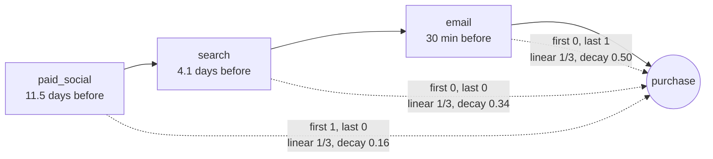

# Attribution: first touch, last touch, linear

Business question: which channel gets credit for the sale, and how much does the answer depend on the model?

## Before you start

- **Level:** 2 (intermediate).
- **Time:** about 2 hours.
- **Builds on:** [Funnel conversion](../02-funnel-conversion/) (a purchase is the end of a path of steps), [Define a metric precisely](../05-define-a-metric-precisely/) (a window and a rule are part of the metric) and [Segmentation and mix effects](../09-segmentation-and-mix-effects/) (splitting a total so the parts add up). Basic Python: `datetime`, sorting tuples, dictionaries.
- **You need:** Python 3.9 or later. Nothing to install.

## The problem

Learnhaven, a fictional online course shop, sets next quarter's marketing budget on Monday 2 November 2026. Hamid, the marketing lead, wants to cut paid social ads, because the dashboard credits them with only about a fifth of September and October purchases while email gets over 40%. Tara, who runs the ads, says people discover courses from ads and only buy later, after a reminder email. Hamid asks you for one table he can trust. You have every tracked marketing touch from 1 August to 31 October and every first purchase in September and October. You will rebuild the credit under four attribution models, with credits that add up exactly to the purchases, and show how much the answer moves with the model.

The files are synthetic, generated by `make_data.py` with a fixed seed. `data/touchpoints.csv` has 1,178 rows (`user_id`, `touch_time`, `channel`), and `data/conversions.csv` has 147 purchases (`user_id`, `conversion_time`, `revenue`). Some touches come after the purchase, some are more than 30 days before it, and a few buyers have no tracked touch at all.

## In plain words

A cricket team wins a match. The opener scored 40, a middle-order batter scored 30, and the finisher hit the winning runs. Who won the match? The newspaper's "player of the match" goes to one person, often the finisher. The scorer's book splits it by runs. Neither is wrong; they answer different questions, and they reward different players.

Marketing has the same problem. A customer saw an ad, later searched for the course, then clicked a reminder email and bought. **Attribution** is the rule that splits the credit for that one sale between the channels on the path. Change the rule and the credit moves, sometimes a lot. The rule does not tell you which channel *caused* the sale; it is a way of sharing out credit.

Terms used in this lesson:

- **Touch (touchpoint):** one tracked contact with a customer through a channel: an ad click, a search visit, an email click.
- **Channel:** where the touch came from: paid_social, search, email, affiliate.
- **Conversion:** here, a first purchase.
- **Path:** the touches that count for one purchase, oldest first.
- **Lookback window:** how far back before the purchase a touch still counts. Here 30 days.
- **First touch:** all credit to the first touch on the path.
- **Last touch:** all credit to the last touch before the purchase.
- **Linear:** equal credit to every touch on the path.
- **Time decay:** more credit to touches closer to the purchase. A touch d days before the purchase gets weight 0.5 ^ (d / half-life), so a touch one **half-life** (here 7 days) older gets half the weight.
- **Credit:** a channel's share of the purchases (or revenue) under a model. The credits of all channels add up to the total.

## What you will build from scratch

- `parse_time(text)` and `load(...)`: one path per purchase, with the 30-day window, touches after the purchase removed and ties in time ordered by channel name.
- `weights(path, model, conv_time)`: one purchase's credit per channel under each of the four models, adding up to 1.
- `attribute(purchases, model, value)`: credits per channel in purchases or in revenue.
- `spread(purchases)`: each channel's lowest and highest credit across the models.

## The idea

Take one purchase and its path. Each model is a list of weights, one per touch, that add up to 1:



Written out, for a path of k touches, touch i being d_i days before the purchase:

    first:       w_1 = 1, every other w_i = 0
    last:        w_k = 1, every other w_i = 0
    linear:      w_i = 1 / k
    time decay:  w_i = 0.5 ^ (d_i / 7) / sum over j of 0.5 ^ (d_j / 7)

A channel's credit for the purchase is the sum of the weights of its touches (a channel that appears twice gets both). Its total credit is the sum over all purchases. Because every purchase hands out exactly 1, **the credits always add up to the number of purchases**, under every model. Weight by revenue instead of 1 and they add up to total revenue. That is the self-check: if your channel totals do not add up, something was dropped or counted twice.

**Building the path is half the work.** The rules this lesson uses:

1. Only touches at or before the purchase time count. A receipt email or a retargeting ad after the purchase did not lead to it.
2. Only touches up to 30 days before the purchase count, boundary included.
3. Order by time; two touches in the same minute are ordered by channel name, so first and last touch are well defined.
4. A purchase with no touch in the window keeps its credit, under the channel `(none)`. Dropping it would hide how much the tracking cannot see.

**How to read the models.** First touch rewards channels that start journeys. Last touch rewards channels that close them. Linear and time decay sit in between. No model is "correct": they are lenses. If a decision changes depending on the lens, the data cannot settle it alone; that is the time for an experiment (switch a channel off in some regions and compare, as in the A/B test lessons).

## Walk through

Step 1. One purchase by hand: an ad on 20 September, a search on 27 September, an email 30 minutes before the purchase on 1 October at 20:00.

```python
import datetime
buy = datetime.datetime(2026, 10, 1, 20, 0)
path = [(datetime.datetime(2026, 9, 20, 9, 0), "paid_social"),
        (datetime.datetime(2026, 9, 27, 18, 0), "search"),
        (datetime.datetime(2026, 10, 1, 19, 30), "email")]
k = len(path)
ages = [(buy - t).total_seconds() / 86400 for t, _ in path]
decay = [0.5 ** (a / 7) for a in ages]
for (t, ch), a, d in zip(path, ages, decay):
    print("%-12s %5.2f days before  first %.2f  last %.2f  linear %.3f  time_decay %.3f" % (
        ch, a, 1.0 if ch == path[0][1] else 0.0, 1.0 if ch == path[-1][1] else 0.0, 1 / k, d / sum(decay)))
```

`ages` is each touch's age in days (seconds / 86,400). `decay` is the unscaled time-decay weight; dividing by `sum(decay)` makes the three add up to 1. It prints:

```
paid_social  11.46 days before  first 1.00  last 0.00  linear 0.333  time_decay 0.162
search        4.08 days before  first 0.00  last 0.00  linear 0.333  time_decay 0.336
email         0.02 days before  first 0.00  last 1.00  linear 0.333  time_decay 0.502
```

Each column adds up to 1. Paid social gets all of the sale, none of it, a third, or 16%, depending only on the rule.

Step 2. Build the paths from the files and count what the rules remove.

```python
import csv
import datetime

def t(text):
    return datetime.datetime.strptime(text, "%Y-%m-%d %H:%M")

touches = {}
with open("data/touchpoints.csv", newline="") as f:
    for r in csv.DictReader(f):
        touches.setdefault(r["user_id"], []).append((t(r["touch_time"]), r["channel"]))
kept = after = too_old = empty = 0
with open("data/conversions.csv", newline="") as f:
    for r in csv.DictReader(f):
        buy = t(r["conversion_time"])
        path = []
        for when, ch in touches.get(r["user_id"], []):
            if when > buy:
                after += 1
            elif buy - when > datetime.timedelta(days=30):
                too_old += 1
            else:
                path.append((when, ch))
        kept += len(path)
        empty += not path
print("kept", kept, "after purchase", after, "older than 30 days", too_old, "purchases with no touch", empty)
```

`touches` maps each user to their touches. For each purchase, each touch is either after it, too old, or kept. `empty += not path` adds 1 when the path is empty. It prints:

```
kept 360 after purchase 20 older than 30 days 12 purchases with no touch 5
```

360 touches make up the 147 paths, 32 are removed by the two time rules, and 5 buyers have no tracked touch.

Step 3. All four models. Running `python3 solution/solution.py` (after you have tried the exercise) prints:

```
channel            first        last      linear  time_decay
(none)               5.0         5.0         5.0         5.0
affiliate           19.0        13.0        15.9        15.8
email                6.0        59.0        31.9        38.3
paid_social         71.0        25.0        46.1        40.4
search              46.0        45.0        48.1        47.5
total              147.0       147.0       147.0       147.0
linear revenue: (none) 395.00, affiliate 1081.65, email 2111.43, paid_social 3108.70, search 3566.22 | total 10263.00
```

Every column adds up to 147, and the linear revenue credits add up to $10,263.00, the total revenue. Read across the rows:

- **Paid social** goes from 25 purchases (17%) under last touch to 71 (48%) under first touch. It opens most journeys and closes few.
- **Email** is the mirror image: 59 under last touch, 6 under first touch. It mostly closes journeys that something else started.
- **Search** is about 45 to 48 under every model. Its credit does not depend on the lens, so it is the one channel you can talk about with confidence.

## Common mistakes

**1. Letting touches after the purchase in (the trap).** A quick "last touch" takes each buyer's latest touch from the touch table, without comparing it to the purchase time:

```python
import csv
import sys
sys.path.insert(0, "solution")
from solution import load, attribute

latest = {}
with open("data/touchpoints.csv", newline="") as f:
    for r in csv.DictReader(f):
        latest[r["user_id"]] = r["channel"]   # the file is sorted by time, so this ends on the latest touch
naive = {}
with open("data/conversions.csv", newline="") as f:
    for r in csv.DictReader(f):
        ch = latest.get(r["user_id"], "(none)")
        naive[ch] = naive.get(ch, 0) + 1
right = attribute(load("data/touchpoints.csv", "data/conversions.csv"), "last")
for ch in sorted(right):
    print("%-12s naive last touch %3d   last touch before purchase %3d" % (ch, naive.get(ch, 0), right[ch]))
```

```
(none)       naive last touch   5   last touch before purchase   5
affiliate    naive last touch  10   last touch before purchase  13
email        naive last touch  64   last touch before purchase  59
paid_social  naive last touch  29   last touch before purchase  25
search       naive last touch  39   last touch before purchase  45
```

The naive version still adds up to 147, so the self-check passes, but it gives email and paid social credit for receipt emails and retargeting ads shown after people had already bought, and takes it from search and affiliate. The test `test_load_window_and_ties` checks the window boundaries.

**2. Counting "touched" or "assisted" purchases and adding them up.** Counting, for each channel, the purchases whose path includes it is a useful view, but the numbers overlap:

```python
import sys
sys.path.insert(0, "solution")
from solution import load

purchases = load("data/touchpoints.csv", "data/conversions.csv")
touched = {}
for p in purchases:
    for ch in set(ch for _, ch in p["path"]) or {"(none)"}:
        touched[ch] = touched.get(ch, 0) + 1
print(dict(sorted(touched.items())), "sum", sum(touched.values()), "purchases", len(purchases))
```

```
{'(none)': 5, 'affiliate': 39, 'email': 74, 'paid_social': 87, 'search': 86} sum 291 purchases 147
```

291 "purchases" from 147. If each channel team reports its touched count, the company appears to have sold almost twice what it did. Only a model whose weights add up to 1 per purchase can be summed.

**3. Reading any model as cause and effect.** All four models share credit among touches that happened; none asks what would have happened without a channel. Some email buyers would have bought anyway. To measure what a channel adds (its **incrementality**), run a holdout: switch it off for a random group and compare.

**4. Dropping buyers with no touch.** The 5 `(none)` purchases are 3.4% of sales. Remove them and every channel's share goes up, and nobody notices that tracking misses some buyers. Keep the row.

## Your turn

Open `exercise.py` and fill in the five functions using only `csv` and `datetime`. The docstrings only say what to return; the path rules and the four models are in The idea. Then run, from this folder:

    python3 test_lesson.py

The tests use the committed data, a second dataset built with another seed, and small hand-made cases: a touch exactly 30 days before the purchase (in) and one a minute older (out), a touch at the purchase minute (in) and one a minute after (out), two touches in the same minute, a buyer with no touches, a channel that appears twice on a path, a longer half-life, an unknown model name and no purchases at all. To see the reference solution pass: `CHECK_SOLUTION=1 python3 test_lesson.py`.

Stretch: add a "position based" model (40% to the first touch, 40% to the last, 20% shared by the middle; 50/50 for a path of two, 100% for a path of one) and check its credits still add up to 147.

## Check yourself

1. Why do the credits under every model add up to the number of purchases, and why is that a useful check?
2. Paid social gets 25 purchases under last touch and 71 under first touch. Which number is right?
3. What does a 7-day half-life mean, and what happens to the time-decay credits if you make it 1 day?
4. Two channel teams each report the purchases their channel "touched", and the two numbers add up to more than total sales. What went wrong?

<details>
<summary>Answers</summary>

1. Each purchase hands out weights that add up to 1, so summing over purchases gives the number of purchases. If the channel totals do not add up, a purchase was dropped (often one with no touch) or counted twice.
2. Neither alone. They answer different questions: last touch asks who closed, first touch asks who opened. The honest answer is the range (25 to 71) plus the fact that paid social mostly starts journeys. If the budget decision flips inside that range, run a holdout test.
3. A touch 7 days older than another gets half its weight. With a 1-day half-life, the weights fall very fast, so time decay moves close to last touch (most credit to the closing email).
4. Touched counts overlap: a purchase with an ad, a search and an email counts once for each team. They are fine as a view of reach, but only credits from a model whose weights add up to 1 per purchase can be added.

</details>

## What to tell the stakeholder

To Hamid: "Paid social's credit depends heavily on the rule. Last touch gives it 25 of 147 purchases (17%); first touch gives it 71 (48%); linear and time decay give it 40 to 46. It opens most journeys that email later closes. Search is steady at 45 to 48 under every rule. The current dashboard also credits receipt emails and ads sent after the purchase. I would not cut paid social on last-touch numbers. If we want a firm answer, pause it in a random half of regions for four weeks and compare purchases."

## In real job postings

In the Real Analyst Jobs data drop of 25 October 2026, 1,477 of the 2,056 US analyst postings that list a tool (71.8%) ask for SQL, where touch and purchase tables like these are usually joined. See [SQL data analyst jobs](https://realanalystjobs.com/jobs/sql-data-analyst-jobs) and the [analyst job market report](https://realanalystjobs.com/analyst-job-market).

## Next

[12: Unit economics: LTV, CAC and payback](../12-ltv-cac-and-payback/)
