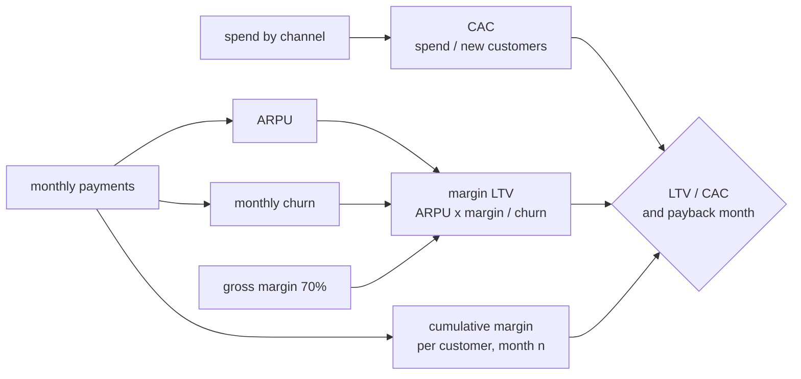

# Unit economics: LTV, CAC and payback

Business question: is paid social acquisition profitable once churn is included?

## Before you start

- **Level:** 2 (intermediate).
- **Time:** about 2 hours.
- **Builds on:** [Retention curves and churn](../08-retention-curves-and-churn/) (churn, and leaving out customers too young to have an answer), [Growth accounting](../07-growth-accounting/) (calendar month arithmetic) and [Attribution](../11-attribution-models/) (which channel a customer is credited to). Basic Python: dictionaries and `csv.DictReader`.
- **You need:** Python 3.9 or later. Nothing to install.

## The problem

Fitloop, a fictional workout tracking app, launched a paid plan in January 2026. Jo, the founder, wants to double paid social spend in November and will ask the board for the budget on Thursday 5 November. The growth deck says each paid social customer is worth $356 against a cost of $78 to acquire, more than 4.5 times what they cost. Ana, the finance lead, does not believe it: paid social customers seem to cancel quickly. You have every paid customer who signed up from January to September, every monthly payment up to October, and the marketing spend by channel. You will compute cost per customer, lifetime value on margin with churn included, and how many months each channel takes to earn back what it cost.

The files are synthetic, generated by `make_data.py` with a fixed seed. `data/customers.csv` has 276 customers (`customer_id`, `signup_month`, `channel`). `data/payments.csv` has 1,226 rows, one per customer per paid month (`customer_id`, `month`, `amount`). `data/spend.csv` has 36 rows (`month`, `channel`, `spend`), including "brand" spend on podcasts and posters that is not tied to any channel's customers. Finance gives the gross margin as 70%.

## In plain words

A tiffin service pays a food blogger Rs 400 to bring in each new customer. Each customer pays Rs 100 a week, and after the cost of the food the service keeps Rs 30. If customers stayed for ever, the blogger would be a bargain. But one in five customers stops ordering each week. The service needs three numbers: what a customer costs to win, what it keeps from them before they leave, and how many weeks until the first number is earned back.

Those are the three numbers of **unit economics**, the economics of one customer.

Terms used in this lesson:

- **CAC (customer acquisition cost):** marketing spend on a channel divided by the new customers it brought.
- **ARPU (average revenue per user):** here, revenue per paid customer-month.
- **Gross margin:** the share of revenue left after the direct cost of serving it (app store fees, hosting, support). Here 70%, from finance.
- **Monthly churn:** of the paid months that could have been followed by another, the share that were not. A customer who pays in March and not in April churned in March.
- **LTV (lifetime value):** the money a customer brings over their whole time as a customer. **Margin LTV** counts margin, not revenue.
- **LTV/CAC:** how many times a customer pays back their acquisition cost. Below 1 means each customer loses money.
- **Payback period:** months until the cumulative margin per acquired customer reaches CAC.
- **Censored:** a customer still paying in October, the last month of data. We do not yet know when they will cancel.

## What you will build from scratch

- `months_between` and `load(folder)`: month arithmetic and the three tables.
- `cac(spend, customers, channel)`: cost per new customer, None for spend with no customers of its own.
- `arpu_and_churn(...)`: revenue per paid month, and monthly churn with October left out of the at-risk months.
- `margin_ltv(arpu, churn)`: ARPU x margin / churn.
- `margin_curve(...)`: average cumulative margin per customer after n months, using only customers old enough to have had n months.
- `payback_months(curve, cac)`: the first month the curve reaches CAC, or None.

## The idea



**CAC.** Spend on a channel / customers from that channel. Brand spend has no customers of its own, so it has no CAC; it belongs in a fully loaded, company-wide CAC, not in any one channel's.

**Churn and the at-risk months.** Every paid month is a chance to cancel, except October: October payers will renew or not in November, which is in the future. So:

    at risk  = paid months before the as-of month
    churned  = at-risk months not followed by a payment the next month
    churn    = churned / at risk

Leaving October out is the same right-censoring rule as in lesson 08: unknown is not "stayed" and not "left".

**LTV with churn.** If a constant share c of customers leaves each month, a customer stays on average 1 / c months (a geometric distribution: stay 1 month with chance c, 2 months with chance (1 - c) x c, and so on). So:

    margin LTV = ARPU x margin x (1 / churn) = ARPU x margin / churn

This is a model, not an observation: it assumes churn stays the same at every tenure. Check it against the curve.

**The curve and payback.** For each n = 1, 2, 3, ..., take the customers who have been around for at least n months, add up the margin each paid in their first n months (a customer who cancelled in month 2 adds their 2 months), and divide by the number of those customers. Customers too young for month n are left out of that point, not counted as 0. Payback is the first n where the curve reaches CAC. If it never does within the data, report "not yet", not a guess.

## Walk through

Step 1. One customer type by hand: $15 a month, 70% margin, 10% monthly churn, $60 to acquire.

```python
arpu, margin, churn, cac = 15.00, 0.70, 0.10, 60.00
survival = 1.0
cumulative = 0.0
for n in range(1, 13):
    cumulative += arpu * margin * survival
    survival *= 1 - churn
    if n in (1, 3, 6, 9, 12):
        print("month %2d  still paying %.3f  cumulative margin %.2f" % (n, survival / (1 - churn), cumulative))
print("margin LTV %.2f  LTV/CAC %.2f" % (arpu * margin / churn, arpu * margin / churn / cac))
```

`survival` is the share of the starting customers who pay in the current month; it falls by 10% after each month. `cumulative` adds the expected margin of each month, $10.50 times the share still paying. It prints:

```
month  1  still paying 1.000  cumulative margin 10.50
month  3  still paying 0.810  cumulative margin 28.46
month  6  still paying 0.590  cumulative margin 49.20
month  9  still paying 0.430  cumulative margin 64.32
month 12  still paying 0.314  cumulative margin 75.34
margin LTV 105.00  LTV/CAC 1.75
```

The $60 CAC is earned back in month 9. Over a whole lifetime a customer is worth $105 of margin, but after a year only $75 of it has arrived: LTV is spread over a long tail.

Step 2. CAC from the spend file.

```python
import csv
spend, customers = {}, {}
with open("data/spend.csv", newline="") as f:
    for r in csv.DictReader(f):
        spend[r["channel"]] = spend.get(r["channel"], 0.0) + float(r["spend"])
with open("data/customers.csv", newline="") as f:
    for r in csv.DictReader(f):
        customers[r["channel"]] = customers.get(r["channel"], 0) + 1
for ch in sorted(spend):
    n = customers.get(ch, 0)
    print("%-12s spend %8.2f  customers %3d  CAC %s" % (ch, spend[ch], n, "%.2f" % (spend[ch] / n) if n else "-"))
print("blended CAC, all spend / all customers: %.2f" % (sum(spend.values()) / sum(customers.values())))
```

```
brand        spend  5540.70  customers   0  CAC -
paid_social  spend 10030.91  customers 128  CAC 78.37
referral     spend   780.00  customers  52  CAC 15.00
search       spend  4355.20  customers  96  CAC 45.37
blended CAC, all spend / all customers: 75.02
```

Paid social costs $78.37 a customer, search $45.37, referral a flat $15 bonus. Brand has spend and no customers, so it gets no CAC.

Step 3. The full table. Running `python3 solution/solution.py` (after you have tried the exercise) prints:

```
channel      customers    CAC   ARPU  churn  margin LTV  LTV/CAC  payback
paid_social        128  78.37  14.82  0.150       69.29     0.88  never
search              96  45.37  15.22  0.099      107.42     2.37  6 months
referral            52  15.00  13.10  0.028      322.25    21.48  2 months
paid_social margin per customer by month n: 1:10.3  2:18.9  3:26.2  4:32.4  5:38.6  6:44.5  7:48.7  8:53.4  9:51.9  10:44.8
```

Paid social customers pay about the same as the others ($14.82 a month), but 15% of them cancel each month, against 10% for search and 3% for referral. Their margin LTV is $69.29, below the $78.37 they cost: each one loses about $9. The observed curve agrees: it peaks around $53 and never reaches $78 in the 10 months of data. Search pays back in 6 months and referral in 2.

Step 4. Why the curve bends down at the end. Print how many customers stand behind each point.

```python
import sys
sys.path.insert(0, "solution")
from solution import load, margin_curve, months_between

customers, payments, spend = load("data")
curve = margin_curve(customers, payments, "paid_social")
for n in (1, 3, 6, 8, 9, 10):
    eligible = sum(1 for s, ch in customers.values() if ch == "paid_social" and months_between(s, "2026-10") + 1 >= n)
    print("month %2d  margin per customer %5.2f  customers old enough %3d" % (n, curve[n], eligible))
```

```
month  1  margin per customer 10.33  customers old enough 128
month  3  margin per customer 26.21  customers old enough 114
month  6  margin per customer 44.52  customers old enough  71
month  8  margin per customer 53.38  customers old enough  46
month  9  margin per customer 51.94  customers old enough  29
month 10  margin per customer 44.80  customers old enough  13
```

A cumulative number cannot really fall. Each point is an average over a different set of customers: month 10 is only the 13 January customers, and they happened to cancel early. Trust the curve where many customers stand behind it, and read the tail as noise.

## Common mistakes

**1. LTV without churn or without margin (the trap).** The growth deck used "ARPU x 24 months". Two other shortcuts are common:

```python
import sys
sys.path.insert(0, "solution")
from solution import load, cac, arpu_and_churn, MARGIN

customers, payments, spend = load("data")
k = cac(spend, customers, "paid_social")
arpu, churn = arpu_and_churn(customers, payments, "paid_social")
for label, ltv in (("revenue x 24 months", arpu * 24),
                   ("revenue / churn", arpu / churn),
                   ("margin / churn", arpu * MARGIN / churn)):
    print("%-20s LTV %6.2f  LTV/CAC %.2f" % (label, ltv, ltv / k))
```

```
revenue x 24 months  LTV 355.56  LTV/CAC 4.54
revenue / churn      LTV  98.99  LTV/CAC 1.26
margin / churn       LTV  69.29  LTV/CAC 0.88
```

The deck's $356 assumes every customer pays for two years; at 15% monthly churn the average paid social customer stays under 7 months. Using revenue instead of margin still says "profitable" (1.26), because it counts the 30% that goes to app stores and hosting as profit. Only the margin version, with churn, answers the question, and it says no.

**2. Counting October as churn, or as retention.** If October payments were counted as "did not renew" because November is missing, churn would jump and LTV would fall for no reason. If customers still paying were treated as never cancelling, LTV would be too high. Leave the as-of month out of the at-risk months. The test `test_churn_and_censoring` checks this.

**3. One blended CAC.** All spend over all customers is $75.02. It mixes brand spend, cheap referrals and expensive paid social, so it says nothing about any channel, and it moves whenever the channel mix moves (lesson 09). Use channel CAC for channel decisions, and a fully loaded CAC (with brand) for the company-wide view.

**4. Trusting the formula over the data.** ARPU x margin / churn assumes the same churn every month. Real products often lose many customers in month 1 and few later, which makes the formula too pessimistic early and too optimistic late. Put it next to the observed curve; if they disagree, report the curve and say how far it goes.

## Your turn

Open `exercise.py` and fill in the seven functions using only `csv`. `next_month` is given. The docstrings only say what to return; the definitions are in The idea. Then run, from this folder:

    python3 test_lesson.py

The tests use the committed data, a second dataset built with another seed, and small hand-made cases: brand spend with no customers, a channel with no customers, a customer still paying in the as-of month, the December to January boundary, zero observed churn, a cancelled customer in the curve, a customer too young for a month, and a curve that reaches CAC exactly. To see the reference solution pass: `CHECK_SOLUTION=1 python3 test_lesson.py`.

Stretch: compute churn by tenure (month 1, month 2, months 3 and later) for each channel and build an LTV from those three rates instead of one. Does paid social look better or worse?

## Check yourself

1. Why does the as-of month not count as an at-risk month for churn?
2. A channel has LTV/CAC of 0.9. Should you switch it off tomorrow?
3. Where does brand spend go in a CAC calculation?
4. Why can the observed cumulative margin curve go down at the end, and what do you do about it?

<details>
<summary>Answers</summary>

1. Whether an October payer renews is decided in November, which is not in the data. Counting them as churned or as retained would be a guess; leaving the month out is the right-censoring rule.
2. Not blindly. Each customer loses money on these numbers, so do not scale it up. Before cutting, check what the channel does that LTV/CAC misses (lesson 11: paid social often starts journeys other channels close), and whether cheaper targeting or a better first month could lift retention. A holdout test can measure what the channel adds.
3. Not in any single channel's CAC, because it brought no customers you can count. Report it in a fully loaded, company-wide CAC (all spend / all new customers), and say so.
4. Each point averages over a different group: only older customers can stand behind the later months, and they are few. Show how many customers each point rests on, and read the tail as noise.

</details>

## What to tell the stakeholder

To Jo: "Paid social customers cost $78 each and, after app store and hosting costs, bring in about $69 over their lifetime, because 15% of them cancel every month. So each one loses about $9, and on average they have not earned back their cost in any of the 10 months we have. The $356 in the deck assumed two years of revenue with no cancellations. Search earns back its $45 in 6 months and referral its $15 in 2. I would not double paid social; I would test cheaper targeting or a better first month and put more into referral and search. These numbers assume churn stays at today's rate, and the oldest month groups are small."

## In real job postings

In the Real Analyst Jobs data drop of 25 October 2026, 996 of the 2,056 US analyst postings that list a tool (48.4%) ask for Python, a common tool for building cohort curves and unit economics like these. See [Python data analyst jobs](https://realanalystjobs.com/jobs/python-data-analyst-jobs) and [data analyst jobs in the USA](https://realanalystjobs.com/jobs/data-analyst-jobs-in-usa).

## Next

[13: Marketplace metrics and liquidity](../13-marketplace-metrics/) (Level 3): what share of job posts get an application within 48 hours, and which side of a marketplace is short.
