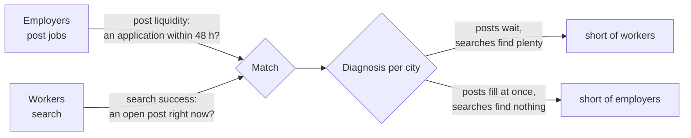

# Marketplace metrics and liquidity

Business question: what share of job posts get an application within 48 hours, and which side is the constraint?

## Before you start

- **Level:** 3 (advanced).
- **Time:** about 2 hours.
- **Builds on:** [Define a metric precisely](../05-define-a-metric-precisely/) (a numerator, a denominator and the rules for edge cases), [Retention curves and churn](../08-retention-curves-and-churn/) (right-censoring: leaving out what is too young to have an answer), [Segmentation and mix effects](../09-segmentation-and-mix-effects/) (a pooled rate can hide its segments) and [North star and guardrails](../04-north-star-and-guardrails/) (one number is never the whole story).
- **You need:** Python 3.9 or later. Nothing to install.

## The problem

Shiftkite is a fictional marketplace for short-term work: cafes, shops and delivery firms post jobs, and local workers search and apply. It runs in Pune, Jaipur and Kochi. Aditi, the head of growth, has one budget for next quarter and two ways to spend it: ads that bring in more workers, or a sales team that signs up more employers. The monthly report says "78.7% of posts get an application within 48 hours", so the plan on the table is to spend it all on employers. Aditi wants to know, by Monday 9 November, whether that number is right, and city by city which side is short. You have the posts, the applications and the worker searches, exported at midnight on 1 November 2026.

The files are synthetic, generated by `make_data.py` with a fixed seed. `data/posts.csv` has 575 posts from 24 September to 31 October (`post_id`, `city`, `category`, `posted_at`, `closed_at`; a blank `closed_at` means still open at the export). `data/applications.csv` has 1,232 rows (`application_id`, `post_id`, `worker_id`, `applied_at`). `data/searches.csv` has 1,352 worker searches in October (`search_id`, `worker_id`, `city`, `category`, `searched_at`). Times are local, `YYYY-MM-DD HH:MM`.

## In plain words

Think of a Saturday vegetable market. If shoppers walk past empty stalls, the market is short of sellers. If sellers sit next to piles of tomatoes nobody buys, it is short of shoppers. A market works when a shopper who comes in finds what they want, and a seller who sets up sells something, both fast enough. That is **liquidity**: the chance that someone who shows up on either side gets a match quickly. You cannot judge it from one side only, because a market with too many sellers looks wonderful to shoppers.

Terms used in this lesson:

- **Two-sided marketplace:** a business that matches two groups who need each other. Here **supply** is workers (the labour on offer) and **demand** is employers (the job posts).
- **Post liquidity** (the demand side's view): the share of eligible posts that got at least one application within 48 hours of being posted.
- **Eligible:** old enough to have had the full 48 hours before the export. A post made on 31 October at 09:00 has had 15 hours; whether it gets an application in time is not known yet. Leaving it out is **right-censoring**, as in lesson 08.
- **Search success** (the supply side's view): the share of worker searches that found at least one open post in the same city and category at the moment of the search.
- **Open:** posted at or before the search time, and not yet closed (closed_at after the search time, or blank).
- **Constraint:** the side that is short. If posts wait and searches find plenty, the market is short of workers. If searches find nothing and posts fill at once, it is short of employers.

## What you will build from scratch

- `post_liquidity(posts, applications, as_of, window_hours)`: filled and eligible posts by city, plus a pooled "all".
- `search_success(searches, posts)`: searches that found an open post, by city, plus "all".
- `diagnose(liquidity, success, target)`: which side each city is short of.

## The idea



**Post liquidity, exactly.** For each post, the wait is applied_at - posted_at for each of its applications. Then:

    eligible  = posts with posted_at + 48 h <= export time
    filled    = eligible posts with some application where 0 <= wait <= 48 h
    liquidity = filled / eligible

Three rules hide in that line. An application at exactly 48:00 counts. An application with a negative wait is a clock error (the data has 3), not a fill. A young post is left out entirely, even if it already has an application, because counting only the young posts that succeeded early would bias the rate up.

**Search success, exactly.** For each search at time t in city c and category k:

    found = some post in (c, k) with posted_at <= t and (closed_at is blank or t < closed_at)

A post that closed at 12:00 is not open for a search at 12:00. Searches in early October need posts from late September, which is why the posts file starts a week earlier: a file that starts on 1 October would make the first days look empty (the left edge of the data, the mirror image of censoring).

**The diagnosis.** Pick one target for both sides, here 80%, agreed before looking:

| post liquidity | search success | short of |
|---|---|---|
| below target | at or above | workers |
| at or above | below target | employers |
| below | below | both (a thin market, or a matching problem) |
| at or above | at or above | neither |

Do it per city. A marketplace is many local markets: a worker in Kochi cannot take a shift in Jaipur.

## Walk through

Step 1. Look at each city before computing any rate.

```python
import sys
sys.path.insert(0, "solution")
from solution import load

posts, apps, searches = load("data")
first = {}
by_id = {p["post_id"]: p for p in posts}
for a in apps:
    wait = (a["applied_at"] - by_id[a["post_id"]]["posted_at"]).total_seconds() / 3600
    if wait >= 0 and wait < first.get(a["post_id"], float("inf")):
        first[a["post_id"]] = wait
for city in ("Jaipur", "Kochi", "Pune"):
    waits = sorted(first[p["post_id"]] for p in posts if p["city"] == city and p["post_id"] in first)
    n = sum(1 for p in posts if p["city"] == city)
    print("%-6s posts %3d  with any application %3d  median first wait %4.1f h" % (city, n, len(waits), waits[len(waits) // 2]))
print("applications stamped before their post:", sum(1 for a in apps if a["applied_at"] < by_id[a["post_id"]]["posted_at"]))
```

`load` parses every time into a `datetime`. `first` keeps, for each post, the shortest non-negative wait in hours. The loop prints how many posts each city has, how many ever got an application, and the middle first wait.

```
Jaipur posts 258  with any application 181  median first wait 18.1 h
Kochi  posts  87  with any application  87  median first wait  0.7 h
Pune   posts 230  with any application 213  median first wait  5.6 h
applications stamped before their post: 3
```

Jaipur has the most posts, and they wait: the middle first application comes after 18 hours, and 77 posts never got one. Kochi has few posts and every one is answered within the hour.

Step 2. Post liquidity, and what two common shortcuts do to it.

```python
import datetime
import sys
sys.path.insert(0, "solution")
from solution import load, post_liquidity, rate, AS_OF

posts, apps, searches = load("data")
right = post_liquidity(posts, apps)
young_counted = post_liquidity(posts, apps, as_of=AS_OF + datetime.timedelta(hours=48))
ever = post_liquidity(posts, apps, window_hours=24 * 60, as_of=AS_OF + datetime.timedelta(days=60))
for city in ("Jaipur", "Kochi", "Pune", "all"):
    print("%-6s right %5.1f%% of %3d   young posts counted %5.1f%% of %3d   any application ever %5.1f%%"
          % (city, 100 * rate(right[city]), right[city][1],
             100 * rate(young_counted[city]), young_counted[city][1], 100 * rate(ever[city])))
```

`right` is the definition. `young_counted` pretends the export was 48 hours later, so every post is eligible but the applications still stop at midnight on 1 November: that is what you get by forgetting censoring. `ever` uses a 60-day window over every post: "has the post ever had an application".

```
Jaipur right  57.9% of 242   young posts counted  56.2% of 258   any application ever  70.2%
Kochi  right 100.0% of  85   young posts counted 100.0% of  87   any application ever 100.0%
Pune   right  93.5% of 217   young posts counted  91.7% of 230   any application ever  92.6%
all    right  78.7% of 544   young posts counted  77.0% of 575   any application ever  83.7%
```

The report's 78.7% is computed correctly. Counting young posts drags every rate down a little; "ever" pushes Jaipur up 12 points, because many of its posts get their first applicant on day 3 or later, too late for a shift that needed filling this week. But the bigger story is in the rows: 57.9% in Jaipur, 100% in Kochi. The pooled 78.7% describes no city.

Step 3. The worker's side. What could a worker in each city see at 18:00 on Wednesday 14 October?

```python
import sys
sys.path.insert(0, "solution")
from solution import load, parse_time

posts, apps, searches = load("data")
when = parse_time("2026-10-14 18:00")
for city in ("Jaipur", "Kochi", "Pune"):
    open_now = {}
    for p in posts:
        if p["city"] == city and p["posted_at"] <= when and (p["closed_at"] is None or when < p["closed_at"]):
            open_now[p["category"]] = open_now.get(p["category"], 0) + 1
    print("%-6s open posts at %s: %s" % (city, when, ", ".join("%s %d" % (c, open_now.get(c, 0)) for c in ("delivery", "kitchen", "retail"))))
```

```
Jaipur open posts at 2026-10-14 18:00:00: delivery 11, kitchen 8, retail 10
Kochi  open posts at 2026-10-14 18:00:00: delivery 4, kitchen 2, retail 0
Pune   open posts at 2026-10-14 18:00:00: delivery 5, kitchen 5, retail 6
```

A Kochi worker looking for retail work that evening finds nothing. In Jaipur 29 posts sit open, many of them for days.

Step 4. Both sides and the diagnosis. Running `python3 solution/solution.py` (after you have tried the exercise) prints:

```
city      posts filled 48h  searches found post  short of
Jaipur   140/242 =  57.9%   209/209 = 100.0%  workers
Kochi     85/ 85 = 100.0%   440/623 =  70.6%  employers
Pune     203/217 =  93.5%   520/520 = 100.0%  neither
all      428/544 =  78.7%  1169/1352 =  86.5%  workers
```

Jaipur's posts wait while every worker search finds something: short of workers. Kochi's posts fill at once while 29.4% of worker searches find nothing: short of employers. Pune is healthy on both sides. The pooled row says "short of workers", which is wrong for Kochi.

## Common mistakes

**1. One pooled number, one decision (the trap).** 78.7% sounds healthy and suggests one plan for the whole company. The pooled row is a mix of three local markets with opposite problems; spending the whole budget on employers would make Jaipur worse (more posts waiting for the same few workers) and help only Kochi. A marketplace metric must be cut by the unit where matching happens (here the city, and in practice often city and category), the same lesson as mix effects in lesson 09.

**2. Reading one side's metric as health.** Kochi gets the most applications per post, which looks like the best market:

```python
import sys
sys.path.insert(0, "solution")
from solution import load, AS_OF
import datetime

posts, apps, searches = load("data")
eligible = {p["post_id"]: p["city"] for p in posts if p["posted_at"] + datetime.timedelta(hours=48) <= AS_OF}
count = {}
for a in apps:
    if a["post_id"] in eligible:
        count[a["post_id"]] = count.get(a["post_id"], 0) + 1
for city in ("Jaipur", "Kochi", "Pune"):
    ids = [p for p, c in eligible.items() if c == city]
    n = [count.get(p, 0) for p in ids]
    print("%-6s applications per post %.2f   posts with none %4.1f%%   most on one post %d"
          % (city, sum(n) / len(n), 100 * n.count(0) / len(n), max(n)))
```

```
Jaipur applications per post 0.89   posts with none 27.3%   most on one post 4
Kochi  applications per post 5.74   posts with none  0.0%   most on one post 12
Pune   applications per post 2.30   posts with none  5.5%   most on one post 8
```

5.74 applications per post is great for an employer and a warning for workers: 12 people applying for one shift means 11 did not get it. A high number on one side is often a shortage on the other. Always put the two sides next to each other.

**3. Counting posts that are too young.** A post from 31 October has not had its 48 hours. Counting it as unfilled lowers the rate (77.0% instead of 78.7% here), and the bias grows the more recent posting is, so a fast-growing city looks worse every month for no reason.

**4. "Ever" instead of "within 48 hours".** Jaipur jumps from 57.9% to 70.2%. An employer who needed someone for Saturday does not care about an applicant on Tuesday. Keep the time window in the metric's name.

**5. Clock errors and boundaries.** Three applications are stamped minutes before their post. A rule like "the first application" without `wait >= 0` would count them as instant fills. And decide whether 48:00 is in or out once, in writing; here it is in.

## Your turn

Open `exercise.py`. `parse_time`, `load` and `rate` are given. Write `post_liquidity`, `search_success` and `diagnose`; the docstrings give the return shapes, The idea gives the rules. Then run, from this folder:

    python3 test_lesson.py

The tests compare your numbers with SQLite queries over the raw files, on the committed data and on a second dataset, and use small hand-made cases: an application at exactly 48:00 and at 48:01, a clock error, a post 1 minute too young, an application for a post that does not exist, a post that closes at the second of the search, a city with no posts, an empty input, and a rate exactly at the target. To see the reference solution pass: `CHECK_SOLUTION=1 python3 test_lesson.py`.

Stretch: cut both metrics by city and category. Is any Pune category short of workers? Then compute post liquidity by posting day and plot it: does Jaipur get worse as the month goes on?

## Check yourself

1. Why must a post younger than 48 hours be left out, even if it already has an application?
2. A city has 6 applications per post. Is that market healthy?
3. Post liquidity and search success are both below target in a city. What could that mean?
4. Why measure search success at the moment of the search instead of "posts open that day"?

<details>
<summary>Answers</summary>

1. Its outcome is not known yet. If you keep only the young posts that already succeeded, and drop the rest, you count early successes and none of the failures, which biases the rate up. If you count the young ones without an application as failures, you bias it down. Both are guesses; censoring removes them.
2. Not necessarily. It is healthy for employers, but it means most applicants lose out. Check the worker side: if searches often find no open post, the city is short of employers and workers will drift away.
3. Too few people on both sides (a thin market, common in a new city), or a matching problem: workers and posts exist but in different categories, hours or neighbourhoods, or the search does not show them. Cut by category and time of day before deciding.
4. Because that is what the worker experienced. A post opened at 20:00 and filled at 21:00 was invisible to someone who searched at 10:00. "Open that day" overstates what workers saw.

</details>

## What to tell the stakeholder

To Aditi: "The 78.7% is a pooled number that hides two opposite problems. In Jaipur only 57.9% of posts get an application within 48 hours, while every worker search finds open posts: Jaipur is short of workers. In Kochi every post is answered, but 29.4% of worker searches find nothing: Kochi is short of employers. Pune is healthy on both sides. I recommend spending on worker acquisition in Jaipur and employer sales in Kochi, not one plan for all three. This is one month of data and an 80% target we chose; Kochi's numbers rest on only 85 posts, and I have not yet checked by job category, which could show a smaller mismatch hiding inside Pune."

## In real job postings

In the Real Analyst Jobs data drop of 25 October 2026 ([data/job-market/2026-10](../../../data/job-market/2026-10/)), 1,477 of the 2,056 US analyst postings that list a tool (71.8%) ask for SQL, the usual way to compute time-window metrics like these from event tables. Browse [product analyst jobs](https://realanalystjobs.com/jobs/product-analyst-jobs).

## Next

[14: Causal impact without an experiment: difference in differences](../14-difference-in-differences/)
