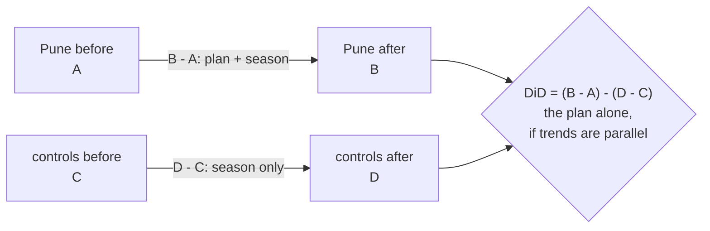

# Causal impact without an experiment: difference in differences

Business question: we launched in one city and not the others. Did it work?

## Before you start

- **Level:** 3 (advanced).
- **Time:** about 2 hours.
- **Builds on:** [A/B test from scratch](../../02-statistics-and-experiments/03-ab-test-from-scratch/) (why a control group is needed), [Linear regression from scratch](../../02-statistics-and-experiments/11-linear-regression-from-scratch/) (least squares, a coefficient), [Correlation, causation and Simpson](../../02-statistics-and-experiments/10-correlation-causation-and-simpson/) (a comparison that is confounded) and [Segmentation and mix effects](../09-segmentation-and-mix-effects/) (comparing averages across groups).
- **You need:** Python 3.9 or later. Nothing to install.

## The problem

Tiffinbell, the fictional food delivery app from phase 00, launched a weekly lunch plan in Pune on Monday 27 July 2026 (week 9) and not in its other three cities, Nashik, Indore and Nagpur. There was no A/B test: the whole city got it. Meera, the head of growth, must decide by Friday 6 November whether to roll the plan out to the other three cities. The launch slide says "Pune orders up 23.6% since launch". You have orders per delivery zone per week for all four cities, 16 weeks from 1 June to 20 September, 6 zones per city. You need one number for what the plan itself added, a way to check it, and a recommendation with its limits.

The file is synthetic, generated by `make_data.py` with a fixed seed: `data/zone_weeks.csv` has 384 rows (`city`, `zone`, `week`, `week_start`, `orders`).

## In plain words

A cricket club changes its coach in June and wins more matches in July. Was it the coach? Maybe, but July is also when the season's easy fixtures come round. So you look at a similar club that did not change its coach. If that club also won more in July, part of the jump is the season, not the coach. The coach's effect is your club's change minus the other club's change: a difference of two differences.

Terms used in this lesson:

- **Treated:** the group that got the change (Pune). **Control:** groups that did not (the other cities).
- **Pre period** and **post period:** weeks before the launch week (1 to 8) and from the launch week on (9 to 16).
- **Counterfactual:** what Pune would have done without the plan. It cannot be observed; every method guesses it somehow.
- **Difference in differences (DiD):** (treated after - treated before) - (control after - control before). The control's change is the guess for how Pune would have changed anyway.
- **Parallel trends:** the assumption DiD rests on. Without the launch, the treated and control groups would have moved by the same amount. It can never be proved for the post period, but it can be checked on the pre period.
- **Interaction term:** in a regression, a column that is the product of two others (treated x post). Its coefficient is the DiD.
- **Placebo test:** run the same method where there was no launch (a fake launch date, or a city that was not treated). It should find about nothing.

## What you will build from scratch

- `cell_means` and `did_from_means`: the four averages and the DiD from them.
- `ols`: least squares for any number of columns, by solving the normal equations.
- `did_regression`: orders = a + b x treated + c x post + d x treated x post, whose d must match the DiD from means.
- `slope`, `pre_gaps` and `pre_trend_slope`: the weekly gap between Pune and its controls before launch, and how fast it moves.

## The idea

Each zone-week falls into one of four cells:

| | before (weeks 1 to 8) | after (weeks 9 to 16) |
|---|---|---|
| Pune (treated) | A | B |
| controls | C | D |

    DiD = (B - A) - (D - C)

B - A mixes the plan with everything else that changed over the summer (the monsoon, a festival). D - C is that "everything else", measured where there was no plan. Subtracting removes it, as long as it hit Pune and the controls equally.



**The same thing as a regression.** For every zone-week row, set T = 1 for Pune and 0 for a control, P = 1 from week 9 and 0 before, and fit by least squares:

    orders = a + b x T + c x P + d x (T x P)

Read off each cell: a control row before launch is a, so a = C. A control row after is a + c, so c = D - C. Pune before is a + b, so b = A - C. Pune after is a + b + c + d, so d = B - A - (D - C), the DiD. With four coefficients for four cells the model fits every cell mean exactly, so d equals the DiD of means even when the cells hold different numbers of rows. Checking that the two routes agree catches bugs in both. The regression is worth having because it extends: add zone and week columns (fixed effects), or several treated cities, and the means table no longer does.

**Least squares by hand.** For rows X (each a list of column values) and outcomes y, the coefficients b solve the **normal equations** (X'X) b = X'y, where X'X[i][j] = sum over rows of x_i x x_j and X'y[i] = sum of x_i x y. Solve the small system by Gaussian elimination. If one column is a mix of the others (for example no control rows after launch, so P and T x P are the same column), X'X has no inverse and there is no single answer: raise an error rather than print a number.

**Checking parallel trends.** For each pre-period week, compute gap(week) = Pune mean - control mean. If the trends are parallel the gap is flat. Fit a straight line to the gaps; its slope, in orders per zone-week per week, should be close to 0. A slope of -2.6 means the control was catching up with Pune by 2.6 orders a week before anything launched, and would presumably keep doing so after, which DiD would wrongly subtract from the plan's effect.

## Walk through

Step 1. Before and after, city by city.

```python
import csv
sums = {}
with open("data/zone_weeks.csv", newline="") as f:
    for r in csv.DictReader(f):
        key = (r["city"], "after" if int(r["week"]) >= 9 else "before")
        s = sums.setdefault(key, [0.0, 0])
        s[0] += float(r["orders"])
        s[1] += 1
for city in ("Pune", "Nashik", "Indore", "Nagpur"):
    b = sums[(city, "before")][0] / sums[(city, "before")][1]
    a = sums[(city, "after")][0] / sums[(city, "after")][1]
    print("%-7s before %6.2f  after %6.2f  change %+6.2f (%+.1f%%)" % (city, b, a, a - b, 100 * (a - b) / b))
```

Each row of the file is one zone in one week; the code adds up orders and counts rows per city and period, then prints the average orders per zone-week.

```
Pune    before 164.29  after 203.06  change +38.77 (+23.6%)
Nashik  before 117.10  after 140.98  change +23.87 (+20.4%)
Indore  before 133.48  after 157.04  change +23.56 (+17.7%)
Nagpur  before 148.29  after 196.48  change +48.19 (+32.5%)
```

The launch slide's +23.6% is real, but Nashik and Indore grew about 24 orders a zone-week with no plan at all. And Nagpur grew more than Pune. Something else is going on there.

Step 2. The four cells and the DiD, with Nashik and Indore as controls (Step 4 shows why Nagpur is left out).

```python
import sys
sys.path.insert(0, "solution")
from solution import load, cell_means, did_from_means

rows = load("data/zone_weeks.csv")
c = cell_means(rows, "Pune", ["Nashik", "Indore"], 9)
for key in ((1, 0), (1, 1), (0, 0), (0, 1)):
    print("treated=%d post=%d  mean %.2f" % (key[0], key[1], c[key]))
print("before/after in Pune only  %+.2f" % (c[(1, 1)] - c[(1, 0)]))
print("Pune vs controls, after    %+.2f" % (c[(1, 1)] - c[(0, 1)]))
print("difference in differences  %+.2f" % did_from_means(c))
```

```
treated=1 post=0  mean 164.29
treated=1 post=1  mean 203.06
treated=0 post=0  mean 125.29
treated=0 post=1  mean 149.01
before/after in Pune only  +38.77
Pune vs controls, after    +54.05
difference in differences  +15.05
```

Two tempting shortcuts are both wrong. Before/after (+38.77) credits the plan with the summer's rise. Treated vs control after launch (+54.05) credits it with the fact that Pune was always the bigger city. DiD removes both: +15.05 orders per zone-week.

Step 3. The regression route must agree.

```python
import sys
sys.path.insert(0, "solution")
from solution import load, did_regression

rows = load("data/zone_weeks.csv")
reg = did_regression(rows, "Pune", ["Nashik", "Indore"], 9)
for name in ("intercept", "treated", "post", "did"):
    print("%-9s %7.2f" % (name, reg[name]))
```

```
intercept  125.29
treated     39.00
post        23.72
did         15.05
```

The intercept is the control-before cell (125.29), `treated` is Pune's head start before launch (164.29 - 125.29 = 39.00), `post` is the controls' summer rise (23.72), and the interaction `did` is 15.05, the same as Step 2. Relative to Pune's counterfactual after launch (164.29 + 23.72 = 188.01), that is a lift of about 8.0%, not 23.6%.

Step 4. Parallel trends, one control city at a time. The numbers are the weekly gaps for weeks 1 to 8.

```python
import sys
sys.path.insert(0, "solution")
from solution import load, pre_gaps, pre_trend_slope

rows = load("data/zone_weeks.csv")
for controls in (["Nashik"], ["Indore"], ["Nagpur"]):
    gaps = pre_gaps(rows, "Pune", controls, 9)
    print("Pune - %-7s" % controls[0], " ".join("%5.1f" % gaps[w] for w in sorted(gaps)),
          " slope %+.2f a week" % pre_trend_slope(rows, "Pune", controls, 9))
```

```
Pune - Nashik   45.2  48.8  48.5  45.7  46.8  48.5  46.0  48.0  slope +0.08 a week
Pune - Indore   32.7  27.8  30.7  30.7  31.2  30.7  29.8  33.0  slope +0.15 a week
Pune - Nagpur   25.5  22.3  20.3  17.2  16.0   9.0   8.7   9.0  slope -2.61 a week
```

The Pune - Nashik and Pune - Indore gaps wobble around a flat line. The Pune - Nagpur gap shrinks by about 2.6 a week before the launch: Nagpur was on its own growth path (the operations team later says a rival app was winding down there). Nagpur fails the check, so it is not a fair stand-in for Pune's counterfactual.

Step 5. Placebo tests: use only weeks 1 to 8 and pretend the plan launched in week 5. Nothing launched then, so a good design should find about 0.

```python
import sys
sys.path.insert(0, "solution")
from solution import load, cell_means, did_from_means

rows = load("data/zone_weeks.csv")
pre = [r for r in rows if r["week"] < 9]
for controls in (["Nashik", "Indore"], ["Nashik", "Indore", "Nagpur"]):
    fake = did_from_means(cell_means(pre, "Pune", controls, 5))
    real = did_from_means(cell_means(rows, "Pune", controls, 9))
    print("controls %-22s placebo (fake launch week 5) %+6.2f   real DiD %+6.2f" % (", ".join(controls), fake, real))
print("placebo in space: Nashik as if treated, vs Indore: %+.2f" % did_from_means(cell_means(rows, "Nashik", ["Indore"], 9)))
```

```
controls Nashik, Indore         placebo (fake launch week 5)  +0.50   real DiD +15.05
controls Nashik, Indore, Nagpur placebo (fake launch week 5)  -3.22   real DiD  +6.90
placebo in space: Nashik as if treated, vs Indore: +0.31
```

With the two clean controls the fake launch finds +0.50, tiny next to +15.05. With Nagpur included it finds -3.22 where nothing happened, and the real estimate halves to +6.90. The placebo in space (Nashik "treated", Indore as control) finds +0.31: two cities without the plan move together.

## Common mistakes

**1. Picking controls without checking the pre-period (the trap).** "Use every other city" sounds neutral. Running `python3 solution/solution.py` prints:

```
all three controls   DiD by means   6.90  by regression   6.90  pre-trend slope -0.79 a week
Nashik and Indore    DiD by means  15.05  by regression  15.05  pre-trend slope +0.12 a week
Pune vs Nashik  pre-trend slope +0.08 a week
Pune vs Indore  pre-trend slope +0.15 a week
Pune vs Nagpur  pre-trend slope -2.61 a week
```

With all three controls the two routes agree perfectly on +6.90, so the arithmetic is right and still the answer is wrong: Nagpur's own growth is subtracted as if it were the season. Agreement between means and regression checks the code, not the assumption. Only the pre-trend check catches this. And the reverse danger is real too: dropping controls until the number looks good is cherry-picking. Decide the rule (here: flat pre-period gap) before you look at the post-period result, and report what the estimate is with and without the excluded city.

**2. Before/after on the treated group only.** +38.77 (+23.6%) includes the monsoon rise and the festival weeks that every city had. Without a control there is no way to separate them.

**3. Treated vs control after launch only.** +54.05 is mostly Pune being a bigger city before anything launched. DiD compares changes, not levels, so a level difference is fine; a difference in trends is not.

**4. Trusting the regression's standard error.** A regression on 288 zone-weeks prints a small standard error as if every zone-week were an independent draw. But the plan was given to one city; zones in the same city and weeks in the same zone move together. The honest unit of evidence is closer to "one treated city", which is why this lesson leans on placebo tests. Clustered standard errors and synthetic control methods go further; they are beyond this lesson.

**5. Reading a percent lift off the wrong base.** 15.05 / 164.29 = 9.2% uses Pune before launch. The plan's lift is relative to what Pune would have done after launch without it, 188.01, so about 8.0%.

## Your turn

Open `exercise.py`. `load` is given; write the other seven functions. The docstrings say what to return; the definitions are in The idea. Then run, from this folder:

    python3 test_lesson.py

The tests check your DiD from means against an SQLite GROUP BY, check that your regression's interaction coefficient equals it and that its residuals satisfy the normal equations, and check the pre-trend slope against a separate formula, on the committed data and on a second dataset. Small hand-made cases cover a city in neither group, cells of different sizes, an empty cell (a None DiD and a regression that must refuse), a singular X, a single pre-period week, and parallel and diverging lines. To see the reference solution pass: `CHECK_SOLUTION=1 python3 test_lesson.py`.

Stretch: add zone and week dummy columns to the regression (two-way fixed effects, dropping one of each to avoid a singular X) and confirm the interaction coefficient does not change on this balanced panel. Then compute the gap for every week, 1 to 16, relative to week 8 (an event-study table). Does the effect appear in week 9 and stay, or build up?

## Check yourself

1. In one sentence, what does DiD assume, and which part of it can you check?
2. Your DiD from means and from the regression agree to the cent. Does that show the estimate is right?
3. Why might a regression standard error be too small here?
4. The pre-period gap against a control city has a clear slope. What are your options?

<details>
<summary>Answers</summary>

1. That without the launch, Pune would have changed by the same amount as the controls (parallel trends). The post period cannot be checked, because Pune did get the plan; the pre period can, by seeing whether the gap was flat.
2. No. With four cells the regression reproduces the cell means exactly, so agreement shows the code is right. It says nothing about whether the controls are a fair counterfactual; with Nagpur included both routes agree on a biased +6.90.
3. It treats each zone-week as independent, but the treatment was assigned to one whole city and zones within a city move together. The real number of independent treated units is one city, so the uncertainty is much larger than the formula says.
4. Drop that control, with a rule decided before looking at results, and report the estimate with and without it. Or model the trend explicitly (a city-specific slope) if you have a reason to think it would have continued. Or find a better comparison. Do not just pool it in and hope.

</details>

## What to tell the stakeholder

To Meera: "The lunch plan added about 15 orders per zone-week in Pune, about 8% over what Pune would have done anyway, not the 23.6% on the launch slide: most of that rise happened in Nashik and Indore too, without the plan. I compared Pune with Nashik and Indore because they moved in step with Pune for the eight weeks before launch; Nagpur did not (a rival there was winding down), and including it would halve the estimate. A fake launch date finds almost nothing, which supports the method. I recommend rolling it out to one more city first, ideally with some zones held back as a control, rather than all three at once: this is one city over eight weeks, so the true effect could easily be a few orders higher or lower, and it may not carry over to cities that differ from Pune."

## In real job postings

In the Real Analyst Jobs data drop of 25 October 2026 ([data/job-market/2026-10](../../../data/job-market/2026-10/)), 996 of the 2,056 US analyst postings that list a tool (48.4%) ask for Python, and 324 (15.8%) ask for R, the two usual tools for regressions like this one. See [product analyst jobs](https://realanalystjobs.com/jobs/product-analyst-jobs) and [Python data analyst jobs](https://realanalystjobs.com/jobs/python-data-analyst-jobs).

## Next

This is the last lesson of phase 03. Back to [Phase 03: Metrics and product analytics](../README.md), or on to the next phase, [04 Dashboards](../../04-dashboards/01-model-the-data-a-dashboard-needs/).
